# **WayuuTravel — Informe de ISS (Frontend Angular + PrimeNG)**

# ISS-00 — Requisitos previos

**Proyecto:** Wayuutravel — Experiencias Turísticas Responsables

**Capa:** Construcción del frontend

## 1. Narrativa

Para iniciar el desarrollo del frontend de mi proyecto Wayuutravel, primero debo preparar y verificar el entorno de trabajo donde construiré la interfaz web. El proyecto estará orientado a la gestión de clientes, viajeros, productos turísticos y ventas.

Para desarrollar esta interfaz utilizaré Angular como framework principal, TypeScript para la programación, PrimeNG para los componentes visuales y Tailwind CSS para la aplicación de estilos.

Actualmente, ya he creado la carpeta `Frontend` dentro de mi proyecto, pero todavía no he inicializado ningún proyecto Angular. Por esta razón, comenzaré verificando las herramientas necesarias para el desarrollo, sus versiones y la disponibilidad del backend desarrollado en Django.

## 2. Objetivo

Preparar el entorno de desarrollo del frontend, verificando que las herramientas necesarias estén correctamente instaladas y que la estructura inicial del proyecto se encuentre lista para comenzar su construcción.

## 3. Requisitos

- Tener creada la carpeta `Frontend`.

- Contar con Node.js y npm.

- Disponer de Angular CLI.

- Tener disponible el backend Django para futuras pruebas de comunicación con la API.

``` sql
pwd
ls -la

node --version
npm --version
ng version
```

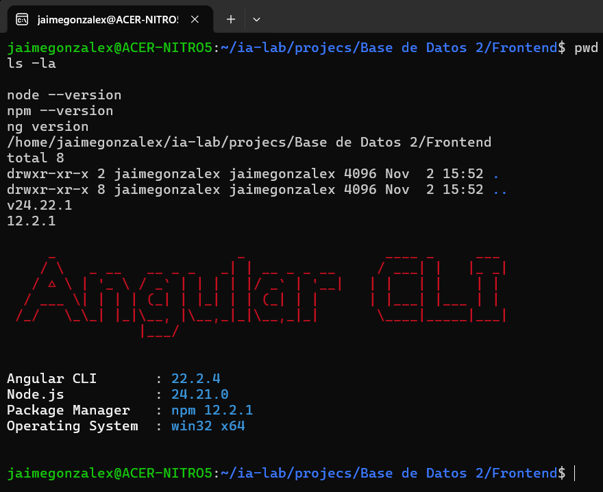

### 4.1 Verificación de Node.js, npm y Angular CLI

Una vez comprobada la ubicación y el estado de mi carpeta `Frontend`, procedí a verificar las herramientas principales que utilizaré para desarrollar la aplicación web.

Para ello, ejecuté los comandos `node --version`, `npm --version` y `ng version`, con los cuales pude identificar las versiones instaladas de Node.js, npm y Angular CLI.

Los resultados obtenidos fueron los siguientes:

- Node.js: versión 24.22.1.

- npm: versión 12.2.1.

- Angular CLI: versión 22.2.4.

Con estos resultados confirmé que cuento con las herramientas necesarias para iniciar la construcción del frontend. Sin embargo, durante la verificación identifiqué una diferencia en el entorno reportado por Angular CLI, ya que reconoce el sistema operativo como Windows (`win32 x64`), aunque estoy ejecutando los comandos desde Ubuntu WSL.

Por este motivo, antes de continuar con la inicialización del proyecto, realizaré una comprobación adicional de las rutas de instalación de las herramientas para garantizar que todas se ejecuten desde el mismo entorno.

``` sql
# Identificar las ubicaciones de las herramientas
which node
which npm
which ng

# Revisar todas las instalaciones disponibles
type -a node
type -a npm
type -a ng

# Comprobar el sistema operativo
uname -a

# Identificar el sistema que reconoce Node.js
node -p "process.platform"

# Consultar la ubicación global de npm
npm config get prefix
```

### ISS-01 · 1.1 Crear el proyecto Angular 22

Vamos a generar el proyecto directamente en la carpeta actual, con estas características:

- Angular 22.

- TypeScript y componentes standalone.

- CSS plano, porque Tailwind se instalará en el siguiente paso.

- Enrutamiento habilitado.

- Sin SSR, porque trabajaremos con una SPA.

- Sin crear otro repositorio Git.

Ejecuta este comando en Ubuntu WSL:

```         
ng new wayuutravel, \
  --directory . \
  --style=css \
  --routing \
  --ssr=false \
  --skip-git \
  --package-manager=npm \
  --defaults
```

**Instalamos Tailwind CSS 4 con PostCSS.**

En este paso integraremos Tailwind CSS para construir la interfaz de WayuuTravel mediante clases de utilidad, sin necesitar una configuración tradicional de `tailwind.config.js`.

### Paso 1. Instalar las dependencias

Desde Ubuntu WSL, ejecutamos:

```         
npm install tailwindcss @tailwindcss/postcss postcss
```

### Paso 2. Crear la configuración de PostCSS

Ejecuta:

```         
nano .postcssrc.json
```

Pega exactamente este contenido:

```         
{
  "plugins": {
    "@tailwindcss/postcss": {}
  }
}
```

Guarda con `Ctrl + O`, Enter y sal con `Ctrl + X`.

### Paso 3. Verificar la instalación

Ejecuta:

```         
npm ls tailwindcss @tailwindcss/postcss postcss --depth=0
```

Debemos comprobar que las tres dependencias estén instaladas y que no aparezcan errores.

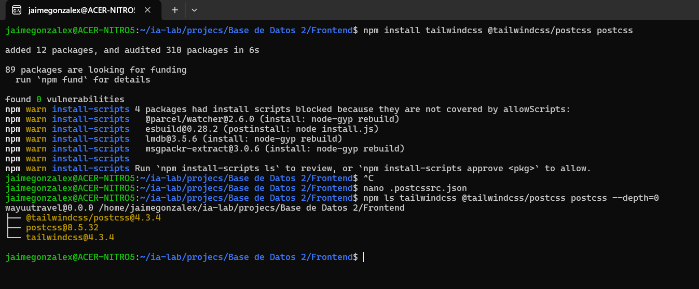

Instalé Tailwind CSS 4 junto con PostCSS y su plugin oficial para integrar un sistema de estilos basado en clases de utilidad en el frontend de WayuuTravel. También creé el archivo .postcssrc.json para configurar el procesamiento de los estilos y permitir que Angular reconozca Tailwind durante la compilación.

### Configurar los estilos globales

Ahora configuraremos `src/styles.css`, que será la hoja de estilos global de nuestra aplicación.

Paso 1. Abrimos el archivo:

``` css
nano src/styles.css
```

Paso 2. Reemplaza todo su contenido por:

``` css
@layer theme, base, primeng, utilities;

@import 'tailwindcss';
@import 'primeicons/primeicons.css';
```

Aunque PrimeIcons se instalará en el punto 1.4, dejamos preparado su import para mantener la estructura solicitada.

Configuré src/styles.css como la hoja de estilos global de WayuuTravel. Definí el orden de las capas theme, base, primeng y utilities para organizar la prioridad de los estilos. También incorporé las importaciones de Tailwind CSS y PrimeIcons, preparando la integración visual de los componentes que utilizaré en la aplicación.

**Instalar PrimeNG 22 con Aura.**

En este paso incorporaremos PrimeNG para utilizar componentes visuales como botones, tarjetas, etiquetas, mensajes y diálogos. El tema Aura proporcionará el diseño inicial de los componentes.

### Paso 1. Instalar las dependencias

Desde la carpeta `Frontend`, ejecutamos:

```         
 npm install primeng @primeuix/themes primeicons @angular/cdk
```

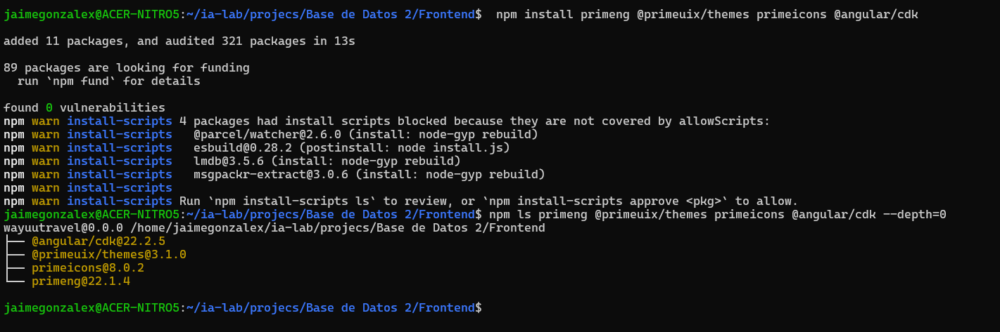

Instalé PrimeNG, PrimeUIX Themes, PrimeIcons y Angular CDK en el frontend de WayuuTravel. Estas dependencias permitirán incorporar componentes visuales, temas personalizables e iconos en la aplicación. La instalación finalizó correctamente y no se reportaron vulnerabilidades de seguridad.

### Paso 2. Revisar la configuración actual

Antes de modificarla, necesitamos conocer el contenido de `app.config.ts` para conservar la configuración que Angular generó.

Ejecuta:

``` typescript
cat src/app/app.config.ts
```

Reemplaza todo su contenido por este código:

``` typescript
import {
  ApplicationConfig,
  provideBrowserGlobalErrorListeners
} from '@angular/core';

import { provideRouter, withComponentInputBinding, withInMemoryScrolling } from '@angular/router';
import { provideAnimationsAsync } from '@angular/platform-browser/animations/async';

import { providePrimeNG } from 'primeng/config';
import Aura from '@primeuix/themes/aura';

import { MessageService, ConfirmationService } from 'primeng/api';

import { routes } from './app.routes';

export const appConfig: ApplicationConfig = {
  providers: [
    provideBrowserGlobalErrorListeners(),

    provideRouter(
      routes,
      withComponentInputBinding(),
      withInMemoryScrolling({
        scrollPositionRestoration: 'enabled',
        anchorScrolling: 'enabled'
      })
    ),

    provideAnimationsAsync(),

    providePrimeNG({
      ripple: true,
      inputVariant: 'outlined',
      theme: {
        preset: Aura,
        options: {
          darkModeSelector: '.app-dark',
          cssLayer: {
            name: 'primeng',
            order: 'theme, base, primeng, utilities'
          }
        }
      }
    }),

    MessageService,
    ConfirmationService
  ]
};
```

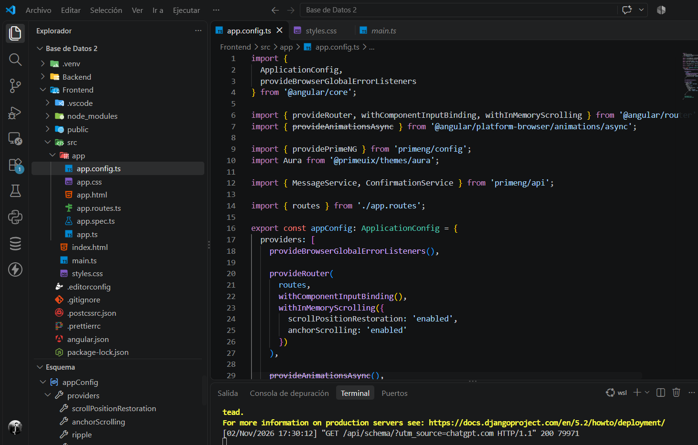

Verifiqué la instalación de las dependencias de PrimeNG en WayuuTravel. Se instalaron PrimeNG 22.1.4, el tema Aura mediante \@primeuix/themes 3.1.0, PrimeIcons 8.0.2 y Angular CDK 22.2.5. Con estas dependencias preparé la base para construir la interfaz y utilizar los componentes visuales de PrimeNG.

### Verificaremos la estructura actual

Desde la carpeta `Frontend`:

``` css
echo "===== ESTILOS GLOBALES ====="
cat src/styles.css

echo "===== COMPONENTE PRINCIPAL ====="
cat src/app/app.ts

echo "===== CONFIGURACIÓN DE RUTAS ====="
cat src/app/app.routes.ts

echo "===== PLANTILLA PRINCIPAL ====="
sed -n '1,35p' src/app/app.html

echo "===== CSS PRINCIPAL ====="
cat src/app/app.css

echo "===== PRUEBAS PRINCIPALES ====="
cat src/app/app.spec.ts
```

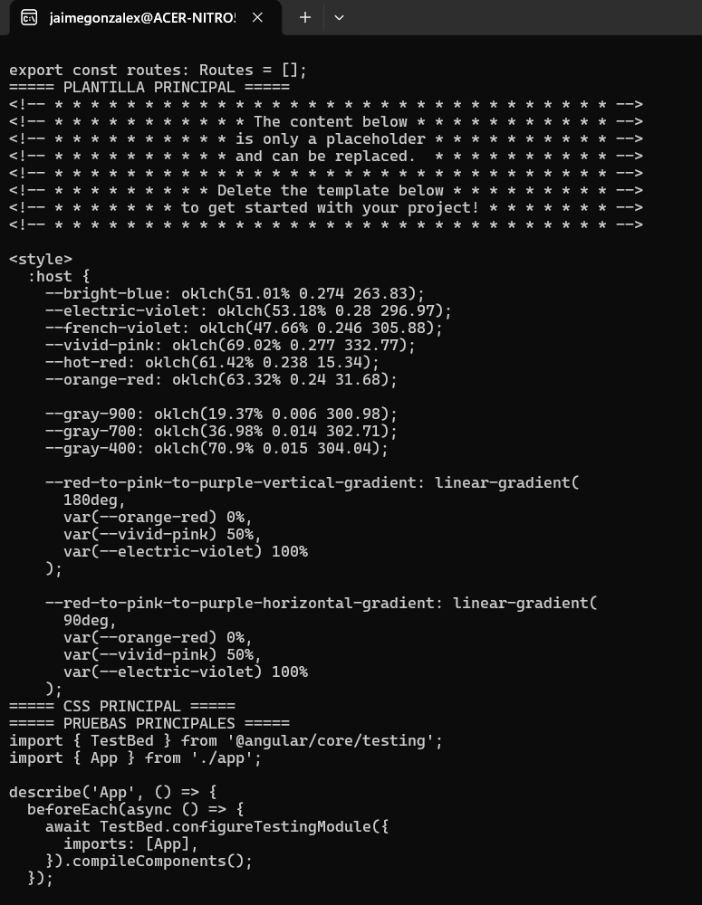

**Configuración de PrimeNG 22 con Aura.**

Ya tenemos las dependencias instaladas:

- PrimeNG `22.1.4`

- \@primeuix/themes `3.1.0`

- PrimeIcons `8.0.2`

- Angular CDK `22.2.5`

### Paso 3. Verificar `app.config.ts`

Ejecuta:

```         
cat src/app/app.config.ts
```

Configuré PrimeNG 22 en WayuuTravel utilizando el tema Aura. Activé los efectos ripple, establecí la variante outlined para los campos de entrada y configuré las opciones del modo oscuro y las capas CSS. Registré MessageService y ConfirmationService, amplié las opciones del enrutador e incorporé Angular Animations 22.2.4 para solucionar un error de dependencia durante la compilación. Finalmente, ejecuté ng build y ng serve, comprobando que el proyecto compilara correctamente y que el servidor de desarrollo iniciara sin errores.

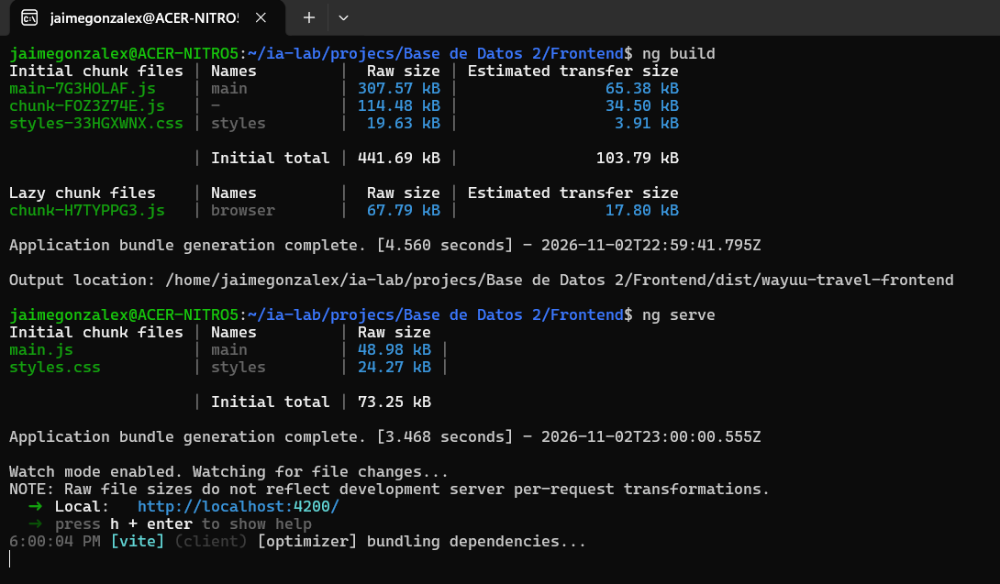

Abrimos:

```         
nano src/app/app.ts
```

Reemplaza todo por:

```         
import { Component } from '@angular/core';
import { RouterOutlet } from '@angular/router';

@Component({
  selector: 'app-root',
  standalone: true,
  imports: [RouterOutlet],
  templateUrl: './app.html',
  styleUrl: './app.css',
})
export class App {}
```

Ejecutamos:

```         
nano src/app/app.html
```

Borra todo y pega:

```         
<main class="min-h-screen bg-slate-100 font-sans text-slate-900">  
<router-outlet /> </main>
```

Ejecutamos:

```         
nano src/app/app.spec.ts
```

Reemplazamos todo por:

```         
import { TestBed } from '@angular/core/testing';
import { App } from './app';

describe('App', () => {
  beforeEach(async () => {
    await TestBed.configureTestingModule({
      imports: [App],
    }).compileComponents();
  });

  it('should create the app', () => {
    const fixture = TestBed.createComponent(App);
    expect(fixture.componentInstance).toBeTruthy();
  });
});
```

Reemplaza el contenido de `src/index.html` por este:

```         
<!doctype html>
<html lang="es">
  <head>
    <meta charset="utf-8" />
    <title>WayuuTravel · Angular 22</title>
    <base href="/" />
    <meta name="viewport" content="width=device-width, initial-scale=1" />
    <meta
      name="description"
      content="WayuuTravel: experiencias turísticas responsables."
    />
    <link rel="icon" type="image/x-icon" href="favicon.ico" />
  </head>
  <body class="m-0 bg-slate-100 font-sans text-slate-900">
    <app-root></app-root>
  </body>
</html>
```

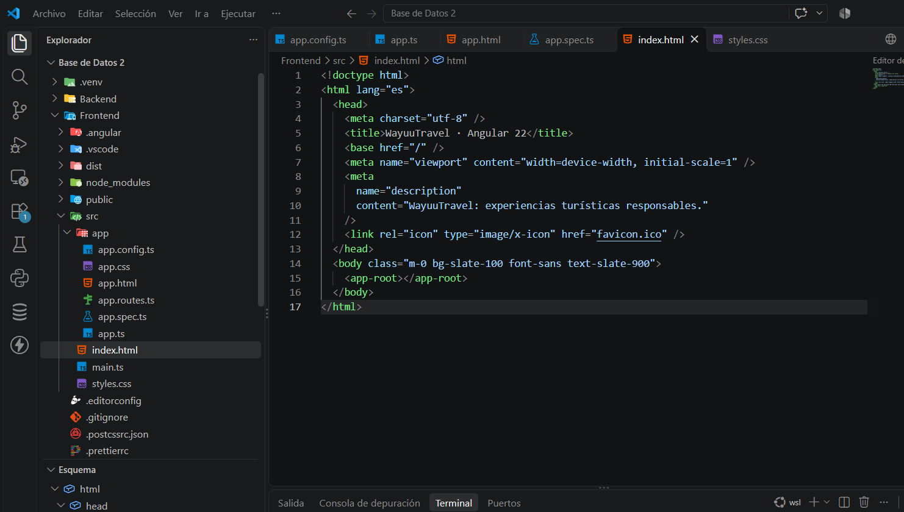

**compilación de producción.**

```         
ng build --configuration production
```

**Compilación de producción exitosa.**

El bundle inicial quedó en 413.44 kB, por debajo del límite de advertencia de 500 kB. No se reportaron errores.

Ahora ejecuta las pruebas unitarias:

```         
ng test --watch=false
```

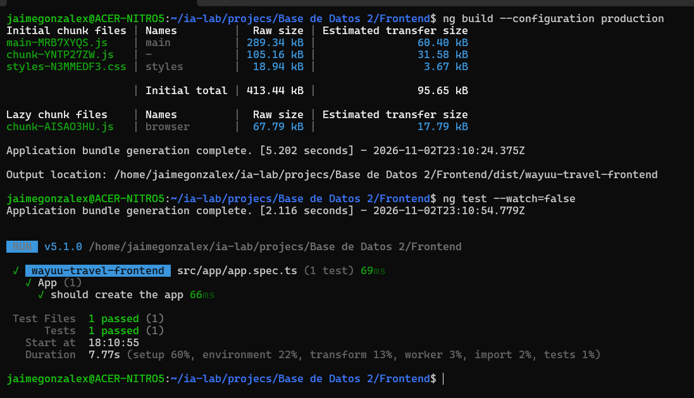

Verificación HTTP. En otra terminal de Ubuntu ejecutamos:

```         
curl -I http://localhost:39361/
```

salida:

``` sq
HTTP/1.1 200 OK
Vary: Origin
Content-Type: text/html
Cache-Control: no-cache
Date: Mon, 02 Nov 2026 23:13:15 GMT
Connection: keep-alive
Keep-Alive: timeout=5
```

Respuesta HTTP 200 OK. El servidor de WayuuTravel está respondiendo correctamente.

### ISS-01A — Esqueleto Header / Aside / contenido / Footer

En esta actividad preparé la estructura visual inicial de la aplicación utilizando Angular 22 y su arquitectura basada en componentes standalone. Organicé la interfaz en cuatro regiones principales: Header, Aside, contenido y Footer.

Para ello, creé tres componentes de presentación dentro de la carpeta `layout/` y posteriormente los integré en el componente principal `App`. Configuré sus respectivas plantillas para mostrar la marca Wayuutravel, el menú de navegación, el área principal de contenido y el pie de página.

Durante esta implementación trabajé con componentes independientes, selectores e imports, comprendiendo cómo se relacionan los componentes hijos con el componente padre. Mantuve los estilos de los componentes vacíos y utilicé las clases de Tailwind CSS para organizar la distribución visual.

Finalmente, verifiqué la composición de las cuatro regiones, la adaptación de la interfaz a diferentes tamaños de pantalla, la ausencia de llamadas a la API y el correcto funcionamiento de la compilación y las pruebas unitarias.

**Paso 1.2 — Generar Header**

Desde la carpeta `Frontend`, ejecuta:

```         
ng generate component layout/header --skip-tests --defaults
```

**Ahora genera el componente `Aside`:**

```         
ng generate component layout/aside --skip-tests --defaults
```

**Ahora genera el último componente, `Footer`:**

```         
ng generate component layout/footer --skip-tests --defaults
```

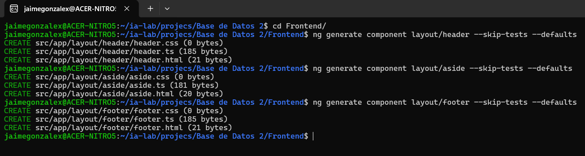

### Paso 1.3 — Configurar Header

Primero revisemos el archivo TypeScript generado:

```         
cat src/app/layout/header/header.ts
```

remplazamos por:

``` typescript
import { Component } from '@angular/core';

@Component({
  selector: 'app-header',
  standalone: true,
  imports: [],
  templateUrl: './header.html',
  styleUrl: './header.css',
  host: {
    class: 'block',
  },
})
export class Header {
  protected readonly title = 'WayuuTravel';
}
```

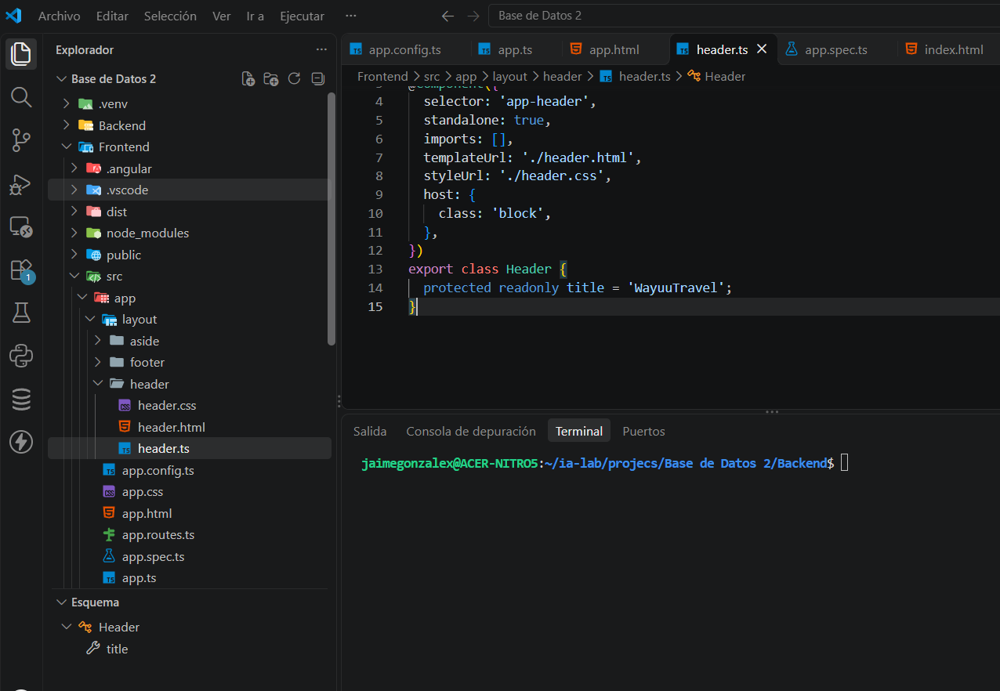

Ahora revisemos la plantilla:

```         
cat src/app/layout/header/header.html
```

remplazamos por:

``` html
cat > src/app/layout/header/header.html <<'EOF'
<header class="flex h-16 items-center border-b border-slate-200 bg-white px-6">
  <span class="truncate text-xl font-bold text-slate-900">
    {{ title }}
  </span>
</header>
EOF
```

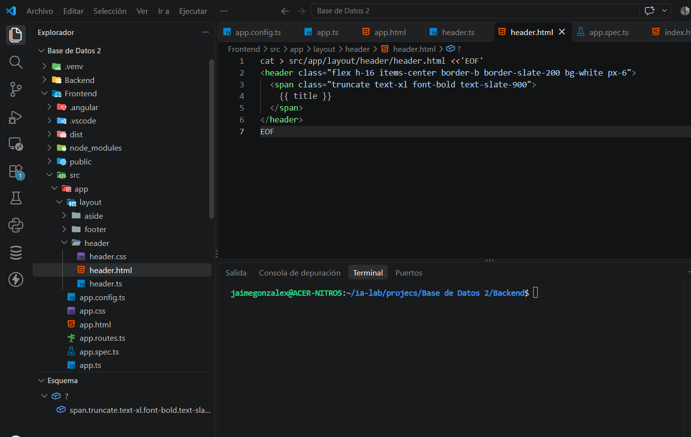

Ahora revisemos el componente Aside.

```         
cat src/app/layout/aside/aside.ts
```

remplazamos por:

``` typescript
cat > src/app/layout/aside/aside.ts <<'EOF'
import { Component } from '@angular/core';

@Component({
  selector: 'app-aside',
  standalone: true,
  imports: [],
  templateUrl: './aside.html',
  styleUrl: './aside.css',
  host: {
    class: 'block h-full',
  },
})
export class Aside {}
EOF
```

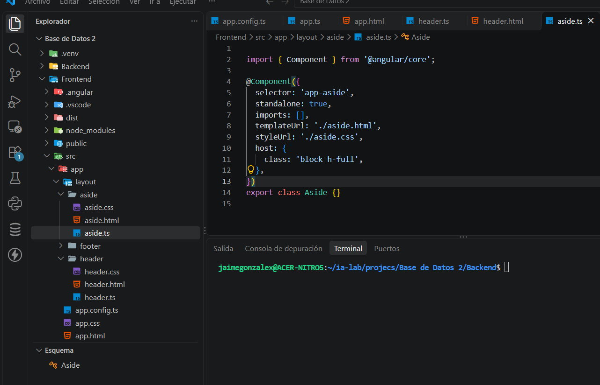

Ahora ejecutamos:

```         
cat src/app/layout/aside/aside.html
```

y remplazamos por:

``` html
cat > src/app/layout/aside/aside.html <<'EOF'
<nav
  aria-label="Navegación principal"
  class="h-full bg-slate-900 px-5 py-6 text-white"
>
  <h2 class="mb-4 text-lg font-semibold">Menú de WayuuTravel</h2>

  <p class="text-sm text-slate-300">
    En la siguiente etapa se incorporará el menú interactivo.
  </p>
</nav>
EOF
```

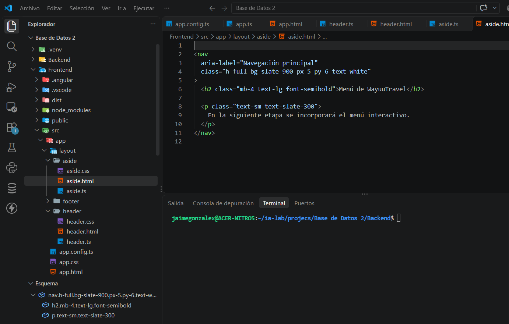

Ahora vamos con el componente Footer.

```         
cat src/app/layout/footer/footer.ts
```

remplazamos por:

``` typescript
cat > src/app/layout/footer/footer.ts <<'EOF'
import { Component } from '@angular/core';

@Component({
  selector: 'app-footer',
  standalone: true,
  imports: [],
  templateUrl: './footer.html',
  styleUrl: './footer.css',
  host: {
    class: 'block',
  },
})
export class Footer {}
EOF
```

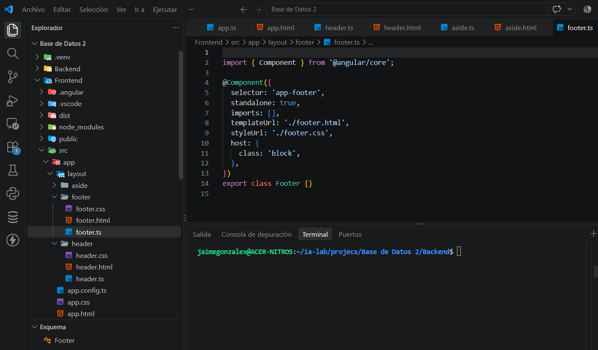

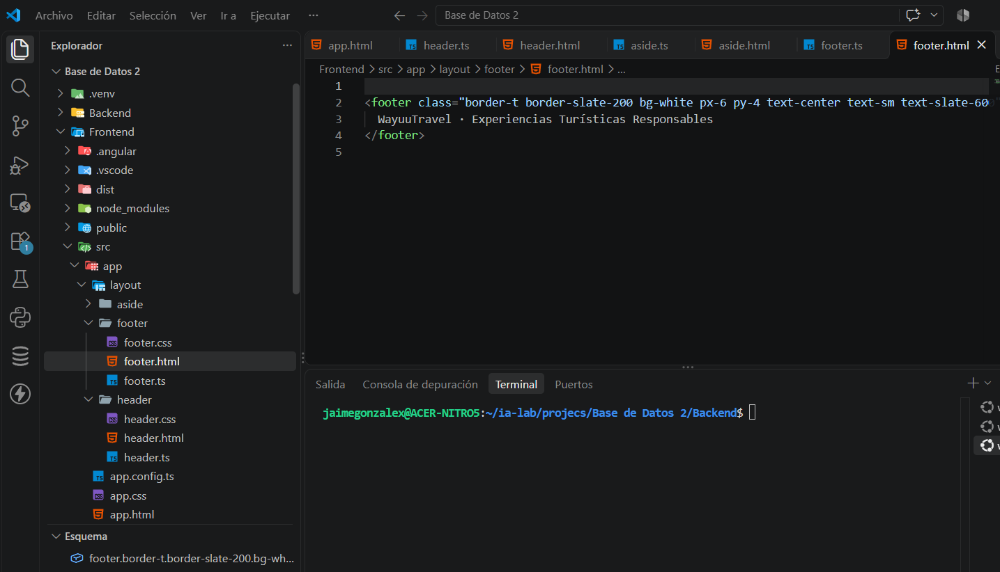

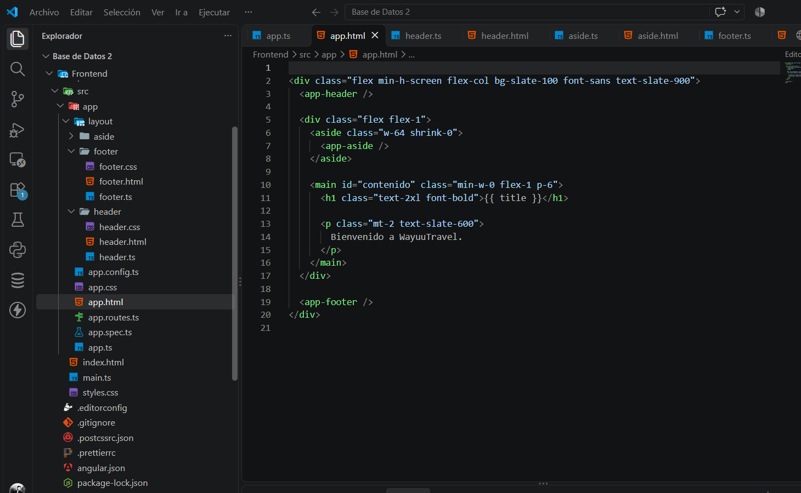

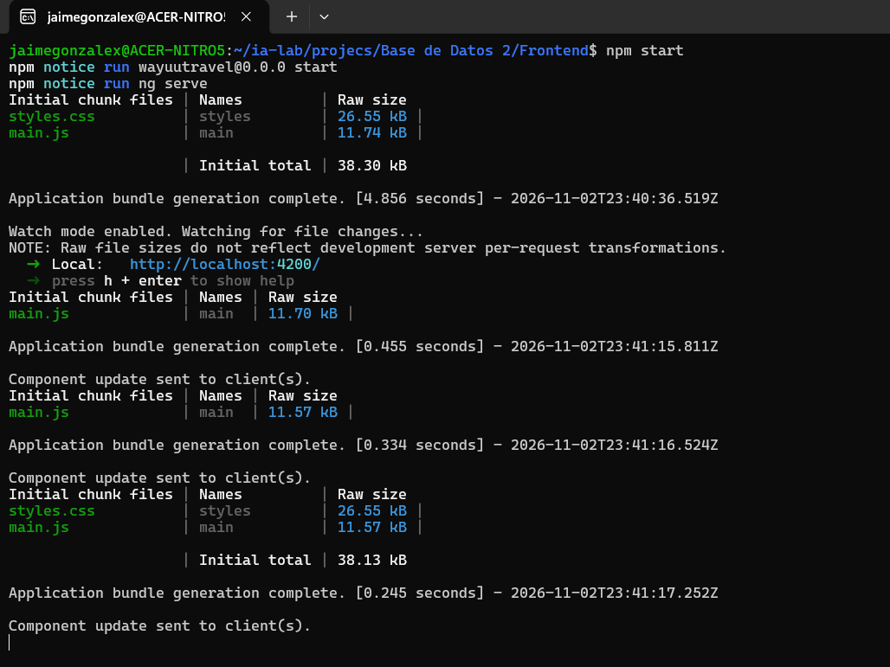

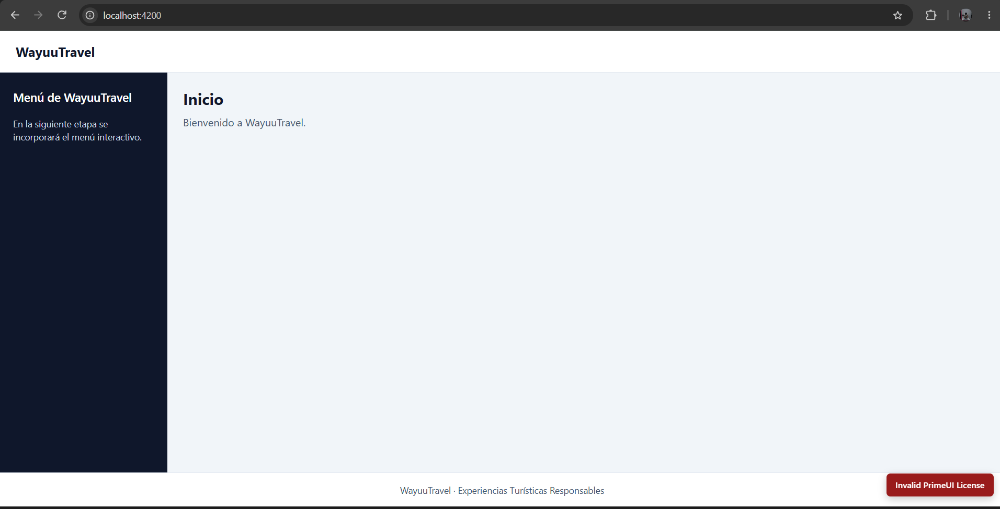

Reemplaza todo el contenido de `src/app/app.spec.ts` con:

```         
cat > src/app/app.spec.ts <<'EOF'
import { TestBed } from '@angular/core/testing';
import { App } from './app';

describe('App - WayuuTravel', () => {
  beforeEach(async () => {
    await TestBed.configureTestingModule({
      imports: [App],
    }).compileComponents();
  });

  it('should create the app', () => {
    const fixture = TestBed.createComponent(App);
    expect(fixture.componentInstance).toBeTruthy();
  });

  it('should display the header component', () => {
    const fixture = TestBed.createComponent(App);
    fixture.detectChanges();

    expect(fixture.nativeElement.querySelector('app-header')).toBeTruthy();
  });

  it('should display the WayuuTravel title in the header', () => {
    const fixture = TestBed.createComponent(App);
    fixture.detectChanges();

    expect(fixture.nativeElement.textContent).toContain('WayuuTravel');
  });

  it('should display the aside component', () => {
    const fixture = TestBed.createComponent(App);
    fixture.detectChanges();

    expect(fixture.nativeElement.querySelector('app-aside')).toBeTruthy();
  });

  it('should display the main content', () => {
    const fixture = TestBed.createComponent(App);
    fixture.detectChanges();

    const main = fixture.nativeElement.querySelector('main');

    expect(main).toBeTruthy();
    expect(main.textContent).toContain('Inicio');
    expect(main.textContent).toContain('Bienvenido a WayuuTravel.');
  });

  it('should display the footer component', () => {
    const fixture = TestBed.createComponent(App);
    fixture.detectChanges();

    const footer = fixture.nativeElement.querySelector('app-footer');

    expect(footer).toBeTruthy();
    expect(footer.textContent).toContain(
      'Experiencias Turísticas Responsables',
    );
  });
});
EOF
```

### Ejecuta las pruebas

```         
ng test --watch=false
```

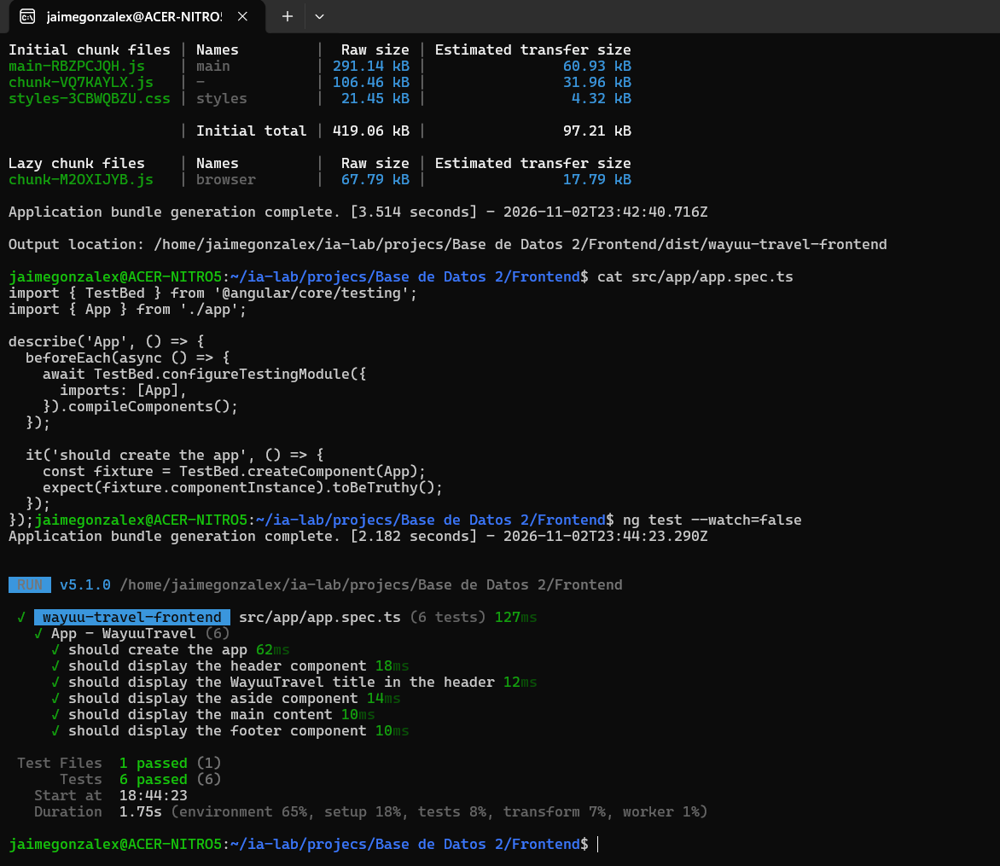

| Verificación        | Resultado |
|---------------------|-----------|
| Creación de App     | PASS      |
| Header              | PASS      |
| Título WayuuTravel  | PASS      |
| Aside               | PASS      |
| Contenido principal | PASS      |
| Footer              | PASS      |

### Siguiente paso: revisar los estilos

La ISS-01A establece que los archivos CSS de los componentes deben permanecer vacíos, porque estamos utilizando Tailwind CSS.

Ejecuta:

``` css
wc -c src/app/app.css \
src/app/layout/header/header.css \
src/app/layout/aside/aside.css \
src/app/layout/footer/footer.css
```

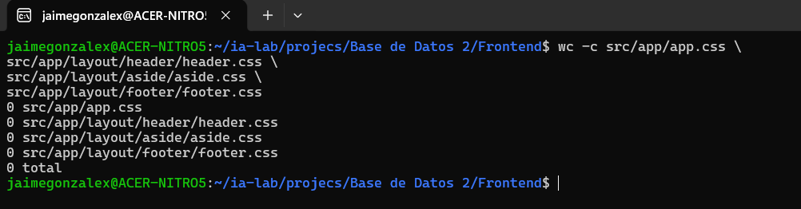

### Verificación visual

Inicia el servidor:

```         
ng serve
```

Abre en tu navegador la dirección que aparezca en la terminal, normalmente:

[`http://localhost:4200`](http://localhost:4200)

Comprueba lo siguiente:

1.  Header blanco con el título WayuuTravel.

2.  Aside oscuro a la izquierda.

3.  Contenido principal con «Inicio» y «Bienvenido a WayuuTravel».

4.  Footer en la parte inferior.

5.  Que no exista desplazamiento horizontal al reducir la ventana a 390 px.

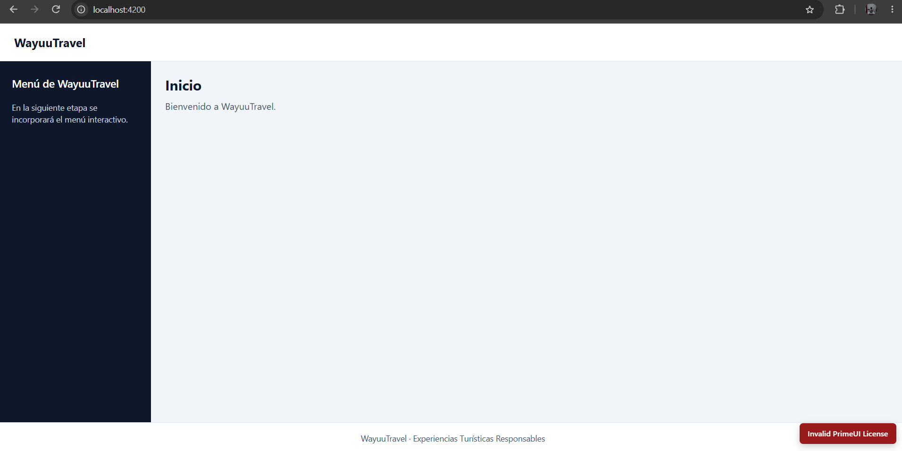

## ISS-01B — Menú PrimeNG y primera interacción

### Narrativa

En esta actividad inicié la implementación de un menú de navegación interactivo para WayuuTravel, con el propósito de mejorar la organización y la experiencia de uso de la plataforma. Para ello, preparé la integración de componentes de PrimeNG y Angular Signals, con los que podré gestionar la navegación local y el estado de los elementos de la interfaz.

También planteé la adaptación del menú lateral para dispositivos de escritorio y móviles, de manera que pueda mostrarse u ocultarse según el tamaño de la pantalla. Además, establecí que las opciones del menú permitirán cambiar dinámicamente el título del contenido principal, sin realizar todavía consultas al backend ni consumir servicios externos.

Con esta implementación busco dejar preparada la estructura visual e interactiva de WayuuTravel para incorporar posteriormente los módulos de paquetes turísticos, salidas, reservas y proveedores, manteniendo una separación clara entre los componentes de presentación y la lógica de la aplicación.

### Paso .1. Actualizar `aside.ts`

Abre el archivo:

``` typescript
code src/app/layout/aside/aside.ts
```

Reemplazamos todo el contenido por este código:

``` typescript

import { Component, input, output } from '@angular/core';
import { MenuItem } from 'primeng/api';
import { PanelMenuModule } from 'primeng/panelmenu';

@Component({
  selector: 'app-aside',
  imports: [PanelMenuModule],
  templateUrl: './aside.html',
  styleUrl: './aside.css',
  host: {
    class: 'block h-full',
  },
})
export class Aside {
  readonly appName = input('WayuuTravel');
  readonly items = input<MenuItem[]>([]);

  readonly navigated = output<void>();

  onNavigationClick(event: Event): void {
    const target = event.target as HTMLElement;

    if (target.closest('a, button, [role="button"]')) {
      this.navigated.emit();
    }
  }
}
```

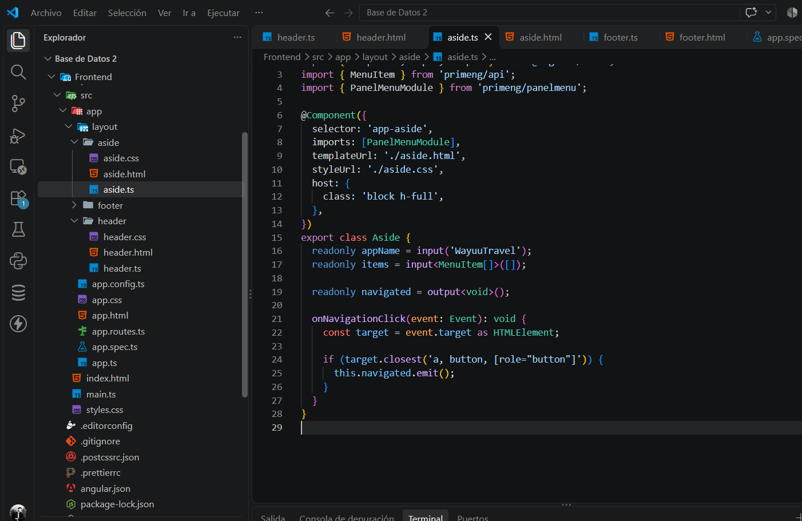

### Paso 1.2. Actualizar `aside.html`

Abre el archivo:

``` html
code src/app/layout/aside/aside.html
```

Reemplazamos todo el contenido por este código:

``` html
 
<div class="flex h-full flex-col border-r border-slate-200 bg-white text-slate-900">

  <!-- Identidad de WayuuTravel -->
  <div class="flex h-16 items-center gap-3 border-b border-slate-200 px-5">
    <div class="flex h-9 w-9 items-center justify-center rounded-lg bg-teal-700 text-sm font-bold text-white">
      WT
    </div>

    <div class="min-w-0">
      <p class="truncate text-sm font-semibold text-slate-900">
        {{ appName() }}
      </p>

      <p class="text-[11px] uppercase tracking-wider text-slate-400">
        Gestión turística
      </p>
    </div>
  </div>

  <!-- Navegación principal -->
  <div class="flex-1 overflow-y-auto p-3">
    <nav
      aria-label="Navegación principal"
      (click)="onNavigationClick($event)"
    >
      <p-panelmenu
        [model]="items()"
        [multiple]="true"
      />
    </nav>
  </div>

</div>
```

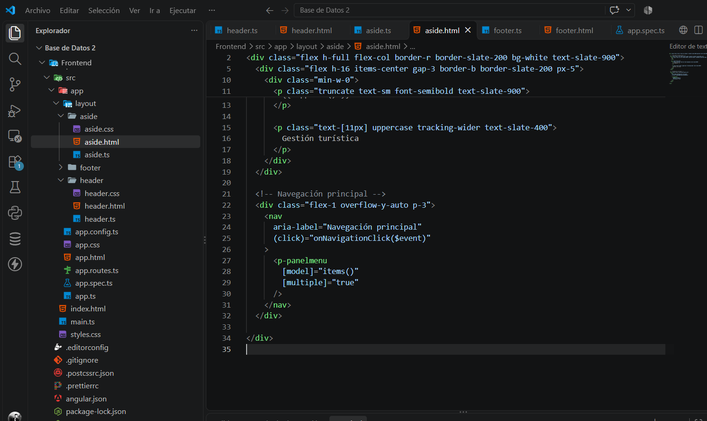

### Paso 1.3. Actualizar `header.ts`

Abre el archivo:

``` typescript
code src/app/layout/header/header.ts
```

Reemplaza todo su contenido por este código:

``` typescript

import { Component, input, output } from '@angular/core';
import { ButtonModule } from 'primeng/button';

@Component({
  selector: 'app-header',
  imports: [ButtonModule],
  templateUrl: './header.html',
  styleUrl: './header.css',
  host: {
    class: 'block',
  },
})
export class Header {
  readonly appName = input('WayuuTravel');

  readonly menuRequested = output<void>();
}
 
```

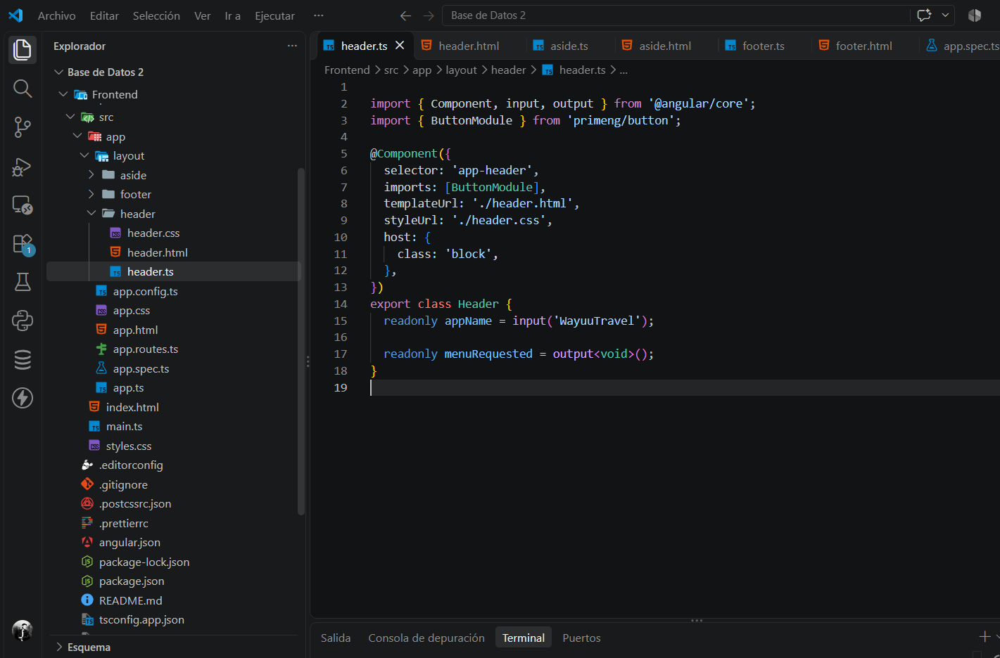

### Paso 1.4. Actualizar `header.html`

Ahora construiremos la parte visual del encabezado, incluyendo el botón que permitirá abrir o cerrar el menú lateral.

Abre el archivo:

``` html
code src/app/layout/header/header.html
```

Reemplaza todo su contenido por:

``` html

<header class="sticky top-0 z-30 flex h-16 items-center gap-3 border-b border-slate-200 bg-white px-4 sm:px-6">

  <!-- Botón del menú -->
  <button
    pButton
    type="button"
    text
    rounded
    aria-label="Mostrar u ocultar el menú"
    (click)="menuRequested.emit()"
  >
    <i pButtonIcon class="pi pi-bars"></i>
  </button>

  <!-- Identidad de la aplicación -->
  <div class="min-w-0 flex-1">
    <p class="truncate text-sm font-semibold text-slate-900">
      {{ appName() }}
    </p>

    <p class="truncate text-xs text-slate-500">
      Experiencias turísticas responsables
    </p>
  </div>

</header>
```

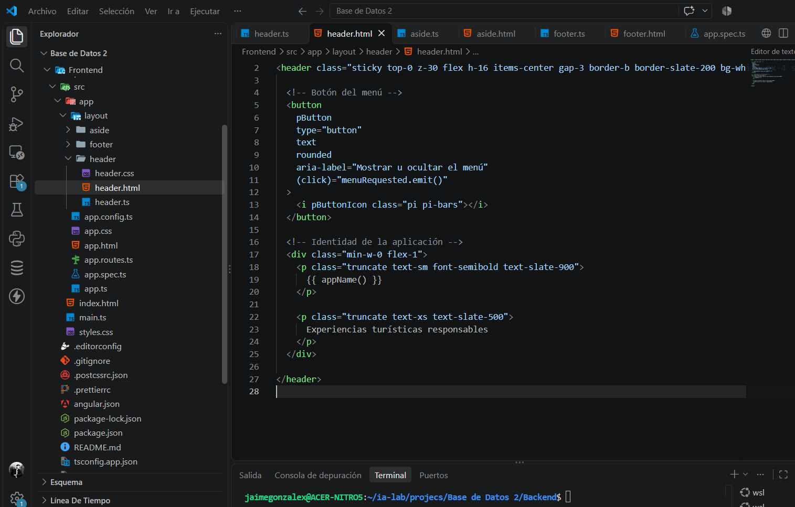

### Paso 1.5. Crear el componente Construir

Este componente será responsable de:

- Administrar las opciones del menú.

- Cambiar el título de la pantalla.

- Mostrar u ocultar el menú lateral en escritorio.

- Abrir el menú como Drawer en dispositivos móviles.

- Compartir el mismo componente `Aside` en ambas presentaciones.

Desde la terminal, ubicado en `Frontend`, ejecuta:

``` css
ng generate component features/construir --skip-tests --defaults
```

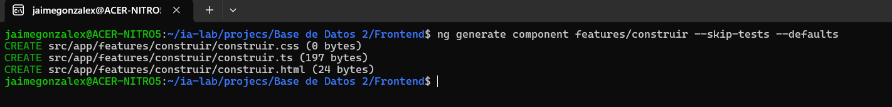

### Paso 1.6. Crear el servicio auxiliar `media-query.ts`

Primero, creamos las carpetas necesarias:

``` sql
mkdir -p src/app/core/utils
```

Después, creamos el archivo:

``` typescript
code src/app/core/utils/media-query.ts
```

Pegamos este código:

``` typescript

import { DestroyRef, Signal, inject, signal } from '@angular/core';

export function watchMediaQuery(query: string): Signal<boolean> {
  const destroyRef = inject(DestroyRef);

  const media =
    typeof window !== 'undefined' &&
    typeof window.matchMedia === 'function'
      ? window.matchMedia(query)
      : null;

  const matches = signal(media?.matches ?? false);

  if (media) {
    const listener = (event: MediaQueryListEvent): void => {
      matches.set(event.matches);
    };

    media.addEventListener('change', listener);

    destroyRef.onDestroy(() => {
      media.removeEventListener('change', listener);
    });
  }

  return matches.asReadonly();
}
```

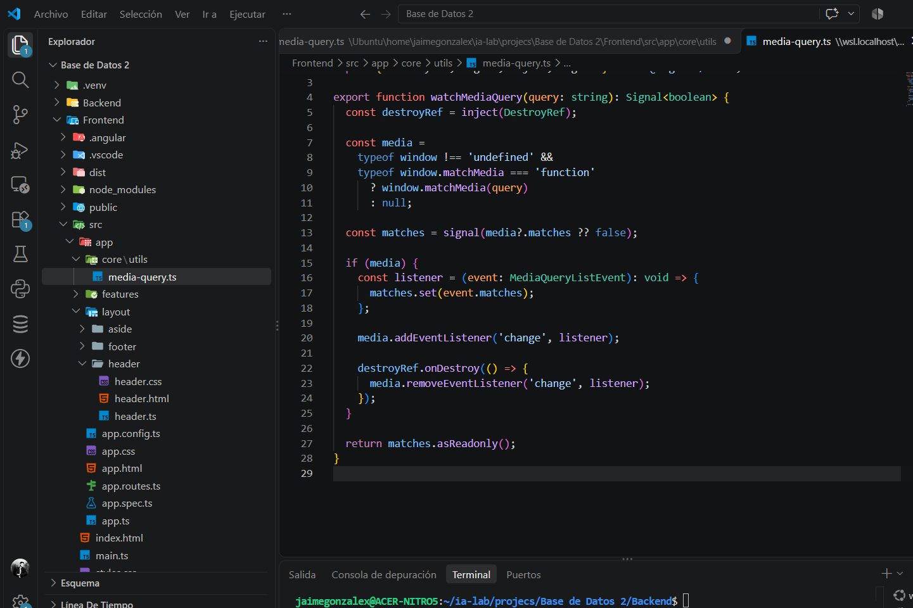

### Paso 1.7. Configurar `construir.ts`

Ahora vamos a implementar la lógica principal de la interfaz de WayuuTravel utilizando Angular Signals y PrimeNG.

Abrimos el archivo:

``` typescript
code src/app/features/construir/construir.ts
```

Reemplazamos todo su contenido por este código:

``` typescript

import { Component, signal } from '@angular/core';
import { MenuItem } from 'primeng/api';
import { ButtonModule } from 'primeng/button';
import { CardModule } from 'primeng/card';
import { DrawerModule } from 'primeng/drawer';

import { watchMediaQuery } from '../../core/utils/media-query';
import { Aside } from '../../layout/aside/aside';
import { Footer } from '../../layout/footer/footer';
import { Header } from '../../layout/header/header';

@Component({
  selector: 'app-construir',
  imports: [
    Aside,
    ButtonModule,
    CardModule,
    DrawerModule,
    Footer,
    Header,
  ],
  templateUrl: './construir.html',
  styleUrl: './construir.css',
  host: {
    class: 'block',
  },
})
export class Construir {
  private readonly isDesktop = watchMediaQuery('(min-width: 1024px)');

  readonly sidebarCollapsed = signal(false);
  readonly mobileOpen = signal(false);
  readonly title = signal('Inicio');

  readonly items: MenuItem[] = [
    {
      label: 'Inicio',
      icon: 'pi pi-home',
      command: () => this.seleccionar('Inicio'),
    },
    {
      label: 'Paquetes',
      icon: 'pi pi-map',
      command: () => this.seleccionar('Paquetes'),
    },
    {
      label: 'Salidas',
      icon: 'pi pi-calendar',
      command: () => this.seleccionar('Salidas'),
    },
    {
      label: 'Reservas',
      icon: 'pi pi-ticket',
      command: () => this.seleccionar('Reservas'),
    },
    {
      label: 'Proveedores',
      icon: 'pi pi-users',
      command: () => this.seleccionar('Proveedores'),
    },
  ];

  protected onMenuToggle(): void {
    if (this.isDesktop()) {
      this.sidebarCollapsed.update((collapsed) => !collapsed);
      return;
    }

    this.mobileOpen.set(true);
  }

  protected seleccionar(titulo: string): void {
    this.title.set(titulo);
    this.mobileOpen.set(false);
  }
}
```

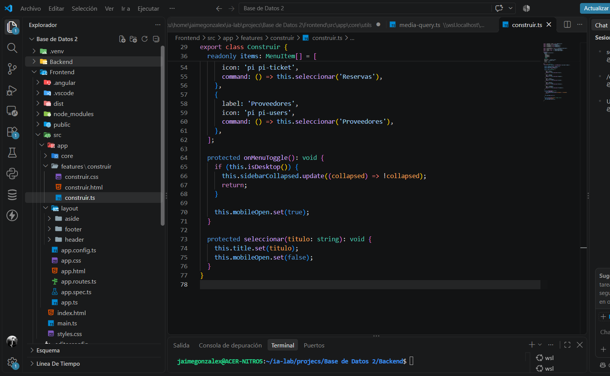

### Paso 1.8. Construir la interfaz en `construir.html`

Ahora vamos a unir los componentes `Header`, `Aside` y `Footer` para formar la interfaz interactiva de WayuuTravel.

Abrimos el archivo:

``` html
code src/app/features/construir/construir.html
```

Reemplazamos todo su contenido por:

``` {.html .ht}

<div class="flex min-h-screen flex-col bg-slate-100">

  <!-- Encabezado -->
  <app-header (menuRequested)="onMenuToggle()" />

  <div class="flex flex-1">

    <!-- Menú lateral para escritorio -->
    @if (!sidebarCollapsed()) {
      <aside class="hidden w-72 shrink-0 lg:block">
        <app-aside
          [items]="items"
          (navigated)="mobileOpen.set(false)"
        />
      </aside>
    }

    <!-- Contenido principal -->
    <main id="contenido" class="min-w-0 flex-1 p-4 sm:p-6">

      <p-card class="block">
        <h1 class="text-2xl font-semibold text-slate-900">
          {{ title() }}
        </h1>

        <p class="mt-3 text-slate-600">
          Bienvenido a WayuuTravel. Selecciona una opción del menú
          para explorar la plataforma.
        </p>

        <p class="mt-2 text-sm text-slate-500">
          Esta pantalla utiliza datos locales. Los formularios y
          la conexión con la API Django se incorporarán después.
        </p>
      </p-card>

    </main>
  </div>

  <!-- Pie de página -->
  <app-footer />

</div>

<!-- Menú lateral para dispositivos móviles -->
<p-drawer
  [(visible)]="mobileOpen"
  header="Menú de WayuuTravel"
  position="left"
  styleClass="w-72"
>
  <app-aside
    [items]="items"
    (navigated)="mobileOpen.set(false)"
  />
</p-drawer>
```

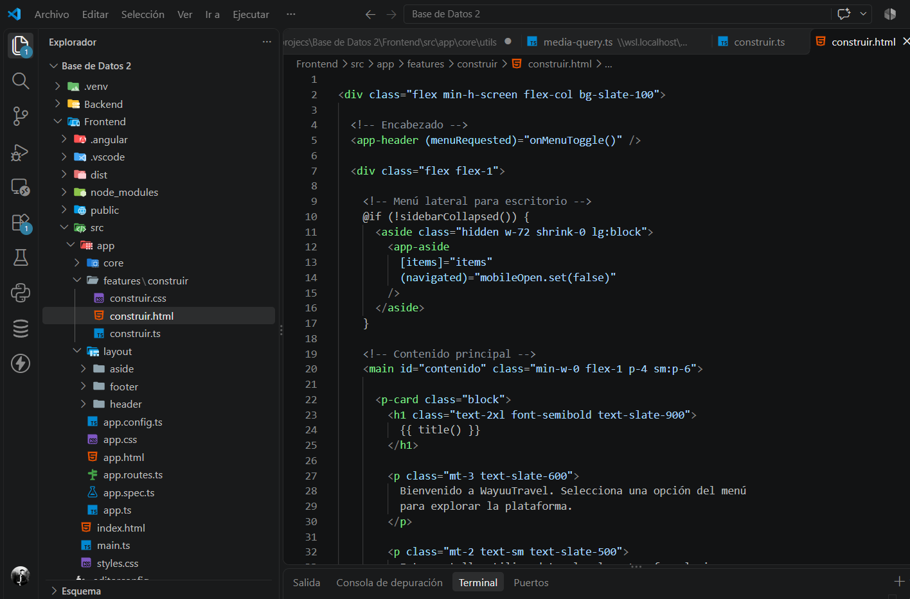

### Paso 1.9. Actualizar `app.ts`

Primero, el componente raíz debe dejar de importar directamente `Header`, `Aside` y `Footer`. Ahora se encargará únicamente de mostrar las páginas mediante `RouterOutlet`.

Abrimos el archivo:

``` typescript
code src/app/app.ts
```

Reemplaza todo su contenido por:

``` typescript

import { Component } from '@angular/core';
import { RouterOutlet } from '@angular/router';

@Component({
  selector: 'app-root',
  imports: [RouterOutlet],
  templateUrl: './app.html',
  styleUrl: './app.css',
  host: {
    class: 'block',
  },
})
export class App {}
```

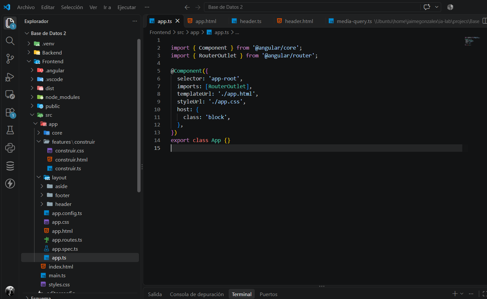

### Paso 1.10. Actualizar `app.html`

Ahora vamos a simplificar la plantilla raíz para que Angular Router controle qué pantalla se muestra.

Abrios el archivo:

``` ht
code src/app/app.html
```

Reemplaza todo su contenido por:

``` ht
 <router-outlet />
```

### Paso 1.11. Configurar las rutas en `app.routes.ts`

Ahora registraremos el componente `Construir` utilizando Lazy Loading, para que Angular lo cargue únicamente cuando se necesite.

Abrimos el archivo:

``` typescript
 src/app/app.routes.ts
```

Reemplazamos todo su contenido por:

``` typescript

import { Routes } from '@angular/router';

export const routes: Routes = [
  {
    path: 'construir',
    loadComponent: () =>
      import('./features/construir/construir').then(
        (m) => m.Construir,
      ),
  },
  {
    path: '',
    pathMatch: 'full',
    redirectTo: 'construir',
  },
  {
    path: '**',
    redirectTo: 'construir',
  },
];
```

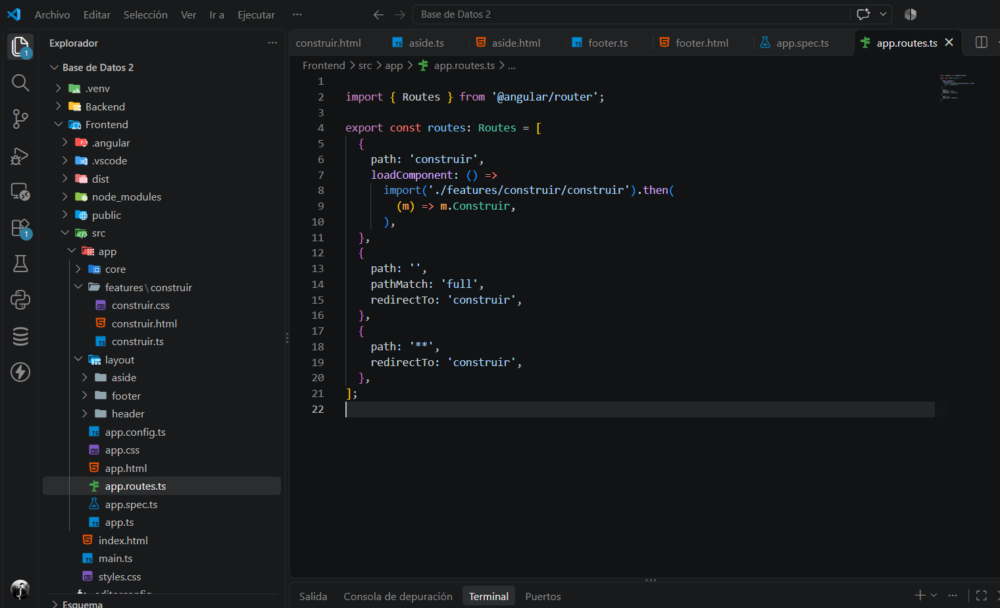

### Paso 1.13. Actualizar las pruebas de `App`

Como ahora `App` utiliza `RouterOutlet`, debemos adaptar sus pruebas para verificar que el enrutador se renderice correctamente.

Abrimos:

``` typescript
 src/app/app.spec.ts
```

Reemplaza su contenido por:

``` typescript

import { TestBed } from '@angular/core/testing';
import { provideRouter } from '@angular/router';
import { App } from './app';

describe('App - WayuuTravel', () => {
  beforeEach(async () => {
    await TestBed.configureTestingModule({
      imports: [App],
      providers: [provideRouter([])],
    }).compileComponents();
  });

  it('should create the app', () => {
    const fixture = TestBed.createComponent(App);

    expect(fixture.componentInstance).toBeTruthy();
  });

  it('should render the router outlet', async () => {
    const fixture = TestBed.createComponent(App);

    await fixture.whenStable();

    const compiled = fixture.nativeElement as HTMLElement;

    expect(compiled.querySelector('router-outlet')).toBeTruthy();
  });
});
```

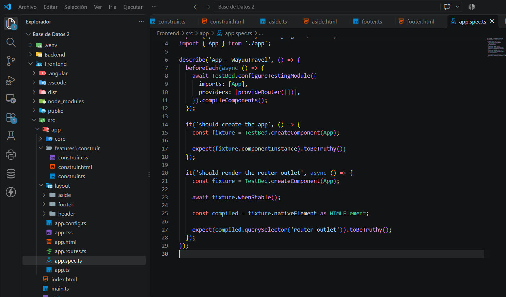

### Paso 1.14. Crear las pruebas de `Construir`

Ahora vamos a comprobar que el componente principal de WayuuTravel funcione correctamente: que cargue, muestre las cinco opciones del menú y actualice el título al seleccionar una opción.

Primero, crea el archivo:

``` typst
code src/app/features/construir/construir.spec.ts
```

Pegamos el siguiente contenido:

``` typescript

import { TestBed } from '@angular/core/testing';
import { provideNoopAnimations } from '@angular/platform-browser/animations';
import { Construir } from './construir';

describe('Construir - WayuuTravel', () => {
  beforeEach(async () => {
    await TestBed.configureTestingModule({
      imports: [Construir],
      providers: [provideNoopAnimations()],
    }).compileComponents();
  });

  it('should create the component', () => {
    const fixture = TestBed.createComponent(Construir);

    expect(fixture.componentInstance).toBeTruthy();
  });

  it('should display Inicio as the initial title', () => {
    const fixture = TestBed.createComponent(Construir);
    fixture.detectChanges();

    expect(fixture.nativeElement.textContent).toContain('Inicio');
  });

  it('should define five menu options', () => {
    const fixture = TestBed.createComponent(Construir);
    const component = fixture.componentInstance;

    expect(component.items.length).toBe(5);
  });

  it('should contain the WayuuTravel menu options', () => {
    const fixture = TestBed.createComponent(Construir);
    const component = fixture.componentInstance;

    const labels = component.items.map((item) => item.label);

    expect(labels).toEqual([
      'Inicio',
      'Paquetes',
      'Salidas',
      'Reservas',
      'Proveedores',
    ]);
  });

  it('should update the title when selecting an option', () => {
    const fixture = TestBed.createComponent(Construir);
    const component = fixture.componentInstance;

    component.seleccionar('Reservas');

    expect(component.title()).toBe('Reservas');
  });

  it('should close the mobile menu after selecting an option', () => {
    const fixture = TestBed.createComponent(Construir);
    const component = fixture.componentInstance;

    component.mobileOpen.set(true);
    component.seleccionar('Paquetes');

    expect(component.mobileOpen()).toBe(false);
  });
});
```

### Paso 1.15. Ejecutar las pruebas

Antes de continuar, vamos a comprobar que los componentes y sus dependencias estén correctamente integrados.

Desde la carpeta `Frontend`, ejecuta:

```         
ng test --watch=false
```

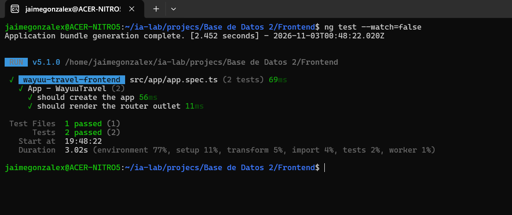

### Paso 1.16. Verificar los archivos de pruebas

Ejecuta este comando:

```         
find src/app -name "*.spec.ts"
```

### Paso 1.17. Crear `construir.spec.ts`

Ejecutamos:

``` typescript
src/app/features/construir/construir.spec.ts
```

Pega este contenido y guarda el archivo:

``` typescript

import { TestBed } from '@angular/core/testing';
import { provideNoopAnimations } from '@angular/platform-browser/animations';
import { Construir } from './construir';

describe('Construir - WayuuTravel', () => {
  beforeEach(async () => {
    await TestBed.configureTestingModule({
      imports: [Construir],
      providers: [provideNoopAnimations()],
    }).compileComponents();
  });

  it('should create the component', () => {
    const fixture = TestBed.createComponent(Construir);

    expect(fixture.componentInstance).toBeTruthy();
  });

  it('should display Inicio as the initial title', () => {
    const fixture = TestBed.createComponent(Construir);
    fixture.detectChanges();

    expect(fixture.nativeElement.textContent).toContain('Inicio');
  });

  it('should define five menu options', () => {
    const fixture = TestBed.createComponent(Construir);

    expect(fixture.componentInstance.items.length).toBe(5);
  });

  it('should contain the correct menu options', () => {
    const fixture = TestBed.createComponent(Construir);

    const labels = fixture.componentInstance.items.map(
      (item) => item.label,
    );

    expect(labels).toEqual([
      'Inicio',
      'Paquetes',
      'Salidas',
      'Reservas',
      'Proveedores',
    ]);
  });

  it('should update the title when selecting an option', () => {
    const fixture = TestBed.createComponent(Construir);
    const component = fixture.componentInstance;
    const item = component.items.find(
      (option) => option.label === 'Reservas',
    );

    item?.command?.({
      originalEvent: new Event('click'),
      item,
    });

    expect(component.title()).toBe('Reservas');
  });

  it('should close the mobile menu after selecting an option', () => {
    const fixture = TestBed.createComponent(Construir);
    const component = fixture.componentInstance;
    const item = component.items.find(
      (option) => option.label === 'Paquetes',
    );

    component.mobileOpen.set(true);

    item?.command?.({
      originalEvent: new Event('click'),
      item,
    });

    expect(component.mobileOpen()).toBe(false);
  });
});
```

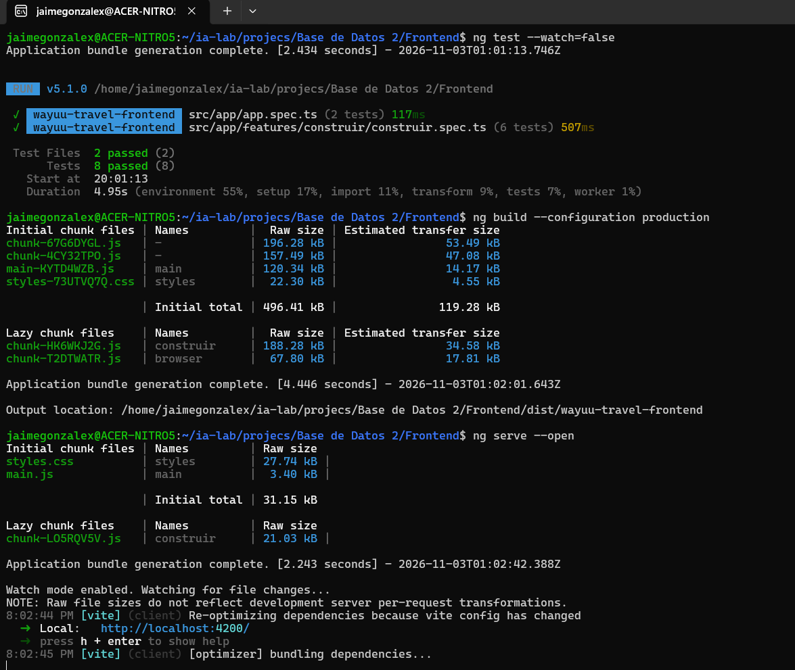](images/clipboard-3011452974.png)

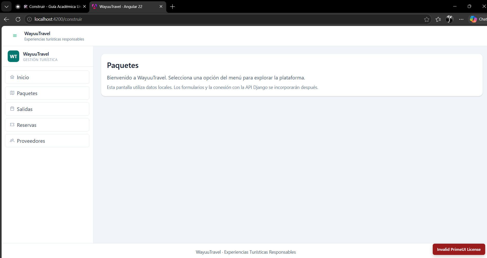

### ISS-02 — Configuración de entornos y preparación de la arquitectura frontend

Narrativa

Durante el desarrollo de WayuuTravel, configuré los entornos de ejecución de Angular para separar la configuración de desarrollo de la configuración de producción. Para ello, generé los archivos `environment.ts` y `environment.development.ts`, donde definí el nombre de la aplicación, la URL base de la API del backend y el indicador correspondiente a cada entorno.

Posteriormente, verifiqué la configuración de `angular.json` para comprobar que Angular reemplazara automáticamente el archivo de entorno durante las compilaciones. Confirmé que `ng serve` utiliza el entorno de desarrollo y que `ng build` utiliza el entorno de producción.

Finalmente, preparé la estructura de directorios que permitirá organizar los modelos de datos, servicios de comunicación HTTP, utilidades, componentes reutilizables y el contenedor principal de navegación. Esta organización servirá como base para integrar progresivamente el frontend con los servicios REST del backend de WayuuTravel.

El siguiente paso es crear las carpetas de la arquitectura frontend. Ejecutamos desde `Frontend`:

``` sql
mkdir -p src/app/core/{models,services,utils} src/app/shared/ui/{status-tag,page-header,empty-state} src/app/layout/shell
```

Verificar la estructura creada.

Ejecutamos:

```         
tree src/app/core src/app/shared/ui src/app/layout -L 3
```

salida:

``` sql
src/app/core
├── models
├── services
└── utils
    └── media-query.ts
src/app/shared/ui
├── empty-state
├── page-header
└── status-tag
src/app/layout
├── aside
│   ├── aside.css
│   ├── aside.html
│   └── aside.ts
├── footer
│   ├── footer.css
│   ├── footer.html
│   └── footer.ts
├── header
│   ├── header.css
│   ├── header.html
│   └── header.ts
└── shell
```

En `src/app/core/models/client.model.ts`, pegamos este contenido:

``` typescript
export type RecordStatus = 'active' | 'inactive';

export interface Client {
  id: number;
  documentType: string;
  documentNumber: string;
  name: string;
  phone: string | null;
  email: string | null;
  status: RecordStatus;
  createdAt: string;
  updatedAt: string;
}

export type CreateClient = Omit<
  Client,
  'id' | 'status' | 'createdAt' | 'updatedAt'
>;

export type UpdateClient = Partial<CreateClient>;
```

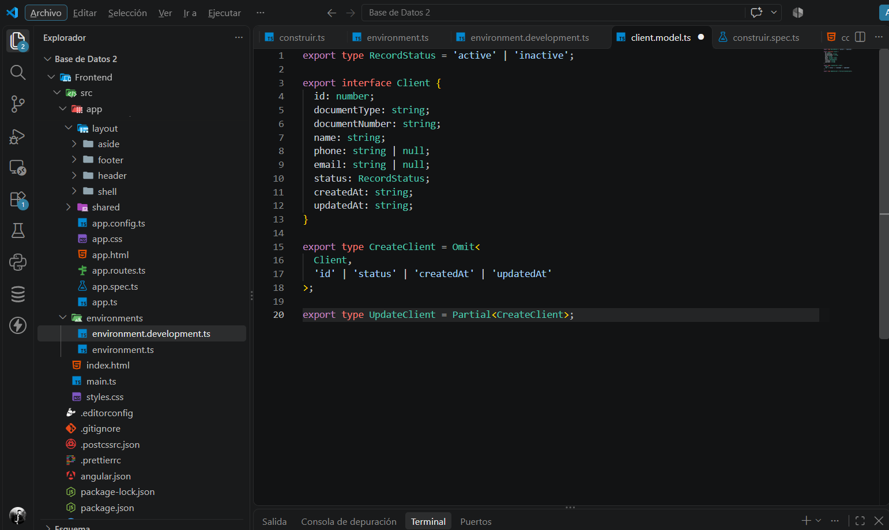

### Crear `client.model.ts`

Ejecutamos:

``` typescript
code src/app/core/models/client.model.ts
```

Pegamos este código:

``` typescript
export type RecordStatus = 'active' | 'inactive';

export interface Client {
  id: number;
  documentType: string;
  documentNumber: string;
  name: string;
  phone: string | null;
  email: string | null;
  status: RecordStatus;
  createdAt: string;
  updatedAt: string;
}

export type CreateClient = Omit<
  Client,
  'id' | 'status' | 'createdAt' | 'updatedAt'
>;

export type UpdateClient = Partial<CreateClient>;
```

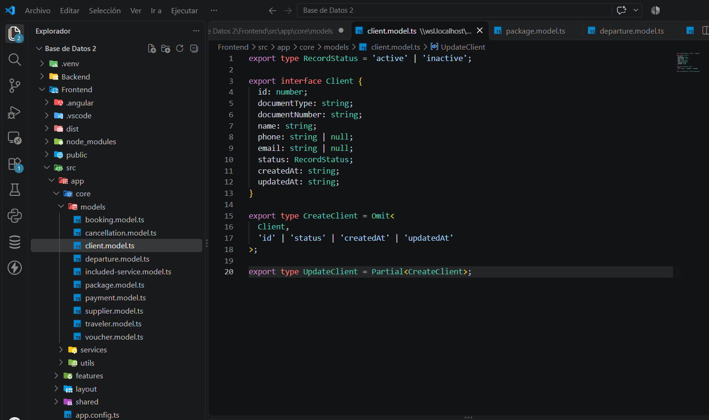

## Crear package.model.ts

Abrimos el archivo:

``` typescript

code src/app/core/models/package.model.ts
```

Pegamos el siguiente contenido:

``` typescript
import type { RecordStatus } from './client.model';

export interface Package {
  id: number;
  name: string;
  description: string | null;
  status: RecordStatus;
  createdAt: string;
  updatedAt: string;
}

export type CreatePackage = Pick<
  Package,
  'name' | 'description'
>;

export type UpdatePackage = Partial<CreatePackage>;
```

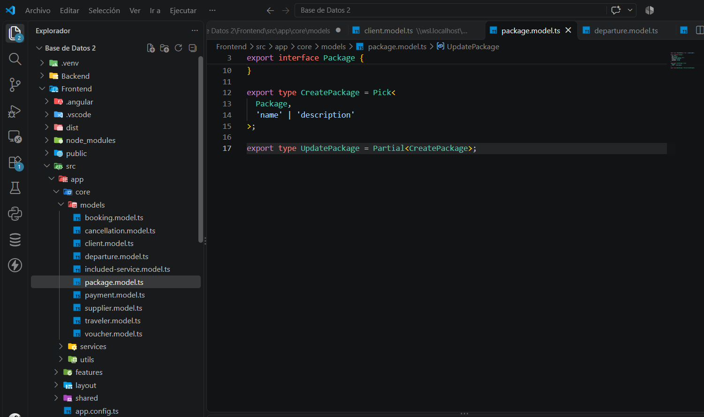

### Crear `departure.model.ts`

Desde la terminal, ejecutamos:

``` typescript
code src/app/core/models/departure.model.ts
```

Pegamos este código:

``` typescript
import type { RecordStatus } from './client.model';

export interface Departure {
  id: number;
  name: string;
  description: string | null;
  package: number;
  departureDate: string;
  capacity: number;
  availableCapacity: number;
  status: RecordStatus;
  createdAt: string;
  updatedAt: string;
}

export type CreateDeparture = Pick<
  Departure,
  | 'name'
  | 'description'
  | 'package'
  | 'departureDate'
  | 'capacity'
  | 'availableCapacity'
>;

export type UpdateDeparture = Partial<CreateDeparture>;
```

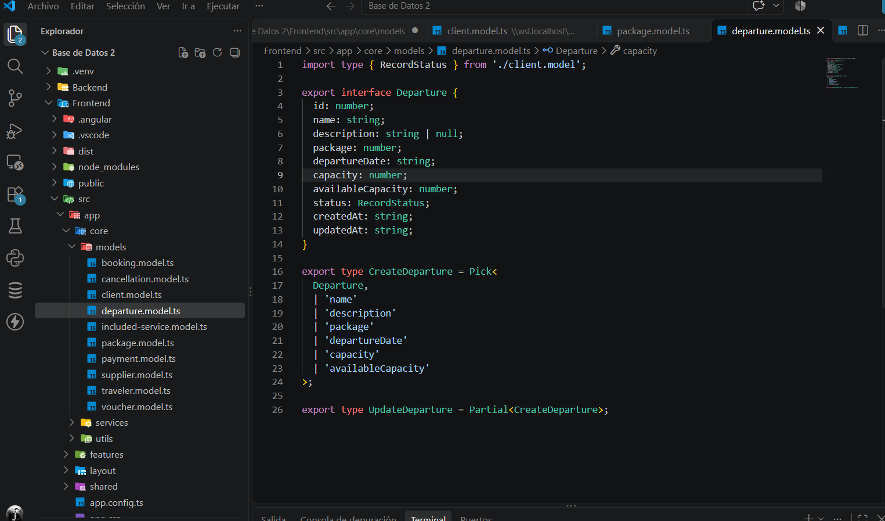

### Crear `supplier.model.ts`

Este modelo representa a los proveedores que ofrecen servicios para los paquetes turísticos.

Ejecutamos:

``` typescript
code src/app/core/models/supplier.model.ts
```

Pegamos el siguiente código:

``` typescript
import type { RecordStatus } from './client.model';

export interface Supplier {
  id: number;
  nit: string;
  razonSocial: string;
  phone: string | null;
  email: string | null;
  status: RecordStatus;
  createdAt: string;
  updatedAt: string;
}

export type CreateSupplier = Pick<
  Supplier,
  'nit' | 'razonSocial' | 'phone' | 'email'
>;

export type UpdateSupplier = Partial<CreateSupplier>;
```

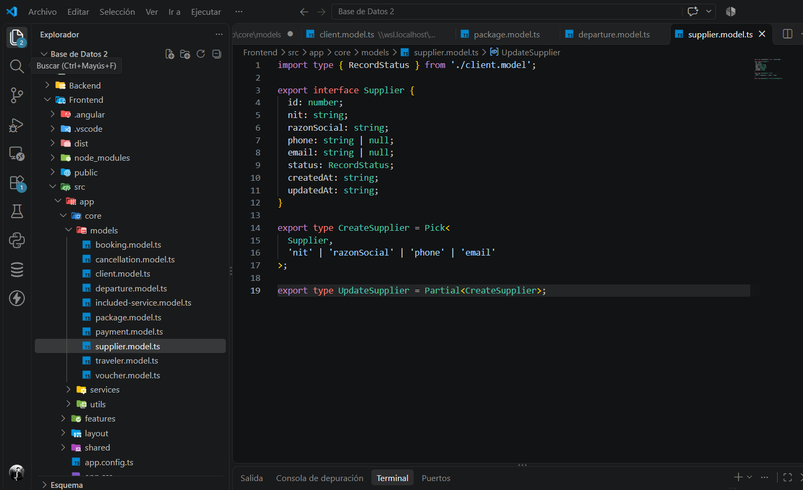

### Crear `included-service.model.ts`

Este modelo representa los servicios incluidos en cada paquete turístico y el proveedor que los ofrece.

Ejecutamos:

``` typescript
code src/app/core/models/included-service.model.ts
```

Pegamos este código:

``` typescript
import type { RecordStatus } from './client.model';

export interface IncludedService {
  id: number;
  package: number;
  supplier: number;
  relationData: Record<string, unknown> | null;
  status: RecordStatus;
  createdAt: string;
  updatedAt: string;
}

export type CreateIncludedService = Pick<
  IncludedService,
  'package' | 'supplier' | 'relationData'
>;

export type UpdateIncludedService = Partial<CreateIncludedService>;
```

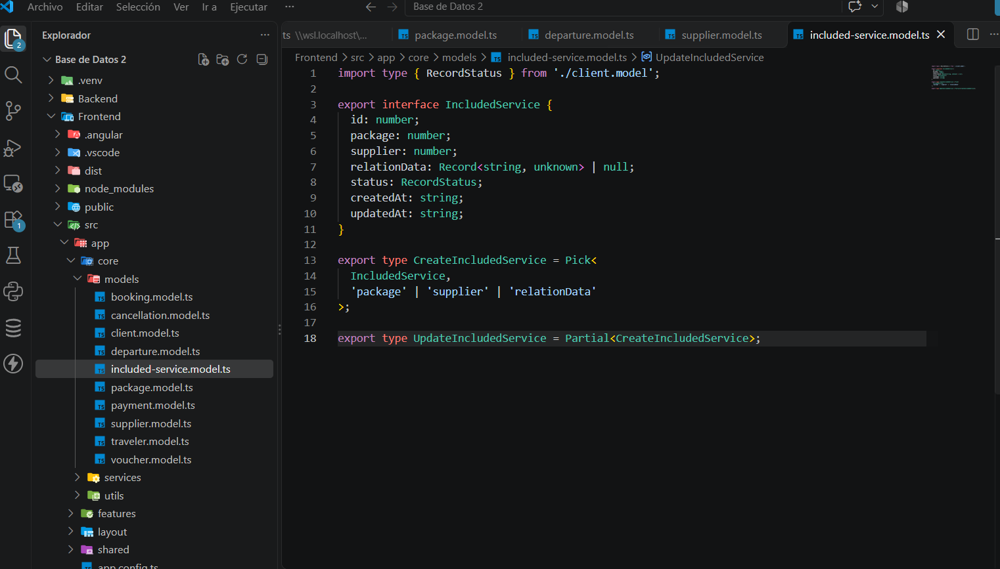

### Crear `traveler.model.ts`

Este modelo representa a los viajeros registrados en WayuuTravel.

Ejecutamos:

``` typescript
code src/app/core/models/traveler.model.ts
```

Pegamos el siguiente código:

``` typescript
import type { RecordStatus } from './client.model';

export interface Traveler {
  id: number;
  name: string;
  description: string | null;
  status: RecordStatus;
  createdAt: string;
  updatedAt: string;
}

export type CreateTraveler = Pick<
  Traveler,
  'name' | 'description'
>;

export type UpdateTraveler = Partial<CreateTraveler>;
```

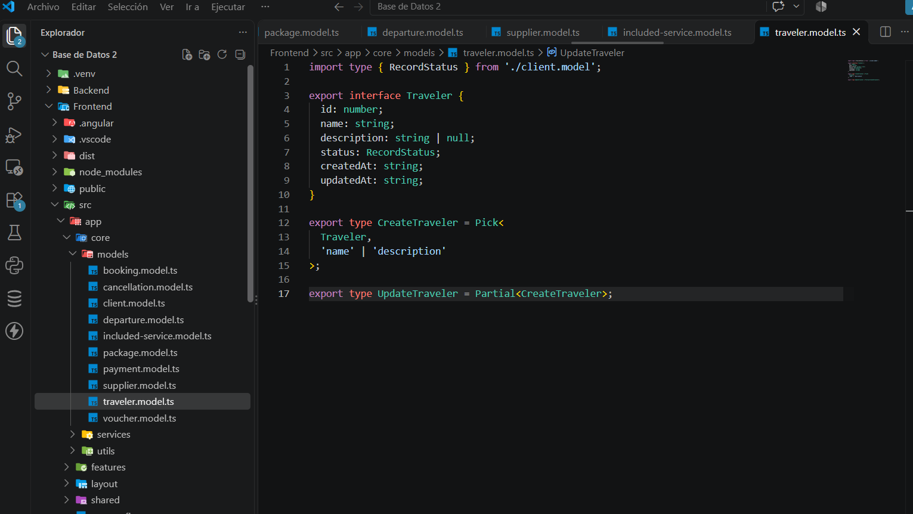

### Crear `booking.model.ts`

Este modelo representa las reservas de paquetes turísticos realizadas por los clientes.

Ejecutamos:

``` typescript
code src/app/core/models/booking.model.ts
```

Pegamos el siguiente código:

``` typescript
import type { RecordStatus } from './client.model';

export interface Booking {
  id: number;
  client: number;
  departure: number;
  traveler: number;
  startDate: string;
  endDate: string;
  observations: string | null;
  status: RecordStatus;
  createdAt: string;
  updatedAt: string;
}

export type CreateBooking = Pick<
  Booking,
  | 'client'
  | 'departure'
  | 'traveler'
  | 'startDate'
  | 'endDate'
  | 'observations'
>;

export type UpdateBooking = Partial<CreateBooking>;
```

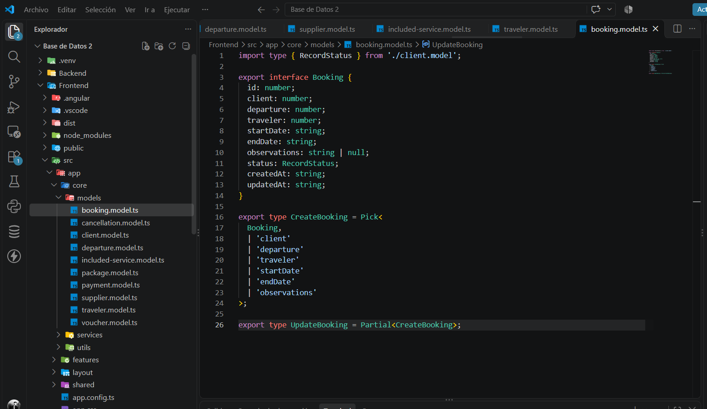

### Crear `payment.model.ts`

Este modelo representa los pagos asociados a las reservas turísticas.

Ejecutamos:

``` typescript
code src/app/core/models/payment.model.ts
```

Pegamos el siguiente código:

``` typescript
import type { RecordStatus } from './client.model';

export interface Payment {
  id: number;
  booking: number;
  referenceType: string;
  method: string;
  amount: string;
  paymentDate: string;
  status: RecordStatus;
}

export interface CreateBookingPayment {
  referenceType: string;
  method: string;
  amount: number;
  paymentDate: string;
}

export type CreatePayment = Omit<
  Payment,
  'id' | 'status'
>;

export type UpdatePayment = Partial<
  Omit<Payment, 'id' | 'status' | 'booking'>
>;
```

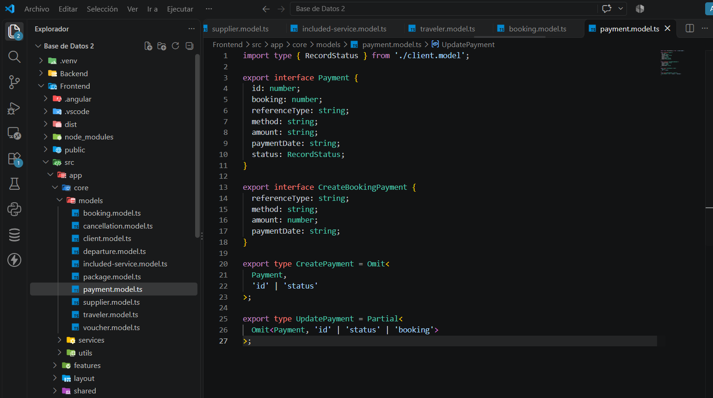

### Crear `cancellation.model.ts`

Este modelo representa las cancelaciones de reservas turísticas.

Ejecutamos:

``` typescript
code src/app/core/models/cancellation.model.ts
```

Pegamos el siguiente código:

``` typescript
import type { RecordStatus } from './client.model';

export interface Cancellation {
  id: number;
  booking: number;
  name: string;
  descriptions: string | null;
  status: RecordStatus;
  createdAt: string;
  updatedAt: string;
}

export type CreateCancellation = Pick<
  Cancellation,
  'booking' | 'name' | 'descriptions'
>;

export type UpdateCancellation = Partial<CreateCancellation>;
```

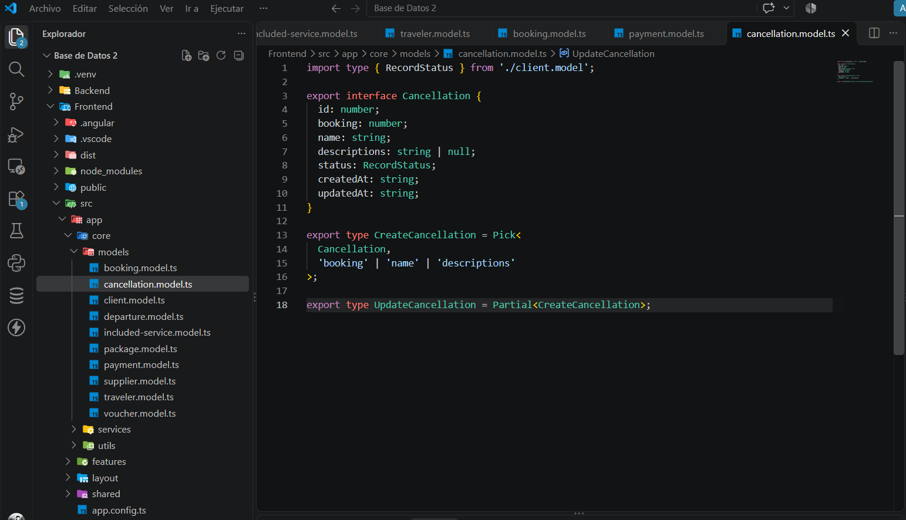

### Crear `voucher.model.ts`

Este será el último modelo de las entidades principales de WayuuTravel. Representa los comprobantes asociados a las reservas.

Ejecutamos:

``` typescript
code src/app/core/models/voucher.model.ts
```

Pegamos el siguiente código:

``` typescript
import type { RecordStatus } from './client.model';

export interface Voucher {
  id: number;
  booking: number;
  name: string;
  descriptions: string | null;
  status: RecordStatus;
  createdAt: string;
  updatedAt: string;
}

export type CreateVoucher = Pick<
  Voucher,
  'booking' | 'name' | 'descriptions'
>;

export type UpdateVoucher = Partial<CreateVoucher>;
```

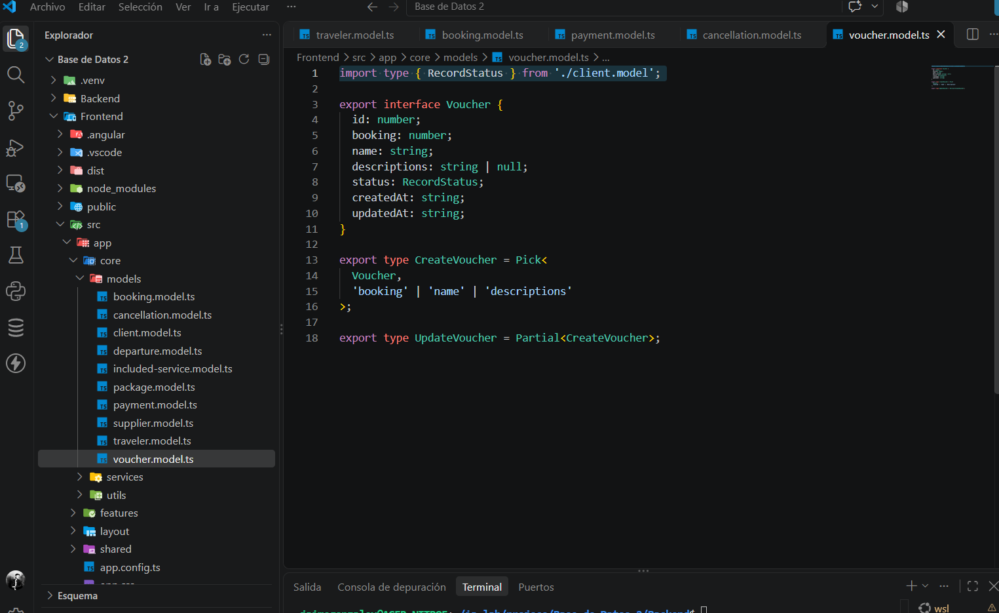

### Agregar HttpClient

Abrimos el archivo:

``` typescript
code src/app/app.config.ts
```

y remplazamos por:

``` typescript
import {
  ApplicationConfig,
  provideBrowserGlobalErrorListeners
} from '@angular/core';

import { provideHttpClient } from '@angular/common/http';

import {
  provideRouter,
  withComponentInputBinding,
  withInMemoryScrolling
} from '@angular/router';

import { provideAnimationsAsync } from '@angular/platform-browser/animations/async';

import { providePrimeNG } from 'primeng/config';
import Aura from '@primeuix/themes/aura';

import { MessageService, ConfirmationService } from 'primeng/api';

import { routes } from './app.routes';

export const appConfig: ApplicationConfig = {
  providers: [
    provideBrowserGlobalErrorListeners(),

    provideHttpClient(),

    provideRouter(
      routes,
      withComponentInputBinding(),
      withInMemoryScrolling({
        scrollPositionRestoration: 'enabled',
        anchorScrolling: 'enabled'
      })
    ),

    provideAnimationsAsync(),

    providePrimeNG({
      ripple: true,
      inputVariant: 'outlined',
      theme: {
        preset: Aura,
        options: {
          darkModeSelector: '.app-dark',
          cssLayer: {
            name: 'primeng',
            order: 'theme, base, primeng, utilities'
          }
        }
      }
    }),

    MessageService,
    ConfirmationService
  ]
};
```

### Crear el servicio de notificaciones

Vamos a centralizar los mensajes de éxito, error, advertencia e información utilizando PrimeNG `MessageService`.

Abrimos:

``` typescript
code src/app/core/services/notification.service.ts
```

Pegamos este código:

``` typescript
import { Injectable, inject } from '@angular/core';
import { MessageService } from 'primeng/api';

@Injectable({
  providedIn: 'root'
})
export class NotificationService {
  private readonly messageService = inject(MessageService);

  success(message: string, title = 'Éxito'): void {
    this.messageService.add({
      severity: 'success',
      summary: title,
      detail: message
    });
  }

  error(message: string, title = 'Error'): void {
    this.messageService.add({
      severity: 'error',
      summary: title,
      detail: message
    });
  }

  warning(message: string, title = 'Advertencia'): void {
    this.messageService.add({
      severity: 'warn',
      summary: title,
      detail: message
    });
  }

  info(message: string, title = 'Información'): void {
    this.messageService.add({
      severity: 'info',
      summary: title,
      detail: message
    });
  }

  clear(): void {
    this.messageService.clear();
  }
}
```

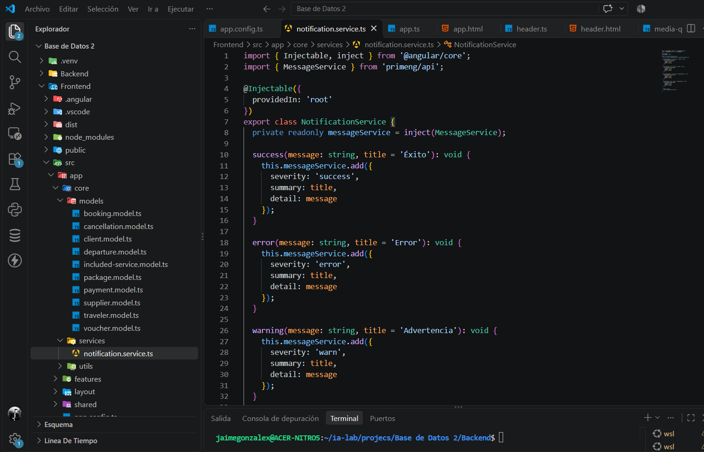

### Crear `toApiMessage.ts`

Esta función permitirá convertir las respuestas de error de Django REST Framework en mensajes que podamos mostrar al usuario.

Abrimos el archivo:

``` typescript
code src/app/core/utils/to-api-message.ts
```

Pegamos el siguiente código:

``` typescript
export function toApiMessage(error: unknown): string {
  if (typeof error === 'string') {
    return error;
  }

  if (error instanceof Error) {
    return error.message;
  }

  if (typeof error !== 'object' || error === null) {
    return 'Ha ocurrido un error inesperado.';
  }

  const data = error as Record<string, unknown>;

  if (typeof data['detail'] === 'string') {
    return data['detail'];
  }

  if (typeof data['message'] === 'string') {
    return data['message'];
  }

  const messages = Object.values(data)
    .flatMap((value) => {
      if (typeof value === 'string') {
        return [value];
      }

      if (Array.isArray(value)) {
        return value.filter(
          (item): item is string => typeof item === 'string'
        );
      }

      return [];
    });

  return messages.length > 0
    ? messages.join(' ')
    : 'Ha ocurrido un error inesperado.';
}
```

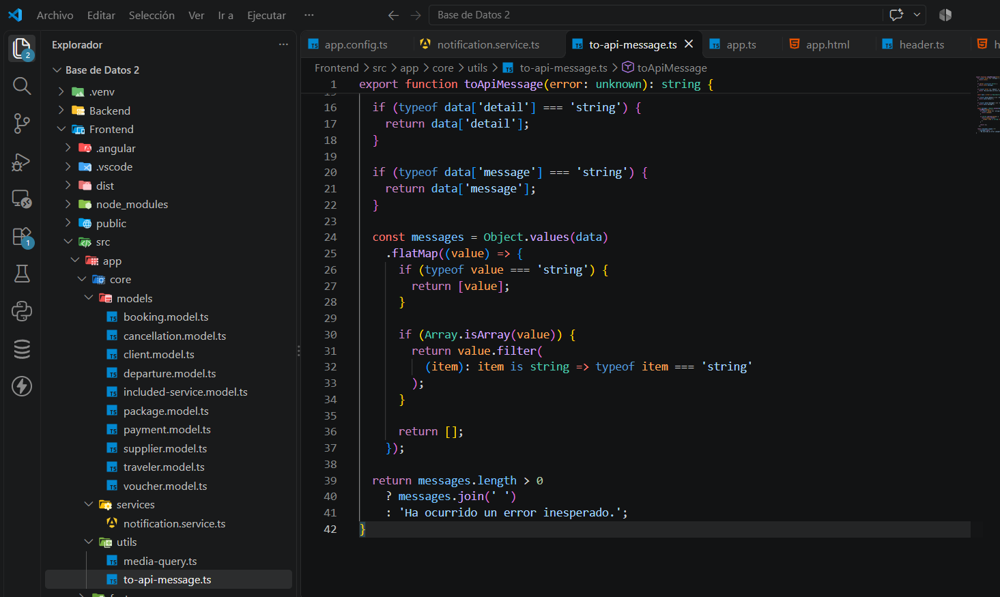

### Crear `filter-rows.ts`

Esta utilidad permitirá filtrar registros de tablas mediante un texto de búsqueda. La utilizaremos posteriormente en listados de clientes, paquetes, proveedores y reservas.

Abrimos:

``` typescript
code src/app/core/utils/filter-rows.ts
```

Pegamos este código:

``` typescript
export function filterRows<T>(
  rows: T[],
  searchTerm: string,
  fields?: (keyof T)[]
): T[] {
  const term = searchTerm.trim().toLowerCase();

  if (!term) {
    return rows;
  }

  return rows.filter((row) => {
    const values = fields
      ? fields.map((field) => row[field])
      : Object.values(row as Record<string, unknown>);

    return values.some((value) =>
      String(value ?? '').toLowerCase().includes(term)
    );
  });
}
```

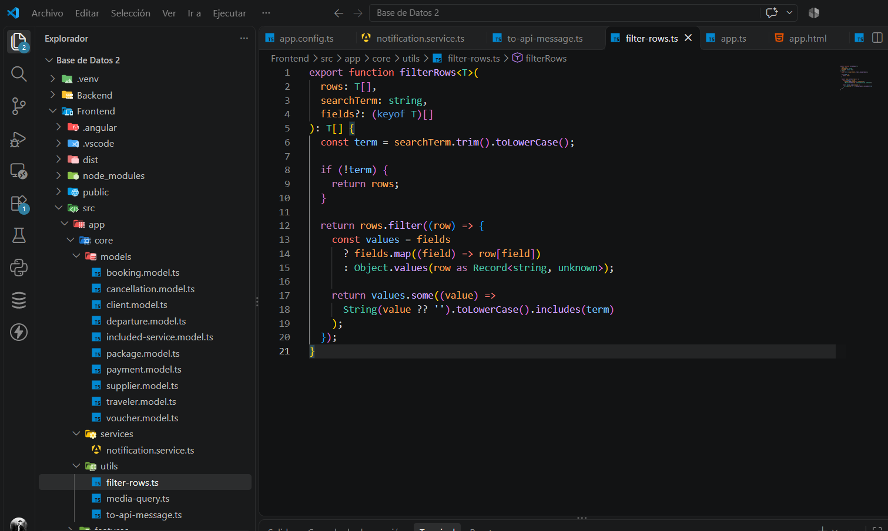

### Crear `client.service.ts`

Este servicio permitirá consultar, registrar, actualizar y eliminar clientes mediante la API de Django.

Abrimos:

``` typescript
code src/app/core/services/client.service.ts
```

Pegamos este código:

``` typescript
import { Injectable, inject } from '@angular/core';
import { HttpClient } from '@angular/common/http';
import { Observable } from 'rxjs';

import { environment } from '../../../environments/environment';
import {
  Client,
  CreateClient,
  UpdateClient
} from '../models/client.model';

@Injectable({
  providedIn: 'root'
})
export class ClientService {
  private readonly http = inject(HttpClient);
  private readonly apiUrl = `${environment.apiUrl}/clients/`;

  getAll(): Observable<Client[]> {
    return this.http.get<Client[]>(this.apiUrl);
  }

  getById(id: number): Observable<Client> {
    return this.http.get<Client>(`${this.apiUrl}${id}/`);
  }

  create(data: CreateClient): Observable<Client> {
    return this.http.post<Client>(this.apiUrl, data);
  }

  update(id: number, data: UpdateClient): Observable<Client> {
    return this.http.patch<Client>(`${this.apiUrl}${id}/`, data);
  }

  delete(id: number): Observable<void> {
    return this.http.delete<void>(`${this.apiUrl}${id}/`);
  }
}
```

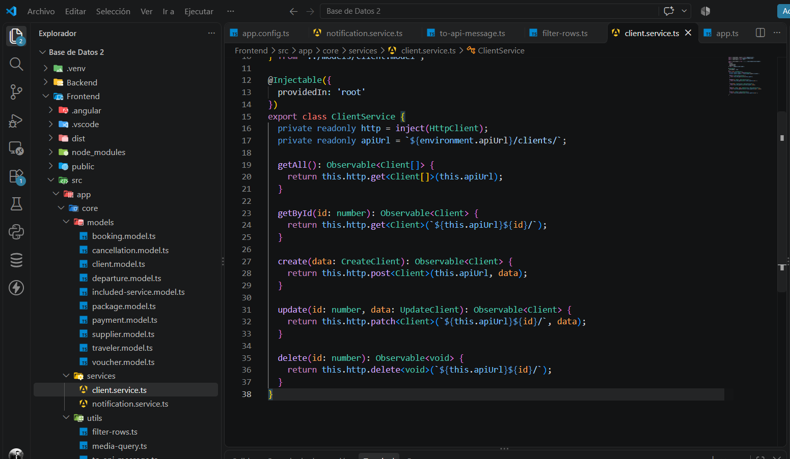

### Crear `package.service.ts`

Este servicio permitirá consultar, registrar, actualizar y eliminar paquetes turísticos, además de consultar los paquetes disponibles.

Abrimos:

``` typescript
code src/app/core/services/package.service.ts
```

Pegamos este código:

``` typescript
import { Injectable, inject } from '@angular/core';
import { HttpClient } from '@angular/common/http';
import { Observable } from 'rxjs';

import { environment } from '../../../environments/environment';
import {
  Package,
  CreatePackage,
  UpdatePackage
} from '../models/package.model';

@Injectable({
  providedIn: 'root'
})
export class PackageService {
  private readonly http = inject(HttpClient);
  private readonly apiUrl = `${environment.apiUrl}/product/packages/`;

  getAll(): Observable<Package[]> {
    return this.http.get<Package[]>(this.apiUrl);
  }

  getAvailable(): Observable<Package[]> {
    return this.http.get<Package[]>(`${this.apiUrl}available/`);
  }

  getById(id: number): Observable<Package> {
    return this.http.get<Package>(`${this.apiUrl}${id}/`);
  }

  create(data: CreatePackage): Observable<Package> {
    return this.http.post<Package>(this.apiUrl, data);
  }

  update(id: number, data: UpdatePackage): Observable<Package> {
    return this.http.patch<Package>(`${this.apiUrl}${id}/`, data);
  }

  delete(id: number): Observable<void> {
    return this.http.delete<void>(`${this.apiUrl}${id}/`);
  }
}
```


### Crear `departure.service.ts`

Este servicio permitirá gestionar las salidas turísticas, consultar sus fechas, capacidades y paquetes asociados.

Abrimos:

``` typescript
code src/app/core/services/departure.service.ts
```

Pegamos este código:

``` typescript
import { Injectable, inject } from '@angular/core';
import { HttpClient } from '@angular/common/http';
import { Observable } from 'rxjs';

import { environment } from '../../../environments/environment';
import {
  Departure,
  CreateDeparture,
  UpdateDeparture
} from '../models/departure.model';

@Injectable({
  providedIn: 'root'
})
export class DepartureService {
  private readonly http = inject(HttpClient);
  private readonly apiUrl = `${environment.apiUrl}/product/departures/`;

  getAll(): Observable<Departure[]> {
    return this.http.get<Departure[]>(this.apiUrl);
  }

  getById(id: number): Observable<Departure> {
    return this.http.get<Departure>(`${this.apiUrl}${id}/`);
  }

  create(data: CreateDeparture): Observable<Departure> {
    return this.http.post<Departure>(this.apiUrl, data);
  }

  update(id: number, data: UpdateDeparture): Observable<Departure> {
    return this.http.patch<Departure>(`${this.apiUrl}${id}/`, data);
  }

  delete(id: number): Observable<void> {
    return this.http.delete<void>(`${this.apiUrl}${id}/`);
  }
}
```


### Crear `supplier.service.ts`

Este servicio permitirá consultar, registrar, actualizar y eliminar proveedores turísticos.

Abrimos:

``` typescript
code src/app/core/services/supplier.service.ts
```

Pegamos este código:

``` typescript
import { Injectable, inject } from '@angular/core';
import { HttpClient } from '@angular/common/http';
import { Observable } from 'rxjs';

import { environment } from '../../../environments/environment';
import {
  Supplier,
  CreateSupplier,
  UpdateSupplier
} from '../models/supplier.model';

@Injectable({
  providedIn: 'root'
})
export class SupplierService {
  private readonly http = inject(HttpClient);
  private readonly apiUrl = `${environment.apiUrl}/product/suppliers/`;

  getAll(): Observable<Supplier[]> {
    return this.http.get<Supplier[]>(this.apiUrl);
  }

  getById(id: number): Observable<Supplier> {
    return this.http.get<Supplier>(`${this.apiUrl}${id}/`);
  }

  create(data: CreateSupplier): Observable<Supplier> {
    return this.http.post<Supplier>(this.apiUrl, data);
  }

  update(id: number, data: UpdateSupplier): Observable<Supplier> {
    return this.http.patch<Supplier>(`${this.apiUrl}${id}/`, data);
  }

  delete(id: number): Observable<void> {
    return this.http.delete<void>(`${this.apiUrl}${id}/`);
  }
} 
```


### Crear `included-service.service.ts`

Este servicio permitirá gestionar los servicios incluidos en los paquetes turísticos y consultar sus proveedores asociados.

Abrimos:

``` typescript
code src/app/core/services/included-service.service.ts
```

Pegamos este código:

``` typescript
import { Injectable, inject } from '@angular/core';
import { HttpClient } from '@angular/common/http';
import { Observable } from 'rxjs';

import { environment } from '../../../environments/environment';
import {
  IncludedService,
  CreateIncludedService,
  UpdateIncludedService
} from '../models/included-service.model';

@Injectable({
  providedIn: 'root'
})
export class IncludedServiceService {
  private readonly http = inject(HttpClient);
  private readonly apiUrl = `${environment.apiUrl}/product/included-services/`;

  getAll(): Observable<IncludedService[]> {
    return this.http.get<IncludedService[]>(this.apiUrl);
  }

  getById(id: number): Observable<IncludedService> {
    return this.http.get<IncludedService>(`${this.apiUrl}${id}/`);
  }

  create(data: CreateIncludedService): Observable<IncludedService> {
    return this.http.post<IncludedService>(this.apiUrl, data);
  }

  update(id: number, data: UpdateIncludedService): Observable<IncludedService> {
    return this.http.patch<IncludedService>(`${this.apiUrl}${id}/`, data);
  }

  delete(id: number): Observable<void> {
    return this.http.delete<void>(`${this.apiUrl}${id}/`);
  }
}
```


### Crear `booking.service.ts`

Este servicio permitirá consultar y gestionar reservas turísticas, incluyendo el registro especial de reservas con sus pagos.

Abrimos:

``` typescript
code src/app/core/services/booking.service.ts
```

Pegamos este código:

``` typescript
import { Injectable, inject } from '@angular/core';
import { HttpClient } from '@angular/common/http';
import { Observable } from 'rxjs';

import { environment } from '../../../environments/environment';
import {
  Booking,
  CreateBooking,
  UpdateBooking
} from '../models/booking.model';
import { CreateBookingPayment } from '../models/payment.model';

@Injectable({
  providedIn: 'root'
})
export class BookingService {
  private readonly http = inject(HttpClient);
  private readonly apiUrl = `${environment.apiUrl}/sale/bookings/`;

  getAll(): Observable<Booking[]> {
    return this.http.get<Booking[]>(this.apiUrl);
  }

  getById(id: number): Observable<Booking> {
    return this.http.get<Booking>(`${this.apiUrl}${id}/`);
  }

  create(data: CreateBooking): Observable<Booking> {
    return this.http.post<Booking>(this.apiUrl, data);
  }

  register(
    data: CreateBooking & { payments: CreateBookingPayment[] }
  ): Observable<Booking> {
    return this.http.post<Booking>(
      `${this.apiUrl}register/`,
      data
    );
  }

  update(id: number, data: UpdateBooking): Observable<Booking> {
    return this.http.patch<Booking>(`${this.apiUrl}${id}/`, data);
  }

  delete(id: number): Observable<void> {
    return this.http.delete<void>(`${this.apiUrl}${id}/`);
  }
}
```


### Crear `payment.service.ts`

Este servicio permitirá consultar, registrar, actualizar y eliminar los pagos asociados a las reservas.

Abrimos:

``` typescript
code src/app/core/services/payment.service.ts
```

Pegamos este código:

``` typescript
import { Injectable, inject } from '@angular/core';
import { HttpClient } from '@angular/common/http';
import { Observable } from 'rxjs';

import { environment } from '../../../environments/environment';
import {
  Payment,
  CreatePayment,
  UpdatePayment
} from '../models/payment.model';

@Injectable({
  providedIn: 'root'
})
export class PaymentService {
  private readonly http = inject(HttpClient);
  private readonly apiUrl = `${environment.apiUrl}/sale/payments/`;

  getAll(): Observable<Payment[]> {
    return this.http.get<Payment[]>(this.apiUrl);
  }

  getById(id: number): Observable<Payment> {
    return this.http.get<Payment>(`${this.apiUrl}${id}/`);
  }

  create(data: CreatePayment): Observable<Payment> {
    return this.http.post<Payment>(this.apiUrl, data);
  }

  update(id: number, data: UpdatePayment): Observable<Payment> {
    return this.http.patch<Payment>(`${this.apiUrl}${id}/`, data);
  }

  delete(id: number): Observable<void> {
    return this.http.delete<void>(`${this.apiUrl}${id}/`);
  }
}
```


### Crear `cancellation.service.ts`

Este servicio permitirá consultar, registrar, actualizar y eliminar cancelaciones de reservas.

Abrimos:

``` typescript
code src/app/core/services/cancellation.service.ts
```

Pegamos este código:

``` typescript
import { Injectable, inject } from '@angular/core';
import { HttpClient } from '@angular/common/http';
import { Observable } from 'rxjs';

import { environment } from '../../../environments/environment';
import {
  Cancellation,
  CreateCancellation,
  UpdateCancellation
} from '../models/cancellation.model';

@Injectable({
  providedIn: 'root'
})
export class CancellationService {
  private readonly http = inject(HttpClient);
  private readonly apiUrl = `${environment.apiUrl}/sale/cancellations/`;

  getAll(): Observable<Cancellation[]> {
    return this.http.get<Cancellation[]>(this.apiUrl);
  }

  getById(id: number): Observable<Cancellation> {
    return this.http.get<Cancellation>(`${this.apiUrl}${id}/`);
  }

  create(data: CreateCancellation): Observable<Cancellation> {
    return this.http.post<Cancellation>(this.apiUrl, data);
  }

  update(id: number, data: UpdateCancellation): Observable<Cancellation> {
    return this.http.patch<Cancellation>(`${this.apiUrl}${id}/`, data);
  }

  delete(id: number): Observable<void> {
    return this.http.delete<void>(`${this.apiUrl}${id}/`);
  }
}
```


### Crear `voucher.service.ts`

Este servicio permitirá consultar, registrar, actualizar y eliminar comprobantes asociados a las reservas.

Abrimos:

``` typescript
code src/app/core/services/voucher.service.ts
```

Pegamos este código:

``` typescript
import { Injectable, inject } from '@angular/core';
import { HttpClient } from '@angular/common/http';
import { Observable } from 'rxjs';

import { environment } from '../../../environments/environment';
import {
  Voucher,
  CreateVoucher,
  UpdateVoucher
} from '../models/voucher.model';

@Injectable({
  providedIn: 'root'
})
export class VoucherService {
  private readonly http = inject(HttpClient);
  private readonly apiUrl = `${environment.apiUrl}/sale/vouchers/`;

  getAll(): Observable<Voucher[]> {
    return this.http.get<Voucher[]>(this.apiUrl);
  }

  getById(id: number): Observable<Voucher> {
    return this.http.get<Voucher>(`${this.apiUrl}${id}/`);
  }

  create(data: CreateVoucher): Observable<Voucher> {
    return this.http.post<Voucher>(this.apiUrl, data);
  }

  update(id: number, data: UpdateVoucher): Observable<Voucher> {
    return this.http.patch<Voucher>(`${this.apiUrl}${id}/`, data);
  }

  delete(id: number): Observable<void> {
    return this.http.delete<void>(`${this.apiUrl}${id}/`);
  }
} 
```


### Crear `shell`

Este componente será la estructura principal de navegación de WayuuTravel. Integrará el Header, Aside, contenido de las páginas y Footer.

Abrimos:

``` typescript
code src/app/layout/shell/shell.ts
```

Antes de escribir el código, necesito revisar cómo están nombrados tus componentes actuales para integrarlos correctamente.

Ejecutamos:

``` typescript
tree src/app/layout -L 3
```

salida:

``` sql

src/app/layout
├── aside
│   ├── aside.css
│   ├── aside.html
│   └── aside.ts
├── footer
│   ├── footer.css
│   ├── footer.html
│   └── footer.ts
├── header
│   ├── header.css
│   ├── header.html
│   └── header.ts
└── shell
```

### Crear `shell.ts`

Este componente será el contenedor principal de WayuuTravel y administrará la navegación lateral.

Abrimos:

``` typescript
code src/app/layout/shell/shell.ts
```

Pegamos este código:

``` typescript
import { Component, signal } from '@angular/core';
import { RouterOutlet } from '@angular/router';
import { MenuItem } from 'primeng/api';

import { Header } from '../header/header';
import { Aside } from '../aside/aside';
import { Footer } from '../footer/footer';

@Component({
  selector: 'app-shell',
  standalone: true,
  imports: [
    RouterOutlet,
    Header,
    Aside,
    Footer
  ],
  templateUrl: './shell.html',
  styleUrl: './shell.css'
})
export class Shell {
  readonly menuOpen = signal(true);

  readonly menuItems: MenuItem[] = [
    {
      label: 'Inicio',
      icon: 'pi pi-home',
      routerLink: '/construir'
    }
  ];

  toggleMenu(): void {
    this.menuOpen.update((value) => !value);
  }

  closeMenu(): void {
    this.menuOpen.set(false);
  }
}
```


### Crear `shell.html`

Esta plantilla organizará el Header, el menú lateral, el contenido de navegación y el Footer.

Abrimos:

``` html
code src/app/layout/shell/shell.html
```

Pegamos este código:

``` html
<div class="flex min-h-screen flex-col bg-slate-50">

  <app-header
    appName="WayuuTravel"
    (menuRequested)="toggleMenu()"
  />

  <div class="flex flex-1 overflow-hidden">

    @if (menuOpen()) {
      <aside class="w-64 shrink-0">
        <app-aside
          appName="WayuuTravel"
          [items]="menuItems"
          (navigated)="closeMenu()"
        />
      </aside>
    }

    <main class="min-w-0 flex-1 overflow-y-auto p-4 sm:p-6">
      <router-outlet />
    </main>

  </div>

  <app-footer />

</div>
```


### Crear `shell.css`

Este archivo establecerá los estilos básicos del contenedor principal.

Abrimos:

``` css
code src/app/layout/shell/shell.css
```

Pegamos este código:

``` css
:host {
  display: block;
  min-height: 100vh;
}
```


### Configurar `app.routes.ts`

Ahora conectaremos el Shell con las rutas de la aplicación. Así, las páginas se mostrarán dentro de la estructura que acabamos de crear.

Abrimos:

``` typescript
code src/app/app.routes.ts
```

Reemplazamos todo el contenido por:

``` typescript
import { Routes } from '@angular/router';

export const routes: Routes = [
  {
    path: '',
    loadComponent: () =>
      import('./layout/shell/shell').then((m) => m.Shell),

    children: [
      {
        path: 'construir',
        loadComponent: () =>
          import('./features/construir/construir').then(
            (m) => m.Construir
          ),
      },
      {
        path: '',
        pathMatch: 'full',
        redirectTo: 'construir',
      },
    ],
  },
  {
    path: '**',
    redirectTo: 'construir',
  },
];
```


### Crear `status-tag.ts`

Abrimos:

``` typescript
code src/app/shared/ui/status-tag/status-tag.ts
```

Pegamos este código:

``` typescript
import { Component, computed, input } from '@angular/core';
import { TagModule } from 'primeng/tag';

import { RecordStatus } from '../../../core/models/client.model';

@Component({
  selector: 'app-status-tag',
  standalone: true,
  imports: [TagModule],
  templateUrl: './status-tag.html',
  styleUrl: './status-tag.css',
})
export class StatusTag {
  readonly status = input<RecordStatus>('active');

  readonly label = computed(() =>
    this.status() === 'active' ? 'Activo' : 'Inactivo'
  );

  readonly severity = computed(() =>
    this.status() === 'active' ? 'success' : 'danger'
  );
}
```


### Crear `status-tag.html`

Abrimos:

``` html
code src/app/shared/ui/status-tag/status-tag.html
```

Pegamos:

``` html
<p-tag
  [value]="label()"
  [severity]="severity()"
  [rounded]="true"
/>
```


### Crear `status-tag.css`

Abrimos:

``` css
code src/app/shared/ui/status-tag/status-tag.css
```

Pegamos:

``` css
:host {
  display: inline-flex;
  align-items: center;
}
```


### Crear `page-header.ts`

Este componente permitirá reutilizar los encabezados de las diferentes páginas de WayuuTravel.

Abrimos:

``` typescript
code src/app/shared/ui/page-header/page-header.ts
```

Pegamos:

``` typescript
import { Component, input } from '@angular/core';

@Component({
  selector: 'app-page-header',
  standalone: true,
  templateUrl: './page-header.html',
  styleUrl: './page-header.css',
})
export class PageHeader {
  readonly title = input.required<string>();
  readonly description = input('');
}
```


### Crear `page-header.html`

Abrimos:

``` html
code src/app/shared/ui/page-header/page-header.html
```

Pegamos:

``` html
<header class="mb-6">
  <h1 class="text-2xl font-bold tracking-tight text-slate-900">
    {{ title() }}
  </h1>

  @if (description()) {
    <p class="mt-2 text-sm leading-6 text-slate-600">
      {{ description() }}
    </p>
  }
</header>
```


### Crear `page-header.css`

Abrimos:

``` css
code src/app/shared/ui/page-header/page-header.css
```

Pegamos:

``` css
:host {
  display: block;
  width: 100%;
}
```


### Crear `empty-state.ts`

Este componente permitirá mostrar mensajes cuando una sección todavía no tenga registros o resultados.

Abrimos:

``` typescript
code src/app/shared/ui/empty-state/empty-state.ts
```

Pegamos:

``` typescript
import { Component, input } from '@angular/core';

@Component({
  selector: 'app-empty-state',
  standalone: true,
  templateUrl: './empty-state.html',
  styleUrl: './empty-state.css',
})
export class EmptyState {
  readonly title = input('No hay información disponible');
  readonly description = input(
    'Todavía no existen registros para mostrar.'
  );
  readonly icon = input('pi pi-inbox');
}
```


### Crear `empty-state.html`

Abrimos:

``` html
code src/app/shared/ui/empty-state/empty-state.html
```

Pegamos:

``` html
<div class="flex flex-col items-center justify-center rounded-xl border border-dashed border-slate-300 bg-white px-6 py-12 text-center">
  <div class="mb-4 flex h-14 w-14 items-center justify-center rounded-full bg-teal-50">
    <i [class]="icon() + ' text-2xl text-teal-700'" aria-hidden="true"></i>
  </div>

  <h3 class="text-lg font-semibold text-slate-900">
    {{ title() }}
  </h3>

  <p class="mt-2 max-w-md text-sm leading-6 text-slate-500">
    {{ description() }}
  </p>
</div>
```


### Crear `empty-state.css`

Abrimos:

``` css
code src/app/shared/ui/empty-state/empty-state.css
```

Pegamos:

``` css
:host {
  display: block;
  width: 100%;
}
```


### Modificar `app.ts`

Abrimos:

``` typescript
code src/app/app.ts
```

Reemplazamos todo el contenido por:

``` typescript
import { Component } from '@angular/core';
import { RouterOutlet } from '@angular/router';
import { ToastModule } from 'primeng/toast';

@Component({
  selector: 'app-root',
  imports: [
    RouterOutlet,
    ToastModule
  ],
  templateUrl: './app.html',
  styleUrl: './app.css',
  host: {
    class: 'block',
  },
})
export class App {}
```


### Modificar `app.html`

Abrimos:

``` html
code src/app/app.html
```

Reemplazamos su contenido por:

``` html
<p-toast
  position="top-right"
  [life]="4000"
/>

<router-outlet />
```


### Verificar la compilación

Vamos a comprobar que los componentes reutilizables y las notificaciones estén correctamente configurados.

Desde la carpeta `Frontend`, ejecuta:

1\. Verificar TypeScript:

``` typescript
npx tsc --noEmit
```

2\. Compilar Angular:

``` sql
npx ng build
```


### Crear el componente de páginas placeholder

Usaremos un componente reutilizable para representar las secciones que todavía no tienen funcionalidades.

Primero creamos su carpeta:

``` sql
mkdir -p src/app/features/placeholder
```

Después abrimos:

``` typescript
code src/app/features/placeholder/placeholder.ts
```


### Crear `placeholder.html`

Abrimos:

``` html
code src/app/features/placeholder/placeholder.html
```

Pegamos:

``` html
<app-page-header
  [title]="title()"
  [description]="description()"
/>

<app-empty-state
  title="Sección en construcción"
  description="Esta funcionalidad estará disponible en una próxima etapa del desarrollo de WayuuTravel."
  icon="pi pi-wrench"
/>
```


### Crear `placeholder.css`

Abrimos:

``` css
code src/app/features/placeholder/placeholder.css
```

Pegamos:

``` css
:host {
  display: block;
  width: 100%;
}
```


### Configurar las rutas placeholder

Ahora conectaremos las secciones de WayuuTravel con el componente `Placeholder`. Cada ruta tendrá su propio título y descripción.

Abrimos:

``` typescript
code src/app/app.routes.ts
```

Reemplazamos todo el contenido por:

``` typescript
import { Routes } from '@angular/router';

export const routes: Routes = [
  {
    path: '',
    loadComponent: () =>
      import('./layout/shell/shell').then((m) => m.Shell),

    children: [
      {
        path: 'construir',
        loadComponent: () =>
          import('./features/construir/construir').then(
            (m) => m.Construir
          ),
      },
      {
        path: 'clientes',
        loadComponent: () =>
          import('./features/placeholder/placeholder').then(
            (m) => m.Placeholder
          ),
        data: {
          title: 'Clientes',
          description: 'Gestión de los clientes de WayuuTravel.',
        },
      },
      {
        path: 'paquetes',
        loadComponent: () =>
          import('./features/placeholder/placeholder').then(
            (m) => m.Placeholder
          ),
        data: {
          title: 'Paquetes turísticos',
          description: 'Administración de los paquetes turísticos.',
        },
      },
      {
        path: 'salidas',
        loadComponent: () =>
          import('./features/placeholder/placeholder').then(
            (m) => m.Placeholder
          ),
        data: {
          title: 'Salidas',
          description: 'Gestión de las salidas y fechas de los paquetes.',
        },
      },
      {
        path: 'proveedores',
        loadComponent: () =>
          import('./features/placeholder/placeholder').then(
            (m) => m.Placeholder
          ),
        data: {
          title: 'Proveedores',
          description: 'Administración de los proveedores turísticos.',
        },
      },
      {
        path: 'reservas',
        loadComponent: () =>
          import('./features/placeholder/placeholder').then(
            (m) => m.Placeholder
          ),
        data: {
          title: 'Reservas',
          description: 'Gestión de las reservas de los viajeros.',
        },
      },
      {
        path: 'pagos',
        loadComponent: () =>
          import('./features/placeholder/placeholder').then(
            (m) => m.Placeholder
          ),
        data: {
          title: 'Pagos',
          description: 'Consulta y gestión de los pagos registrados.',
        },
      },
      {
        path: 'cancelaciones',
        loadComponent: () =>
          import('./features/placeholder/placeholder').then(
            (m) => m.Placeholder
          ),
        data: {
          title: 'Cancelaciones',
          description: 'Administración de las cancelaciones de reservas.',
        },
      },
      {
        path: 'comprobantes',
        loadComponent: () =>
          import('./features/placeholder/placeholder').then(
            (m) => m.Placeholder
          ),
        data: {
          title: 'Comprobantes',
          description: 'Consulta de los comprobantes de las reservas.',
        },
      },
      {
        path: '',
        pathMatch: 'full',
        redirectTo: 'construir',
      },
    ],
  },
  {
    path: '**',
    redirectTo: 'construir',
  },
];
```


### Conectar el menú lateral con las rutas

Ahora agregaremos todas las secciones de WayuuTravel al menú lateral para poder navegar entre ellas.

Abrimos:

``` typescript
code src/app/layout/shell/shell.ts
```

Reemplazamos el contenido por:

``` typescript
import { Component, signal } from '@angular/core';
import { RouterOutlet } from '@angular/router';
import { MenuItem } from 'primeng/api';

import { Header } from '../header/header';
import { Aside } from '../aside/aside';
import { Footer } from '../footer/footer';

@Component({
  selector: 'app-shell',
  standalone: true,
  imports: [
    RouterOutlet,
    Header,
    Aside,
    Footer
  ],
  templateUrl: './shell.html',
  styleUrl: './shell.css'
})
export class Shell {
  readonly menuOpen = signal(true);

  readonly menuItems: MenuItem[] = [
    {
      label: 'Inicio',
      icon: 'pi pi-home',
      routerLink: '/construir'
    },
    {
      separator: true
    },
    {
      label: 'Gestión turística',
      items: [
        {
          label: 'Clientes',
          icon: 'pi pi-users',
          routerLink: '/clientes'
        },
        {
          label: 'Paquetes turísticos',
          icon: 'pi pi-map',
          routerLink: '/paquetes'
        },
        {
          label: 'Salidas',
          icon: 'pi pi-calendar',
          routerLink: '/salidas'
        },
        {
          label: 'Proveedores',
          icon: 'pi pi-truck',
          routerLink: '/proveedores'
        }
      ]
    },
    {
      label: 'Gestión comercial',
      items: [
        {
          label: 'Reservas',
          icon: 'pi pi-book',
          routerLink: '/reservas'
        },
        {
          label: 'Pagos',
          icon: 'pi pi-wallet',
          routerLink: '/pagos'
        },
        {
          label: 'Cancelaciones',
          icon: 'pi pi-times-circle',
          routerLink: '/cancelaciones'
        },
        {
          label: 'Comprobantes',
          icon: 'pi pi-file',
          routerLink: '/comprobantes'
        }
      ]
    }
  ];

  toggleMenu(): void {
    this.menuOpen.update((value) => !value);
  }

  closeMenu(): void {
    this.menuOpen.set(false);
  }
}
```


# **ISS-03 · CRUD de clientes con signals**

### **Narrativa**

### 

En esta unidad desarrollé el CRUD de clientes para el proyecto front-storelab-django, integrando el frontend Angular 22 con la API REST construida en Django. Implementé la consulta, creación, edición y baja lógica de clientes mediante los métodos HTTP GET, POST, PATCH y DELETE, respectivamente.

Organicé la funcionalidad utilizando componentes standalone y una arquitectura basada en features, separando la lógica de presentación, el formulario y el acceso a la API. Implementé Signals para administrar el estado de la lista, los indicadores de carga, los errores y la visibilidad del diálogo. También incorporé propiedades reactivas mediante `input()` y `output()` para comunicar el formulario con el componente principal.

Además, desarrollé un buscador local utilizando `computed` y la función reutilizable `filterRows`, evitando solicitudes innecesarias al backend durante la búsqueda. Finalmente, incorporé validaciones reactivas, notificaciones, confirmación de bajas, pruebas unitarias y verificación de compilación para comprobar el correcto funcionamiento de la funcionalidad.

### Generar los componentes

Primero verificaremos la estructura actual y después generaremos `client-list` y `client-form` sin sobrescribir archivos existentes.

Verificamos si ya existe la carpeta:

``` sql
ls src/app/features/clients
```

Si todavía no existen los componentes, ejecutamos:

``` sql
ng generate component features/clients/client-list --skip-tests --defaults ng generate component features/clients/client-form --skip-tests --defaults
```

Verificamos los archivos generados:

``` sql
tree src/app/features/clients -L 3
```

salida:

``` sql
src/app/features/clients
├── client-form
│   ├── client-form.css
│   ├── client-form.html
│   └── client-form.ts
└── client-list
    ├── client-list.css
    ├── client-list.html
    └── client-list.ts
```

### Preparar el modelo de clientes

Primero verificaremos si el modelo `Client` y el servicio `ClientApi` de ISS-02 ya existen, para reutilizarlos y evitar duplicaciones.

Ejecutamos:

``` sql
tree src/app/core -L 4
```

### Revisar modelo y servicio existentes

Ejecutamos estos comandos:

``` typescript
cat src/app/core/models/client.model.ts
```

``` typescript
cat src/app/core/services/client.service.ts
```

``` typescript
cat src/app/core/models/api.model.ts
```

``` typescript
cat src/app/core/utils/filter-rows.ts
```

Y verificamos la configuración de la API:

``` typescript
cat src/environments/environment.ts
```


### Revisar los modelos compartidos y el filtro

Ejecutamos:

``` typescript
cat src/app/core/models/api.model.ts
```

``` typescript
cat src/app/core/utils/filter-rows.ts
```


### Comprobar dependencias y contrato del backend

Ejecutamos:

``` sql
grep -R "ClientService\|filterRows" -n src/app
```

``` typescript
cat src/environments/environment.development.ts
```

Comprobamos la respuesta real de Django:

```         
curl -s http://localhost:8000/api/clients/ | head -c 1500
```


### Adaptar el modelo de clientes

Vamos a conservar el nombre `ClientService` que ya utiliza tu proyecto y adaptar el modelo al contrato.

Primero, ejecutamos:

``` typescript
cat src/app/core/models/package.model.ts
```

``` typescript
cat src/app/core/models/booking.model.ts
```

### Crear el modelo compartido de API

Primero crearemos `api.model.ts`, que contendrá los tipos compartidos.

Abrimos:

``` typescript
nano src/app/core/models/api.model.ts
```

Pegamos este código:

``` typescript
export type Status = 'active' | 'inactive';

export interface Timestamps {
  createdAt: string;
  updatedAt: string;
}
```


### Actualizar el modelo de clientes

Abrimos:

```         
nano src/app/core/models/client.model.ts
```

Reemplazamos todo el contenido por:

``` typescript
import type { Status, Timestamps } from './api.model';

export type RecordStatus = Status;

export interface Client extends Timestamps {
  id: number;
  name: string;
  address: string | null;
  phone: string | null;
  email: string | null;
  status: Status;
}

export interface ClientPayload {
  name: string;
  address: string | null;
  phone: string | null;
  email: string | null;
}

// Compatibilidad con los nombres anteriores.
export type CreateClient = ClientPayload;
export type UpdateClient = Partial<ClientPayload>;
```


### Adaptar el servicio de clientes

Actualizaremos `ClientService` para que cumpla el contrato:

- `GET /clients/`: listar clientes.

- `POST /clients/`: crear con `status: 'active'`.

- `PATCH /clients/{id}/`: editar sin modificar el estado.

- `DELETE /clients/{id}/`: dar de baja y recibir `204`.

Abrimos:

``` typescript
nano src/app/core/services/client.service.ts
```

Reemplazamos todo el contenido por:

``` typescript
import { Injectable, inject } from '@angular/core';
import { HttpClient } from '@angular/common/http';
import { Observable } from 'rxjs';

import { environment } from '../../../environments/environment';
import { Status } from '../models/api.model';
import {
  Client,
  ClientPayload
} from '../models/client.model';

@Injectable({
  providedIn: 'root'
})
export class ClientService {
  private readonly http = inject(HttpClient);
  private readonly base = `${environment.apiUrl}/clients`;

  list(): Observable<Client[]> {
    return this.http.get<Client[]>(`${this.base}/`);
  }

  getById(id: number): Observable<Client> {
    return this.http.get<Client>(`${this.base}/${id}/`);
  }

  create(payload: ClientPayload & { status: Status }): Observable<Client> {
    return this.http.post<Client>(`${this.base}/`, payload);
  }

  update(id: number, payload: ClientPayload): Observable<Client> {
    return this.http.patch<Client>(`${this.base}/${id}/`, payload);
  }

  remove(id: number): Observable<void> {
    return this.http.delete<void>(`${this.base}/${id}/`);
  }
}
```


### Actualizar el filtro reutilizable

La función actual de `filterRows` tiene una firma diferente a la que necesitamos. Como todavía no tiene otros consumidores, podemos adaptarla directamente.

Abrimos:

``` typescript
nano src/app/core/utils/filter-rows.ts
```

Reemplazamos todo el contenido por:

``` typescript
export function filterRows<T>(
  rows: readonly T[],
  query: string,
  pick: (row: T) => Array<string | number | null | undefined>
): T[] {
  const term = query.trim().toLowerCase();

  if (!term) {
    return [...rows];
  }

  return rows.filter((row) =>
    pick(row).some((value) =>
      (value ?? '').toString().toLowerCase().includes(term)
    )
  );
}
```


### Revisar servicios y componentes compartidos

Antes de construir `client-list.ts`, vamos a revisar cómo están implementadas las notificaciones y los componentes compartidos para reutilizarlos correctamente.

Ejecutamos:

``` sql
cat src/app/core/services/notification.service.ts 
cat src/app/core/utils/to-api-message.ts 
tree src/app/shared -L 3
```


### Revisar componentes compartidos

Ahora necesitamos conocer las propiedades y eventos de los tres componentes compartidos.

Ejecutamos:

``` sql
cat src/app/shared/ui/empty-state/empty-state.ts
cat src/app/shared/ui/empty-state/empty-state.html

cat src/app/shared/ui/page-header/page-header.ts
cat src/app/shared/ui/page-header/page-header.html

cat src/app/shared/ui/status-tag/status-tag.ts
cat src/app/shared/ui/status-tag/status-tag.html
```

### Revisar configuración e integración

Antes de implementar el listado, revisaremos las rutas, el menú y la configuración de PrimeNG.

Ejecutamos:

``` sql
cat src/app/app.routes.ts tree src/app/layout -L 3 
cat src/app/app.config.ts
cat src/app/core/services/client.service.ts
```

### Preparar el listado de clientes

Vamos a conectar el componente con el menú y las rutas existentes antes de implementar su lógica.

Ejecutamos:

``` sql
cat src/app/app.routes.ts
```

``` sql
tree src/app/layout -L 3
```

``` sql
cat src/app/core/models/client.model.ts
```

### Conectar la ruta de clientes

Abrimos:

``` typescript
nano src/app/app.routes.ts
```

remplasamos solo:

``` sql
loadComponent: () =>
  import('./features/clients/client-list/client-list').then(
    (m) => m.ClientList
  ),
```


### Implementar `client-list.ts`

Vamos a incorporar Signals, carga de clientes, búsqueda, eliminación lógica, confirmaciones y notificaciones.

Primero reemplazamos el archivo completo.

Abrimos:

``` typescript
nano src/app/features/clients/client-list/client-list.ts
```

remplazamos por este codigo:

``` typescript
import { Component, computed, inject, OnInit, signal } from '@angular/core';
import { finalize } from 'rxjs';

import { ConfirmationService } from 'primeng/api';
import { ButtonModule } from 'primeng/button';
import { DialogModule } from 'primeng/dialog';
import { InputTextModule } from 'primeng/inputtext';
import { TableModule } from 'primeng/table';
import { TooltipModule } from 'primeng/tooltip';

import { Client, ClientPayload } from '../../../core/models/client.model';
import { ClientService } from '../../../core/services/client.service';
import { NotificationService } from '../../../core/services/notification.service';
import { filterRows } from '../../../core/utils/filter-rows';
import { toApiMessage } from '../../../core/utils/to-api-message';

import { EmptyState } from '../../../shared/ui/empty-state/empty-state';
import { PageHeader } from '../../../shared/ui/page-header/page-header';
import { StatusTag } from '../../../shared/ui/status-tag/status-tag';

import { ClientForm } from '../client-form/client-form';

@Component({
  selector: 'app-client-list',
  standalone: true,
  imports: [
    ButtonModule,
    DialogModule,
    InputTextModule,
    TableModule,
    TooltipModule,
    PageHeader,
    EmptyState,
    StatusTag,
    ClientForm
  ],
  templateUrl: './client-list.html',
  styleUrl: './client-list.css'
})
export class ClientList implements OnInit {
  private readonly clientService = inject(ClientService);
  private readonly notification = inject(NotificationService);
  private readonly confirmation = inject(ConfirmationService);

  readonly rows = signal<Client[]>([]);
  readonly loading = signal(false);
  readonly saving = signal(false);
  readonly error = signal<string | null>(null);

  readonly filter = signal('');
  readonly dialogVisible = signal(false);
  readonly editing = signal<Client | null>(null);
  readonly resetKey = signal(0);

  readonly visibleRows = computed(() =>
    filterRows(this.rows(), this.filter(), (client) => [
      client.id,
      client.name,
      client.address,
      client.phone,
      client.email,
      client.status
    ])
  );

  ngOnInit(): void {
    this.load();
  }

  load(): void {
    this.loading.set(true);
    this.error.set(null);

    this.clientService.list()
      .pipe(finalize(() => this.loading.set(false)))
      .subscribe({
        next: (clients) => this.rows.set(clients),
        error: (err) => {
          const message = toApiMessage(err);
          this.error.set(message);
          this.notification.error(message);
        }
      });
  }

  openCreate(): void {
    this.editing.set(null);
    this.resetKey.update((value) => value + 1);
    this.dialogVisible.set(true);
  }

  openEdit(client: Client): void {
    this.editing.set(client);
    this.dialogVisible.set(true);
  }

  closeDialog(): void {
    this.dialogVisible.set(false);
    this.editing.set(null);
    this.resetKey.update((value) => value + 1);
  }

  save(payload: ClientPayload): void {
    this.saving.set(true);

    const client = this.editing();

    const request = client
      ? this.clientService.update(client.id, payload)
      : this.clientService.create({
          ...payload,
          status: 'active'
        });

    request
      .pipe(finalize(() => this.saving.set(false)))
      .subscribe({
        next: () => {
          this.notification.success(
            client
              ? 'Cliente actualizado correctamente.'
              : 'Cliente registrado correctamente.'
          );

          this.closeDialog();
          this.load();
        },
        error: (err) => {
          const message = toApiMessage(err);
          this.error.set(message);
          this.notification.error(message);
        }
      });
  }

  confirmDelete(client: Client): void {
    this.confirmation.confirm({
      header: 'Eliminar cliente',
      message: `¿Estás seguro de eliminar a ${client.name}?`,
      icon: 'pi pi-exclamation-triangle',
      acceptLabel: 'Eliminar',
      rejectLabel: 'Cancelar',
      accept: () => this.remove(client)
    });
  }

  private remove(client: Client): void {
    this.clientService.remove(client.id).subscribe({
      next: () => {
        this.rows.update((rows) =>
          rows.filter((row) => row.id !== client.id)
        );

        this.notification.success('Cliente eliminado correctamente.');
      },
      error: (err) => {
        const message = toApiMessage(err);
        this.notification.error(message);
      }
    });
  }
}
```


### Implementar `client-list.html`

Ahora construiremos la interfaz del listado: encabezado, búsqueda, tabla de clientes, estados y acciones.

Abrimos:

``` html
nano src/app/features/clients/client-list/client-list.html
```

Pegamos este código:

``` html
<section class="space-y-6">
  <app-page-header
    title="Clientes"
    description="Administra los clientes registrados en WayuuTravel."
  />

  <div class="flex flex-col gap-4 sm:flex-row sm:items-center sm:justify-between">
    <div class="relative w-full sm:max-w-md">
      <i class="pi pi-search absolute left-3 top-1/2 -translate-y-1/2 text-slate-400"></i>

      <input
        pInputText
        type="text"
        class="w-full pl-10"
        placeholder="Buscar clientes..."
        [value]="filter()"
        (input)="filter.set($any($event.target).value)"
      />
    </div>

    <p-button
      label="Nuevo cliente"
      icon="pi pi-plus"
      (onClick)="openCreate()"
    />
  </div>

  @if (error()) {
    <div class="rounded-lg border border-red-200 bg-red-50 p-4 text-sm text-red-700">
      {{ error() }}
      <p-button
        label="Reintentar"
        icon="pi pi-refresh"
        severity="danger"
        [text]="true"
        (onClick)="load()"
      />
    </div>
  }

  @if (loading()) {
    <div class="flex justify-center py-12">
      <i class="pi pi-spin pi-spinner text-3xl text-teal-700"></i>
    </div>
  } @else if (visibleRows().length === 0) {
    <app-empty-state
      [title]="filter() ? 'No se encontraron clientes' : 'No hay clientes registrados'"
      [description]="filter() ? 'Intenta con otro término de búsqueda.' : 'Registra el primer cliente para comenzar.'"
      icon="pi pi-users"
    />
  } @else {
    <div class="overflow-hidden rounded-xl border border-slate-200 bg-white">
      <p-table
        [value]="visibleRows()"
        [rowHover]="true"
        responsiveLayout="scroll"
      >
        <ng-template #header>
          <tr>
            <th>ID</th>
            <th>Nombre</th>
            <th>Dirección</th>
            <th>Teléfono</th>
            <th>Correo electrónico</th>
            <th>Estado</th>
            <th class="text-center">Acciones</th>
          </tr>
        </ng-template>

        <ng-template #body let-client>
          <tr>
            <td>{{ client.id }}</td>
            <td class="font-medium">{{ client.name }}</td>
            <td>{{ client.address || '—' }}</td>
            <td>{{ client.phone || '—' }}</td>
            <td>{{ client.email || '—' }}</td>
            <td>
              <app-status-tag [status]="client.status" />
            </td>
            <td>
              <div class="flex justify-center gap-2">
                <p-button
                  icon="pi pi-pencil"
                  severity="secondary"
                  [text]="true"
                  [rounded]="true"
                  pTooltip="Editar cliente"
                  (onClick)="openEdit(client)"
                />

                <p-button
                  icon="pi pi-trash"
                  severity="danger"
                  [text]="true"
                  [rounded]="true"
                  pTooltip="Eliminar cliente"
                  (onClick)="confirmDelete(client)"
                />
              </div>
            </td>
          </tr>
        </ng-template>
      </p-table>
    </div>
  }
</section>

<p-dialog
  [header]="editing() ? 'Editar cliente' : 'Nuevo cliente'"
  [visible]="dialogVisible()"
  (visibleChange)="!$event && closeDialog()"
  [modal]="true"
  [draggable]="false"
  [resizable]="false"
  [style]="{ width: 'min(95vw, 600px)' }"
>
  <app-client-form
    [client]="editing()"
    [saving]="saving()"
    [resetKey]="resetKey()"
    (saved)="save($event)"
    (cancelled)="closeDialog()"
  />
</p-dialog>
```


### Implementar `client-form.ts`

Ahora construiremos el formulario reactivo para registrar y editar clientes, con validaciones y Signals.

Abrimos:

``` typescript
nano src/app/features/clients/client-form/client-form.ts
```

Pegamos este código:

``` typescript
import {
  Component,
  effect,
  input,
  output
} from '@angular/core';

import {
  FormBuilder,
  ReactiveFormsModule,
  Validators
} from '@angular/forms';

import { ButtonModule } from 'primeng/button';
import { InputTextModule } from 'primeng/inputtext';
import { TextareaModule } from 'primeng/textarea';

import { Client, ClientPayload } from '../../../core/models/client.model';

@Component({
  selector: 'app-client-form',
  standalone: true,
  imports: [
    ReactiveFormsModule,
    ButtonModule,
    InputTextModule,
    TextareaModule
  ],
  templateUrl: './client-form.html',
  styleUrl: './client-form.css'
})
export class ClientForm {
  readonly client = input<Client | null>(null);
  readonly saving = input(false);
  readonly resetKey = input(0);

  readonly saved = output<ClientPayload>();
  readonly cancelled = output<void>();

  private readonly fb = new FormBuilder();

  readonly form = this.fb.group({
    name: ['', [Validators.required, Validators.minLength(3), Validators.maxLength(150)]],
    address: [''],
    phone: ['', [Validators.maxLength(30)]],
    email: ['', [Validators.email, Validators.maxLength(150)]]
  });

  constructor() {
    effect(() => {
      const client = this.client();
      this.resetKey();

      if (client) {
        this.form.reset({
          name: client.name,
          address: client.address ?? '',
          phone: client.phone ?? '',
          email: client.email ?? ''
        });
      } else {
        this.form.reset({
          name: '',
          address: '',
          phone: '',
          email: ''
        });
      }
    });
  }

  submit(): void {
    if (this.form.invalid) {
      this.form.markAllAsTouched();
      return;
    }

    const value = this.form.getRawValue();

    const payload: ClientPayload = {
      name: value.name!.trim(),
      address: value.address?.trim() || null,
      phone: value.phone?.trim() || null,
      email: value.email?.trim() || null
    };

    this.saved.emit(payload);
  }

  cancel(): void {
    this.cancelled.emit();
  }
}
```


### Implementar `client-form.html`

Construiremos el formulario con campos, validaciones y botones para guardar o cancelar.

Abrimos:

``` html
nano src/app/features/clients/client-form/client-form.html
```

Pegamos este código:

``` html
<form [formGroup]="form" (ngSubmit)="submit()" class="space-y-5">

  <div class="space-y-2">
    <label for="name" class="block text-sm font-medium text-slate-700">
      Nombre completo *
    </label>

    <input
      pInputText
      id="name"
      formControlName="name"
      class="w-full"
      placeholder="Nombre del cliente"
    />

    @if (form.controls.name.touched && form.controls.name.invalid) {
      <small class="text-red-600">
        @if (form.controls.name.hasError('required')) {
          El nombre es obligatorio.
        } @else if (form.controls.name.hasError('minlength')) {
          El nombre debe tener al menos 3 caracteres.
        } @else {
          El nombre no puede superar los 150 caracteres.
        }
      </small>
    }
  </div>

  <div class="space-y-2">
    <label for="address" class="block text-sm font-medium text-slate-700">
      Dirección
    </label>

    <textarea
      pTextarea
      id="address"
      formControlName="address"
      rows="2"
      class="w-full"
      placeholder="Dirección del cliente"
    ></textarea>
  </div>

  <div class="space-y-2">
    <label for="phone" class="block text-sm font-medium text-slate-700">
      Teléfono
    </label>

    <input
      pInputText
      id="phone"
      formControlName="phone"
      class="w-full"
      placeholder="Número de contacto"
    />

    @if (form.controls.phone.touched && form.controls.phone.invalid) {
      <small class="text-red-600">
        El teléfono no puede superar los 30 caracteres.
      </small>
    }
  </div>

  <div class="space-y-2">
    <label for="email" class="block text-sm font-medium text-slate-700">
      Correo electrónico
    </label>

    <input
      pInputText
      id="email"
      type="email"
      formControlName="email"
      class="w-full"
      placeholder="correo@ejemplo.com"
    />

    @if (form.controls.email.touched && form.controls.email.invalid) {
      <small class="text-red-600">
        Ingresa un correo electrónico válido.
      </small>
    }
  </div>

  <div class="flex justify-end gap-3 border-t border-slate-200 pt-5">
    <p-button
      label="Cancelar"
      severity="secondary"
      [outlined]="true"
      type="button"
      (onClick)="cancel()"
    />

    <p-button
      [label]="client() ? 'Guardar cambios' : 'Registrar cliente'"
      icon="pi pi-check"
      type="submit"
      [loading]="saving()"
      [disabled]="saving()"
    />
  </div>

</form>
```


### Verificar archivos y rutas

Ya tenemos implementados los dos componentes. Ahora vamos a comprobar que la ruta de clientes esté conectada y que los archivos CSS estén vacíos.

Ejecutamos:

``` typescript
cat src/app/app.routes.ts
```

``` typescript
wc -c src/app/features/clients/client-list/client-list.css
wc -c src/app/features/clients/client-form/client-form.css
```

``` typescript
cat src/app/core/models/client.model.ts
cat src/app/core/services/client.service.ts
```


### Revisar las pruebas

Primero verificaremos qué pruebas y scripts tiene configurados el proyecto.

Ejecutamos:

``` json
cat package.json
```

``` typescript
find src -name "*.spec.ts"
```

### Ejecutar pruebas

Ejecutamos:

```         
ng test --watch=false
```


### Probar la interfaz

Ahora vamos a comprobar visualmente el módulo.

Ejecutamos:

```         
ng serve
```


### ISS-04 · CRUD de tipos de producto

En esta unidad desarrollé el CRUD de tipos de producto para el proyecto **front-storelab-django**, utilizando Angular 22, PrimeNG 22 y Tailwind CSS 4, integrando el frontend con la API REST de Django.

Reutilicé la estructura y los patrones implementados en el CRUD de clientes del ISS-03, aplicando Angular Signals para gestionar el estado, servicios para consumir la API, formularios reactivos para registrar y editar información, y componentes compartidos para mantener una interfaz consistente.

Implementé las operaciones de consulta, creación, edición y baja lógica de tipos de producto. También incorporé un buscador local por nombre y descripción, validaciones para el nombre entre 2 y 100 caracteres y el manejo de descripciones vacías mediante valores `null`.

Finalmente, integré el módulo a la navegación del sistema mediante la ruta `/tipos-producto`, conservando la estructura principal de la aplicación. Realicé las verificaciones de compilación, pruebas y funcionamiento para comprobar el cumplimiento de los criterios de aceptación establecidos en esta unidad.

### Revisar la estructura existente

Primero verificaremos qué archivos del módulo de tipos de producto ya existen para reutilizarlos y evitar duplicaciones.

Ejecutamos:

``` sql
tree src/app/features/product-types -L 3
```

``` sql
cat src/app/core/models/product-type.model.ts 
cat src/app/core/services/product-type-api.ts
```

``` sql
grep -R "ProductType" -n src/app/core
```

### Revisar la estructura de referencia

Ejecutamos:

``` sql
tree src/app/features/clients -L 3 tree src/app/core -L 3
```

Y revisamos el servicio de clientes:

``` typescript
cat src/app/core/services/client.service.ts
```

### Crear el modelo de tipos de producto

Este modelo definirá la estructura de los datos y el contenido que enviaremos a la API.

Creamos el archivo:

``` typescript
touch src/app/core/models/product-type.model.ts
```

Pegamos este código:

``` typescript
import type { Status, Timestamps } from './api.model';

export interface ProductType extends Timestamps {
  id: number;
  name: string;
  description: string | null;
  status: Status;
}

export interface ProductTypePayload {
  name: string;
  description: string | null;
}
```


### Crear el servicio de tipos de producto

Este servicio conectará el frontend con los endpoints de tipos de producto del backend Django.

Creamos el archivo:

``` typescript
touch src/app/core/services/product-type-api.ts
```

Pegamos este código:

``` typescript
import { Injectable, inject } from '@angular/core';
import { HttpClient } from '@angular/common/http';
import { Observable } from 'rxjs';

import { environment } from '../../../environments/environment';
import { Status } from '../models/api.model';
import {
  ProductType,
  ProductTypePayload
} from '../models/product-type.model';

@Injectable({
  providedIn: 'root'
})
export class ProductTypeApi {
  private readonly http = inject(HttpClient);
  private readonly base = `${environment.apiUrl}/product-types`;

  list(status?: Status): Observable<ProductType[]> {
    return this.http.get<ProductType[]>(
      `${this.base}/`,
      status ? { params: { status } } : {}
    );
  }

  getById(id: number): Observable<ProductType> {
    return this.http.get<ProductType>(`${this.base}/${id}/`);
  }

  create(
    payload: ProductTypePayload & { status: Status }
  ): Observable<ProductType> {
    return this.http.post<ProductType>(`${this.base}/`, payload);
  }

  update(
    id: number,
    payload: ProductTypePayload
  ): Observable<ProductType> {
    return this.http.patch<ProductType>(`${this.base}/${id}/`, payload);
  }

  remove(id: number): Observable<void> {
    return this.http.delete<void>(`${this.base}/${id}/`);
  }
}
```


### Revisar el componente de listado

Antes de construir `ProductTypeList`, revisaremos el CRUD de clientes para reutilizar su estructura, Signals, tabla y manejo de notificaciones.

Ejecutamos:

``` html
cat src/app/features/clients/client-list/client-list.ts
cat src/app/features/clients/client-list/client-list.html
```

### Crear la estructura del módulo

Ejecutamos:

``` sql
mkdir -p src/app/features/product-types/product-type-list
mkdir -p src/app/features/product-types/product-type-form

touch src/app/features/product-types/product-type-list/product-type-list.ts
touch src/app/features/product-types/product-type-list/product-type-list.html
touch src/app/features/product-types/product-type-list/product-type-list.css

touch src/app/features/product-types/product-type-form/product-type-form.ts
touch src/app/features/product-types/product-type-form/product-type-form.html
touch src/app/features/product-types/product-type-form/product-type-form.css
```


### Implementar ProductTypeList

Abrimos:

``` typescript
nano src/app/features/product-types/product-type-list/product-type-list.ts
```

Pegamos este código:

``` typescript
import { Component, computed, inject, OnInit, signal } from '@angular/core';
import { finalize } from 'rxjs';

import { ConfirmationService } from 'primeng/api';
import { ButtonModule } from 'primeng/button';
import { DialogModule } from 'primeng/dialog';
import { InputTextModule } from 'primeng/inputtext';
import { TableModule } from 'primeng/table';
import { TooltipModule } from 'primeng/tooltip';

import {
  ProductType,
  ProductTypePayload
} from '../../../core/models/product-type.model';

import { ProductTypeApi } from '../../../core/services/product-type-api';
import { NotificationService } from '../../../core/services/notification.service';
import { filterRows } from '../../../core/utils/filter-rows';
import { toApiMessage } from '../../../core/utils/to-api-message';

import { EmptyState } from '../../../shared/ui/empty-state/empty-state';
import { PageHeader } from '../../../shared/ui/page-header/page-header';
import { StatusTag } from '../../../shared/ui/status-tag/status-tag';

import { ProductTypeForm } from '../product-type-form/product-type-form';

@Component({
  selector: 'app-product-type-list',
  standalone: true,
  imports: [
    ButtonModule,
    DialogModule,
    InputTextModule,
    TableModule,
    TooltipModule,
    PageHeader,
    EmptyState,
    StatusTag,
    ProductTypeForm
  ],
  templateUrl: './product-type-list.html',
  styleUrl: './product-type-list.css'
})
export class ProductTypeList implements OnInit {
  private readonly api = inject(ProductTypeApi);
  private readonly notification = inject(NotificationService);
  private readonly confirmation = inject(ConfirmationService);

  readonly rows = signal<ProductType[]>([]);
  readonly loading = signal(false);
  readonly saving = signal(false);
  readonly error = signal<string | null>(null);

  readonly filter = signal('');
  readonly dialogVisible = signal(false);
  readonly editing = signal<ProductType | null>(null);
  readonly resetKey = signal(0);

  readonly visibleRows = computed(() =>
    filterRows(this.rows(), this.filter(), (productType) => [
      productType.id,
      productType.name,
      productType.description,
      productType.status
    ])
  );

  ngOnInit(): void {
    this.load();
  }

  load(): void {
    this.loading.set(true);
    this.error.set(null);

    this.api.list('active')
      .pipe(finalize(() => this.loading.set(false)))
      .subscribe({
        next: (types) => this.rows.set(types),
        error: (err) => {
          const message = toApiMessage(err);
          this.error.set(message);
          this.notification.error(message);
        }
      });
  }

  openCreate(): void {
    this.editing.set(null);
    this.resetKey.update((value) => value + 1);
    this.dialogVisible.set(true);
  }

  openEdit(productType: ProductType): void {
    this.editing.set(productType);
    this.dialogVisible.set(true);
  }

  closeDialog(): void {
    this.dialogVisible.set(false);
    this.editing.set(null);
    this.resetKey.update((value) => value + 1);
  }

  save(payload: ProductTypePayload): void {
    this.saving.set(true);

    const productType = this.editing();

    const request = productType
      ? this.api.update(productType.id, payload)
      : this.api.create({
          ...payload,
          status: 'active'
        });

    request
      .pipe(finalize(() => this.saving.set(false)))
      .subscribe({
        next: () => {
          this.notification.success(
            productType
              ? 'Tipo de producto actualizado correctamente.'
              : 'Tipo de producto registrado correctamente.'
          );

          this.closeDialog();
          this.load();
        },
        error: (err) => {
          const message = toApiMessage(err);
          this.error.set(message);
          this.notification.error(message);
        }
      });
  }

  confirmDeactivate(productType: ProductType): void {
    this.confirmation.confirm({
      header: 'Desactivar tipo de producto',
      message: `¿Estás seguro de desactivar "${productType.name}"?`,
      icon: 'pi pi-exclamation-triangle',
      acceptLabel: 'Desactivar',
      rejectLabel: 'Cancelar',
      accept: () => this.deactivate(productType)
    });
  }

  private deactivate(productType: ProductType): void {
    this.api.remove(productType.id).subscribe({
      next: () => {
        this.rows.update((rows) =>
          rows.filter((row) => row.id !== productType.id)
        );

        this.notification.success(
          'Tipo de producto desactivado correctamente.'
        );
      },
      error: (err) => {
        const message = toApiMessage(err);
        this.notification.error(message);
      }
    });
  }
}
```


### Construir la interfaz del listado

Crearemos la tabla de tipos de producto con buscador, estados, acciones y diálogo para el formulario.

Abrimos:

``` html
nano src/app/features/product-types/product-type-list/product-type-list.html
```

Pegamos este código:

``` html
<section class="space-y-6">
  <app-page-header
    title="Tipos de producto"
    description="Administra los tipos de producto registrados en StoreLab."
  />

  <div class="flex flex-col gap-4 sm:flex-row sm:items-center sm:justify-between">
    <div class="relative w-full sm:max-w-md">
      <i class="pi pi-search absolute left-3 top-1/2 -translate-y-1/2 text-slate-400"></i>

      <input
        pInputText
        type="text"
        class="w-full pl-10"
        placeholder="Buscar tipos de producto..."
        aria-label="Buscar tipos"
        [value]="filter()"
        (input)="filter.set($any($event.target).value)"
      />
    </div>

    <p-button
      label="Nuevo tipo"
      icon="pi pi-plus"
      (onClick)="openCreate()"
    />
  </div>

  @if (error()) {
    <div class="rounded-lg border border-red-200 bg-red-50 p-4 text-sm text-red-700">
      {{ error() }}

      <p-button
        label="Reintentar"
        icon="pi pi-refresh"
        severity="danger"
        [text]="true"
        (onClick)="load()"
      />
    </div>
  }

  @if (loading()) {
    <div class="flex justify-center py-12">
      <i class="pi pi-spin pi-spinner text-3xl text-teal-700"></i>
    </div>
  } @else if (visibleRows().length === 0) {
    <app-empty-state
      [title]="filter() ? 'No se encontraron tipos de producto' : 'No hay tipos de producto activos'"
      [description]="filter() ? 'Intenta con otro término de búsqueda.' : 'Registra el primer tipo de producto para comenzar.'"
      icon="pi pi-tags"
    />
  } @else {
    <div class="overflow-hidden rounded-xl border border-slate-200 bg-white">
      <p-table
        [value]="visibleRows()"
        [rowHover]="true"
        responsiveLayout="scroll"
      >
        <ng-template #header>
          <tr>
            <th>ID</th>
            <th>Nombre</th>
            <th>Descripción</th>
            <th>Estado</th>
            <th class="text-center">Acciones</th>
          </tr>
        </ng-template>

        <ng-template #body let-productType>
          <tr>
            <td>{{ productType.id }}</td>
            <td class="font-medium">{{ productType.name }}</td>
            <td>{{ productType.description || '—' }}</td>
            <td>
              <app-status-tag [status]="productType.status" />
            </td>
            <td>
              <div class="flex justify-center gap-2">
                <p-button
                  icon="pi pi-pencil"
                  severity="secondary"
                  [text]="true"
                  [rounded]="true"
                  pTooltip="Editar tipo de producto"
                  (onClick)="openEdit(productType)"
                />

                <p-button
                  icon="pi pi-ban"
                  severity="danger"
                  [text]="true"
                  [rounded]="true"
                  pTooltip="Desactivar tipo de producto"
                  (onClick)="confirmDeactivate(productType)"
                />
              </div>
            </td>
          </tr>
        </ng-template>
      </p-table>
    </div>
  }
</section>

<p-dialog
  [header]="editing() ? 'Editar tipo de producto' : 'Nuevo tipo de producto'"
  [visible]="dialogVisible()"
  (visibleChange)="!$event && closeDialog()"
  [modal]="true"
  [draggable]="false"
  [resizable]="false"
  [style]="{ width: 'min(95vw, 600px)' }"
>
  <app-product-type-form
    [productType]="editing()"
    [saving]="saving()"
    [resetKey]="resetKey()"
    (saved)="save($event)"
    (cancelled)="closeDialog()"
  />
</p-dialog>
```


### Revisar el formulario de clientes

Usaremos el formulario existente como referencia para construir el formulario reactivo de tipos de producto.

Ejecutamos:

``` html
cat src/app/features/clients/client-form/client-form.ts
cat src/app/features/clients/client-form/client-form.html
```

### Implementar ProductTypeForm

Abrimos:

``` typescript
nano src/app/features/product-types/product-type-form/product-type-form.ts
```

Pegamos este código:

``` typescript
import {
  Component,
  effect,
  input,
  output
} from '@angular/core';

import {
  FormBuilder,
  ReactiveFormsModule,
  Validators
} from '@angular/forms';

import { ButtonModule } from 'primeng/button';
import { InputTextModule } from 'primeng/inputtext';
import { TextareaModule } from 'primeng/textarea';

import {
  ProductType,
  ProductTypePayload
} from '../../../core/models/product-type.model';

@Component({
  selector: 'app-product-type-form',
  standalone: true,
  imports: [
    ReactiveFormsModule,
    ButtonModule,
    InputTextModule,
    TextareaModule
  ],
  templateUrl: './product-type-form.html',
  styleUrl: './product-type-form.css'
})
export class ProductTypeForm {
  readonly productType = input<ProductType | null>(null);
  readonly saving = input(false);
  readonly resetKey = input(0);

  readonly saved = output<ProductTypePayload>();
  readonly cancelled = output<void>();

  private readonly fb = new FormBuilder();

  readonly form = this.fb.group({
    name: ['', [
      Validators.required,
      Validators.minLength(2),
      Validators.maxLength(100)
    ]],
    description: ['']
  });

  constructor() {
    effect(() => {
      const productType = this.productType();
      this.resetKey();

      if (productType) {
        this.form.reset({
          name: productType.name,
          description: productType.description ?? ''
        });
      } else {
        this.form.reset({
          name: '',
          description: ''
        });
      }
    });
  }

  submit(): void {
    if (this.form.invalid) {
      this.form.markAllAsTouched();
      return;
    }

    const value = this.form.getRawValue();

    const payload: ProductTypePayload = {
      name: value.name!.trim(),
      description: value.description?.trim() || null
    };

    this.saved.emit(payload);
  }

  cancel(): void {
    this.cancelled.emit();
  }
}
```


### Construir el HTML del formulario

Este formulario permitirá registrar y editar tipos de producto con sus respectivas validaciones.

Abrimos:

``` html
nano src/app/features/product-types/product-type-form/product-type-form.html
```

Pegamos este código:

``` html
<form [formGroup]="form" (ngSubmit)="submit()" class="space-y-5">

  <div class="space-y-2">
    <label for="name" class="block text-sm font-medium text-slate-700">
      Nombre *
    </label>

    <input
      pInputText
      id="name"
      formControlName="name"
      class="w-full"
      placeholder="Nombre del tipo de producto"
      maxlength="100"
    />

    @if (form.controls.name.touched && form.controls.name.invalid) {
      <small class="text-red-600">
        @if (form.controls.name.hasError('required')) {
          El nombre es obligatorio.
        } @else if (form.controls.name.hasError('minlength')) {
          El nombre debe tener al menos 2 caracteres.
        } @else {
          El nombre no puede superar los 100 caracteres.
        }
      </small>
    }
  </div>

  <div class="space-y-2">
    <label for="description" class="block text-sm font-medium text-slate-700">
      Descripción
    </label>

    <textarea
      pTextarea
      id="description"
      formControlName="description"
      rows="4"
      class="w-full"
      placeholder="Describe el tipo de producto"
    ></textarea>
  </div>

  <div class="flex justify-end gap-3 border-t border-slate-200 pt-5">
    <p-button
      label="Cancelar"
      severity="secondary"
      [outlined]="true"
      type="button"
      (onClick)="cancel()"
    />

    <p-button
      [label]="productType() ? 'Guardar cambios' : 'Registrar tipo'"
      icon="pi pi-check"
      type="submit"
      [loading]="saving()"
      [disabled]="saving()"
    />
  </div>

</form>
```


### Integrar la ruta del módulo

Revisaremos las rutas actuales para incorporar `ProductTypeList` sin modificar las demás funcionalidades.

Ejecutamos:

``` typescript
cat src/app/app.routes.ts
```

También verificaremos si el menú lateral ya contiene la opción:

``` typescript
grep -R -n "Tipos de producto\|tipos-producto" src/app
```

### Registrar la ruta

Abrimos:

``` typescript
nano src/app/app.routes.ts
```

Agregamos este bloque justo después de la ruta `clientes`:

``` typescript
{
  path: 'tipos-producto',
  loadComponent: () =>
    import('./features/product-types/product-type-list/product-type-list').then(
      (m) => m.ProductTypeList
    ),
  data: {
    title: 'Tipos de producto · StoreLab',
    description: 'Administración de los tipos de producto.',
  },
},
```


### Agregar al menú lateral

Incorporaremos el acceso a tipos de producto dentro de la sección Gestión turística.

Abrimos:

``` typescript
nano src/app/layout/shell/shell.ts
```

Buscamos el elemento `Clientes`:

``` typescript
{   label: 'Clientes',   icon: 'pi pi-users',   routerLink: '/clientes' },
```


Verificamos que TypeScript compile:

```         
npx ng build
```


realizamos las pruebas:

\


# ISS-05 — CRUD de productos turísticos

**Narrativa**

Como desarrollador frontend de WayuuTravel, necesito implementar el módulo de administración de productos turísticos para gestionar la información de los paquetes que ofrece la plataforma. La funcionalidad permitirá consultar, buscar, registrar, editar y dar de baja paquetes, integrando la interfaz Angular con los servicios del backend Django. Además, buscaré mantener la coherencia visual con la estructura existente de la aplicación, reutilizando los componentes compartidos y mostrando notificaciones para informar el resultado de las operaciones. De esta manera, facilitaré la administración del catálogo turístico y dejaré preparada su integración con los módulos de reservas y ventas.

### Crear la estructura del módulo

Vamos a crear dos componentes: listado y formulario.

Desde la terminal de `Frontend`, ejecutamos:

``` sql
mkdir -p src/app/features/packages/pages/package-list
mkdir -p src/app/features/packages/components/package-form
```


### Crear el componente ProductList

En nuestro proyecto lo llamaremos `PackageList`, porque administraremos paquetes turísticos.

Primero generamos el componente standalone.

Abrimos la terminal en `Frontend`:

``` sql
ng generate component features/packages/pages/package-list --standalone --skip-tests
```

Ahora verificamos que se haya creado correctamente:

``` sql
ls -la src/app/features/packages/pages/package-list
```


### Preparar el listado de paquetes

Vamos a conectar `PackageList` con `PackageService` para mostrar los paquetes registrados en WayuuTravel.

Primero, verificamos los archivos generados y los componentes compartidos que reutilizaremos:

``` typescript
cat src/app/features/packages/pages/package-list/package-list.ts
cat src/app/features/packages/pages/package-list/package-list.html
cat src/app/shared/ui/page-header/page-header.ts
cat src/app/shared/ui/empty-state/empty-state.ts
cat src/app/shared/ui/status-tag/status-tag.ts
```

### Implementamos `package-list.ts`

Abrimos:

```         
code src/app/features/packages/pages/package-list/package-list.ts
```

Reemplazamos todo el contenido por:

``` typescript
import {
  Component,
  computed,
  inject,
  signal,
} from '@angular/core';
import { CurrencyPipe } from '@angular/common';
import { FormsModule } from '@angular/forms';
import { forkJoin } from 'rxjs';

import { ButtonModule } from 'primeng/button';
import { InputTextModule } from 'primeng/inputtext';
import { TableModule } from 'primeng/table';
import { TagModule } from 'primeng/tag';

import { Package } from '../../../../core/models/package.model';
import { PackageService } from '../../../../core/services/package.service';
import { NotificationService } from '../../../../core/services/notification.service';

import { PageHeader } from '../../../../shared/ui/page-header/page-header';
import { EmptyState } from '../../../../shared/ui/empty-state/empty-state';
import { StatusTag } from '../../../../shared/ui/status-tag/status-tag';

@Component({
  selector: 'app-package-list',
  standalone: true,
  imports: [
    CurrencyPipe,
    FormsModule,
    ButtonModule,
    InputTextModule,
    TableModule,
    TagModule,
    PageHeader,
    EmptyState,
    StatusTag,
  ],
  templateUrl: './package-list.html',
  styleUrl: './package-list.css',
})
export class PackageList {
  private readonly packageService = inject(PackageService);
  private readonly notification = inject(NotificationService);

  readonly rows = signal<Package[]>([]);
  readonly search = signal('');
  readonly onlyAvailable = signal(false);
  readonly loading = signal(false);

  readonly filteredRows = computed(() => {
    const term = this.search().trim().toLowerCase();

    return this.rows().filter((item) =>
      item.name.toLowerCase().includes(term)
    );
  });

  constructor() {
    this.load();
  }

  load(): void {
    this.loading.set(true);

    const request = this.onlyAvailable()
      ? this.packageService.getAvailable()
      : this.packageService.getAll();

    request.subscribe({
      next: (data) => {
        this.rows.set(data);
        this.loading.set(false);
      },
      error: () => {
        this.loading.set(false);
        this.notification.error(
          'Error al cargar los paquetes turísticos.'
        );
      },
    });
  }

  toggleAvailability(): void {
    this.onlyAvailable.update((value) => !value);
    this.load();
  }

  updateSearch(value: string): void {
    this.search.set(value);
  }
}
```


### Implementar `package-list.html`

Abrimos:

``` html
code src/app/features/packages/pages/package-list/package-list.html
```

Pegamos:

``` html
<div class="space-y-6">
  <app-page-header
    title="Paquetes turísticos"
    description="Administra los paquetes turísticos de WayuuTravel."
  />

  <div class="flex flex-wrap items-center justify-between gap-3">
    <input
      pInputText
      type="text"
      placeholder="Buscar paquetes..."
      aria-label="Buscar paquetes"
      [ngModel]="search()"
      (ngModelChange)="updateSearch($event)"
    />

    <div class="flex gap-2">
      <p-button
        [label]="onlyAvailable() ? 'Ver todos' : 'Solo disponibles'"
        [icon]="onlyAvailable() ? 'pi pi-list' : 'pi pi-check-circle'"
        severity="secondary"
        [outlined]="true"
        (onClick)="toggleAvailability()"
      />
    </div>
  </div>

  @if (loading()) {
    <div class="py-10 text-center text-slate-500">
      Cargando paquetes turísticos...
    </div>
  } @else if (filteredRows().length === 0) {
    <app-empty-state
      title="Sin paquetes turísticos"
      description="No se encontraron paquetes para mostrar."
    />
  } @else {
    <div class="overflow-x-auto rounded-xl border border-slate-200 bg-white">
      <p-table
        [value]="filteredRows()"
        [tableStyle]="{ 'min-width': '40rem' }"
      >
        <ng-template #header>
          <tr>
            <th>Nombre</th>
            <th>Descripción</th>
            <th>Estado</th>
          </tr>
        </ng-template>

        <ng-template #body let-package>
          <tr>
            <td class="font-medium">
              {{ package.name }}
            </td>

            <td>
              {{ package.description || 'Sin descripción' }}
            </td>

            <td>
              <app-status-tag [status]="package.status" />
            </td>
          </tr>
        </ng-template>
      </p-table>
    </div>
  }
</div>
```


### Crear el formulario de paquetes

Generamos el componente:

``` sql
ng generate component features/packages/components/package-form --standalone --skip-tests
```

Después verificamos los archivos:

``` sql
ls -la src/app/features/packages/components/package-form
```


### 

### Implementar `package-form.ts`

Abrimos:

``` typescript
code src/app/features/packages/components/package-form/package-form.ts
```

Reemplazamos todo el contenido por:

``` typescript
import { Component, input, output, effect } from '@angular/core';
import { FormBuilder, ReactiveFormsModule, Validators } from '@angular/forms';

import { ButtonModule } from 'primeng/button';
import { InputTextModule } from 'primeng/inputtext';
import { TextareaModule } from 'primeng/textarea';

import {
  Package,
  CreatePackage,
} from '../../../../core/models/package.model';

@Component({
  selector: 'app-package-form',
  standalone: true,
  imports: [
    ReactiveFormsModule,
    ButtonModule,
    InputTextModule,
    TextareaModule,
  ],
  templateUrl: './package-form.html',
  styleUrl: './package-form.css',
})
export class PackageForm {
  readonly package = input<Package | null>(null);
  readonly saving = input(false);

  readonly saved = output<CreatePackage>();
  readonly cancelled = output<void>();

  private readonly fb = new FormBuilder();

  readonly form = this.fb.nonNullable.group({
    name: ['', [Validators.required, Validators.minLength(2), Validators.maxLength(100)]],
    description: [''],
  });

  constructor() {
    effect(() => {
      const current = this.package();

      this.form.reset({
        name: current?.name ?? '',
        description: current?.description ?? '',
      });
    });
  }

  submit(): void {
    if (this.form.invalid || this.saving()) {
      this.form.markAllAsTouched();
      return;
    }

    const value = this.form.getRawValue();

    this.saved.emit({
      name: value.name.trim(),
      description: value.description.trim() || null,
    });
  }
}
```


### Implementar `package-form.html`

Abrimos:

``` html
code src/app/features/packages/components/package-form/package-form.html
```

Pegamos:

``` html
<form [formGroup]="form" (ngSubmit)="submit()" class="space-y-5">
  <div class="flex flex-col gap-2">
    <label for="name" class="font-medium">Nombre del paquete</label>

    <input
      id="name"
      pInputText
      formControlName="name"
      placeholder="Ej. Experiencia Cabo de la Vela"
      class="w-full"
    />

    @if (form.controls.name.touched && form.controls.name.invalid) {
      <small class="text-red-600">
        El nombre es obligatorio y debe tener entre 2 y 100 caracteres.
      </small>
    }
  </div>

  <div class="flex flex-col gap-2">
    <label for="description" class="font-medium">Descripción</label>

    <textarea
      id="description"
      pTextarea
      formControlName="description"
      rows="4"
      maxlength="255"
      placeholder="Describe la experiencia turística..."
      class="w-full"
    ></textarea>
  </div>

  <div class="flex justify-end gap-2">
    <p-button
      label="Cancelar"
      severity="secondary"
      [outlined]="true"
      type="button"
      (onClick)="cancelled.emit()"
    />

    <p-button
      [label]="package() ? 'Guardar cambios' : 'Registrar paquete'"
      icon="pi pi-check"
      type="submit"
      [loading]="saving()"
      [disabled]="saving()"
    />
  </div>
</form>
```


### Conectar formulario y listado

Vamos a modificar `package-list.ts` para integrar el diálogo, registrar paquetes y editar los existentes.

Abrimos:

``` typescript
code src/app/features/packages/pages/package-list/package-list.ts
```

Reemplazamos todo el contenido por:

``` typescript
import {
  Component,
  computed,
  inject,
  signal,
} from '@angular/core';

import { FormsModule } from '@angular/forms';
import { forkJoin } from 'rxjs';

import { ButtonModule } from 'primeng/button';
import { InputTextModule } from 'primeng/inputtext';
import { TableModule } from 'primeng/table';
import { DialogModule } from 'primeng/dialog';

import {
  Package,
  CreatePackage,
} from '../../../../core/models/package.model';

import { PackageService } from '../../../../core/services/package.service';
import { NotificationService } from '../../../../core/services/notification.service';

import { PageHeader } from '../../../../shared/ui/page-header/page-header';
import { EmptyState } from '../../../../shared/ui/empty-state/empty-state';
import { StatusTag } from '../../../../shared/ui/status-tag/status-tag';

import { PackageForm } from '../../components/package-form/package-form';

@Component({
  selector: 'app-package-list',
  standalone: true,
  imports: [
    FormsModule,
    ButtonModule,
    InputTextModule,
    TableModule,
    DialogModule,
    PageHeader,
    EmptyState,
    StatusTag,
    PackageForm,
  ],
  templateUrl: './package-list.html',
  styleUrl: './package-list.css',
})
export class PackageList {
  private readonly packageService = inject(PackageService);
  private readonly notification = inject(NotificationService);

  readonly rows = signal<Package[]>([]);
  readonly search = signal('');
  readonly onlyAvailable = signal(false);
  readonly loading = signal(false);
  readonly saving = signal(false);

  readonly dialogVisible = signal(false);
  readonly selectedPackage = signal<Package | null>(null);

  readonly filteredRows = computed(() => {
    const term = this.search().trim().toLowerCase();

    return this.rows().filter((item) =>
      item.name.toLowerCase().includes(term)
    );
  });

  constructor() {
    this.load();
  }

  load(): void {
    this.loading.set(true);

    const request = this.onlyAvailable()
      ? this.packageService.getAvailable()
      : this.packageService.getAll();

    request.subscribe({
      next: (data) => {
        this.rows.set(data);
        this.loading.set(false);
      },
      error: () => {
        this.loading.set(false);
        this.notification.error(
          'Error al cargar los paquetes turísticos.'
        );
      },
    });
  }

  toggleAvailability(): void {
    this.onlyAvailable.update((value) => !value);
    this.load();
  }

  updateSearch(value: string): void {
    this.search.set(value);
  }

  openCreate(): void {
    this.selectedPackage.set(null);
    this.dialogVisible.set(true);
  }

  openEdit(item: Package): void {
    this.selectedPackage.set(item);
    this.dialogVisible.set(true);
  }

  closeDialog(): void {
    this.dialogVisible.set(false);
    this.selectedPackage.set(null);
  }

  save(data: CreatePackage): void {
    this.saving.set(true);

    const current = this.selectedPackage();

    const request = current
      ? this.packageService.update(current.id, data)
      : this.packageService.create(data);

    request.subscribe({
      next: () => {
        this.saving.set(false);
        this.closeDialog();

        this.notification.success(
          current
            ? 'Paquete actualizado correctamente.'
            : 'Paquete registrado correctamente.'
        );

        this.load();
      },
      error: () => {
        this.saving.set(false);
        this.notification.error(
          'No fue posible guardar el paquete turístico.'
        );
      },
    });
  }
}
```


### Actualizar `package-list.html`

Abrimos:

``` html
code src/app/features/packages/pages/package-list/package-list.html
```

Reemplazamos el contenido por:

``` html
<div class="space-y-6">
  <app-page-header
    title="Paquetes turísticos"
    description="Administra los paquetes turísticos de WayuuTravel."
  />

  <div class="flex flex-wrap items-center justify-between gap-3">
    <input
      pInputText
      type="text"
      placeholder="Buscar paquetes..."
      aria-label="Buscar paquetes"
      [ngModel]="search()"
      (ngModelChange)="updateSearch($event)"
    />

    <div class="flex flex-wrap gap-2">
      <p-button
        [label]="onlyAvailable() ? 'Ver todos' : 'Solo disponibles'"
        [icon]="onlyAvailable() ? 'pi pi-list' : 'pi pi-check-circle'"
        severity="secondary"
        [outlined]="true"
        (onClick)="toggleAvailability()"
      />

      <p-button
        label="Nuevo paquete"
        icon="pi pi-plus"
        (onClick)="openCreate()"
      />
    </div>
  </div>

  @if (loading()) {
    <div class="py-10 text-center text-slate-500">
      Cargando paquetes turísticos...
    </div>
  } @else if (filteredRows().length === 0) {
    <app-empty-state
      title="Sin paquetes turísticos"
      description="No se encontraron paquetes para mostrar."
    />
  } @else {
    <div class="overflow-x-auto rounded-xl border border-slate-200 bg-white">
      <p-table
        [value]="filteredRows()"
        [tableStyle]="{ 'min-width': '40rem' }"
      >
        <ng-template #header>
          <tr>
            <th>Nombre</th>
            <th>Descripción</th>
            <th>Estado</th>
            <th>Acciones</th>
          </tr>
        </ng-template>

        <ng-template #body let-package>
          <tr>
            <td class="font-medium">
              {{ package.name }}
            </td>

            <td>
              {{ package.description || 'Sin descripción' }}
            </td>

            <td>
              <app-status-tag [status]="package.status" />
            </td>

            <td>
              <p-button
                icon="pi pi-pencil"
                severity="secondary"
                [text]="true"
                [rounded]="true"
                aria-label="Editar paquete"
                (onClick)="openEdit(package)"
              />
            </td>
          </tr>
        </ng-template>
      </p-table>
    </div>
  }
</div>

<p-dialog
  [header]="selectedPackage() ? 'Editar paquete' : 'Nuevo paquete'"
  [visible]="dialogVisible()"
  (visibleChange)="!$event && closeDialog()"
  [modal]="true"
  [draggable]="false"
  [resizable]="false"
  [style]="{ width: 'min(95vw, 35rem)' }"
>
  <app-package-form
    [package]="selectedPackage()"
    [saving]="saving()"
    (saved)="save($event)"
    (cancelled)="closeDialog()"
  />
</p-dialog>
```


### Implementar baja lógica de paquetes

Primero, vamos a integrar el servicio de confirmación en `package-list.ts`.

1\. Abrimos:

``` typescript
code src/app/features/packages/pages/package-list/package-list.ts
```

2\. Agregamos `ConfirmationService` a los imports:

``` sql
import { ConfirmationService } from 'primeng/api';
```

3\. Dentro de la clase `PackageList`, junto a las demás dependencias, agregamos:

``` sql
private readonly confirmationService = inject(ConfirmationService);
```

4\. Al final de la clase, agregamos estos métodos:

``` typescript
confirmDelete(item: Package): void {
  this.confirmationService.confirm({
    header: 'Confirmar desactivación',
    message: `¿Deseas desactivar el paquete "${item.name}"?`,
    icon: 'pi pi-exclamation-triangle',
    acceptLabel: 'Desactivar',
    rejectLabel: 'Cancelar',
    acceptButtonStyleClass: 'p-button-danger',
    accept: () => this.deletePackage(item),
  });
}

private deletePackage(item: Package): void {
  this.packageService.delete(item.id).subscribe({
    next: () => {
      this.notification.success('Paquete desactivado correctamente.');
      this.load();
    },
    error: () => {
      this.notification.error('No fue posible desactivar el paquete.');
    },
  });
}
```


### Agregar botón de desactivación

En `package-list.html`, busca el botón de editar:

``` html
<p-button
  icon="pi pi-pencil"
  severity="secondary"
  [text]="true"
  [rounded]="true"
  aria-label="Editar paquete"
  (onClick)="openEdit(package)"
/>
```

Debajo agrega:

``` html
<p-button
  icon="pi pi-trash"
  severity="danger"
  [text]="true"
  [rounded]="true"
  aria-label="Desactivar paquete"
  (onClick)="confirmDelete(package)"
/>
```


Realizamos las pruebas:


### 

# ISS-06 - Ventas y detalle en memoria

### Narrativa

Como desarrollador frontend de WayuuTravel, necesito implementar el módulo de gestión de ventas para consultar las ventas registradas y permitir el registro de nuevas operaciones comerciales relacionadas con los servicios turísticos ofrecidos por la plataforma.

La funcionalidad permitirá seleccionar clientes, incorporar los conceptos turísticos correspondientes a la venta y gestionar un borrador en memoria antes de confirmar la operación. Además, se validará que no existan líneas duplicadas y que los datos ingresados sean correctos, mostrando una vista previa de los valores calculados antes de enviar la información al backend.

Una vez registrada la venta, la interfaz actualizará el listado con la información devuelta por el servidor y permitirá acceder al detalle de cada operación. De esta manera, se facilitará la gestión comercial de WayuuTravel y se preparará la integración con el módulo de detalle de ventas y dashboard.

### Crear la estructura del módulo de reservas

Crearemos dos componentes: uno para mostrar las reservas y otro para registrar nuevas reservas.

Abrimos:

``` sql
mkdir -p src/app/features/bookings/booking-list
mkdir -p src/app/features/bookings/booking-form

touch src/app/features/bookings/booking-list/booking-list.ts
touch src/app/features/bookings/booking-list/booking-list.html
touch src/app/features/bookings/booking-list/booking-list.css

touch src/app/features/bookings/booking-form/booking-form.ts
touch src/app/features/bookings/booking-form/booking-form.html
touch src/app/features/bookings/booking-form/booking-form.css
```

](images/clipboard-2679325643.png)

### Adaptar el servicio de reservas al backend Django

Vamos a centralizar la conversión de `camelCase` a `snake_case` y viceversa. Así Angular podrá trabajar con sus modelos actuales y Django recibirá los nombres de campos que espera.

Abrimos:

``` typescript
nano src/app/core/services/booking.service.ts
```

Reemplazamos todo el contenido por:

``` typescript
import { Injectable, inject } from '@angular/core';
import { HttpClient } from '@angular/common/http';
import { Observable, map } from 'rxjs';

import { environment } from '../../../environments/environment';
import {
  Booking,
  CreateBooking,
  UpdateBooking
} from '../models/booking.model';
import { CreateBookingPayment } from '../models/payment.model';

interface BookingApi {
  id: number;
  client: number;
  departure: number;
  traveler: number;
  start_date: string;
  end_date: string;
  observations: string | null;
  status: 'active' | 'inactive';
  created_at: string;
  updated_at: string;
}

@Injectable({
  providedIn: 'root'
})
export class BookingService {
  private readonly http = inject(HttpClient);

  private readonly apiUrl =
    `${environment.apiUrl}/sale/bookings/`;

  private toModel(data: BookingApi): Booking {
    return {
      id: data.id,
      client: data.client,
      departure: data.departure,
      traveler: data.traveler,
      startDate: data.start_date,
      endDate: data.end_date,
      observations: data.observations,
      status: data.status,
      createdAt: data.created_at,
      updatedAt: data.updated_at
    };
  }

  private toApi(data: Partial<CreateBooking>) {
    return {
      ...(data.client !== undefined && { client: data.client }),
      ...(data.departure !== undefined && { departure: data.departure }),
      ...(data.traveler !== undefined && { traveler: data.traveler }),
      ...(data.startDate !== undefined && {
        start_date: data.startDate
      }),
      ...(data.endDate !== undefined && {
        end_date: data.endDate
      }),
      ...(data.observations !== undefined && {
        observations: data.observations
      })
    };
  }

  getAll(): Observable<Booking[]> {
    return this.http.get<BookingApi[]>(this.apiUrl).pipe(
      map((rows) => rows.map((row) => this.toModel(row)))
    );
  }

  getById(id: number): Observable<Booking> {
    return this.http.get<BookingApi>(`${this.apiUrl}${id}/`).pipe(
      map((data) => this.toModel(data))
    );
  }

  create(data: CreateBooking): Observable<Booking> {
    return this.http.post<BookingApi>(
      this.apiUrl,
      this.toApi(data)
    ).pipe(
      map((response) => this.toModel(response))
    );
  }

  register(
    data: CreateBooking & { payments: CreateBookingPayment[] }
  ): Observable<Booking> {
    const payload = {
      ...this.toApi(data),
      payments: data.payments.map((payment) => ({
        reference_type: payment.referenceType,
        method: payment.method,
        amount: payment.amount,
        payment_date: payment.paymentDate
      }))
    };

    return this.http.post<BookingApi>(
      `${this.apiUrl}register/`,
      payload
    ).pipe(
      map((response) => this.toModel(response))
    );
  }

  update(id: number, data: UpdateBooking): Observable<Booking> {
    return this.http.patch<BookingApi>(
      `${this.apiUrl}${id}/`,
      this.toApi(data)
    ).pipe(
      map((response) => this.toModel(response))
    );
  }

  delete(id: number): Observable<void> {
    return this.http.delete<void>(`${this.apiUrl}${id}/`);
  }
}
```


### Construir el formulario de reservas

Este formulario permitirá registrar el cliente, la salida turística, el viajero, las fechas, las observaciones y el primer pago obligatorio.

Abrimos:

``` typescript
nano src/app/features/bookings/booking-form/booking-form.ts
```

Pegamos este código:

```         
import {
  Component,
  effect,
  input,
  output
} from '@angular/core';

import {
  FormBuilder,
  ReactiveFormsModule,
  Validators
} from '@angular/forms';

import { ButtonModule } from 'primeng/button';
import { InputTextModule } from 'primeng/inputtext';
import { TextareaModule } from 'primeng/textarea';

import { Client } from '../../../core/models/client.model';
import { Departure } from '../../../core/models/departure.model';
import { CreateBooking } from '../../../core/models/booking.model';
import { CreateBookingPayment } from '../../../core/models/payment.model';

export interface BookingPayload extends CreateBooking {
  payments: CreateBookingPayment[];
}

@Component({
  selector: 'app-booking-form',
  standalone: true,
  imports: [
    ReactiveFormsModule,
    ButtonModule,
    InputTextModule,
    TextareaModule
  ],
  templateUrl: './booking-form.html',
  styleUrl: './booking-form.css'
})
export class BookingForm {
  readonly clients = input<Client[]>([]);
  readonly departures = input<Departure[]>([]);
  readonly saving = input(false);

  readonly saved = output<BookingPayload>();
  readonly cancelled = output<void>();

  private readonly fb = new FormBuilder();

  readonly form = this.fb.group({
    client: [null as number | null, Validators.required],
    departure: [null as number | null, Validators.required],
    traveler: [null as number | null, [
      Validators.required,
      Validators.min(1)
    ]],
    startDate: ['', Validators.required],
    endDate: ['', Validators.required],
    observations: [''],
    referenceType: ['Reserva turística', Validators.required],
    method: ['', [Validators.required, Validators.maxLength(50)]],
    amount: [null as number | null, [
      Validators.required,
      Validators.min(0.01)
    ]],
    paymentDate: [
      new Date().toISOString().slice(0, 16),
      Validators.required
    ]
  });

  constructor() {
    effect(() => {
      const start = this.form.controls.startDate.value;
      const end = this.form.controls.endDate.value;

      if (start && end && end < start) {
        this.form.controls.endDate.setErrors({
          dateOrder: true
        });
      } else if (this.form.controls.endDate.hasError('dateOrder')) {
        this.form.controls.endDate.updateValueAndValidity({
          onlySelf: true,
          emitEvent: false
        });
      }
    });
  }

  submit(): void {
    if (this.form.invalid) {
      this.form.markAllAsTouched();
      return;
    }

    const value = this.form.getRawValue();

    const payload: BookingPayload = {
      client: value.client!,
      departure: value.departure!,
      traveler: value.traveler!,
      startDate: value.startDate!,
      endDate: value.endDate!,
      observations: value.observations?.trim() || null,
      payments: [
        {
          referenceType: value.referenceType!.trim(),
          method: value.method!.trim(),
          amount: value.amount!,
          paymentDate: value.paymentDate!
        }
      ]
    };

    this.saved.emit(payload);
  }

  cancel(): void {
    this.cancelled.emit();
  }
}
```


### Crear la plantilla del formulario de reservas

Vamos a organizar los campos en tres secciones: información de la reserva, fechas y primer pago.

Abrimos:

``` html
nano src/app/features/bookings/booking-form/booking-form.html
```

Pegamos este código:

``` html
<form [formGroup]="form" (ngSubmit)="submit()" class="space-y-6">

  <!-- Información de la reserva -->
  <section class="space-y-4">
    <h3 class="text-base font-semibold text-slate-800">
      Información de la reserva
    </h3>

    <div class="grid grid-cols-1 gap-4 sm:grid-cols-2">

      <div class="space-y-2">
        <label for="client" class="block text-sm font-medium text-slate-700">
          ID del cliente *
        </label>

        <input
          pInputText
          id="client"
          type="number"
          formControlName="client"
          class="w-full"
          placeholder="ID del cliente"
        />

        @if (form.controls.client.touched && form.controls.client.invalid) {
          <small class="text-red-600">El ID del cliente es obligatorio.</small>
        }
      </div>

      <div class="space-y-2">
        <label for="departure" class="block text-sm font-medium text-slate-700">
          Salida turística *
        </label>

        <select
          id="departure"
          formControlName="departure"
          class="w-full rounded-lg border border-slate-300 bg-white px-3 py-2 text-sm"
        >
          <option [ngValue]="null">Selecciona una salida</option>

          @for (departure of departures(); track departure.id) {
            @if (departure.status === 'active' && departure.availableCapacity > 0) {
              <option [ngValue]="departure.id">
                {{ departure.name }} — {{ departure.departureDate }}
                ({{ departure.availableCapacity }} disponibles)
              </option>
            }
          }
        </select>

        @if (form.controls.departure.touched && form.controls.departure.invalid) {
          <small class="text-red-600">Selecciona una salida turística.</small>
        }
      </div>

      <div class="space-y-2">
        <label for="traveler" class="block text-sm font-medium text-slate-700">
          ID del viajero *
        </label>

        <input
          pInputText
          id="traveler"
          type="number"
          formControlName="traveler"
          class="w-full"
          placeholder="ID del viajero"
        />

        <small class="text-slate-500">
          Introduce el ID registrado del viajero.
        </small>

        @if (form.controls.traveler.touched && form.controls.traveler.invalid) {
          <small class="text-red-600">Ingresa un ID de viajero válido.</small>
        }
      </div>

    </div>
  </section>

  <div class="border-t border-slate-200"></div>

  <!-- Fechas -->
  <section class="space-y-4">
    <h3 class="text-base font-semibold text-slate-800">
      Fechas del viaje
    </h3>

    <div class="grid grid-cols-1 gap-4 sm:grid-cols-2">

      <div class="space-y-2">
        <label for="startDate" class="block text-sm font-medium text-slate-700">
          Fecha de inicio *
        </label>

        <input
          pInputText
          id="startDate"
          type="date"
          formControlName="startDate"
          class="w-full"
        />
      </div>

      <div class="space-y-2">
        <label for="endDate" class="block text-sm font-medium text-slate-700">
          Fecha de finalización *
        </label>

        <input
          pInputText
          id="endDate"
          type="date"
          formControlName="endDate"
          class="w-full"
        />

        @if (form.controls.endDate.touched && form.controls.endDate.hasError('dateOrder')) {
          <small class="text-red-600">
            La fecha de finalización no puede ser anterior a la de inicio.
          </small>
        }
      </div>

    </div>

    <div class="space-y-2">
      <label for="observations" class="block text-sm font-medium text-slate-700">
        Observaciones
      </label>

      <textarea
        pTextarea
        id="observations"
        formControlName="observations"
        rows="3"
        class="w-full"
        placeholder="Información adicional de la reserva..."
      ></textarea>
    </div>
  </section>

  <div class="border-t border-slate-200"></div>

  <!-- Primer pago -->
  <section class="space-y-4">
    <h3 class="text-base font-semibold text-slate-800">
      Información del primer pago
    </h3>

    <div class="grid grid-cols-1 gap-4 sm:grid-cols-2">

      <div class="space-y-2">
        <label for="referenceType" class="block text-sm font-medium text-slate-700">
          Tipo de referencia *
        </label>

        <input
          pInputText
          id="referenceType"
          formControlName="referenceType"
          class="w-full"
          placeholder="Reserva turística"
        />
      </div>

      <div class="space-y-2">
        <label for="method" class="block text-sm font-medium text-slate-700">
          Método de pago *
        </label>

        <input
          pInputText
          id="method"
          formControlName="method"
          class="w-full"
          placeholder="Ej. Efectivo, transferencia"
        />
      </div>

      <div class="space-y-2">
        <label for="amount" class="block text-sm font-medium text-slate-700">
          Valor del pago *
        </label>

        <input
          pInputText
          id="amount"
          type="number"
          min="0.01"
          step="0.01"
          formControlName="amount"
          class="w-full"
          placeholder="0.00"
        />
      </div>

      <div class="space-y-2">
        <label for="paymentDate" class="block text-sm font-medium text-slate-700">
          Fecha del pago *
        </label>

        <input
          pInputText
          id="paymentDate"
          type="datetime-local"
          formControlName="paymentDate"
          class="w-full"
        />
      </div>

    </div>

    <p class="rounded-lg bg-teal-50 p-3 text-sm text-teal-800">
      Para registrar una reserva, el sistema requiere al menos un pago.
    </p>
  </section>

  <!-- Acciones -->
  <div class="flex justify-end gap-3 border-t border-slate-200 pt-5">
    <p-button
      label="Cancelar"
      severity="secondary"
      [outlined]="true"
      type="button"
      (onClick)="cancel()"
    />

    <p-button
      label="Registrar reserva"
      icon="pi pi-check"
      type="submit"
      [loading]="saving()"
      [disabled]="saving()"
    />
  </div>

</form>
```


### Crear los estilos del formulario

Abrimos:

``` css
nano src/app/features/bookings/booking-form/booking-form.css
```

Pegamos:

``` css
:host {
  display: block;
  width: 100%;
}

select:focus {
  outline: 2px solid var(--p-primary-color);
  outline-offset: 2px;
}

select:disabled {
  cursor: not-allowed;
  opacity: 0.6;
}
```


### Construir la lógica del listado

Abrimos:

``` typescript
nano src/app/features/bookings/booking-list/booking-list.ts
```

Pegamos este código:

``` typescript
import {
  Component,
  computed,
  inject,
  OnInit,
  signal
} from '@angular/core';

import { forkJoin, finalize } from 'rxjs';

import { ButtonModule } from 'primeng/button';
import { DialogModule } from 'primeng/dialog';
import { InputTextModule } from 'primeng/inputtext';
import { TableModule } from 'primeng/table';
import { ToastModule } from 'primeng/toast';
import { MessageService } from 'primeng/api';

import { Booking } from '../../../core/models/booking.model';
import { Client } from '../../../core/models/client.model';
import { Departure } from '../../../core/models/departure.model';

import { BookingService } from '../../../core/services/booking.service';
import { ClientService } from '../../../core/services/client.service';
import { DepartureService } from '../../../core/services/departure.service';

import {
  BookingForm,
  BookingPayload
} from '../booking-form/booking-form';

import { PageHeader } from '../../../shared/ui/page-header/page-header';
import { EmptyState } from '../../../shared/ui/empty-state/empty-state';
import { StatusTag } from '../../../shared/ui/status-tag/status-tag';

@Component({
  selector: 'app-booking-list',
  standalone: true,
  imports: [
    ButtonModule,
    DialogModule,
    InputTextModule,
    TableModule,
    ToastModule,
    PageHeader,
    EmptyState,
    StatusTag,
    BookingForm
  ],
  templateUrl: './booking-list.html',
  styleUrl: './booking-list.css'
})
export class BookingList implements OnInit {
  private readonly bookingService = inject(BookingService);
  private readonly clientService = inject(ClientService);
  private readonly departureService = inject(DepartureService);
  private readonly messageService = inject(MessageService);

  readonly rows = signal<Booking[]>([]);
  readonly clients = signal<Client[]>([]);
  readonly departures = signal<Departure[]>([]);

  readonly loading = signal(false);
  readonly saving = signal(false);
  readonly error = signal<string | null>(null);

  readonly filter = signal('');
  readonly dialogVisible = signal(false);

  readonly visibleRows = computed(() => {
    const term = this.filter().trim().toLowerCase();

    if (!term) {
      return this.rows();
    }

    return this.rows().filter((booking) => {
      const client = this.getClientName(booking.client);
      const departure = this.getDepartureName(booking.departure);

      return [
        booking.id,
        client,
        departure,
        booking.startDate,
        booking.endDate,
        booking.status
      ].some((value) =>
        String(value ?? '').toLowerCase().includes(term)
      );
    });
  });

  ngOnInit(): void {
    this.load();
  }

  load(): void {
    this.loading.set(true);
    this.error.set(null);

    forkJoin({
      bookings: this.bookingService.getAll(),
      clients: this.clientService.list(),
      departures: this.departureService.getAll()
    })
      .pipe(finalize(() => this.loading.set(false)))
      .subscribe({
        next: (result) => {
          this.rows.set(result.bookings);
          this.clients.set(result.clients);
          this.departures.set(result.departures);
        },
        error: () => {
          this.error.set(
            'No fue posible cargar las reservas y sus datos relacionados.'
          );
        }
      });
  }

  openCreate(): void {
    this.dialogVisible.set(true);
  }

  closeDialog(): void {
    if (!this.saving()) {
      this.dialogVisible.set(false);
    }
  }

  save(payload: BookingPayload): void {
    this.saving.set(true);

    this.bookingService.register(payload)
      .pipe(finalize(() => this.saving.set(false)))
      .subscribe({
        next: () => {
          this.dialogVisible.set(false);

          this.messageService.add({
            severity: 'success',
            summary: 'Reserva registrada',
            detail: 'La reserva se registró correctamente.'
          });

          this.load();
        },
        error: (error) => {
          const detail =
            error?.error?.detail ||
            'No fue posible registrar la reserva. Verifica los datos ingresados.';

          this.messageService.add({
            severity: 'error',
            summary: 'Error al registrar',
            detail
          });
        }
      });
  }

  getClientName(id: number): string {
    return this.clients().find((client) => client.id === id)?.name
      ?? `Cliente #${id}`;
  }

  getDepartureName(id: number): string {
    return this.departures().find((departure) => departure.id === id)?.name
      ?? `Salida #${id}`;
  }
}
```


### Crear la vista del listado

Abrimos:

``` html
nano src/app/features/bookings/booking-list/booking-list.html
```

Pegamos este código:

``` html
<p-toast />

<section class="space-y-6">
  <app-page-header
    title="Reservas"
    description="Administra las reservas y experiencias turísticas de Wayuu Travel."
  />

  <div class="flex flex-col gap-4 sm:flex-row sm:items-center sm:justify-between">
    <div class="relative w-full sm:max-w-md">
      <i class="pi pi-search absolute left-3 top-1/2 -translate-y-1/2 text-slate-400"></i>

      <input
        pInputText
        type="text"
        class="w-full pl-10"
        placeholder="Buscar reservas..."
        [value]="filter()"
        (input)="filter.set($any($event.target).value)"
      />
    </div>

    <p-button
      label="Nueva reserva"
      icon="pi pi-plus"
      (onClick)="openCreate()"
    />
  </div>

  @if (error()) {
    <div class="rounded-lg border border-red-200 bg-red-50 p-4 text-sm text-red-700">
      {{ error() }}

      <p-button
        label="Reintentar"
        icon="pi pi-refresh"
        severity="danger"
        [text]="true"
        (onClick)="load()"
      />
    </div>
  }

  @if (loading()) {
    <div class="flex justify-center py-12">
      <i class="pi pi-spin pi-spinner text-3xl text-teal-700"></i>
    </div>
  } @else if (visibleRows().length === 0) {
    <app-empty-state
      [title]="filter() ? 'No se encontraron reservas' : 'No hay reservas registradas'"
      [description]="filter() ? 'Intenta con otro término de búsqueda.' : 'Registra la primera reserva para comenzar.'"
      icon="pi pi-calendar"
    />
  } @else {
    <div class="overflow-hidden rounded-xl border border-slate-200 bg-white">
      <p-table
        [value]="visibleRows()"
        [rowHover]="true"
        responsiveLayout="scroll"
      >
        <ng-template #header>
          <tr>
            <th>ID</th>
            <th>Cliente</th>
            <th>Salida turística</th>
            <th>Viajero</th>
            <th>Inicio</th>
            <th>Finalización</th>
            <th>Estado</th>
          </tr>
        </ng-template>

        <ng-template #body let-booking>
          <tr>
            <td class="font-medium">#{{ booking.id }}</td>
            <td>{{ getClientName(booking.client) }}</td>
            <td>{{ getDepartureName(booking.departure) }}</td>
            <td>#{{ booking.traveler }}</td>
            <td>{{ booking.startDate }}</td>
            <td>{{ booking.endDate }}</td>
            <td>
              <app-status-tag [status]="booking.status" />
            </td>
          </tr>
        </ng-template>
      </p-table>
    </div>
  }
</section>

<p-dialog
  header="Registrar nueva reserva"
  [visible]="dialogVisible()"
  (visibleChange)="!$event && closeDialog()"
  [modal]="true"
  [draggable]="false"
  [resizable]="false"
  [style]="{ width: 'min(95vw, 760px)' }"
>
  <app-booking-form
    [clients]="clients()"
    [departures]="departures()"
    [saving]="saving()"
    (saved)="save($event)"
    (cancelled)="closeDialog()"
  />
</p-dialog>
```


### Crear los estilos del listado

Abrimos:

``` css
nano src/app/features/bookings/booking-list/booking-list.css
```

Pegamos:

``` css
:host {
  display: block;
  width: 100%;
}
```


### Conectar el módulo de reservas con Angular

Vamos a reemplazar la pantalla provisional por el nuevo componente `BookingList`.

Abrimos:

``` typescript
nano src/app/app.routes.ts
```

Buscamos esta ruta:

``` typescript
{
  path: 'reservas',
  loadComponent: () =>
    import('./features/placeholder/placeholder').then(
      (m) => m.Placeholder
    ),
  data: {
    title: 'Reservas',
    description: 'Gestión de las reservas de los viajeros.',
  },
},
```

La reemplazamos por:

``` typescript
{
  path: 'reservas',
  loadComponent: () =>
    import('./features/bookings/booking-list/booking-list').then(
      (m) => m.BookingList
    ),
  data: {
    title: 'Reservas',
    description: 'Gestión de las reservas de los viajeros.',
  },
},
```


realizamos las pruebas:


### Mejorar la selección del cliente y validar las fechas

Abrimos:

``` typescript
nano src/app/features/bookings/booking-form/booking-form.ts
```

Realiza estos cambios:

1\. Agrega `FormsModule` a la importación de Angular:

``` typescript
import { FormsModule } from '@angular/forms';
```

2\. Agrégalo al arreglo `imports` del componente:

``` typescript
imports: [
  ReactiveFormsModule,
  FormsModule,
  ButtonModule,
  InputTextModule,
  TextareaModule
],
```

3\. Eliminamos `effect` de la importación de Angular y reemplazamos la propiedad `form` por esta versión:

``` typescript
readonly form = this.fb.group({
  client: [null as number | null, Validators.required],
  departure: [null as number | null, Validators.required],
  traveler: [null as number | null, [
    Validators.required,
    Validators.min(1)
  ]],
  startDate: ['', Validators.required],
  endDate: ['', Validators.required],
  observations: [''],
  referenceType: ['Reserva turística', Validators.required],
  method: ['', [Validators.required, Validators.maxLength(50)]],
  amount: [null as number | null, [
    Validators.required,
    Validators.min(0.01)
  ]],
  paymentDate: [
    new Date().toISOString().slice(0, 16),
    Validators.required
  ]
}, {
  validators: (group) => {
    const start = group.get('startDate')?.value;
    const end = group.get('endDate')?.value;

    return start && end && end < start
      ? { dateOrder: true }
      : null;
  }
});
```


4\. Eliminamos el constructor anterior que contenía `effect`. No necesitamos reemplazarlo.

Ahora abrimos:

``` html
nano src/app/features/bookings/booking-form/booking-form.html
```

Reemplazamos el campo del cliente por este selector:

``` html
<div class="space-y-2">
  <label for="client" class="block text-sm font-medium text-slate-700">
    Cliente *
  </label>

  <select
    id="client"
    formControlName="client"
    class="w-full rounded-lg border border-slate-300 bg-white px-3 py-2 text-sm"
  >
    <option [ngValue]="null">Selecciona un cliente</option>

    @for (client of clients(); track client.id) {
      @if (client.status === 'active') {
        <option [ngValue]="client.id">
          {{ client.name }} — #{{ client.id }}
        </option>
      }
    }
  </select>

  @if (form.controls.client.touched && form.controls.client.invalid) {
    <small class="text-red-600">Selecciona un cliente.</small>
  }
</div>
```

También reemplazamos la condición de error de la fecha de finalización por:

``` html
@if (form.controls.endDate.touched && form.hasError('dateOrder')) {
  <small class="text-red-600">
    La fecha de finalización no puede ser anterior a la de inicio.
  </small>
}
```


realizamos la prueba:


## ISS-07 – Detalle de reservas, pagos y panel de control

### Narrativa

En esta etapa continúo con el frontend de Wayuutravel. Voy a construir la vista de detalle de una reserva con sus pagos y el proceso de cancelación, que respeta las reglas de negocio de Django: una reserva cancelada no devuelve el cupo dos veces y no se borran ni la reserva ni sus pagos. También construiré el listado general de pagos, con enlace a cada reserva, y un panel de control cuyos indicadores se derivan de cuatro respuestas del backend. Con esta ISS se cierra la Fase I. No hay login, guard ni menú filtrado; esas piezas llegan en el ISS-08.

#### Método de cancelación

Abrimos:

bash

``` python
nano apps/sale/managers.py
```

Revisamos que arriba del archivo esté:

python

```         
from django.db import transaction
```

Dentro de `BookingManager`, debajo de `register`, pegamos (o reemplazamos si ya existe):

python

``` python
    def cancel(self, *, booking_id, name, descriptions=None):
        from django.core.exceptions import ValidationError
        from apps.sale.models import Cancellation
        from apps.common.status import RecordStatus
        from apps.product.models import Departure

        with transaction.atomic():
            booking = self.select_for_update().get(pk=booking_id)

            if booking.status == RecordStatus.INACTIVE:
                raise ValidationError("La reserva ya se encuentra cancelada.")

            departure = Departure.objects.select_for_update().get(
                pk=booking.departure_id
            )

            if departure.available_capacity >= departure.capacity:
                raise ValidationError(
                    "No es posible devolver el cupo: "
                    "la capacidad disponible ya está completa."
                )

            booking.status = RecordStatus.INACTIVE
            booking.save(update_fields=["status", "updated_at"])

            cancellation = Cancellation.objects.create(
                booking=booking,
                name=name,
                descriptions=descriptions,
                status=RecordStatus.ACTIVE,
            )

            departure.available_capacity += 1
            departure.save(update_fields=["available_capacity", "updated_at"])

            return cancellation
```

**Corregimos bookings services.ts**

y remplasamos su contenido por:

``` typescript
import { Injectable, inject } from '@angular/core';
import { HttpClient } from '@angular/common/http';
import { Observable, map } from 'rxjs';

import { environment } from '../../../environments/environment';

import {
  Booking,
  CreateBooking,
  UpdateBooking
} from '../models/booking.model';

import { CreateBookingPayment } from '../models/payment.model';

/**
 * El backend responde en camelCase; se aceptan también las claves
 * en snake_case por si alguna ruta las devuelve así.
 */
interface BookingApi {
  id: number;
  client: number;
  departure: number;
  traveler: number;
  observations: string | null;
  status: 'active' | 'inactive';
  startDate?: string;
  endDate?: string;
  createdAt?: string;
  updatedAt?: string;
  start_date?: string;
  end_date?: string;
  created_at?: string;
  updated_at?: string;
}

export interface CancelBooking {
  name: string;
  descriptions?: string | null;
}

export interface CancellationApi {
  id: number;
  booking: number;
  name: string;
  descriptions: string | null;
  status: 'active' | 'inactive';
  createdAt: string;
  updatedAt: string;
}

@Injectable({
  providedIn: 'root'
})
export class BookingService {
  private readonly http = inject(HttpClient);

  private readonly apiUrl =
    `${environment.apiUrl}/sale/bookings/`;

  private toModel(data: BookingApi): Booking {
    return {
      id: data.id,
      client: data.client,
      departure: data.departure,
      traveler: data.traveler,
      startDate: data.startDate ?? data.start_date ?? '',
      endDate: data.endDate ?? data.end_date ?? '',
      observations: data.observations,
      status: data.status,
      createdAt: data.createdAt ?? data.created_at ?? '',
      updatedAt: data.updatedAt ?? data.updated_at ?? ''
    };
  }

  private toApi(data: Partial<CreateBooking>) {
    return {
      ...(data.client !== undefined && { client: data.client }),
      ...(data.departure !== undefined && { departure: data.departure }),
      ...(data.traveler !== undefined && { traveler: data.traveler }),
      ...(data.startDate !== undefined && {
        start_date: data.startDate
      }),
      ...(data.endDate !== undefined && {
        end_date: data.endDate
      }),
      ...(data.observations !== undefined && {
        observations: data.observations
      })
    };
  }

  getAll(): Observable<Booking[]> {
    return this.http.get<BookingApi[]>(this.apiUrl).pipe(
      map((rows) => rows.map((row) => this.toModel(row)))
    );
  }

  getById(id: number): Observable<Booking> {
    return this.http.get<BookingApi>(`${this.apiUrl}${id}/`).pipe(
      map((data) => this.toModel(data))
    );
  }

  create(data: CreateBooking): Observable<Booking> {
    return this.http.post<BookingApi>(
      this.apiUrl,
      this.toApi(data)
    ).pipe(
      map((response) => this.toModel(response))
    );
  }

  register(
    data: CreateBooking & { payments: CreateBookingPayment[] }
  ): Observable<Booking> {
    const payload = {
      ...this.toApi(data),
      payments: data.payments.map((payment) => ({
        reference_type: payment.referenceType,
        method: payment.method,
        amount: payment.amount,
        payment_date: payment.paymentDate
      }))
    };

    return this.http.post<BookingApi>(
      `${this.apiUrl}register/`,
      payload
    ).pipe(
      map((response) => this.toModel(response))
    );
  }

  update(id: number, data: UpdateBooking): Observable<Booking> {
    return this.http.patch<BookingApi>(
      `${this.apiUrl}${id}/`,
      this.toApi(data)
    ).pipe(
      map((response) => this.toModel(response))
    );
  }

  cancel(
    id: number,
    data: CancelBooking
  ): Observable<CancellationApi> {
    return this.http.post<CancellationApi>(
      `${this.apiUrl}${id}/cancel/`,
      data
    );
  }
}
```

### Listado de pagos (`/pagos`)

Wayuutravel, el equivalente es `/pagos`: todos los pagos, cada uno con enlace a `/reservas/:id`. Aquí no hace falta aplanar nada, porque el backend ya tiene un endpoint de pagos.

#### Crear la carpeta

```         
mkdir -p src/app/features/payments/payment-list
```

#### Lógica

``` typescript
cat > src/app/features/payments/payment-list/payment-list.html << 'EOF'
<div class="p-4 sm:p-6 lg:p-8">
  <div class="mb-6 flex flex-wrap items-end justify-between gap-4">
    <div>
      <h1 class="text-3xl font-bold text-slate-900">Pagos</h1>
      <p class="mt-1 text-slate-500">
        {{ filtered().length }} pagos de {{ bookingsCount() }} reservas
      </p>
    </div>

    <input
      type="search"
      placeholder="Buscar por reserva, método o referencia"
      class="w-full max-w-xs rounded-lg border border-slate-300 px-3 py-2 text-sm"
      [ngModel]="search()"
      (ngModelChange)="search.set($event)"
    />
  </div>

  @if (loading()) {
    <div class="rounded-xl bg-white p-8 text-center text-slate-500">Cargando pagos...</div>
  } @else if (error()) {
    <div class="rounded-xl border border-red-200 bg-red-50 p-5 text-red-700">{{ error() }}</div>
  } @else if (filtered().length === 0) {
    <div class="rounded-xl bg-slate-50 p-6 text-center text-slate-500">No hay pagos que coincidan.</div>
  } @else {
    <div class="overflow-x-auto rounded-xl border border-slate-200 bg-white">
      <table class="w-full text-left text-sm">
  <thead>
    <tr class="border-b border-slate-200 text-slate-500">
<th class="px-4 py-3">Pago</th>
<th class="px-4 py-3">Reserva</th>
<th class="px-4 py-3">Referencia</th>
<th class="px-4 py-3">Método</th>
<th class="px-4 py-3">Fecha</th>
<th class="px-4 py-3">Importe</th>
<th class="px-4 py-3">Estado</th>
    </tr>
  </thead>
  <tbody>
    @for (payment of filtered(); track payment.id) {
<tr class="border-b border-slate-100 hover:bg-slate-50">
  <td class="px-4 py-3">#{{ payment.id }}</td>
  <td class="px-4 py-3">
    <a
      [routerLink]="['/reservas', payment.booking]"
      class="font-semibold text-teal-700 hover:text-teal-900"
    >
      #{{ payment.booking }}
    </a>
  </td>
  <td class="px-4 py-3">{{ payment.referenceType }}</td>
  <td class="px-4 py-3">{{ payment.method }}</td>
  <td class="px-4 py-3">{{ payment.paymentDate | date: 'dd/MM/yyyy' }}</td>
  <td class="px-4 py-3">{{ payment.amount | currency: 'COP' : 'symbol' : '1.0-2' }}</td>
  <td class="px-4 py-3">{{ payment.status === 'active' ? 'Activo' : 'Inactivo' }}</td>
</tr>
    }
  </tbody>
</table>
    </div>
  }
</div>
EOF
```


**Vista**

``` html
cat > src/app/features/payments/payment-list/payment-list.html << 'EOF'
<div class="p-4 sm:p-6 lg:p-8">
  <div class="mb-6 flex flex-wrap items-end justify-between gap-4">
    <div>
      <h1 class="text-3xl font-bold text-slate-900">Pagos</h1>
      <p class="mt-1 text-slate-500">
        {{ filtered().length }} pagos de {{ bookingsCount() }} reservas
      </p>
    </div>

    <input
      type="search"
      placeholder="Buscar por reserva, método o referencia"
      class="w-full max-w-xs rounded-lg border border-slate-300 px-3 py-2 text-sm"
      [ngModel]="search()"
      (ngModelChange)="search.set($event)"
    />
  </div>

  @if (loading()) {
    <div class="rounded-xl bg-white p-8 text-center text-slate-500">Cargando pagos...</div>
  } @else if (error()) {
    <div class="rounded-xl border border-red-200 bg-red-50 p-5 text-red-700">{{ error() }}</div>
  } @else if (filtered().length === 0) {
    <div class="rounded-xl bg-slate-50 p-6 text-center text-slate-500">No hay pagos que coincidan.</div>
  } @else {
    <div class="overflow-x-auto rounded-xl border border-slate-200 bg-white">
      <table class="w-full text-left text-sm">
  <thead>
    <tr class="border-b border-slate-200 text-slate-500">
<th class="px-4 py-3">Pago</th>
<th class="px-4 py-3">Reserva</th>
<th class="px-4 py-3">Referencia</th>
<th class="px-4 py-3">Método</th>
<th class="px-4 py-3">Fecha</th>
<th class="px-4 py-3">Importe</th>
<th class="px-4 py-3">Estado</th>
    </tr>
  </thead>
  <tbody>
    @for (payment of filtered(); track payment.id) {
<tr class="border-b border-slate-100 hover:bg-slate-50">
  <td class="px-4 py-3">#{{ payment.id }}</td>
  <td class="px-4 py-3">
    <a
      [routerLink]="['/reservas', payment.booking]"
      class="font-semibold text-teal-700 hover:text-teal-900"
    >
      #{{ payment.booking }}
    </a>
  </td>
  <td class="px-4 py-3">{{ payment.referenceType }}</td>
  <td class="px-4 py-3">{{ payment.method }}</td>
  <td class="px-4 py-3">{{ payment.paymentDate | date: 'dd/MM/yyyy' }}</td>
  <td class="px-4 py-3">{{ payment.amount | currency: 'COP' : 'symbol' : '1.0-2' }}</td>
  <td class="px-4 py-3">{{ payment.status === 'active' ? 'Activo' : 'Inactivo' }}</td>
</tr>
    }
  </tbody>
</table>
    </div>
  }
</div>
EOF
```

#### CSS

``` typescript
: > src/app/features/payments/payment-list/payment-list.css
```

#### Conectar la ruta

```         
nano src/app/app.routes.ts
```

Buscamos el bloque de `pagos`:

``` typescript
      {
        path: 'pagos',
        loadComponent: () =>
          import('./features/placeholder/placeholder').then(
            (m) => m.Placeholder
          ),
```

Cambiamos solo el `loadComponent` para que quede así:

``` typescript
      {
        path: 'pagos',
        loadComponent: () =>
          import('./features/payments/payment-list/payment-list').then(
            (m) => m.PaymentList
          ),
```


### Panel de control

#### Revisar el servicio de clientes

El panel necesita la lista de clientes. Los servicios de reservas, pagos y salidas tienen `getAll()`, pero el de clientes usa otra estructura (`this.base`) y no sé cómo se llama su método de listado.

**Cálculo de indicadores**

``` typescript
mkdir -p src/app/features/dashboard
cat > src/app/features/dashboard/dashboard-stats.ts << 'EOF'
export const LOW_CAPACITY_THRESHOLD = 3;

type WithStatus = { status: string };

/** Interpreta "2026-11-03" como fecha local, no como medianoche UTC. */
export function toLocalDate(value: string): Date {
  const match = /^(\d{4})-(\d{2})-(\d{2})$/.exec(value);
  if (match) {
    const [, y, m, d] = match;
    return new Date(Number(y), Number(m) - 1, Number(d));
  }
  return new Date(value);
}

export function sameDay(value: string | null | undefined, reference: Date): boolean {
  if (!value) {
    return false;
  }
  const date = toLocalDate(value);
  return (
    date.getFullYear() === reference.getFullYear() &&
    date.getMonth() === reference.getMonth() &&
    date.getDate() === reference.getDate()
  );
}

export function toNumber(value: unknown): number {
  const n = Number(value);
  return Number.isFinite(n) ? n : 0;
}

export interface DashboardStats<D> {
  todayBookings: number;
  totalBookings: number;
  todayIncome: number;
  lowCapacity: D[];
  activeClients: number;
}

export function computeDashboardStats<D extends WithStatus & { availableCapacity: number }>(
  bookings: (WithStatus & { createdAt: string })[],
  payments: (WithStatus & { paymentDate: string; amount: string | number })[],
  departures: D[],
  clients: WithStatus[],
  today: Date = new Date()
): DashboardStats<D> {
  return {
    todayBookings: bookings.filter(
      (b) => b.status === 'active' && sameDay(b.createdAt, today)
    ).length,
    totalBookings: bookings.length,
    todayIncome: payments
      .filter((p) => p.status === 'active' && sameDay(p.paymentDate, today))
      .reduce((sum, p) => sum + toNumber(p.amount), 0),
    lowCapacity: departures.filter(
      (d) => d.status === 'active' && d.availableCapacity <= LOW_CAPACITY_THRESHOLD
    ),
    activeClients: clients.filter((c) => c.status === 'active').length,
  };
}
EOF
```


**Componente**

``` typescript
cat > src/app/features/dashboard/dashboard.ts << 'EOF'
import { Component, inject, OnInit, signal } from '@angular/core';
import { CommonModule } from '@angular/common';
import { RouterLink } from '@angular/router';
import { forkJoin } from 'rxjs';

import { BookingService } from '../../core/services/booking.service';
import { PaymentService } from '../../core/services/payment.service';
import { DepartureService } from '../../core/services/departure.service';
import { ClientService } from '../../core/services/client.service';
import { Departure } from '../../core/models/departure.model';

import {
  computeDashboardStats,
  DashboardStats,
  LOW_CAPACITY_THRESHOLD,
} from './dashboard-stats';

@Component({
  selector: 'app-dashboard',
  standalone: true,
  imports: [CommonModule, RouterLink],
  templateUrl: './dashboard.html',
  styleUrl: './dashboard.css',
})
export class Dashboard implements OnInit {
  private readonly bookingService = inject(BookingService);
  private readonly paymentService = inject(PaymentService);
  private readonly departureService = inject(DepartureService);
  private readonly clientService = inject(ClientService);

  readonly threshold = LOW_CAPACITY_THRESHOLD;

  loading = signal(true);
  error = signal<string | null>(null);
  stats = signal<DashboardStats<Departure> | null>(null);

  ngOnInit(): void {
    this.load();
  }

  load(): void {
    this.loading.set(true);
    this.error.set(null);

    forkJoin({
      bookings: this.bookingService.getAll(),
      payments: this.paymentService.getAll(),
      departures: this.departureService.getAll(),
      clients: this.clientService.getAll(),
    }).subscribe({
      next: ({ bookings, payments, departures, clients }) => {
        this.stats.set(computeDashboardStats(bookings, payments, departures, clients));
        this.loading.set(false);
      },
      error: () => {
        this.error.set('No fue posible cargar los indicadores. Verifica la conexión con el servidor.');
        this.loading.set(false);
      },
    });
  }
}
EOF
```


**Vista**

``` html
cat > src/app/features/dashboard/dashboard.html << 'EOF'
<div class="p-4 sm:p-6 lg:p-8">
  <div class="mb-8 flex flex-wrap items-end justify-between gap-4">
    <div>
      <p class="text-sm font-semibold uppercase tracking-wider text-teal-700">Panel administrativo</p>
      <h1 class="mt-2 text-3xl font-bold text-slate-900">Panel de control</h1>
      <p class="mt-2 text-slate-500">Actividad del día en Wayuu Travel.</p>
    </div>

    <button
      type="button"
      (click)="load()"
      [disabled]="loading()"
      class="rounded-lg border border-slate-300 bg-white px-4 py-2 text-sm font-semibold text-slate-700 hover:bg-slate-50 disabled:opacity-50"
    >
      Recargar
    </button>
  </div>

  @if (loading()) {
    <div class="rounded-xl border border-slate-200 bg-white p-8 text-center text-slate-500">
      Cargando indicadores...
    </div>
  } @else if (error()) {
    <div class="rounded-xl border border-red-200 bg-red-50 p-5 text-red-700">{{ error() }}</div>
  } @else if (stats(); as s) {
    <div class="grid grid-cols-1 gap-5 sm:grid-cols-2 xl:grid-cols-4">
      <div class="rounded-xl border border-slate-200 bg-white p-5 shadow-sm">
        <p class="text-sm text-slate-500">Reservas de hoy</p>
        <p class="mt-2 text-3xl font-bold text-slate-900">{{ s.todayBookings }}</p>
        <p class="mt-1 text-xs text-slate-400">{{ s.totalBookings }} reservas en total</p>
      </div>

      <div class="rounded-xl border border-slate-200 bg-white p-5 shadow-sm">
        <p class="text-sm text-slate-500">Ingresos de hoy</p>
        <p class="mt-2 text-2xl font-bold text-slate-900">
          {{ s.todayIncome | currency: 'COP' : 'symbol' : '1.0-0' }}
        </p>
      </div>

      <div class="rounded-xl border border-slate-200 bg-white p-5 shadow-sm">
        <p class="text-sm text-slate-500">Salidas con cupos bajos</p>
        <p class="mt-2 text-3xl font-bold text-slate-900">{{ s.lowCapacity.length }}</p>
        <p class="mt-1 text-xs text-slate-400">{{ threshold }} cupos o menos</p>
      </div>

      <div class="rounded-xl border border-slate-200 bg-white p-5 shadow-sm">
        <p class="text-sm text-slate-500">Clientes activos</p>
        <p class="mt-2 text-3xl font-bold text-slate-900">{{ s.activeClients }}</p>
      </div>
    </div>

    <section class="mt-8 rounded-xl border border-slate-200 bg-white p-5 shadow-sm">
      <div class="mb-4 flex flex-wrap items-center justify-between gap-3">
        <h2 class="text-xl font-semibold text-slate-900">Salidas con cupos bajos</h2>
        <a routerLink="/salidas" class="text-sm font-semibold text-teal-700 hover:text-teal-900">
          Ver salidas →
        </a>
      </div>

      @if (s.lowCapacity.length === 0) {
        <div class="rounded-lg bg-slate-50 p-6 text-center text-slate-500">
          Ninguna salida activa tiene cupos bajos.
        </div>
      } @else {
        <div class="overflow-x-auto">
          <table class="w-full text-left text-sm">
  <thead>
    <tr class="border-b border-slate-200 text-slate-500">
      <th class="px-4 py-3">Salida</th>
      <th class="px-4 py-3">Fecha</th>
      <th class="px-4 py-3">Capacidad</th>
      <th class="px-4 py-3">Disponibles</th>
    </tr>
  </thead>
  <tbody>
    @for (departure of s.lowCapacity; track departure.id) {
      <tr class="border-b border-slate-100">
        <td class="px-4 py-3 font-medium text-slate-900">#{{ departure.id }} · {{ departure.name }}</td>
        <td class="px-4 py-3">{{ departure.departureDate | date: 'dd/MM/yyyy' }}</td>
        <td class="px-4 py-3">{{ departure.capacity }}</td>
        <td class="px-4 py-3 font-semibold text-orange-700">{{ departure.availableCapacity }}</td>
      </tr>
    }
  </tbody>
</table>
        </div>
      }
    </section>
  }
</div>
EOF
```


**Organizar las rutas de la aplicación**

``` typescript
cat > src/app/app.routes.ts << 'EOF'
import { Routes } from '@angular/router';

export const routes: Routes = [
  {
    path: 'construir',
    loadComponent: () =>
      import('./features/construir/construir').then((m) => m.Construir),
  },
  {
    path: '',
    loadComponent: () =>
      import('./layout/shell/shell').then((m) => m.Shell),
    children: [
      {
        path: '',
        pathMatch: 'full',
        redirectTo: 'clientes',
      },
      {
        path: 'dashboard',
        loadComponent: () =>
          import('./features/dashboard/dashboard').then((m) => m.Dashboard),
        data: {
          title: 'Panel de control',
          description: 'Actividad del día en Wayuu Travel.',
        },
      },
      {
        path: 'clientes',
        loadComponent: () =>
          import('./features/clients/client-list/client-list').then(
            (m) => m.ClientList
          ),
        data: {
          title: 'Clientes',
          description: 'Gestión de los clientes de Wayuu Travel.',
        },
      },
      {
        path: 'tipos-producto',
        loadComponent: () =>
          import('./features/product-types/product-type-list/product-type-list').then(
            (m) => m.ProductTypeList
          ),
        data: {
          title: 'Tipos de producto',
          description: 'Administración de los tipos de producto.',
        },
      },
      {
        path: 'paquetes',
        loadComponent: () =>
          import('./features/packages/pages/package-list/package-list').then(
            (m) => m.PackageList
          ),
        data: {
          title: 'Paquetes turísticos',
          description: 'Administración de los paquetes turísticos.',
        },
      },
      {
        path: 'salidas',
        loadComponent: () =>
          import('./features/placeholder/placeholder').then(
            (m) => m.Placeholder
          ),
        data: {
          title: 'Salidas',
          description: 'Gestión de las salidas y fechas de los paquetes.',
        },
      },
      {
        path: 'proveedores',
        loadComponent: () =>
          import('./features/placeholder/placeholder').then(
            (m) => m.Placeholder
          ),
        data: {
          title: 'Proveedores',
          description: 'Administración de los proveedores turísticos.',
        },
      },
      {
        path: 'reservas',
        loadComponent: () =>
          import('./features/bookings/booking-list/booking-list').then(
            (m) => m.BookingList
          ),
        data: {
          title: 'Reservas',
          description: 'Gestión de las reservas de los viajeros.',
        },
      },
      {
        path: 'reservas/:id',
        loadComponent: () =>
          import('./features/bookings/booking-detail/booking-detail').then(
            (m) => m.BookingDetail
          ),
        data: {
          title: 'Detalle de reserva',
          description: 'Consulta detallada de una reserva turística.',
        },
      },
      {
        path: 'pagos',
        loadComponent: () =>
          import('./features/payments/payment-list/payment-list').then(
            (m) => m.PaymentList
          ),
        data: {
          title: 'Pagos',
          description: 'Pagos registrados y su reserva.',
        },
      },
      {
        path: 'cancelaciones',
        loadComponent: () =>
          import('./features/placeholder/placeholder').then(
            (m) => m.Placeholder
          ),
        data: {
          title: 'Cancelaciones',
          description: 'Administración de las cancelaciones de reservas.',
        },
      },
      {
        path: 'comprobantes',
        loadComponent: () =>
          import('./features/placeholder/placeholder').then(
            (m) => m.Placeholder
          ),
        data: {
          title: 'Comprobantes',
          description: 'Consulta de los comprobantes de las reservas.',
        },
      },
    ],
  },
  {
    path: '**',
    redirectTo: 'construir',
  },
];
EOF
```


#### Actualizar el menú del Shell

Al mover el panel de control de `/inicio` a `/dashboard`, el menú lateral puede seguir apuntando a una ruta que ya no existe; en ese caso, al hacer clic, la aplicación redirigiría a `/construir`. También hay que comprobar que el menú tenga una entrada para `/pagos`, la pantalla nueva de este ISS.

Ejecutamos:

```         
cat > src/app/layout/shell/shell.ts << 'EOF'
import { Component, signal } from '@angular/core';
import { RouterOutlet } from '@angular/router';
import { MenuItem } from 'primeng/api';

import { Header } from '../header/header';
import { Aside } from '../aside/aside';
import { Footer } from '../footer/footer';

@Component({
  selector: 'app-shell',
  standalone: true,
  imports: [
    RouterOutlet,
    Header,
    Aside,
    Footer
  ],
  templateUrl: './shell.html',
  styleUrl: './shell.css'
})
export class Shell {
  readonly menuOpen = signal(true);

  readonly menuItems: MenuItem[] = [
    {
      label: 'Panel de control',
      icon: 'pi pi-chart-bar',
      routerLink: '/dashboard'
    },
    {
      separator: true
    },
    {
      label: 'Gestión turística',
      items: [
        {
          label: 'Clientes',
          icon: 'pi pi-users',
          routerLink: '/clientes'
        },
        {
          label: 'Tipos de producto',
          icon: 'pi pi-tags',
          routerLink: '/tipos-producto'
        },
        {
          label: 'Paquetes turísticos',
          icon: 'pi pi-map',
          routerLink: '/paquetes'
        },
        {
          label: 'Salidas',
          icon: 'pi pi-calendar',
          routerLink: '/salidas'
        },
        {
          label: 'Proveedores',
          icon: 'pi pi-truck',
          routerLink: '/proveedores'
        }
      ]
    },
    {
      label: 'Gestión comercial',
      items: [
        {
          label: 'Reservas',
          icon: 'pi pi-book',
          routerLink: '/reservas'
        },
        {
          label: 'Pagos',
          icon: 'pi pi-wallet',
          routerLink: '/pagos'
        },
        {
          label: 'Cancelaciones',
          icon: 'pi pi-times-circle',
          routerLink: '/cancelaciones'
        },
        {
          label: 'Comprobantes',
          icon: 'pi pi-file',
          routerLink: '/comprobantes'
        }
      ]
    }
  ];

  toggleMenu(): void {
    this.menuOpen.update((value) => !value);
  }

  closeMenu(): void {
    this.menuOpen.set(false);
  }
}
EOF
```


Probar las pantallas en el navegador:


#### Crear el formulario de salidas

Para registrar y editar salidas creé el componente `DepartureForm`, con la misma estructura del formulario de clientes. Pide el nombre, la descripción, el paquete, la fecha y hora de salida y la capacidad, con las validaciones del serializer de Django: nombre entre 2 y 150 caracteres y capacidad mínima de 1. El paquete se elige en una lista que muestra solo los paquetes activos y, al editar, también el paquete actual de la salida aunque esté inactivo.

**Creamos la carpeta:**

```         
mkdir -p src/app/features/departures/components/departure-form
```

**Abrimos:**

```         
nano src/app/features/departures/components/departure-form/departure-form.ts
```

**Pegamos este código:**

``` typescript
import {
  Component,
  computed,
  effect,
  input,
  output
} from '@angular/core';

import {
  FormBuilder,
  ReactiveFormsModule,
  Validators
} from '@angular/forms';

import { ButtonModule } from 'primeng/button';
import { InputTextModule } from 'primeng/inputtext';
import { TextareaModule } from 'primeng/textarea';

import {
  Departure,
  CreateDeparture
} from '../../../../core/models/departure.model';
import { Package } from '../../../../core/models/package.model';

/** Convierte la fecha ISO del backend al formato de <input type="datetime-local">. */
export function toDateTimeInput(iso: string | null | undefined): string {
  if (!iso) {
    return '';
  }

  const date = new Date(iso);
  if (Number.isNaN(date.getTime())) {
    return '';
  }

  const pad = (value: number) => String(value).padStart(2, '0');

  return `${date.getFullYear()}-${pad(date.getMonth() + 1)}-${pad(date.getDate())}` +
    `T${pad(date.getHours())}:${pad(date.getMinutes())}`;
}

@Component({
  selector: 'app-departure-form',
  standalone: true,
  imports: [
    ReactiveFormsModule,
    ButtonModule,
    InputTextModule,
    TextareaModule
  ],
  templateUrl: './departure-form.html',
  styleUrl: './departure-form.css'
})
export class DepartureForm {
  readonly departure = input<Departure | null>(null);
  readonly packages = input<Package[]>([]);
  readonly saving = input(false);
  readonly resetKey = input(0);

  readonly saved = output<CreateDeparture>();
  readonly cancelled = output<void>();

  private readonly fb = new FormBuilder();

  readonly form = this.fb.group({
    name: ['', [Validators.required, Validators.minLength(2), Validators.maxLength(150)]],
    description: [''],
    package: [null as number | null, Validators.required],
    departureDate: ['', Validators.required],
    capacity: [null as number | null, [Validators.required, Validators.min(1)]]
  });

  /** Cupos ya ocupados por reservas. Solo aplica al editar. */
  readonly reserved = computed(() => {
    const current = this.departure();
    return current
      ? Math.max(current.capacity - current.availableCapacity, 0)
      : 0;
  });

  /** Paquetes activos, más el paquete actual de la salida si está inactivo. */
  readonly selectablePackages = computed(() => {
    const currentPackage = this.departure()?.package;
    return this.packages().filter(
      (item) => item.status === 'active' || item.id === currentPackage
    );
  });

  constructor() {
    effect(() => {
      const current = this.departure();
      this.resetKey();

      if (current) {
        this.form.reset({
          name: current.name,
          description: current.description ?? '',
          package: current.package,
          departureDate: toDateTimeInput(current.departureDate),
          capacity: current.capacity
        });
      } else {
        this.form.reset({
          name: '',
          description: '',
          package: null,
          departureDate: '',
          capacity: null
        });
      }
    });
  }

  submit(): void {
    if (this.form.invalid) {
      this.form.markAllAsTouched();
      return;
    }

    const value = this.form.getRawValue();
    const capacity = Number(value.capacity);

    if (capacity < this.reserved()) {
      this.form.controls.capacity.setErrors({ belowReserved: true });
      this.form.controls.capacity.markAsTouched();
      return;
    }

    const payload: CreateDeparture = {
      name: value.name!.trim(),
      description: value.description?.trim() || null,
      package: Number(value.package),
      departureDate: new Date(value.departureDate!).toISOString(),
      capacity,
      availableCapacity: capacity - this.reserved()
    };

    this.saved.emit(payload);
  }

  cancel(): void {
    this.cancelled.emit();
  }
}
```


**Abrimos:**

```         
nano src/app/features/departures/components/departure-form/departure-form.html
```

**Pegamos este código:**

``` html
<form [formGroup]="form" (ngSubmit)="submit()" class="space-y-5">

  <div class="space-y-2">
    <label for="name" class="block text-sm font-medium text-slate-700">
      Nombre de la salida *
    </label>

    <input
      pInputText
      id="name"
      formControlName="name"
      class="w-full"
      placeholder="Ej. Cabo de la Vela · 15 de noviembre"
    />

    @if (form.controls.name.touched && form.controls.name.invalid) {
      <small class="text-red-600">
        @if (form.controls.name.hasError('required')) {
          El nombre es obligatorio.
        } @else {
          El nombre debe tener entre 2 y 150 caracteres.
        }
      </small>
    }
  </div>

  <div class="space-y-2">
    <label for="package" class="block text-sm font-medium text-slate-700">
      Paquete turístico *
    </label>

    <select
      id="package"
      formControlName="package"
      class="w-full rounded-lg border border-slate-300 bg-white px-3 py-2 text-sm text-slate-900"
    >
      <option [ngValue]="null" disabled>Selecciona un paquete</option>
      @for (item of selectablePackages(); track item.id) {
        <option [ngValue]="item.id">{{ item.name }}</option>
      }
    </select>

    @if (form.controls.package.touched && form.controls.package.invalid) {
      <small class="text-red-600">Selecciona el paquete de la salida.</small>
    }
  </div>

  <div class="grid grid-cols-1 gap-4 sm:grid-cols-2">
    <div class="space-y-2">
      <label for="departureDate" class="block text-sm font-medium text-slate-700">
        Fecha y hora de salida *
      </label>

      <input
        pInputText
        id="departureDate"
        type="datetime-local"
        formControlName="departureDate"
        class="w-full"
      />

      @if (form.controls.departureDate.touched && form.controls.departureDate.invalid) {
        <small class="text-red-600">La fecha de salida es obligatoria.</small>
      }
    </div>

    <div class="space-y-2">
      <label for="capacity" class="block text-sm font-medium text-slate-700">
        Capacidad total *
      </label>

      <input
        pInputText
        id="capacity"
        type="number"
        min="1"
        formControlName="capacity"
        class="w-full"
        placeholder="Número de cupos"
      />

      @if (form.controls.capacity.touched && form.controls.capacity.invalid) {
        <small class="text-red-600">
          @if (form.controls.capacity.hasError('belowReserved')) {
            Hay {{ reserved() }} cupos ocupados; la capacidad no puede ser menor.
          } @else {
            La capacidad debe ser de al menos 1 cupo.
          }
        </small>
      }
    </div>
  </div>

  @if (departure()) {
    <p class="rounded-lg bg-slate-50 p-3 text-sm text-slate-600">
      Esta salida tiene {{ reserved() }} cupos ocupados por reservas.
      Los cupos disponibles se recalculan a partir de la capacidad.
    </p>
  }

  <div class="space-y-2">
    <label for="description" class="block text-sm font-medium text-slate-700">
      Descripción
    </label>

    <textarea
      pTextarea
      id="description"
      formControlName="description"
      rows="2"
      class="w-full"
      placeholder="Detalles de la salida"
    ></textarea>
  </div>

  <div class="flex justify-end gap-3 border-t border-slate-200 pt-5">
    <p-button
      label="Cancelar"
      severity="secondary"
      [outlined]="true"
      type="button"
      (onClick)="cancel()"
    />

    <p-button
      [label]="departure() ? 'Guardar cambios' : 'Registrar salida'"
      icon="pi pi-check"
      type="submit"
      [loading]="saving()"
      [disabled]="saving()"
    />
  </div>

</form>
```

Guardamos y salimos.

**Dejamos el CSS sin reglas:**

```         
: > src/app/features/departures/components/departure-form/departure-form.css
```


#### Crear el listado de salidas

Para administrar las salidas creé el componente `DepartureList`, con el mismo diseño de la pantalla de paquetes: encabezado, buscador, botón para registrar, tabla y diálogo con el formulario. El listado carga en paralelo las salidas y los paquetes, para mostrar el nombre del paquete de cada salida en lugar de su número. La tabla muestra el nombre, el paquete, la fecha y hora, los cupos disponibles sobre la capacidad total y el estado; cuando una salida no tiene cupos, la columna lo indica como agotada. El buscador filtra localmente por nombre de la salida o del paquete. El botón de desactivar pide confirmación y solo aparece en las salidas activas; como el backend ahora marca el registro como inactivo, la salida se conserva junto con sus reservas. Si el backend rechaza un guardado, la notificación muestra su mensaje en lugar de un texto genérico.

**Creamos la carpeta:**

```         
mkdir -p src/app/features/departures/pages/departure-list
```

**Abrimos:**

```         
nano src/app/features/departures/pages/departure-list/departure-list.ts
```

Pegamos este código:

``` typescript
import {
  Component,
  computed,
  inject,
  signal,
} from '@angular/core';

import { DatePipe } from '@angular/common';
import { HttpErrorResponse } from '@angular/common/http';
import { FormsModule } from '@angular/forms';
import { ConfirmationService } from 'primeng/api';
import { forkJoin } from 'rxjs';

import { ButtonModule } from 'primeng/button';
import { InputTextModule } from 'primeng/inputtext';
import { TableModule } from 'primeng/table';
import { DialogModule } from 'primeng/dialog';
import { ConfirmDialogModule } from 'primeng/confirmdialog';

import {
  Departure,
  CreateDeparture,
} from '../../../../core/models/departure.model';
import { Package } from '../../../../core/models/package.model';

import { DepartureService } from '../../../../core/services/departure.service';
import { PackageService } from '../../../../core/services/package.service';
import { NotificationService } from '../../../../core/services/notification.service';

import { PageHeader } from '../../../../shared/ui/page-header/page-header';
import { EmptyState } from '../../../../shared/ui/empty-state/empty-state';
import { StatusTag } from '../../../../shared/ui/status-tag/status-tag';

import { DepartureForm } from '../../components/departure-form/departure-form';

@Component({
  selector: 'app-departure-list',
  standalone: true,
  imports: [
    DatePipe,
    FormsModule,
    ButtonModule,
    InputTextModule,
    TableModule,
    DialogModule,
    ConfirmDialogModule,
    PageHeader,
    EmptyState,
    StatusTag,
    DepartureForm,
  ],
  templateUrl: './departure-list.html',
  styleUrl: './departure-list.css',
})
export class DepartureList {
  private readonly confirmationService = inject(ConfirmationService);
  private readonly departureService = inject(DepartureService);
  private readonly packageService = inject(PackageService);
  private readonly notification = inject(NotificationService);

  readonly rows = signal<Departure[]>([]);
  readonly packages = signal<Package[]>([]);
  readonly search = signal('');
  readonly loading = signal(false);
  readonly saving = signal(false);

  readonly dialogVisible = signal(false);
  readonly selectedDeparture = signal<Departure | null>(null);
  readonly resetKey = signal(0);

  private readonly packageNames = computed(
    () => new Map(this.packages().map((item) => [item.id, item.name]))
  );

  readonly filteredRows = computed(() => {
    const term = this.search().trim().toLowerCase();

    return this.rows().filter((item) =>
      [item.name, this.packageName(item.package)].some((value) =>
        value.toLowerCase().includes(term)
      )
    );
  });

  constructor() {
    this.load();
  }

  load(): void {
    this.loading.set(true);

    forkJoin({
      departures: this.departureService.getAll(),
      packages: this.packageService.getAll(),
    }).subscribe({
      next: ({ departures, packages }) => {
        this.rows.set(departures);
        this.packages.set(packages);
        this.loading.set(false);
      },
      error: () => {
        this.loading.set(false);
        this.notification.error('Error al cargar las salidas.');
      },
    });
  }

  packageName(id: number): string {
    return this.packageNames().get(id) ?? `Paquete #${id}`;
  }

  updateSearch(value: string): void {
    this.search.set(value);
  }

  openCreate(): void {
    this.selectedDeparture.set(null);
    this.resetKey.update((value) => value + 1);
    this.dialogVisible.set(true);
  }

  openEdit(item: Departure): void {
    this.selectedDeparture.set(item);
    this.resetKey.update((value) => value + 1);
    this.dialogVisible.set(true);
  }

  closeDialog(): void {
    this.dialogVisible.set(false);
    this.selectedDeparture.set(null);
  }

  onDialogVisibleChange(visible: boolean): void {
    if (!visible) {
      this.closeDialog();
    }
  }

  save(data: CreateDeparture): void {
    this.saving.set(true);

    const current = this.selectedDeparture();

    const request = current
      ? this.departureService.update(current.id, data)
      : this.departureService.create(data);

    request.subscribe({
      next: () => {
        this.saving.set(false);
        this.closeDialog();

        this.notification.success(
          current
            ? 'Salida actualizada correctamente.'
            : 'Salida registrada correctamente.'
        );

        this.load();
      },
      error: (err: HttpErrorResponse) => {
        this.saving.set(false);
        this.notification.error(
          this.apiMessage(err, 'No fue posible guardar la salida.')
        );
      },
    });
  }

  confirmDeactivate(item: Departure): void {
    this.confirmationService.confirm({
      header: 'Confirmar desactivación',
      message: `¿Deseas desactivar la salida "${item.name}"? Sus reservas se conservan.`,
      icon: 'pi pi-exclamation-triangle',
      acceptLabel: 'Desactivar',
      rejectLabel: 'Cancelar',
      acceptButtonStyleClass: 'p-button-danger',
      accept: () => this.deactivate(item),
    });
  }

  private deactivate(item: Departure): void {
    this.departureService.delete(item.id).subscribe({
      next: () => {
        this.notification.success('Salida desactivada correctamente.');
        this.load();
      },
      error: (err: HttpErrorResponse) => {
        this.notification.error(
          this.apiMessage(err, 'No fue posible desactivar la salida.')
        );
      },
    });
  }

  /** Toma el primer mensaje de validación que envía Django, si existe. */
  private apiMessage(err: HttpErrorResponse, fallback: string): string {
    const body = err.error;

    if (body && typeof body === 'object') {
      const first = Object.values(body)[0];
      const message = Array.isArray(first) ? first[0] : first;

      if (typeof message === 'string' && message) {
        return message;
      }
    }

    return fallback;
  }
}
```


Abrimos:

```         
nano src/app/features/departures/pages/departure-list/departure-list.html
```

Pegamos este código:

``` html
<div class="space-y-6">
  <app-page-header
    title="Salidas"
    description="Administra las fechas y los cupos de los paquetes turísticos."
  />

  <div class="flex flex-wrap items-center justify-between gap-3">
    <input
      pInputText
      type="text"
      placeholder="Buscar por salida o paquete..."
      aria-label="Buscar salidas"
      [ngModel]="search()"
      (ngModelChange)="updateSearch($event)"
    />

    <p-button
      label="Nueva salida"
      icon="pi pi-plus"
      (onClick)="openCreate()"
    />
  </div>

  @if (loading()) {
    <div class="py-10 text-center text-slate-500">
      Cargando salidas...
    </div>
  } @else if (filteredRows().length === 0) {
    <app-empty-state
      title="Sin salidas"
      description="No se encontraron salidas para mostrar."
    />
  } @else {
    <div class="overflow-x-auto rounded-xl border border-slate-200 bg-white">
      <p-table
        [value]="filteredRows()"
        [tableStyle]="{ 'min-width': '50rem' }"
      >
        <ng-template #header>
          <tr>
            <th>Salida</th>
            <th>Paquete</th>
            <th>Fecha</th>
            <th>Cupos</th>
            <th>Estado</th>
            <th class="text-center">Acciones</th>
          </tr>
        </ng-template>

        <ng-template #body let-departure>
          <tr>
            <td class="font-medium">
              {{ departure.name }}
            </td>

            <td>
              {{ packageName(departure.package) }}
            </td>

            <td>
              {{ departure.departureDate | date: 'dd/MM/yyyy HH:mm' }}
            </td>

            <td>
              @if (departure.availableCapacity === 0) {
                <span class="font-semibold text-red-700">Agotada</span>
                <span class="text-slate-500"> · {{ departure.capacity }}</span>
              } @else {
                <span class="font-semibold text-slate-900">{{ departure.availableCapacity }}</span>
                <span class="text-slate-500"> / {{ departure.capacity }}</span>
              }
            </td>

            <td>
              <app-status-tag [status]="departure.status" />
            </td>

            <td>
              <div class="flex justify-center gap-2">
                <p-button
                  icon="pi pi-pencil"
                  severity="secondary"
                  [text]="true"
                  [rounded]="true"
                  ariaLabel="Editar salida"
                  (onClick)="openEdit(departure)"
                />

                @if (departure.status === 'active') {
                  <p-button
                    icon="pi pi-ban"
                    severity="danger"
                    [text]="true"
                    [rounded]="true"
                    ariaLabel="Desactivar salida"
                    (onClick)="confirmDeactivate(departure)"
                  />
                }
              </div>
            </td>
          </tr>
        </ng-template>
      </p-table>
    </div>
  }
</div>

<p-dialog
  [header]="selectedDeparture() ? 'Editar salida' : 'Nueva salida'"
  [modal]="true"
  [visible]="dialogVisible()"
  (visibleChange)="onDialogVisibleChange($event)"
  [style]="{ width: '40rem' }"
  [breakpoints]="{ '640px': '95vw' }"
>
  <app-departure-form
    [departure]="selectedDeparture()"
    [packages]="packages()"
    [saving]="saving()"
    [resetKey]="resetKey()"
    (saved)="save($event)"
    (cancelled)="closeDialog()"
  />
</p-dialog>

<p-confirmdialog />
```

Guardamos y salimos.

**Dejamos el CSS sin reglas:**

```         
: > src/app/features/departures/pages/departure-list/departure-list.css
```


#### Conectar la ruta de salidas

La ruta `/salidas` mostraba la pantalla de construcción. La conecto con el nuevo listado de salidas.

**Abrimos y actualizamos las rutas:**

```         
nano src/app/app.routes.ts
```

``` typescript
import { Routes } from '@angular/router';

export const routes: Routes = [
  {
    path: 'construir',
    loadComponent: () =>
      import('./features/construir/construir').then((m) => m.Construir),
  },
  {
    path: '',
    loadComponent: () =>
      import('./layout/shell/shell').then((m) => m.Shell),
    children: [
      {
        path: '',
        pathMatch: 'full',
        redirectTo: 'clientes',
      },
      {
        path: 'dashboard',
        loadComponent: () =>
          import('./features/dashboard/dashboard').then((m) => m.Dashboard),
        data: {
          title: 'Panel de control',
          description: 'Actividad del día en Wayuu Travel.',
        },
      },
      {
        path: 'clientes',
        loadComponent: () =>
          import('./features/clients/client-list/client-list').then(
            (m) => m.ClientList
          ),
        data: {
          title: 'Clientes',
          description: 'Gestión de los clientes de Wayuu Travel.',
        },
      },
      {
        path: 'paquetes',
        loadComponent: () =>
          import('./features/packages/pages/package-list/package-list').then(
            (m) => m.PackageList
          ),
        data: {
          title: 'Paquetes turísticos',
          description: 'Administración de los paquetes turísticos.',
        },
      },
      {
        path: 'salidas',
        loadComponent: () =>
          import('./features/departures/pages/departure-list/departure-list').then(
            (m) => m.DepartureList
          ),
        data: {
          title: 'Salidas',
          description: 'Gestión de las salidas y fechas de los paquetes.',
        },
      },
      {
        path: 'proveedores',
        loadComponent: () =>
          import('./features/placeholder/placeholder').then(
            (m) => m.Placeholder
          ),
        data: {
          title: 'Proveedores',
          description: 'Administración de los proveedores turísticos.',
        },
      },
      {
        path: 'reservas',
        loadComponent: () =>
          import('./features/bookings/booking-list/booking-list').then(
            (m) => m.BookingList
          ),
        data: {
          title: 'Reservas',
          description: 'Gestión de las reservas de los viajeros.',
        },
      },
      {
        path: 'reservas/:id',
        loadComponent: () =>
          import('./features/bookings/booking-detail/booking-detail').then(
            (m) => m.BookingDetail
          ),
        data: {
          title: 'Detalle de reserva',
          description: 'Consulta detallada de una reserva turística.',
        },
      },
      {
        path: 'pagos',
        loadComponent: () =>
          import('./features/payments/payment-list/payment-list').then(
            (m) => m.PaymentList
          ),
        data: {
          title: 'Pagos',
          description: 'Pagos registrados y su reserva.',
        },
      },
      {
        path: 'cancelaciones',
        loadComponent: () =>
          import('./features/placeholder/placeholder').then(
            (m) => m.Placeholder
          ),
        data: {
          title: 'Cancelaciones',
          description: 'Administración de las cancelaciones de reservas.',
        },
      },
      {
        path: 'comprobantes',
        loadComponent: () =>
          import('./features/placeholder/placeholder').then(
            (m) => m.Placeholder
          ),
        data: {
          title: 'Comprobantes',
          description: 'Consulta de los comprobantes de las reservas.',
        },
      },
    ],
  },
  {
    path: '**',
    redirectTo: 'construir',
  },
];
```


#### Crear el formulario de proveedores

Para registrar y editar proveedores creé el componente `SupplierForm`. Pide el NIT, la razón social, el teléfono y el correo, con las validaciones del serializer de Django: NIT obligatorio y razón social entre 2 y 150 caracteres. Al NIT le agregué una longitud de entre 5 y 20 caracteres, suficiente para el formato colombiano con dígito de verificación (por ejemplo, `900123456-7`). El teléfono y el correo son opcionales y se envían como nulos si quedan vacíos.

**Creamos la carpeta:**

```         
mkdir -p src/app/features/suppliers/components/supplier-form
```

**Abrimos:**

```         
nano src/app/features/suppliers/components/supplier-form/supplier-form.ts
```

**Pegamos este código:**

``` typescript
import {
  Component,
  effect,
  input,
  output
} from '@angular/core';

import {
  FormBuilder,
  ReactiveFormsModule,
  Validators
} from '@angular/forms';

import { ButtonModule } from 'primeng/button';
import { InputTextModule } from 'primeng/inputtext';

import {
  Supplier,
  CreateSupplier
} from '../../../../core/models/supplier.model';

@Component({
  selector: 'app-supplier-form',
  standalone: true,
  imports: [
    ReactiveFormsModule,
    ButtonModule,
    InputTextModule
  ],
  templateUrl: './supplier-form.html',
  styleUrl: './supplier-form.css'
})
export class SupplierForm {
  readonly supplier = input<Supplier | null>(null);
  readonly saving = input(false);
  readonly resetKey = input(0);

  readonly saved = output<CreateSupplier>();
  readonly cancelled = output<void>();

  private readonly fb = new FormBuilder();

  readonly form = this.fb.group({
    nit: ['', [Validators.required, Validators.minLength(5), Validators.maxLength(20)]],
    razonSocial: ['', [Validators.required, Validators.minLength(2), Validators.maxLength(150)]],
    phone: ['', [Validators.maxLength(30)]],
    email: ['', [Validators.email, Validators.maxLength(150)]]
  });

  constructor() {
    effect(() => {
      const current = this.supplier();
      this.resetKey();

      if (current) {
        this.form.reset({
          nit: current.nit,
          razonSocial: current.razonSocial,
          phone: current.phone ?? '',
          email: current.email ?? ''
        });
      } else {
        this.form.reset({
          nit: '',
          razonSocial: '',
          phone: '',
          email: ''
        });
      }
    });
  }

  submit(): void {
    if (this.form.invalid) {
      this.form.markAllAsTouched();
      return;
    }

    const value = this.form.getRawValue();

    const payload: CreateSupplier = {
      nit: value.nit!.trim(),
      razonSocial: value.razonSocial!.trim(),
      phone: value.phone?.trim() || null,
      email: value.email?.trim() || null
    };

    this.saved.emit(payload);
  }

  cancel(): void {
    this.cancelled.emit();
  }
}
```


**Abrimos:**

```         
nano src/app/features/suppliers/components/supplier-form/supplier-form.html
```

**Pegamos este código:**

``` html
<form [formGroup]="form" (ngSubmit)="submit()" class="space-y-5">

  <div class="grid grid-cols-1 gap-4 sm:grid-cols-3">
    <div class="space-y-2">
      <label for="nit" class="block text-sm font-medium text-slate-700">
        NIT *
      </label>

      <input
        pInputText
        id="nit"
        formControlName="nit"
        class="w-full"
        placeholder="900123456-7"
      />

      @if (form.controls.nit.touched && form.controls.nit.invalid) {
        <small class="text-red-600">
          @if (form.controls.nit.hasError('required')) {
            El NIT es obligatorio.
          } @else {
            Debe tener entre 5 y 20 caracteres.
          }
        </small>
      }
    </div>

    <div class="space-y-2 sm:col-span-2">
      <label for="razonSocial" class="block text-sm font-medium text-slate-700">
        Razón social *
      </label>

      <input
        pInputText
        id="razonSocial"
        formControlName="razonSocial"
        class="w-full"
        placeholder="Nombre legal de la empresa"
      />

      @if (form.controls.razonSocial.touched && form.controls.razonSocial.invalid) {
        <small class="text-red-600">
          @if (form.controls.razonSocial.hasError('required')) {
            La razón social es obligatoria.
          } @else {
            Debe tener entre 2 y 150 caracteres.
          }
        </small>
      }
    </div>
  </div>

  <div class="space-y-2">
    <label for="phone" class="block text-sm font-medium text-slate-700">
      Teléfono
    </label>

    <input
      pInputText
      id="phone"
      formControlName="phone"
      class="w-full"
      placeholder="Número de contacto"
    />

    @if (form.controls.phone.touched && form.controls.phone.invalid) {
      <small class="text-red-600">
        El teléfono no puede superar los 30 caracteres.
      </small>
    }
  </div>

  <div class="space-y-2">
    <label for="email" class="block text-sm font-medium text-slate-700">
      Correo electrónico
    </label>

    <input
      pInputText
      id="email"
      type="email"
      formControlName="email"
      class="w-full"
      placeholder="contacto@empresa.com"
    />

    @if (form.controls.email.touched && form.controls.email.invalid) {
      <small class="text-red-600">
        Ingresa un correo electrónico válido.
      </small>
    }
  </div>

  <div class="flex justify-end gap-3 border-t border-slate-200 pt-5">
    <p-button
      label="Cancelar"
      severity="secondary"
      [outlined]="true"
      type="button"
      (onClick)="cancel()"
    />

    <p-button
      [label]="supplier() ? 'Guardar cambios' : 'Registrar proveedor'"
      icon="pi pi-check"
      type="submit"
      [loading]="saving()"
      [disabled]="saving()"
    />
  </div>

</form>
```

Guardamos y salimos.

```         
: > src/app/features/suppliers/components/supplier-form/supplier-form.css
```


#### Crear el listado de proveedores

Para administrar los proveedores creé el componente `SupplierList`, con el mismo diseño de las pantallas de paquetes y salidas: encabezado, buscador, botón para registrar, tabla y diálogo con el formulario. La tabla muestra el NIT, la razón social, el teléfono, el correo y el estado. El buscador filtra localmente por NIT o razón social. El botón de desactivar pide confirmación y solo aparece en los proveedores activos; el backend conserva el registro y lo marca como inactivo. Si Django rechaza un guardado, la notificación muestra su mensaje.

**Creamos la carpeta:**

```         
mkdir -p src/app/features/suppliers/pages/supplier-list
```

**Abrimos:**

```         
nano src/app/features/suppliers/pages/supplier-list/supplier-list.ts
```

**Pegamos este código:**

``` typescript
import {
  Component,
  computed,
  inject,
  signal,
} from '@angular/core';

import { HttpErrorResponse } from '@angular/common/http';
import { FormsModule } from '@angular/forms';
import { ConfirmationService } from 'primeng/api';

import { ButtonModule } from 'primeng/button';
import { InputTextModule } from 'primeng/inputtext';
import { TableModule } from 'primeng/table';
import { DialogModule } from 'primeng/dialog';
import { ConfirmDialogModule } from 'primeng/confirmdialog';

import {
  Supplier,
  CreateSupplier,
} from '../../../../core/models/supplier.model';

import { SupplierService } from '../../../../core/services/supplier.service';
import { NotificationService } from '../../../../core/services/notification.service';

import { PageHeader } from '../../../../shared/ui/page-header/page-header';
import { EmptyState } from '../../../../shared/ui/empty-state/empty-state';
import { StatusTag } from '../../../../shared/ui/status-tag/status-tag';

import { SupplierForm } from '../../components/supplier-form/supplier-form';

@Component({
  selector: 'app-supplier-list',
  standalone: true,
  imports: [
    FormsModule,
    ButtonModule,
    InputTextModule,
    TableModule,
    DialogModule,
    ConfirmDialogModule,
    PageHeader,
    EmptyState,
    StatusTag,
    SupplierForm,
  ],
  templateUrl: './supplier-list.html',
  styleUrl: './supplier-list.css',
})
export class SupplierList {
  private readonly confirmationService = inject(ConfirmationService);
  private readonly supplierService = inject(SupplierService);
  private readonly notification = inject(NotificationService);

  readonly rows = signal<Supplier[]>([]);
  readonly search = signal('');
  readonly loading = signal(false);
  readonly saving = signal(false);

  readonly dialogVisible = signal(false);
  readonly selectedSupplier = signal<Supplier | null>(null);
  readonly resetKey = signal(0);

  readonly filteredRows = computed(() => {
    const term = this.search().trim().toLowerCase();

    return this.rows().filter((item) =>
      [item.nit, item.razonSocial].some((value) =>
        (value ?? '').toLowerCase().includes(term)
      )
    );
  });

  constructor() {
    this.load();
  }

  load(): void {
    this.loading.set(true);

    this.supplierService.getAll().subscribe({
      next: (data) => {
        this.rows.set(data);
        this.loading.set(false);
      },
      error: () => {
        this.loading.set(false);
        this.notification.error('Error al cargar los proveedores.');
      },
    });
  }

  updateSearch(value: string): void {
    this.search.set(value);
  }

  openCreate(): void {
    this.selectedSupplier.set(null);
    this.resetKey.update((value) => value + 1);
    this.dialogVisible.set(true);
  }

  openEdit(item: Supplier): void {
    this.selectedSupplier.set(item);
    this.resetKey.update((value) => value + 1);
    this.dialogVisible.set(true);
  }

  closeDialog(): void {
    this.dialogVisible.set(false);
    this.selectedSupplier.set(null);
  }

  onDialogVisibleChange(visible: boolean): void {
    if (!visible) {
      this.closeDialog();
    }
  }

  save(data: CreateSupplier): void {
    this.saving.set(true);

    const current = this.selectedSupplier();

    const request = current
      ? this.supplierService.update(current.id, data)
      : this.supplierService.create(data);

    request.subscribe({
      next: () => {
        this.saving.set(false);
        this.closeDialog();

        this.notification.success(
          current
            ? 'Proveedor actualizado correctamente.'
            : 'Proveedor registrado correctamente.'
        );

        this.load();
      },
      error: (err: HttpErrorResponse) => {
        this.saving.set(false);
        this.notification.error(
          this.apiMessage(err, 'No fue posible guardar el proveedor.')
        );
      },
    });
  }

  confirmDeactivate(item: Supplier): void {
    this.confirmationService.confirm({
      header: 'Confirmar desactivación',
      message: `¿Deseas desactivar el proveedor "${item.razonSocial}"?`,
      icon: 'pi pi-exclamation-triangle',
      acceptLabel: 'Desactivar',
      rejectLabel: 'Cancelar',
      acceptButtonStyleClass: 'p-button-danger',
      accept: () => this.deactivate(item),
    });
  }

  private deactivate(item: Supplier): void {
    this.supplierService.delete(item.id).subscribe({
      next: () => {
        this.notification.success('Proveedor desactivado correctamente.');
        this.load();
      },
      error: (err: HttpErrorResponse) => {
        this.notification.error(
          this.apiMessage(err, 'No fue posible desactivar el proveedor.')
        );
      },
    });
  }

  /** Toma el primer mensaje de validación que envía Django, si existe. */
  private apiMessage(err: HttpErrorResponse, fallback: string): string {
    const body = err.error;

    if (body && typeof body === 'object') {
      const first = Object.values(body)[0];
      const message = Array.isArray(first) ? first[0] : first;

      if (typeof message === 'string' && message) {
        return message;
      }
    }

    return fallback;
  }
}
```

Guardamos y salimos.


**Abrimos:**

```         
nano src/app/features/suppliers/pages/supplier-list/supplier-list.html
```

Pegamos este código:

``` html
<div class="space-y-6">
  <app-page-header
    title="Proveedores"
    description="Administra las empresas que prestan los servicios de los paquetes."
  />

  <div class="flex flex-wrap items-center justify-between gap-3">
    <input
      pInputText
      type="text"
      placeholder="Buscar por NIT o razón social..."
      aria-label="Buscar proveedores"
      [ngModel]="search()"
      (ngModelChange)="updateSearch($event)"
    />

    <p-button
      label="Nuevo proveedor"
      icon="pi pi-plus"
      (onClick)="openCreate()"
    />
  </div>

  @if (loading()) {
    <div class="py-10 text-center text-slate-500">
      Cargando proveedores...
    </div>
  } @else if (filteredRows().length === 0) {
    <app-empty-state
      title="Sin proveedores"
      description="No se encontraron proveedores para mostrar."
    />
  } @else {
    <div class="overflow-x-auto rounded-xl border border-slate-200 bg-white">
      <p-table
        [value]="filteredRows()"
        [tableStyle]="{ 'min-width': '50rem' }"
      >
        <ng-template #header>
          <tr>
            <th>NIT</th>
            <th>Razón social</th>
            <th>Teléfono</th>
            <th>Correo electrónico</th>
            <th>Estado</th>
            <th class="text-center">Acciones</th>
          </tr>
        </ng-template>

        <ng-template #body let-supplier>
          <tr>
            <td>{{ supplier.nit }}</td>
            <td class="font-medium">{{ supplier.razonSocial }}</td>
            <td>{{ supplier.phone || '—' }}</td>
            <td>{{ supplier.email || '—' }}</td>
            <td>
              <app-status-tag [status]="supplier.status" />
            </td>
            <td>
              <div class="flex justify-center gap-2">
                <p-button
                  icon="pi pi-pencil"
                  severity="secondary"
                  [text]="true"
                  [rounded]="true"
                  ariaLabel="Editar proveedor"
                  (onClick)="openEdit(supplier)"
                />

                @if (supplier.status === 'active') {
                  <p-button
                    icon="pi pi-ban"
                    severity="danger"
                    [text]="true"
                    [rounded]="true"
                    ariaLabel="Desactivar proveedor"
                    (onClick)="confirmDeactivate(supplier)"
                  />
                }
              </div>
            </td>
          </tr>
        </ng-template>
      </p-table>
    </div>
  }
</div>

<p-dialog
  [header]="selectedSupplier() ? 'Editar proveedor' : 'Nuevo proveedor'"
  [modal]="true"
  [visible]="dialogVisible()"
  (visibleChange)="onDialogVisibleChange($event)"
  [style]="{ width: '40rem' }"
  [breakpoints]="{ '640px': '95vw' }"
>
  <app-supplier-form
    [supplier]="selectedSupplier()"
    [saving]="saving()"
    [resetKey]="resetKey()"
    (saved)="save($event)"
    (cancelled)="closeDialog()"
  />
</p-dialog>

<p-confirmdialog />
```

Guardamos y salimos.


```         
: > src/app/features/suppliers/pages/supplier-list/supplier-list.css
```


#### Conectar la ruta de proveedores

La ruta `/proveedores` mostraba la pantalla de construcción. La conecto con el nuevo listado.

**Abrimos:**

```         
nano src/app/app.routes.ts
```

**actualizamos las rutas :**

``` typescript
   import { Routes } from '@angular/router';

export const routes: Routes = [
  {
    path: 'construir',
    loadComponent: () =>
      import('./features/construir/construir').then((m) => m.Construir),
  },
  {
    path: '',
    loadComponent: () =>
      import('./layout/shell/shell').then((m) => m.Shell),
    children: [
      {
        path: '',
        pathMatch: 'full',
        redirectTo: 'clientes',
      },
      {
        path: 'dashboard',
        loadComponent: () =>
          import('./features/dashboard/dashboard').then((m) => m.Dashboard),
        data: {
          title: 'Panel de control',
          description: 'Actividad del día en Wayuu Travel.',
        },
      },
      {
        path: 'clientes',
        loadComponent: () =>
          import('./features/clients/client-list/client-list').then(
            (m) => m.ClientList
          ),
        data: {
          title: 'Clientes',
          description: 'Gestión de los clientes de Wayuu Travel.',
        },
      },
      {
        path: 'paquetes',
        loadComponent: () =>
          import('./features/packages/pages/package-list/package-list').then(
            (m) => m.PackageList
          ),
        data: {
          title: 'Paquetes turísticos',
          description: 'Administración de los paquetes turísticos.',
        },
      },
      {
        path: 'salidas',
        loadComponent: () =>
          import('./features/departures/pages/departure-list/departure-list').then(
            (m) => m.DepartureList
          ),
        data: {
          title: 'Salidas',
          description: 'Gestión de las salidas y fechas de los paquetes.',
        },
      },
      {
        path: 'proveedores',
        loadComponent: () =>
         import('./features/suppliers/pages/supplier-list/supplier-list').then(
            (m) => m.SupplierList
          ),
        data: {
          title: 'Proveedores',
          description: 'Administración de los proveedores turísticos.',
        },
      },
      {
        path: 'reservas',
        loadComponent: () =>
          import('./features/bookings/booking-list/booking-list').then(
            (m) => m.BookingList
          ),
        data: {
          title: 'Reservas',
          description: 'Gestión de las reservas de los viajeros.',
        },
      },
      {
        path: 'reservas/:id',
        loadComponent: () =>
          import('./features/bookings/booking-detail/booking-detail').then(
            (m) => m.BookingDetail
          ),
        data: {
          title: 'Detalle de reserva',
          description: 'Consulta detallada de una reserva turística.',
        },
      },
      {
        path: 'pagos',
        loadComponent: () =>
          import('./features/payments/payment-list/payment-list').then(
            (m) => m.PaymentList
          ),
        data: {
          title: 'Pagos',
          description: 'Pagos registrados y su reserva.',
        },
      },
      {
        path: 'cancelaciones',
        loadComponent: () =>
          import('./features/placeholder/placeholder').then(
            (m) => m.Placeholder
          ),
        data: {
          title: 'Cancelaciones',
          description: 'Administración de las cancelaciones de reservas.',
        },
      },
      {
        path: 'comprobantes',
        loadComponent: () =>
          import('./features/placeholder/placeholder').then(
            (m) => m.Placeholder
          ),
        data: {
          title: 'Comprobantes',
          description: 'Consulta de los comprobantes de las reservas.',
        },
      },
    ],
  },
  {
    path: '**',
    redirectTo: 'construir',
  },
];
```

**probamos el panel:**


#### cancelaciones

`CancellationViewSet` era un `ModelViewSet` completo, así que cualquiera podía crear, modificar o borrar cancelaciones directamente en `/api/sale/cancellations/`, sin pasar por la regla de negocio. Una cancelación creada así no cambia el estado de la reserva ni devuelve el cupo, y una borrada deja una reserva inactiva sin explicación. Cambio el ViewSet a `ReadOnlyModelViewSet`, que solo permite consultar. La única forma de registrar una cancelación queda siendo `POST /api/sale/bookings/{id}/cancel/`, que aplica todas las validaciones dentro de una transacción.

#### cancelaciones en solo lectura

Como el backend ya no permite crear, modificar ni borrar cancelaciones directamente, retiro esos tres métodos del servicio de Angular y dejo solo las consultas. Así ningún componente puede intentar una operación que el backend rechazaría, y la única forma de cancelar sigue siendo el botón del detalle de la reserva.

**Vaciamos el archivo:**

```         
: > src/app/core/services/cancellation.service.ts
```

**Abrimos:**

```         
nano src/app/core/services/cancellation.service.ts
```

**Pegamos este código:**

``` typescript
import { Injectable, inject } from '@angular/core';
import { HttpClient } from '@angular/common/http';
import { Observable } from 'rxjs';

import { environment } from '../../../environments/environment';
import { Cancellation } from '../models/cancellation.model';

/**
 * Solo lectura: las cancelaciones se registran únicamente con
 * BookingService.cancel(), que devuelve el cupo a la salida.
 */
@Injectable({
  providedIn: 'root'
})
export class CancellationService {
  private readonly http = inject(HttpClient);
  private readonly apiUrl = `${environment.apiUrl}/sale/cancellations/`;

  getAll(): Observable<Cancellation[]> {
    return this.http.get<Cancellation[]>(this.apiUrl);
  }

  getById(id: number): Observable<Cancellation> {
    return this.http.get<Cancellation>(`${this.apiUrl}${id}/`);
  }
}
```


#### Crear el listado de cancelaciones

Para consultar las cancelaciones registradas creé el componente `CancellationList`, de solo lectura. La tabla muestra el número de la cancelación, la reserva cancelada como enlace a su detalle, el motivo, la descripción, la fecha y el estado. El buscador filtra localmente por número de reserva o por motivo. La pantalla no tiene botones para crear ni editar: una nota indica que las cancelaciones se registran desde el detalle de cada reserva, que es donde se devuelve el cupo.

**Creamos la carpeta:**

```         
mkdir -p src/app/features/cancellations/pages/cancellation-list
```

**Abrimos:**

```         
nano src/app/features/cancellations/pages/cancellation-list/cancellation-list.ts
```

**Pegamos este código:**

``` typescript
import {
  Component,
  computed,
  inject,
  signal,
} from '@angular/core';

import { DatePipe } from '@angular/common';
import { FormsModule } from '@angular/forms';
import { RouterLink } from '@angular/router';

import { InputTextModule } from 'primeng/inputtext';
import { TableModule } from 'primeng/table';

import { Cancellation } from '../../../../core/models/cancellation.model';
import { CancellationService } from '../../../../core/services/cancellation.service';
import { NotificationService } from '../../../../core/services/notification.service';

import { PageHeader } from '../../../../shared/ui/page-header/page-header';
import { EmptyState } from '../../../../shared/ui/empty-state/empty-state';
import { StatusTag } from '../../../../shared/ui/status-tag/status-tag';

@Component({
  selector: 'app-cancellation-list',
  standalone: true,
  imports: [
    DatePipe,
    FormsModule,
    RouterLink,
    InputTextModule,
    TableModule,
    PageHeader,
    EmptyState,
    StatusTag,
  ],
  templateUrl: './cancellation-list.html',
  styleUrl: './cancellation-list.css',
})
export class CancellationList {
  private readonly cancellationService = inject(CancellationService);
  private readonly notification = inject(NotificationService);

  readonly rows = signal<Cancellation[]>([]);
  readonly search = signal('');
  readonly loading = signal(false);

  readonly filteredRows = computed(() => {
    const term = this.search().trim().toLowerCase();

    return this.rows().filter((item) =>
      [String(item.booking), item.name].some((value) =>
        value.toLowerCase().includes(term)
      )
    );
  });

  constructor() {
    this.load();
  }

  load(): void {
    this.loading.set(true);

    this.cancellationService.getAll().subscribe({
      next: (data) => {
        this.rows.set(data);
        this.loading.set(false);
      },
      error: () => {
        this.loading.set(false);
        this.notification.error('Error al cargar las cancelaciones.');
      },
    });
  }

  updateSearch(value: string): void {
    this.search.set(value);
  }
}
```


**Abrimos:**

```         
nano src/app/features/cancellations/pages/cancellation-list/cancellation-list.html
```

**Pegamos este código:**

``` html
<div class="space-y-6">
  <app-page-header
    title="Cancelaciones"
    description="Consulta las cancelaciones de reservas registradas."
  />

  <div class="flex flex-wrap items-center justify-between gap-3">
    <input
      pInputText
      type="text"
      placeholder="Buscar por reserva o motivo..."
      aria-label="Buscar cancelaciones"
      [ngModel]="search()"
      (ngModelChange)="updateSearch($event)"
    />

    <p class="text-sm text-slate-500">
      Las cancelaciones se registran desde el detalle de cada reserva.
    </p>
  </div>

  @if (loading()) {
    <div class="py-10 text-center text-slate-500">
      Cargando cancelaciones...
    </div>
  } @else if (filteredRows().length === 0) {
    <app-empty-state
      title="Sin cancelaciones"
      description="No se encontraron cancelaciones para mostrar."
    />
  } @else {
    <div class="overflow-x-auto rounded-xl border border-slate-200 bg-white">
      <p-table
        [value]="filteredRows()"
        [tableStyle]="{ 'min-width': '50rem' }"
      >
        <ng-template #header>
          <tr>
            <th>Cancelación</th>
            <th>Reserva</th>
            <th>Motivo</th>
            <th>Descripción</th>
            <th>Fecha</th>
            <th>Estado</th>
          </tr>
        </ng-template>

        <ng-template #body let-cancellation>
          <tr>
            <td>#{{ cancellation.id }}</td>
            <td>
              <a
                [routerLink]="['/reservas', cancellation.booking]"
                class="font-semibold text-teal-700 hover:text-teal-900"
              >
                #{{ cancellation.booking }}
              </a>
            </td>
            <td class="font-medium">{{ cancellation.name }}</td>
            <td>{{ cancellation.descriptions || '—' }}</td>
            <td>{{ cancellation.createdAt | date: 'dd/MM/yyyy HH:mm' }}</td>
            <td>
              <app-status-tag [status]="cancellation.status" />
            </td>
          </tr>
        </ng-template>
      </p-table>
    </div>
  }
</div>
```


Guardamos y salimos.

```         
: > src/app/features/cancellations/pages/cancellation-list/cancellation-list.css
```

#### Conectar la ruta de cancelaciones

La ruta `/cancelaciones` mostraba la pantalla de construcción. La conecto con el nuevo listado.

**Abrimos:**

```         
nano src/app/app.routes.ts
```

Realiza los cambio:

``` typescript
   import { Routes } from '@angular/router';

export const routes: Routes = [
  {
    path: 'construir',
    loadComponent: () =>
      import('./features/construir/construir').then((m) => m.Construir),
  },
  {
    path: '',
    loadComponent: () =>
      import('./layout/shell/shell').then((m) => m.Shell),
    children: [
      {
        path: '',
        pathMatch: 'full',
        redirectTo: 'clientes',
      },
      {
        path: 'dashboard',
        loadComponent: () =>
          import('./features/dashboard/dashboard').then((m) => m.Dashboard),
        data: {
          title: 'Panel de control',
          description: 'Actividad del día en Wayuu Travel.',
        },
      },
      {
        path: 'clientes',
        loadComponent: () =>
          import('./features/clients/client-list/client-list').then(
            (m) => m.ClientList
          ),
        data: {
          title: 'Clientes',
          description: 'Gestión de los clientes de Wayuu Travel.',
        },
      },
      {
        path: 'paquetes',
        loadComponent: () =>
          import('./features/packages/pages/package-list/package-list').then(
            (m) => m.PackageList
          ),
        data: {
          title: 'Paquetes turísticos',
          description: 'Administración de los paquetes turísticos.',
        },
      },
      {
        path: 'salidas',
        loadComponent: () =>
          import('./features/departures/pages/departure-list/departure-list').then(
            (m) => m.DepartureList
          ),
        data: {
          title: 'Salidas',
          description: 'Gestión de las salidas y fechas de los paquetes.',
        },
      },
      {
        path: 'proveedores',
        loadComponent: () =>
         import('./features/suppliers/pages/supplier-list/supplier-list').then(
            (m) => m.SupplierList
          ),
        data: {
          title: 'Proveedores',
          description: 'Administración de los proveedores turísticos.',
        },
      },
      {
        path: 'reservas',
        loadComponent: () =>
          import('./features/bookings/booking-list/booking-list').then(
            (m) => m.BookingList
          ),
        data: {
          title: 'Reservas',
          description: 'Gestión de las reservas de los viajeros.',
        },
      },
      {
        path: 'reservas/:id',
        loadComponent: () =>
          import('./features/bookings/booking-detail/booking-detail').then(
            (m) => m.BookingDetail
          ),
        data: {
          title: 'Detalle de reserva',
          description: 'Consulta detallada de una reserva turística.',
        },
      },
      {
        path: 'pagos',
        loadComponent: () =>
          import('./features/payments/payment-list/payment-list').then(
            (m) => m.PaymentList
          ),
        data: {
          title: 'Pagos',
          description: 'Pagos registrados y su reserva.',
        },
      },
      {
        path: 'cancelaciones',
        loadComponent: () =>
                    import('./features/cancellations/pages/cancellation-list/cancellation-list').then(
            (m) => m.CancellationList
          ),
        data: {
          title: 'Cancelaciones',
          description: 'Administración de las cancelaciones de reservas.',
        },
      },
      {
        path: 'comprobantes',
        loadComponent: () =>
          import('./features/placeholder/placeholder').then(
            (m) => m.Placeholder
          ),
        data: {
          title: 'Comprobantes',
          description: 'Consulta de los comprobantes de las reservas.',
        },
      },
    ],
  },
  {
    path: '**',
    redirectTo: 'construir',
  },
];
```

#### probamos la pantalla de cancelaciones

Verificamos que ningún otro componente use los métodos que quitamos del servicio, y que los archivos tengan contenido:

](images/clipboard-1353276866.png)

#### Crear el formulario de comprobantes

Para emitir y editar comprobantes creé el componente `VoucherForm`. Pide la reserva, el nombre del comprobante y una descripción opcional, con las validaciones del serializer: nombre entre 2 y 100 caracteres. La lista de reservas muestra solo las activas, con el número de la reserva y el nombre del cliente. Al editar un comprobante, la reserva queda bloqueada: un comprobante pertenece siempre a la misma reserva y solo se pueden corregir su nombre y su descripción.

**Creamos la carpeta:**

```         
 mkdir -p src/app/features/vouchers/components/voucher-form
```

**Abrimos:**

```         
nano src/app/features/vouchers/components/voucher-form/voucher-form.ts
```

**Pegamos este código:**

``` typescript
import {
  Component,
  computed,
  effect,
  input,
  output
} from '@angular/core';

import {
  FormBuilder,
  ReactiveFormsModule,
  Validators
} from '@angular/forms';

import { ButtonModule } from 'primeng/button';
import { InputTextModule } from 'primeng/inputtext';
import { TextareaModule } from 'primeng/textarea';

import {
  Voucher,
  CreateVoucher
} from '../../../../core/models/voucher.model';

export interface BookingOption {
  id: number;
  label: string;
  active: boolean;
}

@Component({
  selector: 'app-voucher-form',
  standalone: true,
  imports: [
    ReactiveFormsModule,
    ButtonModule,
    InputTextModule,
    TextareaModule
  ],
  templateUrl: './voucher-form.html',
  styleUrl: './voucher-form.css'
})
export class VoucherForm {
  readonly voucher = input<Voucher | null>(null);
  readonly bookingOptions = input<BookingOption[]>([]);
  readonly saving = input(false);
  readonly resetKey = input(0);

  readonly saved = output<CreateVoucher>();
  readonly cancelled = output<void>();

  private readonly fb = new FormBuilder();

  readonly form = this.fb.group({
    booking: [null as number | null, Validators.required],
    name: ['', [Validators.required, Validators.minLength(2), Validators.maxLength(100)]],
    descriptions: ['']
  });

  /** Reservas activas, más la reserva actual del comprobante si ya no lo está. */
  readonly selectableBookings = computed(() => {
    const currentBooking = this.voucher()?.booking;
    return this.bookingOptions().filter(
      (option) => option.active || option.id === currentBooking
    );
  });

  constructor() {
    effect(() => {
      const current = this.voucher();
      this.resetKey();

      if (current) {
        this.form.reset({
          booking: current.booking,
          name: current.name,
          descriptions: current.descriptions ?? ''
        });
        this.form.controls.booking.disable();
      } else {
        this.form.reset({
          booking: null,
          name: '',
          descriptions: ''
        });
        this.form.controls.booking.enable();
      }
    });
  }

  submit(): void {
    if (this.form.invalid) {
      this.form.markAllAsTouched();
      return;
    }

    const value = this.form.getRawValue();

    const payload: CreateVoucher = {
      booking: Number(value.booking),
      name: value.name!.trim(),
      descriptions: value.descriptions?.trim() || null
    };

    this.saved.emit(payload);
  }

  cancel(): void {
    this.cancelled.emit();
  }
}
```


**Abrimos:**

```         
nano src/app/features/vouchers/components/voucher-form/voucher-form.html
```

**Pegamos este código:**

``` html
<form [formGroup]="form" (ngSubmit)="submit()" class="space-y-5">

  <div class="space-y-2">
    <label for="booking" class="block text-sm font-medium text-slate-700">
      Reserva *
    </label>

    <select
      id="booking"
      formControlName="booking"
      class="w-full rounded-lg border border-slate-300 bg-white px-3 py-2 text-sm text-slate-900 disabled:bg-slate-100 disabled:text-slate-500"
    >
      <option [ngValue]="null" disabled>Selecciona una reserva activa</option>
      @for (option of selectableBookings(); track option.id) {
        <option [ngValue]="option.id">{{ option.label }}</option>
      }
    </select>

    @if (voucher()) {
      <small class="text-slate-500">
        La reserva de un comprobante no se puede cambiar.
      </small>
    }

    @if (form.controls.booking.touched && form.controls.booking.invalid) {
      <small class="text-red-600">Selecciona la reserva del comprobante.</small>
    }
  </div>

  <div class="space-y-2">
    <label for="name" class="block text-sm font-medium text-slate-700">
      Nombre del comprobante *
    </label>

    <input
      pInputText
      id="name"
      formControlName="name"
      class="w-full"
      placeholder="Ej. Comprobante de pago de reserva"
    />

    @if (form.controls.name.touched && form.controls.name.invalid) {
      <small class="text-red-600">
        @if (form.controls.name.hasError('required')) {
          El nombre es obligatorio.
        } @else {
          El nombre debe tener entre 2 y 100 caracteres.
        }
      </small>
    }
  </div>

  <div class="space-y-2">
    <label for="descriptions" class="block text-sm font-medium text-slate-700">
      Descripción
    </label>

    <textarea
      pTextarea
      id="descriptions"
      formControlName="descriptions"
      rows="3"
      class="w-full"
      placeholder="Detalles del comprobante"
    ></textarea>
  </div>

  <div class="flex justify-end gap-3 border-t border-slate-200 pt-5">
    <p-button
      label="Cancelar"
      severity="secondary"
      [outlined]="true"
      type="button"
      (onClick)="cancel()"
    />

    <p-button
      [label]="voucher() ? 'Guardar cambios' : 'Emitir comprobante'"
      icon="pi pi-check"
      type="submit"
      [loading]="saving()"
      [disabled]="saving()"
    />
  </div>

</form>
```


Guardamos y salimos.

```         
: > src/app/features/vouchers/components/voucher-form/voucher-form.css
```


#### Crear el listado de comprobantes

Para consultar y emitir comprobantes creé el componente `VoucherList`, con el mismo diseño de las demás pantallas. El listado carga en paralelo los comprobantes, las reservas y los clientes, para construir las opciones del formulario con el número de la reserva y el nombre del cliente. La tabla muestra el número del comprobante, la reserva como enlace a su detalle, el nombre, la descripción, la fecha y el estado. El buscador filtra localmente por número de reserva o por nombre. El botón de desactivar pide confirmación y solo aparece en los comprobantes activos; el backend conserva el registro. Si Django rechaza un comprobante, por ejemplo para una reserva cancelada, la notificación muestra su mensaje.

**Creamos la carpeta:**

```         
mkdir -p src/app/features/vouchers/pages/voucher-list
```

**Abrimos:**

```         
nano src/app/features/vouchers/pages/voucher-list/voucher-list.ts
```

**Pegamos este código:**

``` typescript
import {
  Component,
  computed,
  inject,
  signal,
} from '@angular/core';

import { DatePipe } from '@angular/common';
import { HttpErrorResponse } from '@angular/common/http';
import { FormsModule } from '@angular/forms';
import { RouterLink } from '@angular/router';
import { ConfirmationService } from 'primeng/api';
import { forkJoin } from 'rxjs';

import { ButtonModule } from 'primeng/button';
import { InputTextModule } from 'primeng/inputtext';
import { TableModule } from 'primeng/table';
import { DialogModule } from 'primeng/dialog';
import { ConfirmDialogModule } from 'primeng/confirmdialog';

import {
  Voucher,
  CreateVoucher,
} from '../../../../core/models/voucher.model';
import { Booking } from '../../../../core/models/booking.model';
import { Client } from '../../../../core/models/client.model';

import { VoucherService } from '../../../../core/services/voucher.service';
import { BookingService } from '../../../../core/services/booking.service';
import { ClientService } from '../../../../core/services/client.service';
import { NotificationService } from '../../../../core/services/notification.service';

import { PageHeader } from '../../../../shared/ui/page-header/page-header';
import { EmptyState } from '../../../../shared/ui/empty-state/empty-state';
import { StatusTag } from '../../../../shared/ui/status-tag/status-tag';

import {
  BookingOption,
  VoucherForm,
} from '../../components/voucher-form/voucher-form';

@Component({
  selector: 'app-voucher-list',
  standalone: true,
  imports: [
    DatePipe,
    FormsModule,
    RouterLink,
    ButtonModule,
    InputTextModule,
    TableModule,
    DialogModule,
    ConfirmDialogModule,
    PageHeader,
    EmptyState,
    StatusTag,
    VoucherForm,
  ],
  templateUrl: './voucher-list.html',
  styleUrl: './voucher-list.css',
})
export class VoucherList {
  private readonly confirmationService = inject(ConfirmationService);
  private readonly voucherService = inject(VoucherService);
  private readonly bookingService = inject(BookingService);
  private readonly clientService = inject(ClientService);
  private readonly notification = inject(NotificationService);

  readonly rows = signal<Voucher[]>([]);
  readonly bookings = signal<Booking[]>([]);
  readonly clients = signal<Client[]>([]);
  readonly search = signal('');
  readonly loading = signal(false);
  readonly saving = signal(false);

  readonly dialogVisible = signal(false);
  readonly selectedVoucher = signal<Voucher | null>(null);
  readonly resetKey = signal(0);

  private readonly clientNames = computed(
    () => new Map(this.clients().map((client) => [client.id, client.name]))
  );

  readonly bookingOptions = computed<BookingOption[]>(() =>
    this.bookings().map((booking) => {
      const clientName =
        this.clientNames().get(booking.client) ?? `Cliente #${booking.client}`;
      const active = booking.status === 'active';

      return {
        id: booking.id,
        label: `Reserva #${booking.id} · ${clientName}${active ? '' : ' (cancelada)'}`,
        active,
      };
    })
  );

  readonly filteredRows = computed(() => {
    const term = this.search().trim().toLowerCase();

    return this.rows().filter((item) =>
      [String(item.booking), item.name].some((value) =>
        value.toLowerCase().includes(term)
      )
    );
  });

  constructor() {
    this.load();
  }

  load(): void {
    this.loading.set(true);

    forkJoin({
      vouchers: this.voucherService.getAll(),
      bookings: this.bookingService.getAll(),
      clients: this.clientService.list(),
    }).subscribe({
      next: ({ vouchers, bookings, clients }) => {
        this.rows.set(vouchers);
        this.bookings.set(bookings);
        this.clients.set(clients);
        this.loading.set(false);
      },
      error: () => {
        this.loading.set(false);
        this.notification.error('Error al cargar los comprobantes.');
      },
    });
  }

  updateSearch(value: string): void {
    this.search.set(value);
  }

  openCreate(): void {
    this.selectedVoucher.set(null);
    this.resetKey.update((value) => value + 1);
    this.dialogVisible.set(true);
  }

  openEdit(item: Voucher): void {
    this.selectedVoucher.set(item);
    this.resetKey.update((value) => value + 1);
    this.dialogVisible.set(true);
  }

  closeDialog(): void {
    this.dialogVisible.set(false);
    this.selectedVoucher.set(null);
  }

  onDialogVisibleChange(visible: boolean): void {
    if (!visible) {
      this.closeDialog();
    }
  }

  save(data: CreateVoucher): void {
    this.saving.set(true);

    const current = this.selectedVoucher();

    const request = current
      ? this.voucherService.update(current.id, {
          name: data.name,
          descriptions: data.descriptions,
        })
      : this.voucherService.create(data);

    request.subscribe({
      next: () => {
        this.saving.set(false);
        this.closeDialog();

        this.notification.success(
          current
            ? 'Comprobante actualizado correctamente.'
            : 'Comprobante emitido correctamente.'
        );

        this.load();
      },
      error: (err: HttpErrorResponse) => {
        this.saving.set(false);
        this.notification.error(
          this.apiMessage(err, 'No fue posible guardar el comprobante.')
        );
      },
    });
  }

  confirmDeactivate(item: Voucher): void {
    this.confirmationService.confirm({
      header: 'Confirmar desactivación',
      message: `¿Deseas desactivar el comprobante "${item.name}"?`,
      icon: 'pi pi-exclamation-triangle',
      acceptLabel: 'Desactivar',
      rejectLabel: 'Cancelar',
      acceptButtonStyleClass: 'p-button-danger',
      accept: () => this.deactivate(item),
    });
  }

  private deactivate(item: Voucher): void {
    this.voucherService.delete(item.id).subscribe({
      next: () => {
        this.notification.success('Comprobante desactivado correctamente.');
        this.load();
      },
      error: (err: HttpErrorResponse) => {
        this.notification.error(
          this.apiMessage(err, 'No fue posible desactivar el comprobante.')
        );
      },
    });
  }

  /** Toma el primer mensaje de validación que envía Django, si existe. */
  private apiMessage(err: HttpErrorResponse, fallback: string): string {
    const body = err.error;

    if (body && typeof body === 'object') {
      const first = Object.values(body)[0];
      const message = Array.isArray(first) ? first[0] : first;

      if (typeof message === 'string' && message) {
        return message;
      }
    }

    return fallback;
  }
}
```


Guardamos y salimos.

**Abrimos:**

```         
nano src/app/features/vouchers/pages/voucher-list/voucher-list.html
```

**Pegamos este código:**

``` html
<div class="space-y-6">
  <app-page-header
    title="Comprobantes"
    description="Emite y consulta los comprobantes de las reservas."
  />

  <div class="flex flex-wrap items-center justify-between gap-3">
    <input
      pInputText
      type="text"
      placeholder="Buscar por reserva o nombre..."
      aria-label="Buscar comprobantes"
      [ngModel]="search()"
      (ngModelChange)="updateSearch($event)"
    />

    <p-button
      label="Nuevo comprobante"
      icon="pi pi-plus"
      (onClick)="openCreate()"
    />
  </div>

  @if (loading()) {
    <div class="py-10 text-center text-slate-500">
      Cargando comprobantes...
    </div>
  } @else if (filteredRows().length === 0) {
    <app-empty-state
      title="Sin comprobantes"
      description="No se encontraron comprobantes para mostrar."
    />
  } @else {
    <div class="overflow-x-auto rounded-xl border border-slate-200 bg-white">
      <p-table
        [value]="filteredRows()"
        [tableStyle]="{ 'min-width': '50rem' }"
      >
        <ng-template #header>
          <tr>
            <th>Comprobante</th>
            <th>Reserva</th>
            <th>Nombre</th>
            <th>Descripción</th>
            <th>Fecha</th>
            <th>Estado</th>
            <th class="text-center">Acciones</th>
          </tr>
        </ng-template>

        <ng-template #body let-voucher>
          <tr>
            <td>#{{ voucher.id }}</td>
            <td>
              <a
                [routerLink]="['/reservas', voucher.booking]"
                class="font-semibold text-teal-700 hover:text-teal-900"
              >
                #{{ voucher.booking }}
              </a>
            </td>
            <td class="font-medium">{{ voucher.name }}</td>
            <td>{{ voucher.descriptions || '—' }}</td>
            <td>{{ voucher.createdAt | date: 'dd/MM/yyyy HH:mm' }}</td>
            <td>
              <app-status-tag [status]="voucher.status" />
            </td>
            <td>
              <div class="flex justify-center gap-2">
                <p-button
                  icon="pi pi-pencil"
                  severity="secondary"
                  [text]="true"
                  [rounded]="true"
                  ariaLabel="Editar comprobante"
                  (onClick)="openEdit(voucher)"
                />

                @if (voucher.status === 'active') {
                  <p-button
                    icon="pi pi-ban"
                    severity="danger"
                    [text]="true"
                    [rounded]="true"
                    ariaLabel="Desactivar comprobante"
                    (onClick)="confirmDeactivate(voucher)"
                  />
                }
              </div>
            </td>
          </tr>
        </ng-template>
      </p-table>
    </div>
  }
</div>

<p-dialog
  [header]="selectedVoucher() ? 'Editar comprobante' : 'Nuevo comprobante'"
  [modal]="true"
  [visible]="dialogVisible()"
  (visibleChange)="onDialogVisibleChange($event)"
  [style]="{ width: '40rem' }"
  [breakpoints]="{ '640px': '95vw' }"
>
  <app-voucher-form
    [voucher]="selectedVoucher()"
    [bookingOptions]="bookingOptions()"
    [saving]="saving()"
    [resetKey]="resetKey()"
    (saved)="save($event)"
    (cancelled)="closeDialog()"
  />
</p-dialog>

<p-confirmdialog />
```


Guardamos y salimos.

```         
: > src/app/features/vouchers/pages/voucher-list/voucher-list.css
```


#### Conectar la ruta de comprobantes

La ruta `/comprobantes` era el último placeholder del menú. La conecto con el nuevo listado.

**Abrimos:**

```         
nano src/app/app.routes.ts
```

Realiza este cambio:

``` typescript
import { Routes } from '@angular/router';

export const routes: Routes = [
  {
    path: 'construir',
    loadComponent: () =>
      import('./features/construir/construir').then((m) => m.Construir),
  },
  {
    path: '',
    loadComponent: () =>
      import('./layout/shell/shell').then((m) => m.Shell),
    children: [
      {
        path: '',
        pathMatch: 'full',
        redirectTo: 'clientes',
      },
      {
        path: 'dashboard',
        loadComponent: () =>
          import('./features/dashboard/dashboard').then((m) => m.Dashboard),
        data: {
          title: 'Panel de control',
          description: 'Actividad del día en Wayuu Travel.',
        },
      },
      {
        path: 'clientes',
        loadComponent: () =>
          import('./features/clients/client-list/client-list').then(
            (m) => m.ClientList
          ),
        data: {
          title: 'Clientes',
          description: 'Gestión de los clientes de Wayuu Travel.',
        },
      },
      {
        path: 'paquetes',
        loadComponent: () =>
          import('./features/packages/pages/package-list/package-list').then(
            (m) => m.PackageList
          ),
        data: {
          title: 'Paquetes turísticos',
          description: 'Administración de los paquetes turísticos.',
        },
      },
      {
        path: 'salidas',
        loadComponent: () =>
          import('./features/departures/pages/departure-list/departure-list').then(
            (m) => m.DepartureList
          ),
        data: {
          title: 'Salidas',
          description: 'Gestión de las salidas y fechas de los paquetes.',
        },
      },
      {
        path: 'proveedores',
        loadComponent: () =>
         import('./features/suppliers/pages/supplier-list/supplier-list').then(
            (m) => m.SupplierList
          ),
        data: {
          title: 'Proveedores',
          description: 'Administración de los proveedores turísticos.',
        },
      },
      {
        path: 'reservas',
        loadComponent: () =>
          import('./features/bookings/booking-list/booking-list').then(
            (m) => m.BookingList
          ),
        data: {
          title: 'Reservas',
          description: 'Gestión de las reservas de los viajeros.',
        },
      },
      {
        path: 'reservas/:id',
        loadComponent: () =>
          import('./features/bookings/booking-detail/booking-detail').then(
            (m) => m.BookingDetail
          ),
        data: {
          title: 'Detalle de reserva',
          description: 'Consulta detallada de una reserva turística.',
        },
      },
      {
        path: 'pagos',
        loadComponent: () =>
          import('./features/payments/payment-list/payment-list').then(
            (m) => m.PaymentList
          ),
        data: {
          title: 'Pagos',
          description: 'Pagos registrados y su reserva.',
        },
      },
      {
        path: 'cancelaciones',
        loadComponent: () =>
                    import('./features/cancellations/pages/cancellation-list/cancellation-list').then(
            (m) => m.CancellationList
          ),
        data: {
          title: 'Cancelaciones',
          description: 'Administración de las cancelaciones de reservas.',
        },
      },
      {
        path: 'comprobantes',
        loadComponent: () =>
                   import('./features/vouchers/pages/voucher-list/voucher-list').then(
            (m) => m.VoucherList
          ),
        data: {
          title: 'Comprobantes',
          description: 'Consulta de los comprobantes de las reservas.',
        },
      },
    ],
  },
  {
    path: '**',
    redirectTo: 'construir',
  },
];
```

](images/clipboard-993966369.png)

realizamos las pruebas


# ISS-08 · Autenticación JWT y refresh

**Narrativa**

En esta etapa inicio la Fase II de Wayuutravel, dedicada a la autenticación de los usuarios del sistema. El backend en Django ya emite tokens JWT al iniciar sesión, los renueva con un refresh que rota en cada uso y revoca toda la familia de tokens si detecta que se reutiliza uno ya reemplazado. Mi objetivo es construir en Angular la sesión del cliente: los modelos de autenticación, un almacén de sesión basado en signals que sobreviva a la recarga de la página, un servicio que encadene el login con la consulta del perfil y de los permisos, y dos interceptores, uno que adjunta el token y lo renueva una sola vez ante un 401 y otro que muestra los errores generales de la API. Antes de empezar revisé el contrato real del backend y encontré que no existía el endpoint con la matriz de permisos del usuario, así que lo crearé, traduciendo las rutas de los recursos a una forma única que el frontend pueda comparar. También construiré las pantallas de inicio de sesión y de perfil. Los guards y el filtrado del menú por permisos quedan para el ISS-09, y en cada paso verificaré el funcionamiento con pruebas y compilaciones del proyecto.

#### Declaramos los modelos de autenticación

La sesión de Angular necesita tipos que describan exactamente lo que responde el backend. Creé `auth.model.ts` con cuatro interfaces: `LoginRequest`, con usuario o correo y contraseña; `TokenPair`, el par de tokens que devuelven el login y el refresh; `SessionUser`, con los campos reales del perfil de Wayuutravel (incluidos el nombre, el apellido y los indicadores de superusuario y staff); y `EffectivePermission`, cada entrada de la matriz de permisos. También agregué al modelo base de la API el tipo `HttpMethod`, que restringe los métodos a GET, POST, PUT, PATCH y DELETE.

**Abrimos:**

```         
 nano src/app/core/models/api.model.ts
```

agregamos esto:

```         
export type HttpMethod = 'GET' | 'POST' | 'PUT' | 'PATCH' | 'DELETE';
```


**Abrimos:**

```         
nano src/app/core/models/auth.model.ts
```

**Pegamos este código:**

``` typescript
import type { HttpMethod, Status } from './api.model';

/** Cuerpo de POST /api/auth/login/: se envía username o email, nunca ambos vacíos. */
export interface LoginRequest {
  username?: string;
  email?: string;
  password: string;
}

/** Respuesta de login y refresh: solo el par de tokens, sin datos del usuario. */
export interface TokenPair {
  access: string;
  refresh: string;
  tokenType: 'Bearer';
  accessExpiresIn: number;
}

/** Respuesta de GET /api/auth/profile/ (objeto directo, sin envoltorio). */
export interface SessionUser {
  id: number;
  username: string;
  email: string;
  firstName: string;
  lastName: string;
  status: Status;
  isSuperuser: boolean;
  isStaff: boolean;
}

/** Una entrada de GET /api/auth/permissions/: método, ruta y rol que la concede. */
export interface EffectivePermission {
  method: HttpMethod;
  path: string;
  roleId: number;
  roleName: string;
}

/** GET /api/auth/permissions/ responde envuelto en { permissions: [...] }. */
export interface PermissionsResponse {
  permissions: EffectivePermission[];
}
```


Guardamos y salimos.

#### Crear el almacén de la sesión

Creé `SessionStore`, la única fuente de verdad de la sesión en el frontend. Guarda en signals el access token, el refresh token, el usuario y sus permisos, y deriva con computed si hay sesión iniciada, cuántos permisos tiene el usuario y qué roles le conceden esos permisos. La sesión se guarda en `localStorage` con la clave `wayuutravel.session.v1` y se restaura al crear el servicio, así que sobrevive a una recarga de la página; si lo guardado está dañado, se descarta. El método `canPermission` recibe una clave como `PATCH /api/clients/7` y la compara con la matriz, donde el `:id` reconoce cualquier número y la barra final y los parámetros de consulta se ignoran. El backend sigue siendo la autoridad: este almacén solo sirve para que la interfaz sepa qué mostrar.

**Abrimos:**

```         
nano src/app/core/services/session-store.ts
```

Pegamos este código:

``` typescript
import { Injectable, computed, signal } from '@angular/core';

import {
  EffectivePermission,
  SessionUser,
  TokenPair,
} from '../models/auth.model';

const STORAGE_KEY = 'wayuutravel.session.v1';

interface StoredSession {
  access: string;
  refresh: string;
  user: SessionUser | null;
  permissions: EffectivePermission[];
}

/** Única fuente de verdad de la sesión en el cliente; el backend sigue siendo la autoridad. */
@Injectable({ providedIn: 'root' })
export class SessionStore {
  private readonly _accessToken = signal<string | null>(null);
  private readonly _refreshToken = signal<string | null>(null);
  private readonly _user = signal<SessionUser | null>(null);
  private readonly _permissions = signal<EffectivePermission[]>([]);

  readonly accessToken = this._accessToken.asReadonly();
  readonly refreshToken = this._refreshToken.asReadonly();
  readonly user = this._user.asReadonly();
  readonly permissions = this._permissions.asReadonly();

  readonly isAuthenticated = computed(() => this._accessToken() !== null);
  readonly permissionCount = computed(() => this._permissions().length);

  /** Roles deducidos de la matriz efectiva: el perfil no trae los roles. */
  readonly roles = computed(() =>
    [...new Set(this._permissions().map((p) => p.roleName))].sort()
  );

  constructor() {
    this.restore();
  }

  setTokens(tokens: TokenPair): void {
    this._accessToken.set(tokens.access);
    this._refreshToken.set(tokens.refresh);
    this.persist();
  }

  setUser(user: SessionUser, permissions: EffectivePermission[]): void {
    this._user.set(user);
    this._permissions.set(permissions);
    this.persist();
  }

  clear(): void {
    this._accessToken.set(null);
    this._refreshToken.set(null);
    this._user.set(null);
    this._permissions.set([]);

    try {
      localStorage.removeItem(STORAGE_KEY);
    } catch {
      /* sin almacenamiento disponible */
    }
  }

  /** canPermission('PATCH /api/clients/7') contra 'PATCH /api/clients/:id/'. */
  canPermission(key: string): boolean {
    const separator = key.indexOf(' ');
    if (separator < 0) {
      return false;
    }

    const method = key.slice(0, separator).toUpperCase();
    const path = key.slice(separator + 1);

    return this._permissions().some(
      (p) => p.method === method && samePath(p.path, path)
    );
  }

  private restore(): void {
    try {
      const raw = localStorage.getItem(STORAGE_KEY);
      if (!raw) {
        return;
      }

      const data = JSON.parse(raw) as StoredSession;
      if (!Array.isArray(data.permissions)) {
        this.clear();
        return;
      }

      this._accessToken.set(data.access || null);
      this._refreshToken.set(data.refresh || null);
      this._user.set(data.user ?? null);
      this._permissions.set(data.permissions);
    } catch {
      this.clear();
    }
  }

  private persist(): void {
    const data: StoredSession = {
      access: this._accessToken() ?? '',
      refresh: this._refreshToken() ?? '',
      user: this._user(),
      permissions: this._permissions(),
    };

    try {
      localStorage.setItem(STORAGE_KEY, JSON.stringify(data));
    } catch {
      /* cuota llena o almacenamiento bloqueado */
    }
  }
}

/** El ':id' reconoce el valor real; la consulta y la barra final se ignoran. */
function samePath(pattern: string, path: string): boolean {
  const trim = (value: string) => value.split('?')[0].replace(/(.)\/+$/, '$1');

  const body = trim(pattern)
    .replace(/[.*+?^${}()|[\]\\]/g, '\\$&')
    .replace(/\/:[^/]+/g, '/[^/]+');

  return new RegExp(`^${body}$`).test(trim(path));
}
```


#### Crear el servicio de autenticación

Creé `AuthService`, el único punto del frontend que habla con `/api/auth/`. Su método central es `login`: envía las credenciales, guarda el par de tokens que devuelve el backend y, con ese access token, pide el perfil y la matriz de permisos en paralelo con `forkJoin`. El login solo emite cuando ya tiene las tres respuestas, así que la pantalla navega con la sesión completa; si el perfil o los permisos fallan, limpia la sesión para no dejar un token sin usuario. El método `me` repite esas dos consultas y sirve también para sincronizar la sesión desde el perfil. `refresh` envía el refresh token guardado y almacena el par nuevo, que el backend rota en cada uso. `logout` invalida el refresh en el servidor y borra la sesión local aunque el backend no responda, para que el usuario siempre pueda salir.

Seguí la convención de nombres del proyecto: el archivo se llama `auth.service.ts`, como los demás servicios.

**Abrimos:**

```         
nano src/app/core/services/auth.service.ts
```

Pegamos este código:

``` typescript
import { HttpClient } from '@angular/common/http';
import { Injectable, inject } from '@angular/core';
import {
  Observable,
  catchError,
  finalize,
  forkJoin,
  map,
  of,
  switchMap,
  tap,
  throwError,
} from 'rxjs';

import { environment } from '../../../environments/environment';
import {
  LoginRequest,
  PermissionsResponse,
  SessionUser,
  TokenPair,
} from '../models/auth.model';
import { SessionStore } from './session-store';

/** Único punto de contacto con /api/auth/. El login solo devuelve el par de tokens. */
@Injectable({ providedIn: 'root' })
export class AuthService {
  private readonly http = inject(HttpClient);
  private readonly session = inject(SessionStore);
  private readonly base = `${environment.apiUrl}/auth`;

  /** Login + perfil + permisos: no emite hasta que la sesión está completa. */
  login(credentials: LoginRequest): Observable<SessionUser> {
    return this.http.post<TokenPair>(`${this.base}/login/`, credentials).pipe(
      tap((tokens) => this.session.setTokens(tokens)),
      switchMap(() =>
        this.me().pipe(
          catchError((error: unknown) => {
            this.session.clear();
            return throwError(() => error);
          })
        )
      )
    );
  }

  /** GET /auth/profile/ (objeto directo) y GET /auth/permissions/ (envuelto), en paralelo. */
  me(): Observable<SessionUser> {
    return forkJoin({
      user: this.http.get<SessionUser>(`${this.base}/profile/`),
      permissions: this.http.get<PermissionsResponse>(`${this.base}/permissions/`),
    }).pipe(
      tap(({ user, permissions }) =>
        this.session.setUser(user, permissions.permissions)
      ),
      map(({ user }) => user)
    );
  }

  /** Renueva el par. El backend rota el refresh: el anterior deja de servir. */
  refresh(): Observable<TokenPair> {
    const refresh = this.session.refreshToken();

    if (!refresh) {
      return throwError(() => new Error('La sesión no tiene refresh token.'));
    }

    return this.http
      .post<TokenPair>(`${this.base}/refresh/`, { refresh })
      .pipe(tap((tokens) => this.session.setTokens(tokens)));
  }

  /** Invalida el refresh en el servidor y borra la sesión local aunque falle la red. */
  logout(): Observable<unknown> {
    const refresh = this.session.refreshToken();

    const request = refresh
      ? this.http.post(`${this.base}/logout/`, { refresh })
      : of(null);

    return request.pipe(
      catchError(() => of(null)),
      finalize(() => this.session.clear())
    );
  }
}
```


#### Crear el interceptor de sesión

Creé `authInterceptor`, que actúa sobre todas las peticiones HTTP. Si hay sesión, agrega a cada petición la cabecera `Authorization: Bearer <access>`, excepto en login, refresh y logout, que no la necesitan. Cuando una petición recibe un 401 y existe refresh token, pide un par nuevo y repite la petición original con el access renovado. Como el backend rota el refresh y revoca toda la familia si se reutiliza uno ya usado, nunca deben salir dos refresh a la vez: la variable `refreshInFlight` guarda el refresh en curso, y si llegan varios 401 al mismo tiempo todos esperan esa misma respuesta, que `shareReplay` reparte. Si el refresh falla, o no hay refresh token, el interceptor limpia la sesión, avisa que venció y lleva al usuario a `/login` con la dirección a la que intentaba entrar.

**Creamos la carpeta:**

```         
mkdir -p src/app/core/interceptors
```

**Abrimos:**

```         
nano src/app/core/interceptors/auth-interceptor.ts
```

**Pegamos este código:**

``` typescript
import { HttpErrorResponse, HttpInterceptorFn } from '@angular/common/http';
import { inject } from '@angular/core';
import { Router } from '@angular/router';
import {
  Observable,
  catchError,
  finalize,
  shareReplay,
  switchMap,
  throwError,
} from 'rxjs';

import { TokenPair } from '../models/auth.model';
import { AuthService } from '../services/auth.service';
import { NotificationService } from '../services/notification.service';
import { SessionStore } from '../services/session-store';

/** Un único refresh en vuelo para todas las peticiones que reciban 401. */
let refreshInFlight: Observable<TokenPair> | null = null;

/** Rutas que emiten o revocan tokens: no llevan Bearer ni se reintentan. */
const TOKEN_ENDPOINTS = ['/auth/login/', '/auth/refresh/', '/auth/logout/'];

export const authInterceptor: HttpInterceptorFn = (req, next) => {
  const session = inject(SessionStore);
  const auth = inject(AuthService);
  const router = inject(Router);
  const notify = inject(NotificationService);

  const isTokenEndpoint = TOKEN_ENDPOINTS.some((endpoint) =>
    req.url.includes(endpoint)
  );

  const access = session.accessToken();
  const request =
    access && !isTokenEndpoint
      ? req.clone({ setHeaders: { Authorization: `Bearer ${access}` } })
      : req;

  return next(request).pipe(
    catchError((error: unknown) => {
      if (
        !(error instanceof HttpErrorResponse) ||
        error.status !== 401 ||
        isTokenEndpoint
      ) {
        return throwError(() => error);
      }

      if (!session.refreshToken()) {
        redirectToLogin(session, router, notify);
        return throwError(() => error);
      }

      // Si ya hay un refresh en vuelo se comparte; no se abre otro.
      refreshInFlight ??= auth.refresh().pipe(
        catchError((refreshError: unknown) => {
          redirectToLogin(session, router, notify);
          return throwError(() => refreshError);
        }),
        finalize(() => {
          refreshInFlight = null;
        }),
        shareReplay({ bufferSize: 1, refCount: false })
      );

      // Reintento con el access nuevo; si vuelve a fallar, el error sigue su curso.
      return refreshInFlight.pipe(
        switchMap(() => {
          const renewed = session.accessToken();
          return next(
            renewed
              ? req.clone({ setHeaders: { Authorization: `Bearer ${renewed}` } })
              : req
          );
        })
      );
    })
  );
};

function redirectToLogin(
  session: SessionStore,
  router: Router,
  notify: NotificationService
): void {
  session.clear();
  notify.error('Vuelve a iniciar sesión.', 'Sesión vencida');

  const returnUrl = router.url.startsWith('/login') ? '/dashboard' : router.url;
  void router.navigate(['/login'], { queryParams: { returnUrl } });
}
```


#### Crear el interceptor de errores

Creé `errorInterceptor` para que los errores generales de la API se anuncien en un solo lugar. Cada código tiene un responsable: el 400 lo explica el formulario que envió los datos, el 401 lo resuelve el interceptor de sesión, y este interceptor avisa del 403 (permiso denegado), el 404 (registro inexistente), el 409 (dato duplicado), la falta de conexión con Django y los errores 5xx. Los errores de login, refresh y logout no generan aviso, porque los muestra la pantalla de inicio de sesión. Si el mismo error se repite varias veces en pocos segundos, se muestra una sola notificación.

**Abrimos:**

```         
nano src/app/core/interceptors/error-interceptor.ts
```

**Pegamos este código:**

``` typescript
import { HttpErrorResponse, HttpInterceptorFn } from '@angular/common/http';
import { inject } from '@angular/core';
import { catchError, throwError } from 'rxjs';

import { NotificationService } from '../services/notification.service';

/** Rutas de sesión: su error se explica en el formulario, no en una notificación. */
const AUTH_ENTRY = ['/auth/login/', '/auth/refresh/', '/auth/logout/'];

/** Código HTTP → [mensaje, título], en el orden que recibe NotificationService. */
const MESSAGES: Record<number, [string, string]> = {
  0: ['Verifica que Django esté corriendo en http://localhost:8000.', 'Sin conexión con la API'],
  403: ['Tu rol no tiene el permiso que exige esta operación.', 'Acceso denegado'],
  404: ['El registro ya no existe.', 'Registro no encontrado'],
  409: ['Ese valor ya está registrado.', 'Dato duplicado'],
};

let lastToast = { key: '', at: 0 };

export const errorInterceptor: HttpInterceptorFn = (req, next) => {
  const notify = inject(NotificationService);

  return next(req).pipe(
    catchError((error: unknown) => {
      // 400: lo muestra el formulario. 401: lo resuelve authInterceptor.
      const isAuthEntry = AUTH_ENTRY.some((endpoint) => req.url.includes(endpoint));

      if (error instanceof HttpErrorResponse && !isAuthEntry) {
        const message = MESSAGES[error.status];

        if (message) {
          toastOnce(`${error.status}-${req.url}`, () =>
            notify.error(message[0], message[1])
          );
        } else if (error.status >= 500) {
          toastOnce(`server-${error.status}`, () =>
            notify.error('Revisa la consola de Django.', 'Error del servidor')
          );
        }
      }

      return throwError(() => error);
    })
  );
};

/** Un mismo fallo repetido en ráfaga produce un solo aviso. */
function toastOnce(key: string, show: () => void): void {
  const now = Date.now();

  if (lastToast.key === key && now - lastToast.at < 4000) {
    return;
  }

  lastToast = { key, at: now };
  show();
}
```


Guardamos y salimos.

#### Registrar los interceptores

Los interceptores solo actúan si se registran al crear el cliente HTTP. Cambié `provideHttpClient()` por su versión con `withInterceptors`, con un orden que importa: primero `authInterceptor`, que agrega el token y reintenta tras el refresh, y después `errorInterceptor`, que avisa de los errores que quedan.

**Abrimos:**

```         
nano src/app/app.config.ts
```

**y remplazamos por :**

``` typescript
import {
  ApplicationConfig,
  provideBrowserGlobalErrorListeners
} from '@angular/core';

import { provideHttpClient, withInterceptors } from '@angular/common/http';
import { authInterceptor } from './core/interceptors/auth-interceptor';
import { errorInterceptor } from './core/interceptors/error-interceptor';

import {
  provideRouter,
  withComponentInputBinding,
  withInMemoryScrolling
} from '@angular/router';

import { provideAnimationsAsync } from '@angular/platform-browser/animations/async';

import { providePrimeNG } from 'primeng/config';
import Aura from '@primeuix/themes/aura';

import { MessageService, ConfirmationService } from 'primeng/api';

import { routes } from './app.routes';

export const appConfig: ApplicationConfig = {
  providers: [
    provideBrowserGlobalErrorListeners(),

    
    provideHttpClient(withInterceptors([authInterceptor, errorInterceptor])),

    provideRouter(
      routes,
      withComponentInputBinding(),
      withInMemoryScrolling({
        scrollPositionRestoration: 'enabled',
        anchorScrolling: 'enabled'
      })
    ),

    provideAnimationsAsync(),

    providePrimeNG({
      ripple: true,
      inputVariant: 'outlined',
        license: 'eyJpZCI6IjNhYzAzNmFlLWVjZmEtNDY5Zi05NmZkLTVlOTM4NTYzNzA5OCIsInByb2R1Y3QiOiJwcmltZXVpIiwidGllciI6ImNvbW11bml0eSIsInR5cGUiOiJkZXYiLCJpYXQiOjE3OTI2ODc3ODQsImV4cCI6MTgyNDIyMzc4NH0.LPd-gI9YN8sPdni1YHpm0eThRUkA4j-pkuvM3rYtyav9i71fpVIjTBGVj4C8HCRyYdjjRm8qbRZboRysQhREBg',

      theme: {
        preset: Aura,
        options: {
          darkModeSelector: '.app-dark',
          cssLayer: {
            name: 'primeng',
            order: 'theme, base, primeng, utilities'
          }
        }
      }
    }),

    MessageService,
    ConfirmationService
  ]
};
```


#### Crear la pantalla de inicio de sesión

Creé el componente `Login`, que se muestra fuera del Shell, sin menú lateral. Tiene un solo campo para el usuario o el correo y otro para la contraseña. Como el backend acepta `username` o `email` pero no un campo genérico, el componente arma la petición según lo escrito: si el texto contiene `@` lo envía como correo y, si no, como usuario. Mientras espera, el botón muestra un indicador de carga; si las credenciales son incorrectas, el mensaje del backend («Credenciales inválidas.») aparece dentro del formulario. Al iniciar sesión, la pantalla navega a la dirección indicada en `returnUrl`, que escribe el interceptor cuando una sesión vence, o al panel de control si no hay ninguna. Solo se aceptan direcciones internas, para que nadie pueda redirigir a un sitio externo.

**Creamos la carpeta:**

```         
mkdir -p src/app/features/auth/login src/app/features/auth/profile
```

**Abrimos:**

```         
nano src/app/features/auth/login/login.ts
```

**Pegamos este código:**

``` typescript
import { Component, inject, signal } from '@angular/core';
import {
  NonNullableFormBuilder,
  ReactiveFormsModule,
  Validators,
} from '@angular/forms';
import { ActivatedRoute, Router } from '@angular/router';

import { ButtonModule } from 'primeng/button';
import { CardModule } from 'primeng/card';
import { InputTextModule } from 'primeng/inputtext';
import { MessageModule } from 'primeng/message';
import { PasswordModule } from 'primeng/password';

import { LoginRequest } from '../../../core/models/auth.model';
import { AuthService } from '../../../core/services/auth.service';
import { toApiMessage } from '../../../core/utils/to-api-message';

@Component({
  selector: 'app-login',
  standalone: true,
  host: { class: 'block' },
  imports: [
    ReactiveFormsModule,
    ButtonModule,
    CardModule,
    InputTextModule,
    MessageModule,
    PasswordModule,
  ],
  templateUrl: './login.html',
  styleUrl: './login.css',
})
export class Login {
  private readonly fb = inject(NonNullableFormBuilder);
  private readonly auth = inject(AuthService);
  private readonly router = inject(Router);
  private readonly route = inject(ActivatedRoute);

  readonly loading = signal(false);
  readonly error = signal<string | null>(null);

  readonly form = this.fb.group({
    identifier: ['', [Validators.required]],
    password: ['', [Validators.required]],
  });

  submit(): void {
    if (this.form.invalid) {
      this.form.markAllAsTouched();
      return;
    }

    this.loading.set(true);
    this.error.set(null);

    const { identifier, password } = this.form.getRawValue();
    const value = identifier.trim();

    // Django acepta username o email: se envía uno de los dos, nunca "identifier".
    const credentials: LoginRequest = value.includes('@')
      ? { email: value, password }
      : { username: value, password };

    this.auth.login(credentials).subscribe({
      next: () => {
        void this.router.navigateByUrl(this.returnUrl());
      },
      error: (error: unknown) => {
        this.loading.set(false);
        this.error.set(toApiMessage(error));
      },
    });
  }

  /** returnUrl lo escribe el interceptor; solo se acepta una ruta interna. */
  private returnUrl(): string {
    const requested =
      this.route.snapshot.queryParamMap.get('returnUrl') ?? '/dashboard';

    return requested.startsWith('/') &&
      !requested.startsWith('//') &&
      !requested.startsWith('/login')
      ? requested
      : '/dashboard';
  }
}
```


Agregué la condición `!requested.startsWith('//')` porque una dirección como `//sitio-externo.com` empieza por `/` pero el navegador la trata como un dominio distinto.

**Abrimos:**

```         
nano src/app/features/auth/login/login.html
```

**Pegamos este código:**

``` html
<main class="flex min-h-screen items-center justify-center bg-slate-50 p-4">
  <p-card styleClass="w-full max-w-md">
    <ng-template #title>
      <div class="text-center">
        <p class="text-sm font-semibold uppercase tracking-wider text-teal-700">
          Wayuu Travel
        </p>
        <h1 class="mt-1 text-2xl font-bold text-slate-900">Iniciar sesión</h1>
      </div>
    </ng-template>

    <form [formGroup]="form" (ngSubmit)="submit()" class="space-y-5">
      @if (error()) {
        <p-message severity="error" [text]="error()!" styleClass="w-full" />
      }

      <div class="space-y-2">
        <label for="identifier" class="block text-sm font-medium text-slate-700">
          Usuario o correo electrónico
        </label>

        <input
          pInputText
          id="identifier"
          formControlName="identifier"
          autocomplete="username"
          class="w-full"
          placeholder="usuario o correo@ejemplo.com"
        />

        @if (form.controls.identifier.touched && form.controls.identifier.invalid) {
          <small class="text-red-600">Escribe tu usuario o tu correo.</small>
        }
      </div>

      <div class="space-y-2">
        <label for="password" class="block text-sm font-medium text-slate-700">
          Contraseña
        </label>

        <p-password
          inputId="password"
          formControlName="password"
          [toggleMask]="true"
          [feedback]="false"
          [fluid]="true"
          autocomplete="current-password"
          placeholder="Tu contraseña"
        />

        @if (form.controls.password.touched && form.controls.password.invalid) {
          <small class="text-red-600">Escribe tu contraseña.</small>
        }
      </div>

      <p-button
        type="submit"
        label="Entrar"
        icon="pi pi-sign-in"
        styleClass="w-full"
        [loading]="loading()"
        [disabled]="loading()"
      />
    </form>
  </p-card>
</main>
```


**Guardamos y salimos.**

```         
: > src/app/features/auth/login/login.css
```


`[feedback]="false"` quita el medidor de fortaleza de la contraseña, que solo tiene sentido al crear una, no al iniciar sesión.

#### Crear la pantalla de perfil

Creé el componente `Profile`, que se muestra dentro del Shell en `/perfil` y solo lee el almacén de sesión. Presenta el usuario, su nombre completo, su correo, si es superusuario o staff, los roles que le conceden permisos y la cantidad de permisos, junto con la matriz completa de operaciones autorizadas (método y ruta). Tiene dos acciones: «Refrescar desde el backend», que vuelve a pedir el perfil y los permisos sin cerrar la sesión, y «Salir», que invalida el refresh token en el servidor, borra la sesión local y vuelve a `/login`. Si no hay sesión, la pantalla invita a iniciarla.

**Abrimos:**

```         
nano src/app/features/auth/profile/profile.ts
```

**Pegamos este código:**

``` typescript
import { Component, computed, inject, signal } from '@angular/core';
import { Router, RouterLink } from '@angular/router';

import { ButtonModule } from 'primeng/button';
import { CardModule } from 'primeng/card';
import { TableModule } from 'primeng/table';
import { TagModule } from 'primeng/tag';

import { AuthService } from '../../../core/services/auth.service';
import { NotificationService } from '../../../core/services/notification.service';
import { SessionStore } from '../../../core/services/session-store';
import { PageHeader } from '../../../shared/ui/page-header/page-header';

@Component({
  selector: 'app-profile',
  standalone: true,
  host: { class: 'block' },
  imports: [
    RouterLink,
    ButtonModule,
    CardModule,
    TableModule,
    TagModule,
    PageHeader,
  ],
  templateUrl: './profile.html',
  styleUrl: './profile.css',
})
export class Profile {
  private readonly auth = inject(AuthService);
  private readonly notify = inject(NotificationService);
  private readonly router = inject(Router);

  readonly session = inject(SessionStore);
  readonly refreshing = signal(false);

  readonly fullName = computed(() => {
    const user = this.session.user();
    const name = `${user?.firstName ?? ''} ${user?.lastName ?? ''}`.trim();
    return name || 'Sin nombre registrado';
  });

  /** Vuelve a pedir /auth/profile/ y /auth/permissions/ sin cerrar la sesión. */
  refresh(): void {
    this.refreshing.set(true);

    this.auth.me().subscribe({
      next: () => {
        this.refreshing.set(false);
        this.notify.success('Perfil y permisos actualizados.', 'Sesión sincronizada');
      },
      error: () => this.refreshing.set(false),
    });
  }

  logout(): void {
    this.auth.logout().subscribe({
      complete: () => {
        this.notify.info('Hasta pronto.', 'Sesión cerrada');
        void this.router.navigate(['/login']);
      },
    });
  }
}
```


Guardamos y salimos.

En `logout` usé `complete` en lugar de `next`: si el backend no responde, la petición termina sin emitir valores, y con `next` el usuario se quedaría en la pantalla. Con `complete`, siempre vuelve a `/login`.

**Abrimos:**

```         
nano src/app/features/auth/profile/profile.html
```

**Pegamos este código:**

``` html
<div class="space-y-6">
  <app-page-header
    title="Mi sesión"
    description="Usuario, roles y permisos de la sesión actual."
  />

  @if (session.user(); as user) {
    <div class="flex flex-wrap justify-end gap-2">
      <p-button
        label="Refrescar desde el backend"
        icon="pi pi-refresh"
        severity="secondary"
        [outlined]="true"
        [loading]="refreshing()"
        (onClick)="refresh()"
      />

      <p-button
        label="Salir"
        icon="pi pi-sign-out"
        severity="danger"
        [outlined]="true"
        (onClick)="logout()"
      />
    </div>

    <div class="grid grid-cols-1 gap-5 lg:grid-cols-3">
      <p-card header="Usuario" styleClass="lg:col-span-2">
        <dl class="grid grid-cols-1 gap-4 sm:grid-cols-2">
          <div>
            <dt class="text-sm text-slate-500">Usuario</dt>
            <dd class="font-semibold text-slate-900">{{ user.username }}</dd>
          </div>
          <div>
            <dt class="text-sm text-slate-500">Nombre</dt>
            <dd class="font-semibold text-slate-900">{{ fullName() }}</dd>
          </div>
          <div>
            <dt class="text-sm text-slate-500">Correo electrónico</dt>
            <dd class="font-semibold text-slate-900">{{ user.email }}</dd>
          </div>
          <div>
            <dt class="text-sm text-slate-500">Tipo de cuenta</dt>
            <dd class="flex flex-wrap gap-2">
              @if (user.isSuperuser) {
                <p-tag value="Superusuario" severity="warn" [rounded]="true" />
              }
              @if (user.isStaff) {
                <p-tag value="Staff" severity="secondary" [rounded]="true" />
              }
              @if (!user.isSuperuser && !user.isStaff) {
                <span class="text-slate-700">Usuario estándar</span>
              }
            </dd>
          </div>
        </dl>
      </p-card>

      <p-card header="Roles y permisos">
        <p class="m-0 text-sm text-slate-500">
          {{ user.username }} · {{ session.permissionCount() }} permisos
        </p>

        <div class="mt-4 flex flex-wrap gap-2">
          @for (role of session.roles(); track role) {
            <p-tag [value]="role" severity="info" [rounded]="true" />
          } @empty {
            <span class="text-sm text-slate-500">Sin roles asignados.</span>
          }
        </div>
      </p-card>
    </div>

    <p-card header="Operaciones autorizadas">
      @if (session.permissionCount() === 0) {
        <p class="m-0 text-slate-500">
          Este usuario no tiene permisos asignados.
        </p>
      } @else {
        <div class="overflow-x-auto">
          <p-table
            [value]="session.permissions()"
            [paginator]="true"
            [rows]="10"
            [tableStyle]="{ 'min-width': '30rem' }"
          >
            <ng-template #header>
              <tr>
                <th>Método</th>
                <th>Ruta</th>
                <th>Rol</th>
              </tr>
            </ng-template>

            <ng-template #body let-permission>
              <tr>
                <td class="font-mono text-sm font-semibold">{{ permission.method }}</td>
                <td class="font-mono text-sm">{{ permission.path }}</td>
                <td>{{ permission.roleName }}</td>
              </tr>
            </ng-template>
          </p-table>
        </div>
      }
    </p-card>
  } @else {
    <p-card>
      <p class="m-0 text-slate-600">No hay una sesión iniciada.</p>
      <a
        routerLink="/login"
        [queryParams]="{ returnUrl: '/perfil' }"
        class="mt-3 inline-block font-semibold text-teal-700 hover:text-teal-900"
      >
        Iniciar sesión →
      </a>
    </p-card>
  }
</div>
```


Guardamos y salimos.

```         
: > src/app/features/auth/profile/profile.css
```


#### Conectar las rutas de login y perfil

La ruta `/login` va fuera del Shell, como `/construir`, porque la pantalla de inicio de sesión no lleva menú. La ruta `/perfil` va dentro del Shell. También agregué la entrada «Mi sesión» al menú lateral para llegar al perfil. Las rutas de negocio siguen abiertas: los guards que las protegen son el ISS-09.

**Abrimos:**

```         
nano src/app/app.routes.ts
```

Realiza estos cambios:

``` typescript
import { Routes } from '@angular/router';

export const routes: Routes = [
  {
    path: 'construir',
    loadComponent: () =>
      import('./features/construir/construir').then((m) => m.Construir),
  },
  {
    path: '',
    loadComponent: () =>
      import('./layout/shell/shell').then((m) => m.Shell),
    children: [
      {
        path: '',
        pathMatch: 'full',
        redirectTo: 'clientes',
      },
      {
        path: 'dashboard',
        loadComponent: () =>
          import('./features/dashboard/dashboard').then((m) => m.Dashboard),
        data: {
          title: 'Panel de control',
          description: 'Actividad del día en Wayuu Travel.',
        },
        
      },
            {
        path: 'perfil',
        loadComponent: () =>
          import('./features/auth/profile/profile').then((m) => m.Profile),
        data: {
          title: 'Mi sesión',
          description: 'Usuario, roles y permisos de la sesión actual.',
        },
      },
      {
        path: 'clientes',
        loadComponent: () =>
          import('./features/clients/client-list/client-list').then(
            (m) => m.ClientList
          ),
        data: {
          title: 'Clientes',
          description: 'Gestión de los clientes de Wayuu Travel.',
        },
      },
      {
        path: 'paquetes',
        loadComponent: () =>
          import('./features/packages/pages/package-list/package-list').then(
            (m) => m.PackageList
          ),
        data: {
          title: 'Paquetes turísticos',
          description: 'Administración de los paquetes turísticos.',
        },
      },
      {
        path: 'salidas',
        loadComponent: () =>
          import('./features/departures/pages/departure-list/departure-list').then(
            (m) => m.DepartureList
          ),
        data: {
          title: 'Salidas',
          description: 'Gestión de las salidas y fechas de los paquetes.',
        },
      },
      {
        path: 'proveedores',
        loadComponent: () =>
         import('./features/suppliers/pages/supplier-list/supplier-list').then(
            (m) => m.SupplierList
          ),
        data: {
          title: 'Proveedores',
          description: 'Administración de los proveedores turísticos.',
        },
      },
      {
        path: 'reservas',
        loadComponent: () =>
          import('./features/bookings/booking-list/booking-list').then(
            (m) => m.BookingList
          ),
        data: {
          title: 'Reservas',
          description: 'Gestión de las reservas de los viajeros.',
        },
      },
      {
        path: 'reservas/:id',
        loadComponent: () =>
          import('./features/bookings/booking-detail/booking-detail').then(
            (m) => m.BookingDetail
          ),
        data: {
          title: 'Detalle de reserva',
          description: 'Consulta detallada de una reserva turística.',
        },
      },
      {
        path: 'pagos',
        loadComponent: () =>
          import('./features/payments/payment-list/payment-list').then(
            (m) => m.PaymentList
          ),
        data: {
          title: 'Pagos',
          description: 'Pagos registrados y su reserva.',
        },
      },
      {
        path: 'cancelaciones',
        loadComponent: () =>
                    import('./features/cancellations/pages/cancellation-list/cancellation-list').then(
            (m) => m.CancellationList
          ),
        data: {
          title: 'Cancelaciones',
          description: 'Administración de las cancelaciones de reservas.',
        },
      },
      {
        path: 'comprobantes',
        loadComponent: () =>
                   import('./features/vouchers/pages/voucher-list/voucher-list').then(
            (m) => m.VoucherList
          ),
        data: {
          title: 'Comprobantes',
          description: 'Consulta de los comprobantes de las reservas.',
        },
      },
    ],
  },
  {
    path: '**',
    redirectTo: 'construir',
  },
    {
    path: 'login',
    title: 'Iniciar sesión · Wayuu Travel',
    loadComponent: () =>
      import('./features/auth/login/login').then((m) => m.Login),
  },  
];
```

**Abrimos:**

```         
nano src/app/layout/shell/shell.ts
```

``` typescript
  import { Component, signal } from '@angular/core';
import { RouterOutlet } from '@angular/router';
import { MenuItem } from 'primeng/api';

import { Header } from '../header/header';
import { Aside } from '../aside/aside';
import { Footer } from '../footer/footer';

@Component({
  selector: 'app-shell',
  standalone: true,
  imports: [
    RouterOutlet,
    Header,
    Aside,
    Footer
  ],
  templateUrl: './shell.html',
  styleUrl: './shell.css'
})
export class Shell {
  readonly menuOpen = signal(true);

  readonly menuItems: MenuItem[] = [
    {
      label: 'Panel de control',
      icon: 'pi pi-chart-bar',
      routerLink: '/dashboard'
    },
        {
      label: 'Mi sesión',
      icon: 'pi pi-user',
      routerLink: '/perfil'
    },
    {
      separator: true
    },
    {
      label: 'Gestión turística',
      items: [
        {
          label: 'Clientes',
          icon: 'pi pi-users',
          routerLink: '/clientes'
        },
      
        {
          label: 'Paquetes turísticos',
          icon: 'pi pi-map',
          routerLink: '/paquetes'
        },
        {
          label: 'Salidas',
          icon: 'pi pi-calendar',
          routerLink: '/salidas'
        },
        {
          label: 'Proveedores',
          icon: 'pi pi-truck',
          routerLink: '/proveedores'
        }
      ]
    },
    {
      label: 'Gestión comercial',
      items: [
        {
          label: 'Reservas',
          icon: 'pi pi-book',
          routerLink: '/reservas'
        },
        {
          label: 'Pagos',
          icon: 'pi pi-wallet',
          routerLink: '/pagos'
        },
        {
          label: 'Cancelaciones',
          icon: 'pi pi-times-circle',
          routerLink: '/cancelaciones'
        },
        {
          label: 'Comprobantes',
          icon: 'pi pi-file',
          routerLink: '/comprobantes'
        }
      ]
    }
  ];

  toggleMenu(): void {
    this.menuOpen.update((value) => !value);
  }

  closeMenu(): void {
    this.menuOpen.set(false);
  }
}
```


revisamos la interfaz en el navegador:


#### Probar el refresh automático y los avisos de error

Para comprobar el interceptor de sesión sin esperar los 60 minutos que dura el access token, lo reemplazo por un valor inválido en el almacenamiento del navegador. El backend rechaza ese token con 401, el interceptor pide un par nuevo una sola vez y repite las peticiones. También compruebo que una reserva inexistente produzca el aviso de registro no encontrado.

#### Escribir las pruebas de autenticación

Escribí tres archivos de pruebas para la sesión. `auth.service.spec.ts` comprueba que el login guarda el par de tokens y no emite hasta recibir el perfil y los permisos, y que limpia la sesión si una de esas consultas falla. `session-store.spec.ts` comprueba que `canPermission` resuelva el `:id`, tolere la barra final y rechace métodos no concedidos, y que la sesión se restaure desde el almacenamiento al crear de nuevo el servicio. `auth-interceptor.spec.ts` comprueba que las peticiones lleven el token, que dos 401 simultáneos produzcan un solo refresh y dos reintentos con el token nuevo, y que un refresh fallido limpie la sesión.

**Abrimos:**

```         
nano src/app/core/services/auth.service.spec.ts
```

**Pegamos este código:**

``` typescript
import { TestBed } from '@angular/core/testing';
import { provideHttpClient } from '@angular/common/http';
import {
  HttpTestingController,
  provideHttpClientTesting,
} from '@angular/common/http/testing';

import { AuthService } from './auth.service';
import { SessionStore } from './session-store';
import {
  EffectivePermission,
  SessionUser,
  TokenPair,
} from '../models/auth.model';

const API = 'http://localhost:8000/api';

const PAR: TokenPair = {
  access: 'a1',
  refresh: 'r1',
  tokenType: 'Bearer',
  accessExpiresIn: 3600,
};

const USER: SessionUser = {
  id: 1,
  username: 'gonzalez',
  email: 'gonzalez@wayuutravel.test',
  firstName: 'Jaime',
  lastName: 'González',
  status: 'active',
  isSuperuser: false,
  isStaff: false,
};

const PERMISO: EffectivePermission = {
  method: 'GET',
  path: '/api/clients/',
  roleId: 1,
  roleName: 'admin',
};

describe('AuthService', () => {
  beforeEach(() => {
    localStorage.clear();
    TestBed.configureTestingModule({
      providers: [provideHttpClient(), provideHttpClientTesting()],
    });
  });

  afterEach(() => TestBed.inject(HttpTestingController).verify());

  it('guarda el par y solo emite después de recibir perfil y permisos', () => {
    const http = TestBed.inject(HttpTestingController);
    const session = TestBed.inject(SessionStore);
    let emitted: SessionUser | undefined;

    TestBed.inject(AuthService)
      .login({ username: 'gonzalez', password: 'secreta' })
      .subscribe((user) => (emitted = user));

    const login = http.expectOne(`${API}/auth/login/`);
    expect(login.request.body).toEqual({ username: 'gonzalez', password: 'secreta' });
    login.flush(PAR);

    // El par ya está guardado, pero login() todavía no emite.
    expect(session.accessToken()).toBe('a1');
    expect(emitted).toBeUndefined();

    http.expectOne(`${API}/auth/profile/`).flush(USER);
    http.expectOne(`${API}/auth/permissions/`).flush({ permissions: [PERMISO] });

    expect(emitted).toEqual(USER);
    expect(session.user()).toEqual(USER);
    expect(session.permissionCount()).toBe(1);
  });

  it('limpia la sesión si falla la carga del perfil', () => {
    const http = TestBed.inject(HttpTestingController);
    const session = TestBed.inject(SessionStore);
    let failed = false;

    TestBed.inject(AuthService)
      .login({ email: 'gonzalez@wayuutravel.test', password: 'secreta' })
      .subscribe({ error: () => (failed = true) });

    http.expectOne(`${API}/auth/login/`).flush(PAR);
    http.expectOne(`${API}/auth/permissions/`).flush({ permissions: [PERMISO] });
    http
      .expectOne(`${API}/auth/profile/`)
      .flush({ detail: 'Error' }, { status: 500, statusText: 'Server Error' });

    expect(failed).toBe(true);
    expect(session.isAuthenticated()).toBe(false);
    expect(localStorage.getItem('wayuutravel.session.v1')).toBeNull();
  });
});
```


**Abrimos:**

```         
nano src/app/core/services/session-store.spec.ts
```

**Pegamos este código:**

```         
import { TestBed } from '@angular/core/testing';

import { SessionStore } from './session-store';
import {
  EffectivePermission,
  SessionUser,
  TokenPair,
} from '../models/auth.model';

const PAR: TokenPair = {
  access: 'a1',
  refresh: 'r1',
  tokenType: 'Bearer',
  accessExpiresIn: 3600,
};

const USER: SessionUser = {
  id: 1,
  username: 'gonzalez',
  email: 'gonzalez@wayuutravel.test',
  firstName: 'Jaime',
  lastName: 'González',
  status: 'active',
  isSuperuser: false,
  isStaff: false,
};

const PERMISO: EffectivePermission = {
  method: 'GET',
  path: '/api/clients/',
  roleId: 1,
  roleName: 'admin',
};

describe('SessionStore', () => {
  beforeEach(() => {
    localStorage.clear();
    TestBed.configureTestingModule({});
  });

  it('resuelve :id, tolera la barra final y restaura la sesión', () => {
    const store = TestBed.inject(SessionStore);

    store.setTokens(PAR);
    store.setUser(USER, [
      PERMISO,
      { ...PERMISO, method: 'PATCH', path: '/api/clients/:id/' },
    ]);

    expect(store.isAuthenticated()).toBe(true);
    expect(store.permissionCount()).toBe(2);
    expect(store.roles()).toEqual(['admin']);

    expect(store.canPermission('GET /api/clients')).toBe(true);
    expect(store.canPermission('PATCH /api/clients/7')).toBe(true);
    expect(store.canPermission('PATCH /api/clients/7/')).toBe(true);
    expect(store.canPermission('DELETE /api/clients/7')).toBe(false);
    expect(store.canPermission('sin-espacio')).toBe(false);

    // Una instancia nueva restaura la sesión desde localStorage (como tras F5).
    TestBed.resetTestingModule();
    TestBed.configureTestingModule({});
    const restored = TestBed.inject(SessionStore);

    expect(restored.accessToken()).toBe('a1');
    expect(restored.user()?.username).toBe('gonzalez');
    expect(restored.canPermission('GET /api/clients/')).toBe(true);
  });

  it('clear borra la sesión y el almacenamiento', () => {
    const store = TestBed.inject(SessionStore);
    store.setTokens(PAR);

    store.clear();

    expect(store.isAuthenticated()).toBe(false);
    expect(store.refreshToken()).toBeNull();
    expect(localStorage.getItem('wayuutravel.session.v1')).toBeNull();
  });
});
```


**Abrimos:**

```         
nano src/app/core/interceptors/auth-interceptor.spec.ts
```

**Pegamos este código:**

```         
import { TestBed } from '@angular/core/testing';
import { provideHttpClient, withInterceptors } from '@angular/common/http';
import {
  HttpTestingController,
  provideHttpClientTesting,
} from '@angular/common/http/testing';
import { provideRouter } from '@angular/router';
import { MessageService } from 'primeng/api';

import { authInterceptor } from './auth-interceptor';
import { ClientService } from '../services/client.service';
import { SessionStore } from '../services/session-store';
import { TokenPair } from '../models/auth.model';

const API = 'http://localhost:8000/api';

const PAR: TokenPair = {
  access: 'a1',
  refresh: 'r1',
  tokenType: 'Bearer',
  accessExpiresIn: 3600,
};

const UNAUTHORIZED = { status: 401, statusText: 'Unauthorized' };

describe('authInterceptor', () => {
  beforeEach(() => {
    localStorage.clear();
    TestBed.configureTestingModule({
      providers: [
        provideHttpClient(withInterceptors([authInterceptor])),
        provideHttpClientTesting(),
        provideRouter([{ path: 'login', children: [] }]),
        MessageService,
      ],
    });
  });

  afterEach(() => TestBed.inject(HttpTestingController).verify());

  it('adjunta Bearer y refresca una sola vez ante dos 401 simultáneos', () => {
    const store = TestBed.inject(SessionStore);
    store.setTokens({ ...PAR, access: 'viejo' });

    const clients = TestBed.inject(ClientService);
    const http = TestBed.inject(HttpTestingController);

    clients.list().subscribe();
    clients.list().subscribe();

    const original = http.match(`${API}/clients/`);
    expect(original.length).toBe(2);
    expect(original[0].request.headers.get('Authorization')).toBe('Bearer viejo');

    original[0].flush({ detail: 'vencido' }, UNAUTHORIZED);
    original[1].flush({ detail: 'vencido' }, UNAUTHORIZED);

    // Single-flight: una sola llamada al refresh para las dos peticiones.
    const refresh = http.expectOne(`${API}/auth/refresh/`);
    expect(refresh.request.headers.has('Authorization')).toBe(false);
    expect(refresh.request.body).toEqual({ refresh: 'r1' });
    refresh.flush({ ...PAR, access: 'nuevo', refresh: 'r2' });

    const retried = http.match(`${API}/clients/`);
    expect(retried.length).toBe(2);
    retried.forEach((request) => {
      expect(request.request.headers.get('Authorization')).toBe('Bearer nuevo');
      request.flush([]);
    });

    expect(store.refreshToken()).toBe('r2');
  });

  it('si el refresh falla, limpia la sesión', () => {
    const store = TestBed.inject(SessionStore);
    store.setTokens({ ...PAR, access: 'viejo' });

    const http = TestBed.inject(HttpTestingController);
    let failed = false;

    TestBed.inject(ClientService).list().subscribe({ error: () => (failed = true) });

    http.expectOne(`${API}/clients/`).flush({ detail: 'vencido' }, UNAUTHORIZED);
    http
      .expectOne(`${API}/auth/refresh/`)
      .flush({ detail: 'Refresh token inválido o no vigente.' }, UNAUTHORIZED);

    expect(failed).toBe(true);
    expect(store.isAuthenticated()).toBe(false);
    expect(localStorage.getItem('wayuutravel.session.v1')).toBeNull();
  });
});
```


#### Escribir las pruebas de autenticación

Escribí tres archivos de pruebas para la sesión. `auth.service.spec.ts` comprueba que el login guarda el par de tokens y no emite hasta recibir el perfil y los permisos, y que limpia la sesión si una de esas consultas falla. `session-store.spec.ts` comprueba que `canPermission` resuelva el `:id`, tolere la barra final y rechace los métodos no concedidos, y que una instancia nueva del almacén restaure la sesión desde `localStorage`, como ocurre al recargar la página. `auth-interceptor.spec.ts` comprueba que las peticiones lleven el token, que dos 401 simultáneos produzcan un solo refresh y dos reintentos con el token nuevo, y que un refresh fallido limpie la sesión. La prueba del interceptor no se ejecutaba al principio porque su archivo no llegó a guardarse; tras eliminar el bloqueo que había dejado el editor y crearla de nuevo, la suite completa pasó con 19 pruebas en 7 archivos.


**ISS-09 · Guards y RBAC en la UI**

En esta etapa convierto la sesión del ISS-08 en autorización visible dentro de Wayuutravel. Implementaré guards que exigen sesión, protegen cada ruta con su permiso exacto y redirigen a una pantalla `/forbidden` que indica qué permiso falta. Crearé la directiva `*appHasPermission` para ocultar los botones de registrar, editar y desactivar no concedidos, y filtraré el menú lateral según la matriz de `/api/auth/permissions/`, nunca por el nombre del rol. Como ocultar un botón no es la seguridad del sistema, también restauraré en Django la validación con `HasResourceAccess`, y verificaré todo con dos usuarios, pruebas automáticas y compilaciones.

#### Restaurar la autorización en las vistas de negocio

Durante la Fase I las vistas de negocio usaban `AllowAny` para funcionar sin sesión. Ahora que existe el login, las vuelvo a proteger con `HasResourceAccess`, que comprueba en cada petición si alguno de los roles activos del usuario tiene concedido el método y la ruta. Sin token, Django responde 401; con token pero sin concesión, responde 403. Las vistas de autenticación no cambian, porque el login y el refresh deben seguir abiertos.

``` sql
 sed -i 's/permission_classes = \[AllowAny\]/permission_classes = [HasResourceAccess]/' \
  apps/client/views.py apps/product/views.py apps/sale/views.py

grep -n "permission_classes\|HasResourceAccess" apps/client/views.py apps/product/views.py apps/sale/views.py
```

Ahora agregamos el import donde falte. En `apps/client/views.py` ya existe; en los otros dos, abrimos cada archivo:

```         
nano apps/product/views.py
```

Junto a los imports de `apps.`, agregamos:

``` python
from apps.security.permissions import HasResourceAccess
```


#### Crear un usuario vendedor para las pruebas

Para comprobar el RBAC con dos usuarios, creé el rol `vendedor`, le concedí solo las lecturas (`GET`) de clientes, catálogo y ventas, y se lo asigné a `Rafael`, que no tenía roles. Así, `gonzalez` (admin) ve todo y `Rafael` solo consulta.

``` python
python3 manage.py shell -c "
from apps.security.models import User, Role, RoleUser, Resource, ResourceRole
from apps.common.status import RecordStatus as S

role, _ = Role.objects.get_or_create(name='vendedor', defaults={'status': S.ACTIVE})
reads = Resource.objects.filter(status=S.ACTIVE, method='GET').filter(
    route__regex=r'^api/(clients|product|sale)/')
for resource in reads:
    ResourceRole.objects.get_or_create(resource=resource, role=role, defaults={'status': S.ACTIVE})

user = User.objects.get(username='Rafael')
user.set_password('Vendedor2026!')
user.save()
RoleUser.objects.get_or_create(role=role, user=user, defaults={'status': S.ACTIVE})
print('lecturas concedidas a vendedor:', reads.count())
"
```

La contraseña de prueba de `Rafael` queda en `Vendedor2026!`. Si el comando falla por algún campo obligatorio de `Role` o `RoleUser`, pégame el error.

**Probar la autorización con los dos usuarios** (con `runserver` corriendo):

``` python
API=http://localhost:8000/api
read -s -p "Contraseña de gonzalez: " WT_PASS; echo

ADMIN=$(curl -s -X POST $API/auth/login/ -H "Content-Type: application/json" \
  -d "{\"username\": \"gonzalez\", \"password\": \"$WT_PASS\"}" | python3 -c "import json,sys; print(json.load(sys.stdin)['access'])")
SELLER=$(curl -s -X POST $API/auth/login/ -H "Content-Type: application/json" \
  -d '{"username": "Rafael", "password": "Vendedor2026!"}' | python3 -c "import json,sys; print(json.load(sys.stdin)['access'])")

check() { curl -s -o /dev/null -w "$1 → HTTP %{http_code}\n" "${@:2}"; }

check "sin token   GET clients " $API/clients/
check "admin       GET clients " $API/clients/ -H "Authorization: Bearer $ADMIN"
check "vendedor    GET clients " $API/clients/ -H "Authorization: Bearer $SELLER"
check "vendedor   POST clients " -X POST $API/clients/ -H "Authorization: Bearer $SELLER" -H "Content-Type: application/json" -d '{}'
check "admin    POST cancel #4 " -X POST $API/sale/bookings/4/cancel/ -H "Authorization: Bearer $ADMIN" -H "Content-Type: application/json" -d '{"name":"x2"}'

curl -s $API/auth/permissions/ -H "Authorization: Bearer $ADMIN" | python3 -c "
import json, sys
paths = sorted({p['method'] + ' ' + p['path'] for p in json.load(sys.stdin)['permissions'] if p['method'] == 'GET'})
print('\n'.join(paths))
"
```

#### Crear los guards

Creé cuatro guards funcionales. `authGuard` exige una sesión iniciada y, si no la hay, lleva a `/login` con la dirección pedida en `returnUrl`. `guestGuard` hace lo contrario en la pantalla de login: si ya hay sesión, lleva al panel. `permissionGuard` lee el permiso que declara cada ruta en `data.permission` y, si la matriz no lo concede, lleva a `/forbidden` indicando cuál falta. `authOnlyGuard` es el mismo `authGuard` con un nombre que declara su intención, para las pantallas que solo piden sesión, como el perfil. Todos redirigen con `createUrlTree`, de modo que Angular decide antes de cargar la pantalla.

```         
```

``` typescript
import { inject } from '@angular/core';
import { CanActivateFn, Router } from '@angular/router';

import { SessionStore } from '../services/session-store';

/** ¿Quién eres? Sin sesión no hay ruta: a /login con el destino en returnUrl. */
export const authGuard: CanActivateFn = (_route, state) => {
  const session = inject(SessionStore);
  const router = inject(Router);

  if (session.isAuthenticated()) {
    return true;
  }

  return router.createUrlTree(['/login'], { queryParams: { returnUrl: state.url } });
};
```


```         
nano src/app/core/guards/guest-guard.ts
```

```         
import { inject } from '@angular/core';
import { CanActivateFn, Router } from '@angular/router';

import { SessionStore } from '../services/session-store';

/** Con sesión abierta, /login no tiene nada que ofrecer: al panel. */
export const guestGuard: CanActivateFn = () => {
  const session = inject(SessionStore);
  const router = inject(Router);

  return session.isAuthenticated() ? router.createUrlTree(['/dashboard']) : true;
};
```


```         
nano src/app/core/guards/permission-guard.ts
```

``` typescript
import { inject } from '@angular/core';
import { CanActivateFn, Router } from '@angular/router';

import { SessionStore } from '../services/session-store';

/** ¿Qué puedes hacer? La ruta lo declara: data: { permission: 'GET /api/clients' }. */
export const permissionGuard: CanActivateFn = (route) => {
  const session = inject(SessionStore);
  const router = inject(Router);
  const permission = route.data?.['permission'] as string | undefined;

  if (!permission || session.canPermission(permission)) {
    return true;
  }

  return router.createUrlTree(['/forbidden'], { queryParams: { permission } });
};
```


```         
nano src/app/core/guards/auth-only-guard.ts
```

``` typescript
import { authGuard } from './auth-guard';

/** Mismo cuerpo, otra intención: /perfil exige sesión y ningún permiso. */
export const authOnlyGuard = authGuard;
```


#### Crear la directiva de permisos

Creé la directiva estructural `*appHasPermission`, que recibe una clave como `'POST /api/clients'` y solo pinta su bloque si la sesión tiene ese permiso. Usa un `effect` que se vuelve a ejecutar cuando cambian los permisos (al iniciar o cerrar sesión, o al actualizarlos), y la bandera `rendered` evita crear y destruir la vista innecesariamente.

```         
nano src/app/shared/directives/has-permission.ts
```

typescript

``` typescript
import {
  Directive,
  TemplateRef,
  ViewContainerRef,
  effect,
  inject,
  input,
} from '@angular/core';

import { SessionStore } from '../../core/services/session-store';

/** Estructural: pinta el bloque solo si la sesión tiene el permiso. */
@Directive({ selector: '[appHasPermission]', standalone: true })
export class HasPermission {
  private readonly templateRef = inject(TemplateRef<unknown>);
  private readonly viewContainer = inject(ViewContainerRef);
  private readonly session = inject(SessionStore);

  readonly permission = input.required<string>({ alias: 'appHasPermission' });

  private rendered = false;

  constructor() {
    effect(() => {
      const allowed = this.session.canPermission(this.permission());

      if (allowed && !this.rendered) {
        this.viewContainer.createEmbeddedView(this.templateRef);
        this.rendered = true;
      } else if (!allowed && this.rendered) {
        this.viewContainer.clear();
        this.rendered = false;
      }
    });
  }
}
```


#### Crear la página de acceso denegado

Creé la pantalla `/forbidden`, que se muestra dentro del Shell cuando el usuario intenta entrar a una ruta sin el permiso necesario. Lee de la dirección el permiso que faltó y lo muestra, para que el usuario sepa qué pedir al administrador.

bash

```         
nano src/app/features/auth/forbidden/forbidden.ts
```

``` typescript
import { Component, inject } from '@angular/core';
import { ActivatedRoute, RouterLink } from '@angular/router';

import { ButtonModule } from 'primeng/button';
import { CardModule } from 'primeng/card';

/** Convierte un acceso denegado en una pista: qué permiso falta. */
@Component({
  selector: 'app-forbidden',
  standalone: true,
  host: { class: 'block' },
  imports: [ButtonModule, CardModule, RouterLink],
  templateUrl: './forbidden.html',
  styleUrl: './forbidden.css',
})
export class Forbidden {
  /** permissionGuard lo deja en la URL; llega ya decodificado. */
  readonly permission = inject(ActivatedRoute).snapshot.queryParamMap.get('permission');
}
```


```         
nano src/app/features/auth/forbidden/forbidden.html
```

``` html
<p-card header="Acceso denegado">
  <div class="flex flex-col gap-4">
    <p class="m-0 text-slate-600">
      Tu sesión no tiene la concesión que exige esta pantalla. Pide el permiso al administrador.
    </p>

    @if (permission) {
      <div class="rounded-xl bg-slate-900 px-4 py-3">
        <p class="m-0 text-[11px] uppercase text-slate-400">Permiso requerido</p>
        <code class="text-sm text-emerald-300">{{ permission }}</code>
      </div>
    }

    <div class="flex flex-wrap gap-2">
      <p-button label="Ir a mi sesión" icon="pi pi-user" routerLink="/perfil" />
      <p-button label="Ir al panel" icon="pi pi-home" severity="secondary" [outlined]="true" routerLink="/dashboard" />
    </div>
  </div>
</p-card>
```


```         
: > src/app/features/auth/forbidden/forbidden.css
```


#### Protegeremos las rutas con su permiso

Cada ruta de negocio declara ahora `canActivate: [permissionGuard]` y en `data.permission` la clave exacta que la matriz debe conceder, con la forma `MÉTODO /api/recurso`. El Shell completo queda detrás de `authGuard`, así que sin sesión cualquier pantalla lleva a `/login`; el login lleva `guestGuard`, y el perfil y `/forbidden` solo exigen sesión. El panel de control se protege con la lectura de reservas, porque no existe un endpoint propio del panel. La aplicación ahora empieza en `/dashboard`.

**Vaciamos el archivo:**

```         
: > src/app/app.routes.ts
nano src/app/app.routes.ts
```

**Pegamos este código:**

```         
import { Routes } from '@angular/router';

import { authGuard } from './core/guards/auth-guard';
import { authOnlyGuard } from './core/guards/auth-only-guard';
import { guestGuard } from './core/guards/guest-guard';
import { permissionGuard } from './core/guards/permission-guard';

export const routes: Routes = [
  {
    path: 'construir',
    loadComponent: () =>
      import('./features/construir/construir').then((m) => m.Construir),
  },
  {
    path: 'login',
    title: 'Iniciar sesión · Wayuu Travel',
    canActivate: [guestGuard],
    loadComponent: () =>
      import('./features/auth/login/login').then((m) => m.Login),
  },
  {
    path: '',
    canActivate: [authGuard],
    loadComponent: () =>
      import('./layout/shell/shell').then((m) => m.Shell),
    children: [
      {
        path: '',
        pathMatch: 'full',
        redirectTo: 'dashboard',
      },
      {
        path: 'dashboard',
        canActivate: [permissionGuard],
        loadComponent: () =>
          import('./features/dashboard/dashboard').then((m) => m.Dashboard),
        data: {
          permission: 'GET /api/sale/bookings',
          title: 'Panel de control',
          description: 'Actividad del día en Wayuu Travel.',
        },
      },
      {
        path: 'perfil',
        canActivate: [authOnlyGuard],
        loadComponent: () =>
          import('./features/auth/profile/profile').then((m) => m.Profile),
        data: {
          title: 'Mi sesión',
          description: 'Usuario, roles y permisos de la sesión actual.',
        },
      },
      {
        path: 'forbidden',
        loadComponent: () =>
          import('./features/auth/forbidden/forbidden').then((m) => m.Forbidden),
        data: {
          title: 'Acceso denegado',
          description: 'Falta un permiso para abrir esta pantalla.',
        },
      },
      {
        path: 'clientes',
        canActivate: [permissionGuard],
        loadComponent: () =>
          import('./features/clients/client-list/client-list').then(
            (m) => m.ClientList
          ),
        data: {
          permission: 'GET /api/clients',
          title: 'Clientes',
          description: 'Gestión de los clientes de Wayuu Travel.',
        },
      },
      {
        path: 'paquetes',
        canActivate: [permissionGuard],
        loadComponent: () =>
          import('./features/packages/pages/package-list/package-list').then(
            (m) => m.PackageList
          ),
        data: {
          permission: 'GET /api/product/packages',
          title: 'Paquetes turísticos',
          description: 'Administración de los paquetes turísticos.',
        },
      },
      {
        path: 'salidas',
        canActivate: [permissionGuard],
        loadComponent: () =>
          import('./features/departures/pages/departure-list/departure-list').then(
            (m) => m.DepartureList
          ),
        data: {
          permission: 'GET /api/product/departures',
          title: 'Salidas',
          description: 'Gestión de las salidas y fechas de los paquetes.',
        },
      },
      {
        path: 'proveedores',
        canActivate: [permissionGuard],
        loadComponent: () =>
          import('./features/suppliers/pages/supplier-list/supplier-list').then(
            (m) => m.SupplierList
          ),
        data: {
          permission: 'GET /api/product/suppliers',
          title: 'Proveedores',
          description: 'Administración de los proveedores turísticos.',
        },
      },
      {
        path: 'reservas',
        canActivate: [permissionGuard],
        loadComponent: () =>
          import('./features/bookings/booking-list/booking-list').then(
            (m) => m.BookingList
          ),
        data: {
          permission: 'GET /api/sale/bookings',
          title: 'Reservas',
          description: 'Gestión de las reservas de los viajeros.',
        },
      },
      {
        path: 'reservas/:id',
        canActivate: [permissionGuard],
        loadComponent: () =>
          import('./features/bookings/booking-detail/booking-detail').then(
            (m) => m.BookingDetail
          ),
        data: {
          permission: 'GET /api/sale/bookings/:id',
          title: 'Detalle de reserva',
          description: 'Consulta detallada de una reserva turística.',
        },
      },
      {
        path: 'pagos',
        canActivate: [permissionGuard],
        loadComponent: () =>
          import('./features/payments/payment-list/payment-list').then(
            (m) => m.PaymentList
          ),
        data: {
          permission: 'GET /api/sale/payments',
          title: 'Pagos',
          description: 'Pagos registrados y su reserva.',
        },
      },
      {
        path: 'cancelaciones',
        canActivate: [permissionGuard],
        loadComponent: () =>
          import('./features/cancellations/pages/cancellation-list/cancellation-list').then(
            (m) => m.CancellationList
          ),
        data: {
          permission: 'GET /api/sale/cancellations',
          title: 'Cancelaciones',
          description: 'Consulta de las cancelaciones de reservas.',
        },
      },
      {
        path: 'comprobantes',
        canActivate: [permissionGuard],
        loadComponent: () =>
          import('./features/vouchers/pages/voucher-list/voucher-list').then(
            (m) => m.VoucherList
          ),
        data: {
          permission: 'GET /api/sale/vouchers',
          title: 'Comprobantes',
          description: 'Emisión y consulta de los comprobantes de las reservas.',
        },
      },
    ],
  },
  {
    path: '**',
    redirectTo: 'dashboard',
  },
];
```


#### Filtrar el menú por permisos

El menú lateral era un arreglo fijo. Lo convertí en un catálogo, `nav.config.ts`, donde cada entrada declara el mismo permiso que su ruta, y en una función pura, `visibleNav`, que conserva solo las entradas concedidas y elimina los grupos que quedan vacíos. En el Shell, el menú pasa a ser un `computed` que llama a esa función con `canPermission`, así que se repinta solo cuando cambian los permisos (al iniciar o cerrar sesión, o al refrescarlos desde el perfil), sin recargar la página. «Mi sesión» no declara permiso y siempre está visible.

```         
nano src/app/layout/shell/nav.config.ts
```

``` typescript
export interface NavItem {
  label: string;
  icon: string;
  routerLink: string;
  /** Clave MÉTODO /api/recurso; sin permiso, la entrada siempre se ve. */
  permission?: string;
}

export interface NavGroup {
  /** Sin etiqueta: sus entradas van sueltas al principio del menú. */
  label?: string;
  items: NavItem[];
}

export const NAV: NavGroup[] = [
  {
    items: [
      { label: 'Panel de control', icon: 'pi pi-chart-bar', routerLink: '/dashboard', permission: 'GET /api/sale/bookings' },
      { label: 'Mi sesión', icon: 'pi pi-user', routerLink: '/perfil' },
    ],
  },
  {
    label: 'Gestión turística',
    items: [
      { label: 'Clientes', icon: 'pi pi-users', routerLink: '/clientes', permission: 'GET /api/clients' },
      { label: 'Paquetes turísticos', icon: 'pi pi-map', routerLink: '/paquetes', permission: 'GET /api/product/packages' },
      { label: 'Salidas', icon: 'pi pi-calendar', routerLink: '/salidas', permission: 'GET /api/product/departures' },
      { label: 'Proveedores', icon: 'pi pi-truck', routerLink: '/proveedores', permission: 'GET /api/product/suppliers' },
    ],
  },
  {
    label: 'Gestión comercial',
    items: [
      { label: 'Reservas', icon: 'pi pi-book', routerLink: '/reservas', permission: 'GET /api/sale/bookings' },
      { label: 'Pagos', icon: 'pi pi-wallet', routerLink: '/pagos', permission: 'GET /api/sale/payments' },
      { label: 'Cancelaciones', icon: 'pi pi-times-circle', routerLink: '/cancelaciones', permission: 'GET /api/sale/cancellations' },
      { label: 'Comprobantes', icon: 'pi pi-file', routerLink: '/comprobantes', permission: 'GET /api/sale/vouchers' },
    ],
  },
];

/** Filtra el catálogo con el predicado de la sesión; sin Angular, para poder probarlo. */
export function visibleNav(can: (permission: string) => boolean): NavGroup[] {
  return NAV.map((group) => ({
    ...group,
    items: group.items.filter((item) => !item.permission || can(item.permission)),
  })).filter((group) => group.items.length > 0);
}
```


**Reemplazamos el Shell:**

```         
: > src/app/layout/shell/shell.ts nano src/app/layout/shell/shell.ts
```

``` typescript
export interface NavItem {
  label: string;
  icon: string;
  routerLink: string;
  /** Clave MÉTODO /api/recurso; sin permiso, la entrada siempre se ve. */
  permission?: string;
}

export interface NavGroup {
  /** Sin etiqueta: sus entradas van sueltas al principio del menú. */
  label?: string;
  items: NavItem[];
}

export const NAV: NavGroup[] = [
  {
    items: [
      { label: 'Panel de control', icon: 'pi pi-chart-bar', routerLink: '/dashboard', permission: 'GET /api/sale/bookings' },
      { label: 'Mi sesión', icon: 'pi pi-user', routerLink: '/perfil' },
    ],
  },
  {
    label: 'Gestión turística',
    items: [
      { label: 'Clientes', icon: 'pi pi-users', routerLink: '/clientes', permission: 'GET /api/clients' },
      { label: 'Paquetes turísticos', icon: 'pi pi-map', routerLink: '/paquetes', permission: 'GET /api/product/packages' },
      { label: 'Salidas', icon: 'pi pi-calendar', routerLink: '/salidas', permission: 'GET /api/product/departures' },
      { label: 'Proveedores', icon: 'pi pi-truck', routerLink: '/proveedores', permission: 'GET /api/product/suppliers' },
    ],
  },
  {
    label: 'Gestión comercial',
    items: [
      { label: 'Reservas', icon: 'pi pi-book', routerLink: '/reservas', permission: 'GET /api/sale/bookings' },
      { label: 'Pagos', icon: 'pi pi-wallet', routerLink: '/pagos', permission: 'GET /api/sale/payments' },
      { label: 'Cancelaciones', icon: 'pi pi-times-circle', routerLink: '/cancelaciones', permission: 'GET /api/sale/cancellations' },
      { label: 'Comprobantes', icon: 'pi pi-file', routerLink: '/comprobantes', permission: 'GET /api/sale/vouchers' },
    ],
  },
];

/** Filtra el catálogo con el predicado de la sesión; sin Angular, para poder probarlo. */
export function visibleNav(can: (permission: string) => boolean): NavGroup[] {
  return NAV.map((group) => ({
    ...group,
    items: group.items.filter((item) => !item.permission || can(item.permission)),
  })).filter((group) => group.items.length > 0);
}
```


#### Ocultar los botones sin permiso

Envolví los botones de escritura de cada pantalla con `*appHasPermission` y la clave del método que envía: `POST` para registrar, `PATCH` para editar y `DELETE` para desactivar. Las pantallas no cambian su lógica; solo se envuelven sus botones y se agrega la directiva a sus imports. El botón de cancelar reserva usa la clave de la acción de cancelar.

En los cuatro componentes de abajo (`departure-list.ts`, `supplier-list.ts`, `voucher-list.ts` y `booking-detail.ts`), agrega este import:

typescript

```         
import { HasPermission } from '../../../../shared/directives/has-permission';
```

#### Escribir las pruebas de guards, directiva y menú

Escribí tres archivos de pruebas. `rbac-guards.spec.ts` comprueba que `authGuard` lleve a `/login` con `returnUrl` cuando no hay sesión, y que `permissionGuard` deje pasar con la concesión o lleve a `/forbidden` con el permiso que falta. `has-permission.spec.ts` comprueba que la directiva pinte el botón con el permiso y no pinte nada sin él. `nav.config.spec.ts` comprueba que el menú muestre todas las entradas con todos los permisos y que, sin concesiones, solo quede «Mi sesión».

```         
nano src/app/core/guards/rbac-guards.spec.ts
```

``` typescript
import { TestBed } from '@angular/core/testing';
import {
  ActivatedRouteSnapshot,
  CanActivateFn,
  RouterStateSnapshot,
  UrlTree,
  provideRouter,
} from '@angular/router';

import { SessionStore } from '../services/session-store';
import { authGuard } from './auth-guard';
import { guestGuard } from './guest-guard';
import { permissionGuard } from './permission-guard';

/** Ejecuta un guard con una sesión simulada y devuelve su decisión. */
function run(
  guard: CanActivateFn,
  url: string,
  allowed: boolean,
  data: Record<string, unknown> = {}
) {
  TestBed.configureTestingModule({
    providers: [
      provideRouter([]),
      {
        provide: SessionStore,
        useValue: { isAuthenticated: () => allowed, canPermission: () => allowed },
      },
    ],
  });

  return TestBed.runInInjectionContext(() =>
    guard({ data } as unknown as ActivatedRouteSnapshot, { url } as RouterStateSnapshot)
  );
}

describe('guards de RBAC', () => {
  it('authGuard manda a /login con returnUrl cuando no hay sesión', () => {
    const result = run(authGuard, '/clientes', false);
    expect(result).toBeInstanceOf(UrlTree);
    expect((result as UrlTree).queryParams['returnUrl']).toBe('/clientes');
  });

  it('guestGuard manda al panel cuando ya hay sesión', () => {
    const result = run(guestGuard, '/login', true);
    expect(result).toBeInstanceOf(UrlTree);
    expect((result as UrlTree).toString()).toBe('/dashboard');
  });

  it('permissionGuard deja pasar con la concesión', () => {
    expect(run(permissionGuard, '/clientes', true, { permission: 'GET /api/clients' })).toBe(true);
  });

  it('permissionGuard desvía a /forbidden con el permiso que falta', () => {
    const result = run(permissionGuard, '/clientes', false, { permission: 'GET /api/clients' });
    expect(result).toBeInstanceOf(UrlTree);
    expect((result as UrlTree).queryParams['permission']).toBe('GET /api/clients');
  });
});
```


```         
nano src/app/shared/directives/has-permission.spec.ts
```

``` typescript
import { Component } from '@angular/core';
import { TestBed } from '@angular/core/testing';

import { SessionStore } from '../../core/services/session-store';
import { HasPermission } from './has-permission';

@Component({
  standalone: true,
  imports: [HasPermission],
  template: `<button *appHasPermission="'POST /api/clients'">Nuevo</button>`,
})
class Host {}

async function mount(allowed: boolean): Promise<HTMLElement> {
  await TestBed.configureTestingModule({
    imports: [Host],
    providers: [{ provide: SessionStore, useValue: { canPermission: () => allowed } }],
  }).compileComponents();

  const fixture = TestBed.createComponent(Host);
  fixture.detectChanges();
  await fixture.whenStable();
  return fixture.nativeElement as HTMLElement;
}

describe('directiva *appHasPermission', () => {
  it('pinta el botón cuando la sesión tiene el permiso', async () => {
    expect((await mount(true)).textContent).toContain('Nuevo');
  });

  it('no pinta nada cuando falta la concesión', async () => {
    expect((await mount(false)).querySelector('button')).toBeNull();
  });
});
```


```         
nano src/app/layout/shell/nav.config.spec.ts
```

``` typescript
import { visibleNav } from './nav.config';

describe('menú filtrado', () => {
  it('con todos los permisos muestra las diez entradas', () => {
    expect(visibleNav(() => true).flatMap((group) => group.items)).toHaveLength(10);
  });

  it('sin concesiones solo queda Mi sesión y desaparecen los grupos vacíos', () => {
    const groups = visibleNav(() => false);
    expect(groups).toHaveLength(1);
    expect(groups[0].items.map((item) => item.label)).toEqual(['Mi sesión']);
  });
});
```


#### Envolver los botones con un script

Para evitar errores al editar a mano cuatro plantillas, escribí un script que busca cada botón por su texto (por ejemplo, `label="Nueva salida"` o `ariaLabel="Editar salida"`), lo rodea con `<ng-container *appHasPermission="'CLAVE'">` y conserva su sangría. Si un botón ya está envuelto, lo deja como está, así que se puede ejecutar más de una vez sin duplicar nada.

**Abrimos:**

```         
nano /tmp/wrap_buttons.py
```

**Pegamos este código:**

``` python
import re
from pathlib import Path

BASE = Path("src/app/features")

RULES = {
    "departures/pages/departure-list/departure-list.html": [
        ('label="Nueva salida"', "POST /api/product/departures"),
        ('ariaLabel="Editar salida"', "PATCH /api/product/departures/:id"),
        ('ariaLabel="Desactivar salida"', "DELETE /api/product/departures/:id"),
    ],
    "suppliers/pages/supplier-list/supplier-list.html": [
        ('label="Nuevo proveedor"', "POST /api/product/suppliers"),
        ('ariaLabel="Editar proveedor"', "PATCH /api/product/suppliers/:id"),
        ('ariaLabel="Desactivar proveedor"', "DELETE /api/product/suppliers/:id"),
    ],
    "vouchers/pages/voucher-list/voucher-list.html": [
        ('label="Nuevo comprobante"', "POST /api/sale/vouchers"),
        ('ariaLabel="Editar comprobante"', "PATCH /api/sale/vouchers/:id"),
        ('ariaLabel="Desactivar comprobante"', "DELETE /api/sale/vouchers/:id"),
    ],
}


def wrap(text, element, key):
    """Rodea el elemento con ng-container, respetando la sangría de su primera línea."""
    start = text.index(element)
    line_start = text.rfind("\n", 0, start) + 1
    indent = text[line_start:start]
    wrapped = (
        f"<ng-container *appHasPermission=\"'{key}'\">\n"
        + indent + "  " + element.replace("\n", "\n  ")
        + "\n" + indent + "</ng-container>"
    )
    return text[:start] + wrapped + text[start + len(element):]


for relative, rules in RULES.items():
    path = BASE / relative
    text = path.read_text()

    for marker, key in rules:
        if f"appHasPermission=\"'{key}'\"" in text:
            print(f"ya envuelto  · {relative} · {key}")
            continue

        # Un <p-button … /> cuyo bloque contiene el marcador.
        match = re.search(r"<p-button\b[^>]*?" + re.escape(marker) + r"[^>]*?/>", text, re.S)
        if not match:
            print(f"NO ENCONTRADO · {relative} · {marker}")
            continue

        text = wrap(text, match.group(0), key)
        print(f"envuelto     · {relative} · {key}")

    path.write_text(text)

# Detalle de reserva: un <button> nativo que llama a cancelBooking().
detail = BASE / "bookings/booking-detail/booking-detail.html"
key = "POST /api/sale/bookings/:id/cancel"
text = detail.read_text()

if f"appHasPermission=\"'{key}'\"" in text:
    print(f"ya envuelto  · booking-detail.html · {key}")
else:
    match = re.search(r"<button\b[^>]*cancelBooking\(\)[^>]*>.*?</button>", text, re.S)
    if match:
        detail.write_text(wrap(text, match.group(0), key))
        print(f"envuelto     · booking-detail.html · {key}")
    else:
        print("NO ENCONTRADO · booking-detail.html · cancelBooking()")
```


#### Registrar el recurso de cancelación de reservas

La acción de cancelar reservas se creó en el ISS-07, después de que se generaron los recursos del RBAC, así que no tenía un recurso propio y nadie podía tener permiso sobre ella. Registré el recurso con el método `POST` y la ruta exacta que Django resuelve para esa acción, obtenida con `resolve` para que coincida con lo que compara `HasResourceAccess`, y se lo concedí al rol `admin`. El rol `vendedor` no lo recibe: un vendedor solo consulta.

``` python
python3 manage.py shell -c "
from django.urls import resolve
from apps.security.models import Resource, ResourceRole, Role
from apps.common.status import RecordStatus as S

route = resolve('/api/sale/bookings/1/cancel/').route
print('ruta resuelta:', route)

resource, created = Resource.objects.get_or_create(
    method='POST', route=route,
    defaults={'name': 'Cancelar reserva', 'status': S.ACTIVE},
)
admin = Role.objects.get(name='admin')
ResourceRole.objects.get_or_create(resource=resource, role=admin, defaults={'status': S.ACTIVE})
print('recurso creado:', created, '| id:', resource.id)
"
```

#### Confirmar la protección del backend

Si todavía no aplicaste `HasResourceAccess` en las vistas de negocio, ejecuta antes los tres `sed` del mensaje anterior (sección **Aplicar `HasResourceAccess` en las vistas de negocio**) y reinicia `runserver`.

**Después repetimos las pruebas:**

```         
API=http://localhost:8000/api
ADMIN=$(curl -s -X POST $API/auth/login/ -H "Content-Type: application/json" \
  -d "{\"username\": \"gonzalez\", \"password\": \"$WT_PASS\"}" | python3 -c "import json,sys; print(json.load(sys.stdin)['access'])")
SELLER=$(curl -s -X POST $API/auth/login/ -H "Content-Type: application/json" \
  -d '{"username": "Rafael", "password": "Vendedor2026!"}' | python3 -c "import json,sys; print(json.load(sys.stdin)['access'])")
check() { curl -s -o /dev/null -w "$1 → HTTP %{http_code}\n" "${@:2}"; }

check "sin token   GET clients    " $API/clients/
check "admin       GET clients    " $API/clients/ -H "Authorization: Bearer $ADMIN"
check "vendedor    GET clients    " $API/clients/ -H "Authorization: Bearer $SELLER"
check "vendedor   POST clients    " -X POST $API/clients/ -H "Authorization: Bearer $SELLER" -H "Content-Type: application/json" -d '{}'
check "vendedor    GET booking 4  " $API/sale/bookings/4/ -H "Authorization: Bearer $SELLER"
check "admin      POST cancel #4  " -X POST $API/sale/bookings/4/cancel/ -H "Authorization: Bearer $ADMIN" -H "Content-Type: application/json" -d '{"name":"x2"}'
check "vendedor   POST cancel #4  " -X POST $API/sale/bookings/4/cancel/ -H "Authorization: Bearer $SELLER" -H "Content-Type: application/json" -d '{"name":"x2"}'

curl -s $API/auth/permissions/ -H "Authorization: Bearer $ADMIN" | python3 -c "
import json, sys
perms = json.load(sys.stdin)['permissions']
print('total admin:', len(perms))
print('\n'.join(sorted({p['method'] + ' ' + p['path'] for p in perms if 'cancel' in p['path']})))
"
```


](images/clipboard-829290288.png)

**ISS-10 · Administración RBAC**

En esta etapa cierro la Fase II de Wayuutravel con la administración de la seguridad desde la propia aplicación. Hasta ahora la interfaz obedece la matriz de permisos, pero los usuarios, roles, recursos, asignaciones y concesiones solo se pueden cambiar desde el administrador de Django. Construiré cinco pantallas en un grupo nuevo del menú, «Seguridad», que leen y escriben esas tablas con la misma API del negocio, protegidas con sus permisos como las demás rutas. La pantalla de concesiones demuestra la idea central del RBAC: conceder un permiso es insertar una fila y retirarlo es dejarla inactiva, sin escribir código ni condicionar por el nombre del rol. Además, agregaré la consulta de permisos efectivos por usuario para diagnosticar rápidamente un 403, y verificaré todo con pruebas, compilaciones y los dos usuarios del sistema.

#### Compartir la consulta de permisos efectivos

La matriz de permisos de un usuario se calculaba dentro de la vista de `/api/auth/permissions/`. Como ahora también la necesita la administración de usuarios, la extraje a la función `effective_permissions(user)`. Las dos vistas la usan, así que la matriz que ve el usuario y la que ve el administrador salen de la misma consulta.

```         
nano apps/security/auth_views.py
```

**Remplazamos por:**

``` python

import uuid
import re
from django.conf import settings
from django.contrib.auth import get_user_model
from rest_framework import status
from rest_framework.permissions import AllowAny, IsAuthenticated
from rest_framework.response import Response
from rest_framework.views import APIView
from rest_framework_simplejwt.tokens import AccessToken
from drf_spectacular.utils import extend_schema
from django.db import transaction
from django.utils import timezone
from apps.security.serializers import RefreshSerializer
from apps.common.status import RecordStatus
from apps.security.models import RefreshToken, ResourceRole
from apps.security.serializers import LoginSerializer, TokenPairSerializer
from apps.security.tokens import generate_refresh_value, hash_token
from apps.security.serializers import LogoutSerializer

User = get_user_model()


def token_payload(user, raw_refresh):
    access = AccessToken.for_user(user)
    lifetime = int(
        settings.SIMPLE_JWT["ACCESS_TOKEN_LIFETIME"].total_seconds()
    )

    return {
        "access": str(access),
        "refresh": raw_refresh,
        "token_type": "Bearer",
        "access_expires_in": lifetime,
    }


def issue_refresh(user, family_id=None):
    raw_refresh = generate_refresh_value()

    stored = RefreshToken.objects.create(
        user=user,
        token_hash=hash_token(raw_refresh),
        family_id=family_id or uuid.uuid4(),
        expires_at=RefreshToken.default_expiry(),
        status=RecordStatus.ACTIVE,
    )

    return stored, raw_refresh


class LoginAPIView(APIView):
    authentication_classes = []
    permission_classes = [AllowAny]

    @extend_schema(
        request=LoginSerializer,
        responses={200: TokenPairSerializer},
        description=(
            "Inicia sesión mediante username o email y devuelve "
            "un access token y un refresh token."
        ),
        tags=["Autenticación"],
    )
    def post(self, request):
        serializer = LoginSerializer(data=request.data)
        serializer.is_valid(raise_exception=True)
        data = serializer.validated_data

        user = _find_user(data.get("username"), data.get("email"))

        invalid = Response(
            {"detail": "Credenciales inválidas."},
            status=status.HTTP_401_UNAUTHORIZED,
        )

        if user is None or user.status != RecordStatus.ACTIVE:
            return invalid

        if not user.check_password(data["password"]):
            return invalid

        _stored, raw_refresh = issue_refresh(user)

        return Response(
            token_payload(user, raw_refresh),
            status=status.HTTP_200_OK,
        )


def _find_user(username, email):
    if username and email:
        return User.objects.filter(
            username=username,
            email__iexact=email,
        ).first()

    if username:
        return User.objects.filter(username=username).first()

    if email:
        return User.objects.filter(email__iexact=email).first()

    return None

class RefreshAPIView(APIView):
    authentication_classes = []
    permission_classes = [AllowAny]

    @extend_schema(
        request=RefreshSerializer,
        responses={200: TokenPairSerializer},
        description=(
            "Renueva los tokens mediante un refresh token, "
            "aplica rotación y revoca la familia si detecta reutilización."
        ),
        tags=["Autenticación"],
    )
    def post(self, request):
        serializer = RefreshSerializer(data=request.data)
        serializer.is_valid(raise_exception=True)
        raw_refresh = serializer.validated_data["refresh"]

        invalid = Response(
            {"detail": "Refresh token inválido o no vigente."},
            status=status.HTTP_401_UNAUTHORIZED,
        )

        with transaction.atomic():
            stored = (
                RefreshToken.objects
                .select_for_update()
                .filter(token_hash=hash_token(raw_refresh))
                .first()
            )

            if stored is None:
                return invalid

            # Un token reemplazado indica posible reutilización.
            if (
                stored.replaced_by_id is not None
                or stored.status != RecordStatus.ACTIVE
            ):
                RefreshToken.objects.filter(
                    family_id=stored.family_id
                ).update(status=RecordStatus.INACTIVE)

                return invalid

            # Un token vencido no provoca la revocación de la familia.
            if stored.expires_at <= timezone.now():
                stored.status = RecordStatus.INACTIVE
                stored.save(update_fields=["status"])
                return invalid

            # No se permite renovar la sesión de un usuario inactiv o.
            if stored.user.status != RecordStatus.ACTIVE:
                stored.status = RecordStatus.INACTIVE
                stored.save(update_fields=["status"])
                return invalid

            # Emite el nuevo refresh dentro de la misma familia.
            new_stored, new_raw_refresh = issue_refresh(
                stored.user,
                family_id=stored.family_id,
            )

            # Marca el token anterior como reemplazado.
            stored.replaced_by = new_stored
            stored.status = RecordStatus.INACTIVE
            stored.save(
                update_fields=["replaced_by", "status"]
            )

            payload = token_payload(
                stored.user,
                new_raw_refresh,
            )

        return Response(payload, status=status.HTTP_200_OK)

class LogoutAPIView(APIView):
    authentication_classes = []
    permission_classes = [AllowAny]

    @extend_schema(
        request=LogoutSerializer,
        responses={204: None, 401: None},
        description=(
            "Cierra la sesión invalidando el refresh token presentado. "
            "Si detecta un token reemplazado, revoca su familia."
        ),
        tags=["Autenticación"],
    )
    def post(self, request):
        serializer = LogoutSerializer(data=request.data)
        serializer.is_valid(raise_exception=True)
        raw_refresh = serializer.validated_data["refresh"]

        invalid = Response(
            {"detail": "Refresh token inválido."},
            status=status.HTTP_401_UNAUTHORIZED,
        )

        with transaction.atomic():
            stored = (
                RefreshToken.objects
                .select_for_update()
                .filter(token_hash=hash_token(raw_refresh))
                .first()
            )

            if stored is None:
                return invalid

            now = timezone.now()

            # Un token ya reemplazado indica posible reutilización.
            if stored.replaced_by_id is not None:
                RefreshToken.objects.filter(
                    family_id=stored.family_id
                ).update(
                    status=RecordStatus.INACTIVE,
                    revoked_at=now,
                )
                return invalid

            # Invalidar el refresh presentado.
            stored.status = RecordStatus.INACTIVE
            stored.revoked_at = now
            stored.save(
                update_fields=["status", "revoked_at"]
            )

        return Response(status=status.HTTP_204_NO_CONTENT)


_CONVERTER = re.compile(r"<[^>]+>")
_NAMED_GROUP = re.compile(r"\(\?P<[^>]+>[^)]*\)")


def to_client_path(route):
    """
    Traduce la ruta guardada en Resource a la forma que usa el frontend.

    'api/clients/<int:pk>/'                  -> '/api/clients/:id/'
    'api/product/packages/(?P<pk>[^/.]+)/$'  -> '/api/product/packages/:id/'
    """
    path = _NAMED_GROUP.sub(":id", route)
    path = _CONVERTER.sub(":id", path)
    path = path.replace("^", "").replace("$", "")
    return "/" + path.lstrip("/")


def effective_permissions(user):
    """Matriz de permisos efectivos: los mismos filtros que aplica HasResourceAccess."""
    if getattr(user, "status", None) != RecordStatus.ACTIVE:
        return []

    grants = (
        ResourceRole.objects.filter(
            status=RecordStatus.ACTIVE,
            resource__status=RecordStatus.ACTIVE,
            role__status=RecordStatus.ACTIVE,
            role__assignments__user=user,
            role__assignments__status=RecordStatus.ACTIVE,
        )
        .select_related("resource", "role")
        .distinct()
        .order_by("resource__route", "resource__method", "role__name")
    )

    return [
        {
            "method": grant.resource.method.upper(),
            "path": to_client_path(grant.resource.route),
            "role_id": grant.role_id,
            "role_name": grant.role.name,
        }
        for grant in grants
    ]


class PermissionsAPIView(APIView):
    permission_classes = [IsAuthenticated]

    @extend_schema(
        description=(
            "Devuelve la matriz de permisos efectivos del usuario autenticado: "
            "método, ruta y rol que concede cada operación."
        ),
        tags=["Autenticación"],
    )
    def get(self, request):
        return Response(
            {"permissions": effective_permissions(request.user)},
            status=status.HTTP_200_OK,
        )
    def get(self, request):
        user = request.user

        if getattr(user, "status", None) != RecordStatus.ACTIVE:
            return Response({"permissions": []}, status=status.HTTP_200_OK)

        grants = (
            ResourceRole.objects.filter(
                status=RecordStatus.ACTIVE,
                resource__status=RecordStatus.ACTIVE,
                role__status=RecordStatus.ACTIVE,
                role__assignments__user=user,
                role__assignments__status=RecordStatus.ACTIVE,
            )
            .select_related("resource", "role")
            .distinct()
            .order_by("resource__route", "resource__method", "role__name")
        )

        permissions = [
            {
                "method": grant.resource.method.upper(),
                "path": to_client_path(grant.resource.route),
                "role_id": grant.role_id,
                "role_name": grant.role.name,
            }
            for grant in grants
        ]

        return Response({"permissions": permissions}, status=status.HTTP_200_OK)
```


#### Agregar la consulta de permisos por usuario y el listado completo

En las vistas de seguridad hice dos cambios. Primero, los listados aceptan `?status=all` para devolver también las filas inactivas: sin eso, una asignación o concesión retirada desaparecía y no se podía reactivar. Sin el parámetro, siguen devolviendo solo las activas. Segundo, agregué a la vista de usuarios la acción `GET /api/users/{id}/permissions/`, que devuelve la matriz efectiva de cualquier usuario envuelta en `{permissions: [...]}`; es la forma más rápida de diagnosticar un 403.

```         
nano apps/security/rbac_views.py
```

``` python

from rest_framework.generics import RetrieveUpdateAPIView
from rest_framework.permissions import IsAuthenticated
from django.shortcuts import get_object_or_404
from rest_framework.decorators import action
from rest_framework.response import Response
from apps.security.auth_views import effective_permissions
from apps.security.serializers import ProfileSerializer
from rest_framework import viewsets
from apps.common.status import RecordStatus
from apps.security.models import ( Resource,ResourceRole,Role,RoleUser,User,)
from apps.security.permissions import HasResourceAccess
from apps.security.serializers import (ResourceRoleSerializer,ResourceSerializer, RoleSerializer, RoleUserSerializer, UserSerializer,)

class ProfileAPIView(RetrieveUpdateAPIView):
    serializer_class = ProfileSerializer
    permission_classes = [IsAuthenticated]
    http_method_names = ["get", "patch", "head", "options"]

    def get_object(self):
        return self.request.user


class SoftDeleteModelViewSet(viewsets.ModelViewSet):
    http_method_names = [
        "get",
        "post",
        "put",
        "patch",
        "delete",
        "head",
        "options",
    ]
    permission_classes = [IsAuthenticated, HasResourceAccess]

    def get_queryset(self):
        queryset = super().get_queryset()
        status_value = self.request.query_params.get("status")

            
        if status_value == "all":
            return queryset

        if status_value:
            return queryset.filter(status=status_value)

        return queryset.filter(status=RecordStatus.ACTIVE)

    def perform_destroy(self, instance):
        instance.status = RecordStatus.INACTIVE
        instance.save()


class UserViewSet(SoftDeleteModelViewSet):
    queryset = User.objects.all().order_by("id")
    serializer_class = UserSerializer

    @action(detail=True, methods=["get"], url_path="permissions")
    def user_permissions(self, request, pk=None):
        """Permisos efectivos de un usuario, activo o no."""
        user = get_object_or_404(User, pk=pk)
        return Response({"permissions": effective_permissions(user)})

class RoleViewSet(SoftDeleteModelViewSet):
    queryset = Role.objects.all().order_by("id")
    serializer_class = RoleSerializer


class RoleUserViewSet(SoftDeleteModelViewSet):
    queryset = RoleUser.objects.all().order_by("id")
    serializer_class = RoleUserSerializer


class ResourceViewSet(SoftDeleteModelViewSet):
    queryset = Resource.objects.all().order_by("id")
    serializer_class = ResourceSerializer


class ResourceRoleViewSet(SoftDeleteModelViewSet):
    queryset = ResourceRole.objects.all().order_by("id")
    serializer_class = ResourceRoleSerializer
   
```

**Verificamos:**

```         
python3 manage.py check
```

#### Registrar el recurso de la nueva consulta

Como las vistas de seguridad también usan `HasResourceAccess`, la acción nueva necesita su propio recurso y una concesión al rol `admin`. Si no, el administrador recibiría 403 al consultarla.

``` python
python3 manage.py shell -c "
from django.urls import resolve
from apps.security.models import Resource, ResourceRole, Role
from apps.common.status import RecordStatus as S

route = resolve('/api/users/1/permissions/').route
print('ruta resuelta:', route)

resource, created = Resource.objects.get_or_create(
    method='GET', route=route,
    defaults={'name': 'GET ' + route, 'status': S.ACTIVE},
)
ResourceRole.objects.get_or_create(
    resource=resource, role=Role.objects.get(name='admin'), defaults={'status': S.ACTIVE},
)
print('recurso creado:', created, '| id:', resource.id)
"
```

#### Probar el backend de administración

```         
API=http://localhost:8000/api
ADMIN=$(curl -s -X POST $API/auth/login/ -H "Content-Type: application/json" \
  -d "{\"username\": \"gonzalez\", \"password\": \"$WT_PASS\"}" | python3 -c "import json,sys; print(json.load(sys.stdin)['access'])")
SELLER=$(curl -s -X POST $API/auth/login/ -H "Content-Type: application/json" \
  -d '{"username": "Rafael", "password": "Vendedor2026!"}' | python3 -c "import json,sys; print(json.load(sys.stdin)['access'])")
check() { curl -s -o /dev/null -w "$1 → HTTP %{http_code}\n" "${@:2}"; }

curl -s $API/users/3/permissions/ -H "Authorization: Bearer $ADMIN" | python3 -c "
import json, sys
perms = json.load(sys.stdin)['permissions']
print('permisos de Rafael:', len(perms), '| roles:', sorted({p['roleName'] for p in perms}))
print(perms[0])
"

for r in role-users resource-roles; do
  curl -s "$API/$r/?status=all" -H "Authorization: Bearer $ADMIN" | python3 -c "
import json, sys
rows = json.load(sys.stdin)
print('$r ?status=all:', len(rows), '| inactivas:', sum(1 for x in rows if x['status'] == 'inactive'))
"
done

check "vendedor GET users           " $API/users/ -H "Authorization: Bearer $SELLER"
check "vendedor GET users/3/permisos" $API/users/3/permissions/ -H "Authorization: Bearer $SELLER"
```


#### Declarar los modelos de seguridad

Creé los modelos de las cinco tablas de seguridad con los campos reales de Wayuutravel, que difieren de la guía: los usuarios no tienen avatar pero sí nombre y apellido, los recursos guardan `name`, `method` y `route` (la ruta con el formato de Django), y las asignaciones y concesiones relacionan sus extremos con los campos `user`, `role` y `resource`. El modelo de lectura del usuario no declara contraseña: solo existe en el payload, y únicamente al crear. Para no confundirlo con el usuario de la sesión, este se llama `User` y el de la sesión sigue siendo `SessionUser`.

```         
 nano src/app/core/models/security.model.ts
```

``` typescript
import type { HttpMethod, Status, Timestamps } from './api.model';

/** Tabla users — /api/users/. La respuesta NUNCA trae password. */
export interface User extends Timestamps {
  id: number;
  username: string;
  email: string;
  firstName: string;
  lastName: string;
  status: Status;
}

/** password es de solo escritura y viaja únicamente en el alta. */
export interface UserPayload {
  username: string;
  email: string;
  firstName: string;
  lastName: string;
  status: Status;
  password?: string;
}

/** Tabla roles — /api/roles/. name es único. */
export interface Role extends Timestamps {
  id: number;
  name: string;
  description: string | null;
  status: Status;
}

export interface RolePayload {
  name: string;
  description: string | null;
  status: Status;
}

/** Tabla resources — /api/resources/. route usa el formato de Django; (method, route) es único. */
export interface Resource extends Timestamps {
  id: number;
  name: string;
  method: HttpMethod;
  route: string;
  status: Status;
}

export interface ResourcePayload {
  name: string;
  method: HttpMethod;
  route: string;
  status: Status;
}

/** Tabla role_users — /api/role-users/. A quién se le da un rol. */
export interface RoleUser extends Timestamps {
  id: number;
  user: number;
  role: number;
  status: Status;
}

export interface RoleUserPayload {
  user: number;
  role: number;
  status: Status;
}

/** Tabla resource_roles — /api/resource-roles/. ESTA fila es el permiso. */
export interface ResourceRole extends Timestamps {
  id: number;
  resource: number;
  role: number;
  status: Status;
}

export interface ResourceRolePayload {
  resource: number;
  role: number;
  status: Status;
}
```


**Agregamos las opciones de estado al modelo base:**

```         
nano src/app/core/models/api.model.ts
```

**Al final del archivo, agregamos:**

``` typescript

/** Opciones de los selectores de estado: optionLabel="label" y optionValue="value". */
export const STATUS_OPTIONS: Array<{ label: string; value: Status }> = [
  { label: 'Activo', value: 'active' },
  { label: 'Inactivo', value: 'inactive' },
];
```


#### Crear las ayudas de métodos y rutas

Creé `http-method.ts` con tres ayudas de presentación: la lista de los cinco métodos para el selector, el color de cada método en las etiquetas (lectura en azul, creación en verde, edición en amarillo y borrado en rojo) y `toClientPath`, que traduce la ruta de Django a la forma `/api/clients/:id/` con la misma regla que usa el backend, para mostrar los recursos de forma legible.

```         
nano src/app/core/utils/http-method.ts
```

``` typescript
import type { HttpMethod } from '../models/api.model';

/** Opciones del selector de método: el valor es el propio verbo. */
export const HTTP_METHODS: HttpMethod[] = ['GET', 'POST', 'PUT', 'PATCH', 'DELETE'];

const SEVERITY: Record<HttpMethod, 'info' | 'success' | 'warn' | 'danger'> = {
  GET: 'info',
  POST: 'success',
  PUT: 'warn',
  PATCH: 'warn',
  DELETE: 'danger',
};

/** Lectura informativa, creación en verde, edición en aviso y borrado en peligro. */
export function methodSeverity(method?: string): 'info' | 'success' | 'warn' | 'danger' | 'secondary' {
  return method && method in SEVERITY ? SEVERITY[method as HttpMethod] : 'secondary';
}

/**
 * Misma traducción que el backend (to_client_path):
 * 'api/product/packages/(?P<pk>[^/.]+)/$' → '/api/product/packages/:id/'
 */
export function toClientPath(route: string): string {
  const path = route
    .replace(/\(\?P<[^>]+>[^)]*\)/g, ':id')
    .replace(/<[^>]+>/g, ':id')
    .replace(/[\^$]/g, '');
  return '/' + path.replace(/^\/+/, '');
}
```


#### Crear el cliente HTTP de administración

Las cinco tablas de seguridad publican el mismo CRUD, así que escribí el cliente una sola vez en la clase abstracta `CrudService`, con listar, crear, actualizar con `PATCH` y desactivar con `DELETE`. El listado pide `?status=all` para incluir las filas inactivas y poder reactivarlas. Cada tabla tiene su servicio, que solo indica su endpoint; el de usuarios agrega la consulta de permisos efectivos de un usuario.

```         
mkdir -p src/app/features/admin/users/user-list nano src/app/features/admin/security-api.ts
```

``` typescript
import { HttpClient } from '@angular/common/http';
import { Injectable, inject } from '@angular/core';
import { Observable, map } from 'rxjs';

import { environment } from '../../../environments/environment';
import { EffectivePermission } from '../../core/models/auth.model';
import {
  Resource,
  ResourcePayload,
  ResourceRole,
  ResourceRolePayload,
  Role,
  RolePayload,
  RoleUser,
  RoleUserPayload,
  User,
  UserPayload,
} from '../../core/models/security.model';

/** CRUD común de las cinco tablas de seguridad. endpoint va SIN barra final. */
export abstract class CrudService<T, P> {
  protected readonly http = inject(HttpClient);

  protected constructor(protected readonly endpoint: string) {}

  /** ?status=all incluye las filas inactivas, para poder reactivarlas. */
  list(): Observable<T[]> {
    return this.http.get<T[]>(`${this.endpoint}/`, { params: { status: 'all' } });
  }

  create(payload: P): Observable<T> {
    return this.http.post<T>(`${this.endpoint}/`, payload);
  }

  update(id: number, payload: Partial<P>): Observable<T> {
    return this.http.patch<T>(`${this.endpoint}/${id}/`, payload);
  }

  /** DELETE es baja lógica: 204 y la fila queda inactive. */
  remove(id: number): Observable<void> {
    return this.http.delete<void>(`${this.endpoint}/${id}/`);
  }
}

@Injectable({ providedIn: 'root' })
export class UserApi extends CrudService<User, UserPayload> {
  constructor() {
    super(`${environment.apiUrl}/users`);
  }

  /** GET /api/users/{id}/permissions/: el cuerpo llega envuelto en permissions. */
  permissions(id: number): Observable<EffectivePermission[]> {
    return this.http
      .get<{ permissions: EffectivePermission[] }>(`${this.endpoint}/${id}/permissions/`)
      .pipe(map((response) => response.permissions));
  }
}

@Injectable({ providedIn: 'root' })
export class RoleApi extends CrudService<Role, RolePayload> {
  constructor() {
    super(`${environment.apiUrl}/roles`);
  }
}

@Injectable({ providedIn: 'root' })
export class ResourceApi extends CrudService<Resource, ResourcePayload> {
  constructor() {
    super(`${environment.apiUrl}/resources`);
  }
}

@Injectable({ providedIn: 'root' })
export class RoleUserApi extends CrudService<RoleUser, RoleUserPayload> {
  constructor() {
    super(`${environment.apiUrl}/role-users`);
  }
}

@Injectable({ providedIn: 'root' })
export class ResourceRoleApi extends CrudService<ResourceRole, ResourceRolePayload> {
  constructor() {
    super(`${environment.apiUrl}/resource-roles`);
  }
}
```


#### Crear la pantalla de usuarios

Creé `UserList`, la primera pantalla de seguridad, con el mismo diseño de las pantallas de negocio. Lista los usuarios activos e inactivos con su nombre, correo y estado, y un buscador local. El formulario pide usuario, correo, nombre, apellido, estado y contraseña; la contraseña solo existe al crear: al editar se deshabilita y no viaja en el `PATCH`. Cada fila tiene cuatro acciones protegidas con su permiso: ver permisos, editar, desactivar o reactivar. «Ver permisos» abre un diálogo con la matriz efectiva del usuario (método, ruta y rol), que es la forma más rápida de diagnosticar por qué alguien recibe un 403.

```         
nano src/app/features/admin/users/user-list/user-list.ts
```

``` typescript
import { Component, computed, inject, signal } from '@angular/core';
import {
  NonNullableFormBuilder,
  ReactiveFormsModule,
  Validators,
} from '@angular/forms';
import { FormsModule } from '@angular/forms';
import { ConfirmationService } from 'primeng/api';

import { ButtonModule } from 'primeng/button';
import { ConfirmDialogModule } from 'primeng/confirmdialog';
import { DialogModule } from 'primeng/dialog';
import { InputTextModule } from 'primeng/inputtext';
import { PasswordModule } from 'primeng/password';
import { SelectModule } from 'primeng/select';
import { TableModule } from 'primeng/table';
import { TagModule } from 'primeng/tag';

import { STATUS_OPTIONS, Status } from '../../../../core/models/api.model';
import { EffectivePermission } from '../../../../core/models/auth.model';
import { User, UserPayload } from '../../../../core/models/security.model';
import { NotificationService } from '../../../../core/services/notification.service';
import { filterRows } from '../../../../core/utils/filter-rows';
import { methodSeverity } from '../../../../core/utils/http-method';
import { toApiMessage } from '../../../../core/utils/to-api-message';
import { HasPermission } from '../../../../shared/directives/has-permission';
import { EmptyState } from '../../../../shared/ui/empty-state/empty-state';
import { PageHeader } from '../../../../shared/ui/page-header/page-header';
import { StatusTag } from '../../../../shared/ui/status-tag/status-tag';
import { UserApi } from '../../security-api';

@Component({
  selector: 'app-user-list',
  standalone: true,
  host: { class: 'block' },
  imports: [
    FormsModule,
    ReactiveFormsModule,
    ButtonModule,
    ConfirmDialogModule,
    DialogModule,
    InputTextModule,
    PasswordModule,
    SelectModule,
    TableModule,
    TagModule,
    EmptyState,
    PageHeader,
    StatusTag,
    HasPermission,
  ],
  templateUrl: './user-list.html',
  styleUrl: './user-list.css',
})
export class UserList {
  private readonly api = inject(UserApi);
  private readonly notify = inject(NotificationService);
  private readonly confirmation = inject(ConfirmationService);
  private readonly fb = inject(NonNullableFormBuilder);

  readonly statusOptions = STATUS_OPTIONS;
  readonly methodSeverity = methodSeverity;

  readonly rows = signal<User[]>([]);
  readonly loading = signal(true);
  readonly saving = signal(false);
  readonly filter = signal('');

  readonly dialogVisible = signal(false);
  readonly editing = signal<User | null>(null);

  readonly permissionsUser = signal<User | null>(null);
  readonly permissions = signal<EffectivePermission[]>([]);
  readonly permissionsLoading = signal(false);

  readonly form = this.fb.group({
    username: ['', [Validators.required, Validators.minLength(3), Validators.maxLength(150)]],
    email: ['', [Validators.required, Validators.email]],
    firstName: [''],
    lastName: [''],
    password: ['', [Validators.required, Validators.minLength(8)]],
    status: ['active' as Status, [Validators.required]],
  });

  /** computed: escribir en el buscador no genera peticiones. */
  readonly visibleRows = computed(() =>
    filterRows(this.rows(), this.filter(), (row) => [
      row.username,
      row.email,
      row.firstName,
      row.lastName,
    ])
  );

  constructor() {
    this.load();
  }

  load(): void {
    this.loading.set(true);

    this.api.list().subscribe({
      next: (rows) => {
        this.rows.set(rows);
        this.loading.set(false);
      },
      error: () => {
        this.loading.set(false);
        this.notify.error('No fue posible cargar los usuarios.');
      },
    });
  }

  fullName(row: User): string {
    return `${row.firstName} ${row.lastName}`.trim() || 'Sin nombre';
  }

  openCreate(): void {
    this.editing.set(null);
    this.resetForm(null);
    this.dialogVisible.set(true);
  }

  openEdit(row: User): void {
    this.editing.set(row);
    this.resetForm(row);
    this.dialogVisible.set(true);
  }

  /** Al editar, la contraseña se deshabilita: el PATCH no la lleva. */
  private resetForm(row: User | null): void {
    this.form.reset({
      username: row?.username ?? '',
      email: row?.email ?? '',
      firstName: row?.firstName ?? '',
      lastName: row?.lastName ?? '',
      password: '',
      status: row?.status ?? 'active',
    });

    if (row) {
      this.form.controls.password.disable();
    } else {
      this.form.controls.password.enable();
    }
  }

  submit(): void {
    if (this.form.invalid) {
      this.form.markAllAsTouched();
      return;
    }

    const value = this.form.getRawValue();
    const payload: UserPayload = {
      username: value.username.trim(),
      email: value.email.trim(),
      firstName: value.firstName.trim(),
      lastName: value.lastName.trim(),
      status: value.status,
    };

    if (!this.editing()) {
      payload.password = value.password;
    }

    this.save(payload);
  }

  private save(payload: UserPayload): void {
    const current = this.editing();
    this.saving.set(true);

    const request = current
      ? this.api.update(current.id, payload)
      : this.api.create(payload);

    request.subscribe({
      next: () => {
        this.saving.set(false);
        this.dialogVisible.set(false);
        this.notify.success(current ? 'Usuario actualizado.' : 'Usuario creado.');
        this.load();
      },
      error: (error: unknown) => {
        this.saving.set(false);
        this.notify.error(toApiMessage(error), 'No se pudo guardar');
      },
    });
  }

  confirmDeactivate(row: User): void {
    this.confirmation.confirm({
      header: 'Confirmar desactivación',
      message: `¿Desactivar al usuario "${row.username}"? No podrá iniciar sesión.`,
      icon: 'pi pi-exclamation-triangle',
      acceptLabel: 'Desactivar',
      rejectLabel: 'Cancelar',
      acceptButtonStyleClass: 'p-button-danger',
      accept: () =>
        this.api.remove(row.id).subscribe({
          next: () => {
            this.notify.success('Usuario desactivado.');
            this.load();
          },
          error: (error: unknown) => this.notify.error(toApiMessage(error)),
        }),
    });
  }

  reactivate(row: User): void {
    this.api.update(row.id, { status: 'active' }).subscribe({
      next: () => {
        this.notify.success('Usuario reactivado.');
        this.load();
      },
      error: (error: unknown) => this.notify.error(toApiMessage(error)),
    });
  }

  /** Qué filas sostienen a este usuario: la forma más rápida de diagnosticar un 403. */
  openPermissions(row: User): void {
    this.permissionsUser.set(row);
    this.permissions.set([]);
    this.permissionsLoading.set(true);

    this.api.permissions(row.id).subscribe({
      next: (rows) => {
        this.permissions.set(rows);
        this.permissionsLoading.set(false);
      },
      error: (error: unknown) => {
        this.permissionsLoading.set(false);
        this.notify.error(toApiMessage(error), 'No se pudieron leer los permisos');
      },
    });
  }

  closePermissions(visible: boolean): void {
    if (!visible) {
      this.permissionsUser.set(null);
    }
  }
}
```


```         
nano src/app/features/admin/users/user-list/user-list.html
```

``` html
<div class="space-y-6">
  <app-page-header
    title="Usuarios"
    description="Personas que pueden iniciar sesión en Wayuu Travel."
  />

  <div class="flex flex-wrap items-center justify-between gap-3">
    <input
      pInputText
      type="text"
      placeholder="Buscar por usuario, correo o nombre..."
      aria-label="Buscar usuarios"
      [ngModel]="filter()"
      (ngModelChange)="filter.set($event)"
    />

    <ng-container *appHasPermission="'POST /api/users'">
      <p-button label="Nuevo usuario" icon="pi pi-plus" (onClick)="openCreate()" />
    </ng-container>
  </div>

  @if (loading()) {
    <div class="py-10 text-center text-slate-500">Cargando usuarios...</div>
  } @else if (visibleRows().length === 0) {
    <app-empty-state title="Sin usuarios" description="No se encontraron usuarios para mostrar." />
  } @else {
    <div class="overflow-x-auto rounded-xl border border-slate-200 bg-white">
      <p-table [value]="visibleRows()" [paginator]="true" [rows]="10" [tableStyle]="{ 'min-width': '45rem' }">
        <ng-template #header>
          <tr>
            <th>Usuario</th>
            <th>Nombre</th>
            <th>Estado</th>
            <th class="text-center">Acciones</th>
          </tr>
        </ng-template>

        <ng-template #body let-row>
          <tr>
            <td>
              <p class="m-0 font-medium text-slate-800">{{ row.username }}</p>
              <p class="m-0 text-xs text-slate-400">#{{ row.id }} · {{ row.email }}</p>
            </td>
            <td>{{ fullName(row) }}</td>
            <td><app-status-tag [status]="row.status" /></td>
            <td>
              <div class="flex justify-center gap-1">
                <ng-container *appHasPermission="'GET /api/users/:id/permissions'">
                  <p-button
                    icon="pi pi-key"
                    severity="secondary"
                    [text]="true"
                    [rounded]="true"
                    ariaLabel="Ver permisos"
                    (onClick)="openPermissions(row)"
                  />
                </ng-container>

                <ng-container *appHasPermission="'PATCH /api/users/:id'">
                  <p-button
                    icon="pi pi-pencil"
                    severity="secondary"
                    [text]="true"
                    [rounded]="true"
                    ariaLabel="Editar usuario"
                    (onClick)="openEdit(row)"
                  />

                  @if (row.status === 'inactive') {
                    <p-button
                      icon="pi pi-replay"
                      severity="success"
                      [text]="true"
                      [rounded]="true"
                      ariaLabel="Reactivar usuario"
                      (onClick)="reactivate(row)"
                    />
                  }
                </ng-container>

                @if (row.status === 'active') {
                  <ng-container *appHasPermission="'DELETE /api/users/:id'">
                    <p-button
                      icon="pi pi-ban"
                      severity="danger"
                      [text]="true"
                      [rounded]="true"
                      ariaLabel="Desactivar usuario"
                      (onClick)="confirmDeactivate(row)"
                    />
                  </ng-container>
                }
              </div>
            </td>
          </tr>
        </ng-template>
      </p-table>
    </div>
  }
</div>

<p-dialog
  [header]="editing() ? 'Editar usuario' : 'Nuevo usuario'"
  [modal]="true"
  [visible]="dialogVisible()"
  (visibleChange)="dialogVisible.set($event)"
  [style]="{ width: '42rem' }"
  [breakpoints]="{ '640px': '95vw' }"
>
  <form [formGroup]="form" (ngSubmit)="submit()" class="grid gap-4 sm:grid-cols-2">
    <div class="flex flex-col gap-2">
      <label for="u-name" class="text-sm font-medium text-slate-700">Usuario *</label>
      <input id="u-name" pInputText formControlName="username" class="w-full" />
      @if (form.controls.username.touched && form.controls.username.invalid) {
        <small class="text-red-600">Entre 3 y 150 caracteres.</small>
      }
    </div>

    <div class="flex flex-col gap-2">
      <label for="u-mail" class="text-sm font-medium text-slate-700">Correo *</label>
      <input id="u-mail" type="email" pInputText formControlName="email" class="w-full" />
      @if (form.controls.email.touched && form.controls.email.invalid) {
        <small class="text-red-600">Ingresa un correo válido.</small>
      }
    </div>

    <div class="flex flex-col gap-2">
      <label for="u-first" class="text-sm font-medium text-slate-700">Nombre</label>
      <input id="u-first" pInputText formControlName="firstName" class="w-full" />
    </div>

    <div class="flex flex-col gap-2">
      <label for="u-last" class="text-sm font-medium text-slate-700">Apellido</label>
      <input id="u-last" pInputText formControlName="lastName" class="w-full" />
    </div>

    <div class="flex flex-col gap-2">
      <label for="u-pass" class="text-sm font-medium text-slate-700">
        Contraseña {{ editing() ? '(sin cambios)' : '*' }}
      </label>
      <p-password inputId="u-pass" formControlName="password" [feedback]="false" [toggleMask]="true" [fluid]="true" />
      @if (form.controls.password.touched && form.controls.password.invalid) {
        <small class="text-red-600">Mínimo 8 caracteres.</small>
      }
    </div>

    <div class="flex flex-col gap-2">
      <label for="u-status" class="text-sm font-medium text-slate-700">Estado</label>
      <p-select
        inputId="u-status"
        formControlName="status"
        [options]="statusOptions"
        optionLabel="label"
        optionValue="value"
        [fluid]="true"
      />
    </div>

    <div class="flex justify-end gap-2 border-t border-slate-200 pt-4 sm:col-span-2">
      <p-button label="Cancelar" severity="secondary" [outlined]="true" type="button" (onClick)="dialogVisible.set(false)" />
      <p-button label="Guardar" icon="pi pi-check" type="submit" [loading]="saving()" [disabled]="saving()" />
    </div>
  </form>
</p-dialog>

<p-dialog
  [header]="'Permisos de ' + (permissionsUser()?.username ?? '')"
  [modal]="true"
  [visible]="permissionsUser() !== null"
  (visibleChange)="closePermissions($event)"
  [style]="{ width: '42rem' }"
  [breakpoints]="{ '640px': '95vw' }"
>
  <p-table
    data-testid="permisos"
    [value]="permissions()"
    [loading]="permissionsLoading()"
    [paginator]="permissions().length > 10"
    [rows]="10"
  >
    <ng-template #header>
      <tr>
        <th>Método</th>
        <th>Ruta</th>
        <th>Rol</th>
      </tr>
    </ng-template>

    <ng-template #body let-row>
      <tr>
        <td><p-tag [value]="row.method" [severity]="methodSeverity(row.method)" [rounded]="true" /></td>
        <td><code class="text-xs">{{ row.path }}</code></td>
        <td class="text-sm text-slate-600">{{ row.roleName }}</td>
      </tr>
    </ng-template>

    <ng-template #emptymessage>
      <tr>
        <td colspan="3" class="py-6 text-center text-slate-500">
          Sin permisos: toda operación de negocio le responderá 403.
        </td>
      </tr>
    </ng-template>
  </p-table>
</p-dialog>

<p-confirmdialog />
```


```         
: > src/app/features/admin/users/user-list/user-list.css
```


#### Conectar la ruta y el grupo Seguridad

Agregué la ruta `/admin/usuarios` dentro del Shell, protegida con `permissionGuard` y la clave `GET /api/users`, y estrené en el menú el grupo «Seguridad». Las demás pantallas del grupo se agregan al construirlas.

```         
nano src/app/app.routes.ts
```

**Modificamos app.routes.ts:**

```         
import { Routes } from '@angular/router';

import { authGuard } from './core/guards/auth-guard';
import { authOnlyGuard } from './core/guards/auth-only-guard';
import { guestGuard } from './core/guards/guest-guard';
import { permissionGuard } from './core/guards/permission-guard';

export const routes: Routes = [
  {
    path: 'construir',
    loadComponent: () =>
      import('./features/construir/construir').then((m) => m.Construir),
  },
  {
    path: 'login',
    title: 'Iniciar sesión · Wayuu Travel',
    canActivate: [guestGuard],
    loadComponent: () =>
      import('./features/auth/login/login').then((m) => m.Login),
  },
  {
    path: '',
    canActivate: [authGuard],
    loadComponent: () =>
      import('./layout/shell/shell').then((m) => m.Shell),
    children: [
      {
        path: '',
        pathMatch: 'full',
        redirectTo: 'dashboard',
      },
      {
        path: 'dashboard',
        canActivate: [permissionGuard],
        loadComponent: () =>
          import('./features/dashboard/dashboard').then((m) => m.Dashboard),
        data: {
          permission: 'GET /api/sale/bookings',
          title: 'Panel de control',
          description: 'Actividad del día en Wayuu Travel.',
        },
      },
      {
        path: 'perfil',
        canActivate: [authOnlyGuard],
        loadComponent: () =>
          import('./features/auth/profile/profile').then((m) => m.Profile),
        data: {
          title: 'Mi sesión',
          description: 'Usuario, roles y permisos de la sesión actual.',
        },
      },
      {
        path: 'forbidden',
        loadComponent: () =>
          import('./features/auth/forbidden/forbidden').then((m) => m.Forbidden),
        data: {
          title: 'Acceso denegado',
          description: 'Falta un permiso para abrir esta pantalla.',
        },
      },
      {
        path: 'clientes',
        canActivate: [permissionGuard],
        loadComponent: () =>
          import('./features/clients/client-list/client-list').then(
            (m) => m.ClientList
          ),
        data: {
          permission: 'GET /api/clients',
          title: 'Clientes',
          description: 'Gestión de los clientes de Wayuu Travel.',
        },
      },
      {
        path: 'paquetes',
        canActivate: [permissionGuard],
        loadComponent: () =>
          import('./features/packages/pages/package-list/package-list').then(
            (m) => m.PackageList
          ),
        data: {
          permission: 'GET /api/product/packages',
          title: 'Paquetes turísticos',
          description: 'Administración de los paquetes turísticos.',
        },
      },
      {
        path: 'salidas',
        canActivate: [permissionGuard],
        loadComponent: () =>
          import('./features/departures/pages/departure-list/departure-list').then(
            (m) => m.DepartureList
          ),
        data: {
          permission: 'GET /api/product/departures',
          title: 'Salidas',
          description: 'Gestión de las salidas y fechas de los paquetes.',
        },
      },
      {
        path: 'proveedores',
        canActivate: [permissionGuard],
        loadComponent: () =>
          import('./features/suppliers/pages/supplier-list/supplier-list').then(
            (m) => m.SupplierList
          ),
        data: {
          permission: 'GET /api/product/suppliers',
          title: 'Proveedores',
          description: 'Administración de los proveedores turísticos.',
        },
      },
      {
        path: 'reservas',
        canActivate: [permissionGuard],
        loadComponent: () =>
          import('./features/bookings/booking-list/booking-list').then(
            (m) => m.BookingList
          ),
        data: {
          permission: 'GET /api/sale/bookings',
          title: 'Reservas',
          description: 'Gestión de las reservas de los viajeros.',
        },
      },
      {
        path: 'reservas/:id',
        canActivate: [permissionGuard],
        loadComponent: () =>
          import('./features/bookings/booking-detail/booking-detail').then(
            (m) => m.BookingDetail
          ),
        data: {
          permission: 'GET /api/sale/bookings/:id',
          title: 'Detalle de reserva',
          description: 'Consulta detallada de una reserva turística.',
        },
      },
      {
        path: 'pagos',
        canActivate: [permissionGuard],
        loadComponent: () =>
          import('./features/payments/payment-list/payment-list').then(
            (m) => m.PaymentList
          ),
        data: {
          permission: 'GET /api/sale/payments',
          title: 'Pagos',
          description: 'Pagos registrados y su reserva.',
        },
      },
      {
        path: 'cancelaciones',
        canActivate: [permissionGuard],
        loadComponent: () =>
          import('./features/cancellations/pages/cancellation-list/cancellation-list').then(
            (m) => m.CancellationList
          ),
        data: {
          permission: 'GET /api/sale/cancellations',
          title: 'Cancelaciones',
          description: 'Consulta de las cancelaciones de reservas.',
        },
      },
      {
        path: 'comprobantes',
        canActivate: [permissionGuard],
        loadComponent: () =>
          import('./features/vouchers/pages/voucher-list/voucher-list').then(
            (m) => m.VoucherList
          ),
        data: {
          permission: 'GET /api/sale/vouchers',
          title: 'Comprobantes',
          description: 'Emisión y consulta de los comprobantes de las reservas.',
        },
      },
      {
        path: 'admin/usuarios',
        canActivate: [permissionGuard],
        loadComponent: () =>
          import('./features/admin/users/user-list/user-list').then(
            (m) => m.UserList
          ),
        data: {
          permission: 'GET /api/users',
          title: 'Usuarios',
          description: 'Personas que pueden iniciar sesión en Wayuu Travel.',
        },
      },
    ],
  },
  {
    path: '**',
    redirectTo: 'dashboard',
  },
];
```

```         
nano src/app/layout/shell/nav.config.ts
```

Al final del arreglo `NAV`, después del grupo «Gestión comercial» (antes del `];`), agregamos:

```         
  {
    label: 'Seguridad',
    items: [
      { label: 'Usuarios', icon: 'pi pi-user-edit', routerLink: '/admin/usuarios', permission: 'GET /api/users' },
    ],
  },
```


realizamos las pruebas:\
\


#### Crear la pantalla de roles

Creé `RoleList`, que administra los roles: agrupaciones de permisos con nombre, descripción y estado. Sigue el mismo patrón de la pantalla de usuarios: tabla con buscador local, diálogo de alta y edición, y acciones de editar, desactivar y reactivar, protegidas con su permiso. El nombre se guarda en minúsculas, igual que los roles existentes (`admin` y `vendedor`), para evitar duplicados que solo difieran en mayúsculas. Un rol por sí solo no autoriza nada: sus permisos son las concesiones activas que tiene.

```         
mkdir -p src/app/features/admin/roles/role-list src/app/features/admin/resources/resource-list nano src/app/features/admin/roles/role-list/role-list.ts
```

``` typescript
import { Component, computed, inject, signal } from '@angular/core';
import {
  FormsModule,
  NonNullableFormBuilder,
  ReactiveFormsModule,
  Validators,
} from '@angular/forms';
import { ConfirmationService } from 'primeng/api';

import { ButtonModule } from 'primeng/button';
import { ConfirmDialogModule } from 'primeng/confirmdialog';
import { DialogModule } from 'primeng/dialog';
import { InputTextModule } from 'primeng/inputtext';
import { SelectModule } from 'primeng/select';
import { TableModule } from 'primeng/table';

import { STATUS_OPTIONS, Status } from '../../../../core/models/api.model';
import { Role, RolePayload } from '../../../../core/models/security.model';
import { NotificationService } from '../../../../core/services/notification.service';
import { filterRows } from '../../../../core/utils/filter-rows';
import { toApiMessage } from '../../../../core/utils/to-api-message';
import { HasPermission } from '../../../../shared/directives/has-permission';
import { EmptyState } from '../../../../shared/ui/empty-state/empty-state';
import { PageHeader } from '../../../../shared/ui/page-header/page-header';
import { StatusTag } from '../../../../shared/ui/status-tag/status-tag';
import { RoleApi } from '../../security-api';

@Component({
  selector: 'app-role-list',
  standalone: true,
  host: { class: 'block' },
  imports: [
    FormsModule,
    ReactiveFormsModule,
    ButtonModule,
    ConfirmDialogModule,
    DialogModule,
    InputTextModule,
    SelectModule,
    TableModule,
    EmptyState,
    PageHeader,
    StatusTag,
    HasPermission,
  ],
  templateUrl: './role-list.html',
  styleUrl: './role-list.css',
})
export class RoleList {
  private readonly api = inject(RoleApi);
  private readonly notify = inject(NotificationService);
  private readonly confirmation = inject(ConfirmationService);
  private readonly fb = inject(NonNullableFormBuilder);

  readonly statusOptions = STATUS_OPTIONS;

  readonly rows = signal<Role[]>([]);
  readonly loading = signal(true);
  readonly saving = signal(false);
  readonly filter = signal('');

  readonly dialogVisible = signal(false);
  readonly editing = signal<Role | null>(null);

  readonly form = this.fb.group({
    name: ['', [Validators.required, Validators.minLength(2), Validators.maxLength(100)]],
    description: ['', [Validators.maxLength(255)]],
    status: ['active' as Status, [Validators.required]],
  });

  readonly visibleRows = computed(() =>
    filterRows(this.rows(), this.filter(), (row) => [row.name, row.description])
  );

  constructor() {
    this.load();
  }

  load(): void {
    this.loading.set(true);

    this.api.list().subscribe({
      next: (rows) => {
        this.rows.set(rows);
        this.loading.set(false);
      },
      error: () => {
        this.loading.set(false);
        this.notify.error('No fue posible cargar los roles.');
      },
    });
  }

  openCreate(): void {
    this.editing.set(null);
    this.form.reset({ name: '', description: '', status: 'active' });
    this.dialogVisible.set(true);
  }

  openEdit(row: Role): void {
    this.editing.set(row);
    this.form.reset({
      name: row.name,
      description: row.description ?? '',
      status: row.status,
    });
    this.dialogVisible.set(true);
  }

  submit(): void {
    if (this.form.invalid) {
      this.form.markAllAsTouched();
      return;
    }

    const value = this.form.getRawValue();
    const payload: RolePayload = {
      name: value.name.trim().toLowerCase(),
      description: value.description.trim() || null,
      status: value.status,
    };

    const current = this.editing();
    this.saving.set(true);

    const request = current
      ? this.api.update(current.id, payload)
      : this.api.create(payload);

    request.subscribe({
      next: () => {
        this.saving.set(false);
        this.dialogVisible.set(false);
        this.notify.success(current ? 'Rol actualizado.' : 'Rol creado.');
        this.load();
      },
      error: (error: unknown) => {
        this.saving.set(false);
        this.notify.error(toApiMessage(error), 'No se pudo guardar');
      },
    });
  }

  confirmDeactivate(row: Role): void {
    this.confirmation.confirm({
      header: 'Confirmar desactivación',
      message: `¿Desactivar el rol "${row.name}"? Sus usuarios perderán los permisos que concede.`,
      icon: 'pi pi-exclamation-triangle',
      acceptLabel: 'Desactivar',
      rejectLabel: 'Cancelar',
      acceptButtonStyleClass: 'p-button-danger',
      accept: () =>
        this.api.remove(row.id).subscribe({
          next: () => {
            this.notify.success('Rol desactivado.');
            this.load();
          },
          error: (error: unknown) => this.notify.error(toApiMessage(error)),
        }),
    });
  }

  reactivate(row: Role): void {
    this.api.update(row.id, { status: 'active' }).subscribe({
      next: () => {
        this.notify.success('Rol reactivado.');
        this.load();
      },
      error: (error: unknown) => this.notify.error(toApiMessage(error)),
    });
  }
}
```


```         
nano src/app/features/admin/roles/role-list/role-list.html
```

``` html
<div class="space-y-6">
  <app-page-header
    title="Roles"
    description="Agrupaciones de permisos que se asignan a los usuarios."
  />

  <div class="flex flex-wrap items-center justify-between gap-3">
    <input
      pInputText
      type="text"
      placeholder="Buscar por nombre o descripción..."
      aria-label="Buscar roles"
      [ngModel]="filter()"
      (ngModelChange)="filter.set($event)"
    />

    <ng-container *appHasPermission="'POST /api/roles'">
      <p-button label="Nuevo rol" icon="pi pi-plus" (onClick)="openCreate()" />
    </ng-container>
  </div>

  @if (loading()) {
    <div class="py-10 text-center text-slate-500">Cargando roles...</div>
  } @else if (visibleRows().length === 0) {
    <app-empty-state title="Sin roles" description="No se encontraron roles para mostrar." />
  } @else {
    <div class="overflow-x-auto rounded-xl border border-slate-200 bg-white">
      <p-table [value]="visibleRows()" [paginator]="true" [rows]="10" [tableStyle]="{ 'min-width': '40rem' }">
        <ng-template #header>
          <tr>
            <th>Rol</th>
            <th>Descripción</th>
            <th>Estado</th>
            <th class="text-center">Acciones</th>
          </tr>
        </ng-template>

        <ng-template #body let-row>
          <tr>
            <td>
              <p class="m-0 font-medium text-slate-800">{{ row.name }}</p>
              <p class="m-0 text-xs text-slate-400">#{{ row.id }}</p>
            </td>
            <td>{{ row.description || '—' }}</td>
            <td><app-status-tag [status]="row.status" /></td>
            <td>
              <div class="flex justify-center gap-1">
                <ng-container *appHasPermission="'PATCH /api/roles/:id'">
                  <p-button
                    icon="pi pi-pencil"
                    severity="secondary"
                    [text]="true"
                    [rounded]="true"
                    ariaLabel="Editar rol"
                    (onClick)="openEdit(row)"
                  />

                  @if (row.status === 'inactive') {
                    <p-button
                      icon="pi pi-replay"
                      severity="success"
                      [text]="true"
                      [rounded]="true"
                      ariaLabel="Reactivar rol"
                      (onClick)="reactivate(row)"
                    />
                  }
                </ng-container>

                @if (row.status === 'active') {
                  <ng-container *appHasPermission="'DELETE /api/roles/:id'">
                    <p-button
                      icon="pi pi-ban"
                      severity="danger"
                      [text]="true"
                      [rounded]="true"
                      ariaLabel="Desactivar rol"
                      (onClick)="confirmDeactivate(row)"
                    />
                  </ng-container>
                }
              </div>
            </td>
          </tr>
        </ng-template>
      </p-table>
    </div>
  }
</div>

<p-dialog
  [header]="editing() ? 'Editar rol' : 'Nuevo rol'"
  [modal]="true"
  [visible]="dialogVisible()"
  (visibleChange)="dialogVisible.set($event)"
  [style]="{ width: '36rem' }"
  [breakpoints]="{ '640px': '95vw' }"
>
  <form [formGroup]="form" (ngSubmit)="submit()" class="grid gap-4">
    <div class="flex flex-col gap-2">
      <label for="r-name" class="text-sm font-medium text-slate-700">Nombre *</label>
      <input id="r-name" pInputText formControlName="name" class="w-full" placeholder="ej. guia" />
      @if (form.controls.name.touched && form.controls.name.invalid) {
        <small class="text-red-600">Entre 2 y 100 caracteres.</small>
      }
    </div>

    <div class="flex flex-col gap-2">
      <label for="r-desc" class="text-sm font-medium text-slate-700">Descripción</label>
      <input id="r-desc" pInputText formControlName="description" class="w-full" />
    </div>

    <div class="flex flex-col gap-2">
      <label for="r-status" class="text-sm font-medium text-slate-700">Estado</label>
      <p-select
        inputId="r-status"
        formControlName="status"
        [options]="statusOptions"
        optionLabel="label"
        optionValue="value"
        [fluid]="true"
      />
    </div>

    <div class="flex justify-end gap-2 border-t border-slate-200 pt-4">
      <p-button label="Cancelar" severity="secondary" [outlined]="true" type="button" (onClick)="dialogVisible.set(false)" />
      <p-button label="Guardar" icon="pi pi-check" type="submit" [loading]="saving()" [disabled]="saving()" />
    </div>
  </form>
</p-dialog>

<p-confirmdialog />
```


```         
: > src/app/features/admin/roles/role-list/role-list.css
```


#### Crear la pantalla de recursos

Creé `ResourceList`, que administra los recursos: cada operación de la API, definida por un método y una ruta. La tabla muestra el método en una etiqueta de color, la ruta legible (por ejemplo, `/api/clients/:id/`) y, debajo, la ruta tal como la guarda Django, que es la que compara `HasResourceAccess`. Al crear o editar, la ruta debe escribirse con el formato de Django, igual que las existentes (por ejemplo, `api/clients/<int:pk>/`), porque si no coincide con la que resuelve Django, ninguna concesión sobre ese recurso tendrá efecto. El nombre del recurso se arma automáticamente con el método y la ruta, como los del seeder. El buscador filtra por método, ruta o nombre.

```         
nano src/app/features/admin/resources/resource-list/resource-list.ts
```

``` typescript
import { Component, computed, inject, signal } from '@angular/core';
import {
  FormsModule,
  NonNullableFormBuilder,
  ReactiveFormsModule,
  Validators,
} from '@angular/forms';
import { ConfirmationService } from 'primeng/api';

import { ButtonModule } from 'primeng/button';
import { ConfirmDialogModule } from 'primeng/confirmdialog';
import { DialogModule } from 'primeng/dialog';
import { InputTextModule } from 'primeng/inputtext';
import { SelectModule } from 'primeng/select';
import { TableModule } from 'primeng/table';
import { TagModule } from 'primeng/tag';

import { HttpMethod, STATUS_OPTIONS, Status } from '../../../../core/models/api.model';
import { Resource, ResourcePayload } from '../../../../core/models/security.model';
import { NotificationService } from '../../../../core/services/notification.service';
import { filterRows } from '../../../../core/utils/filter-rows';
import { HTTP_METHODS, methodSeverity, toClientPath } from '../../../../core/utils/http-method';
import { toApiMessage } from '../../../../core/utils/to-api-message';
import { HasPermission } from '../../../../shared/directives/has-permission';
import { EmptyState } from '../../../../shared/ui/empty-state/empty-state';
import { PageHeader } from '../../../../shared/ui/page-header/page-header';
import { StatusTag } from '../../../../shared/ui/status-tag/status-tag';
import { ResourceApi } from '../../security-api';

@Component({
  selector: 'app-resource-list',
  standalone: true,
  host: { class: 'block' },
  imports: [
    FormsModule,
    ReactiveFormsModule,
    ButtonModule,
    ConfirmDialogModule,
    DialogModule,
    InputTextModule,
    SelectModule,
    TableModule,
    TagModule,
    EmptyState,
    PageHeader,
    StatusTag,
    HasPermission,
  ],
  templateUrl: './resource-list.html',
  styleUrl: './resource-list.css',
})
export class ResourceList {
  private readonly api = inject(ResourceApi);
  private readonly notify = inject(NotificationService);
  private readonly confirmation = inject(ConfirmationService);
  private readonly fb = inject(NonNullableFormBuilder);

  readonly statusOptions = STATUS_OPTIONS;
  readonly methods = HTTP_METHODS;
  readonly methodSeverity = methodSeverity;
  readonly toClientPath = toClientPath;

  readonly rows = signal<Resource[]>([]);
  readonly loading = signal(true);
  readonly saving = signal(false);
  readonly filter = signal('');

  readonly dialogVisible = signal(false);
  readonly editing = signal<Resource | null>(null);

  readonly form = this.fb.group({
    method: ['GET' as HttpMethod, [Validators.required]],
    // Formato de Django, sin barra inicial: api/clients/ o api/clients/<int:pk>/
    route: ['', [Validators.required, Validators.pattern(/^api\//), Validators.maxLength(255)]],
    status: ['active' as Status, [Validators.required]],
  });

  readonly visibleRows = computed(() =>
    filterRows(this.rows(), this.filter(), (row) => [
      row.method,
      row.route,
      toClientPath(row.route),
      row.name,
    ])
  );

  constructor() {
    this.load();
  }

  load(): void {
    this.loading.set(true);

    this.api.list().subscribe({
      next: (rows) => {
        this.rows.set(rows);
        this.loading.set(false);
      },
      error: () => {
        this.loading.set(false);
        this.notify.error('No fue posible cargar los recursos.');
      },
    });
  }

  openCreate(): void {
    this.editing.set(null);
    this.form.reset({ method: 'GET', route: '', status: 'active' });
    this.dialogVisible.set(true);
  }

  openEdit(row: Resource): void {
    this.editing.set(row);
    this.form.reset({ method: row.method, route: row.route, status: row.status });
    this.dialogVisible.set(true);
  }

  submit(): void {
    if (this.form.invalid) {
      this.form.markAllAsTouched();
      return;
    }

    const value = this.form.getRawValue();
    const route = value.route.trim();

    const payload: ResourcePayload = {
      name: `${value.method} ${route}`,
      method: value.method,
      route,
      status: value.status,
    };

    const current = this.editing();
    this.saving.set(true);

    const request = current
      ? this.api.update(current.id, payload)
      : this.api.create(payload);

    request.subscribe({
      next: () => {
        this.saving.set(false);
        this.dialogVisible.set(false);
        this.notify.success(current ? 'Recurso actualizado.' : 'Recurso creado.');
        this.load();
      },
      error: (error: unknown) => {
        this.saving.set(false);
        this.notify.error(toApiMessage(error), 'No se pudo guardar');
      },
    });
  }

  confirmDeactivate(row: Resource): void {
    this.confirmation.confirm({
      header: 'Confirmar desactivación',
      message: `¿Desactivar ${row.method} ${toClientPath(row.route)}? Nadie podrá ejecutar esa operación.`,
      icon: 'pi pi-exclamation-triangle',
      acceptLabel: 'Desactivar',
      rejectLabel: 'Cancelar',
      acceptButtonStyleClass: 'p-button-danger',
      accept: () =>
        this.api.remove(row.id).subscribe({
          next: () => {
            this.notify.success('Recurso desactivado.');
            this.load();
          },
          error: (error: unknown) => this.notify.error(toApiMessage(error)),
        }),
    });
  }

  reactivate(row: Resource): void {
    this.api.update(row.id, { status: 'active' }).subscribe({
      next: () => {
        this.notify.success('Recurso reactivado.');
        this.load();
      },
      error: (error: unknown) => this.notify.error(toApiMessage(error)),
    });
  }
}
```


```         
nano src/app/features/admin/resources/resource-list/resource-list.html
```

``` html
<div class="space-y-6">
  <app-page-header
    title="Recursos"
    description="Operaciones de la API, definidas por método y ruta."
  />

  <div class="flex flex-wrap items-center justify-between gap-3">
    <input
      pInputText
      type="text"
      placeholder="Buscar por método o ruta..."
      aria-label="Buscar recursos"
      [ngModel]="filter()"
      (ngModelChange)="filter.set($event)"
    />

    <ng-container *appHasPermission="'POST /api/resources'">
      <p-button label="Nuevo recurso" icon="pi pi-plus" (onClick)="openCreate()" />
    </ng-container>
  </div>

  @if (loading()) {
    <div class="py-10 text-center text-slate-500">Cargando recursos...</div>
  } @else if (visibleRows().length === 0) {
    <app-empty-state title="Sin recursos" description="No se encontraron recursos para mostrar." />
  } @else {
    <div class="overflow-x-auto rounded-xl border border-slate-200 bg-white">
      <p-table [value]="visibleRows()" [paginator]="true" [rows]="10" [tableStyle]="{ 'min-width': '45rem' }">
        <ng-template #header>
          <tr>
            <th>Método</th>
            <th>Ruta</th>
            <th>Estado</th>
            <th class="text-center">Acciones</th>
          </tr>
        </ng-template>

        <ng-template #body let-row>
          <tr>
            <td><p-tag [value]="row.method" [severity]="methodSeverity(row.method)" [rounded]="true" /></td>
            <td>
              <code class="text-sm text-slate-800">{{ toClientPath(row.route) }}</code>
              <p class="m-0 text-xs text-slate-400">#{{ row.id }} · {{ row.route }}</p>
            </td>
            <td><app-status-tag [status]="row.status" /></td>
            <td>
              <div class="flex justify-center gap-1">
                <ng-container *appHasPermission="'PATCH /api/resources/:id'">
                  <p-button
                    icon="pi pi-pencil"
                    severity="secondary"
                    [text]="true"
                    [rounded]="true"
                    ariaLabel="Editar recurso"
                    (onClick)="openEdit(row)"
                  />

                  @if (row.status === 'inactive') {
                    <p-button
                      icon="pi pi-replay"
                      severity="success"
                      [text]="true"
                      [rounded]="true"
                      ariaLabel="Reactivar recurso"
                      (onClick)="reactivate(row)"
                    />
                  }
                </ng-container>

                @if (row.status === 'active') {
                  <ng-container *appHasPermission="'DELETE /api/resources/:id'">
                    <p-button
                      icon="pi pi-ban"
                      severity="danger"
                      [text]="true"
                      [rounded]="true"
                      ariaLabel="Desactivar recurso"
                      (onClick)="confirmDeactivate(row)"
                    />
                  </ng-container>
                }
              </div>
            </td>
          </tr>
        </ng-template>
      </p-table>
    </div>
  }
</div>

<p-dialog
  [header]="editing() ? 'Editar recurso' : 'Nuevo recurso'"
  [modal]="true"
  [visible]="dialogVisible()"
  (visibleChange)="dialogVisible.set($event)"
  [style]="{ width: '40rem' }"
  [breakpoints]="{ '640px': '95vw' }"
>
  <form [formGroup]="form" (ngSubmit)="submit()" class="grid gap-4 sm:grid-cols-3">
    <div class="flex flex-col gap-2">
      <label for="res-method" class="text-sm font-medium text-slate-700">Método *</label>
      <p-select inputId="res-method" formControlName="method" [options]="methods" [fluid]="true" />
    </div>

    <div class="flex flex-col gap-2 sm:col-span-2">
      <label for="res-route" class="text-sm font-medium text-slate-700">Ruta de Django *</label>
      <input id="res-route" pInputText formControlName="route" class="w-full" placeholder="api/clients/<int:pk>/" />
      @if (form.controls.route.touched && form.controls.route.invalid) {
        <small class="text-red-600">Debe empezar por api/ (sin barra inicial).</small>
      }
    </div>

    <p class="m-0 rounded-lg bg-slate-50 p-3 text-xs text-slate-600 sm:col-span-3">
      La ruta debe coincidir con la que resuelve Django, igual que las de esta tabla
      (por ejemplo, <code>api/clients/&lt;int:pk&gt;/</code> o
      <code>api/sale/bookings/(?P&lt;pk&gt;[^/.]+)/$</code>). Si no coincide, las concesiones sobre este recurso no tendrán efecto.
    </p>

    <div class="flex flex-col gap-2">
      <label for="res-status" class="text-sm font-medium text-slate-700">Estado</label>
      <p-select
        inputId="res-status"
        formControlName="status"
        [options]="statusOptions"
        optionLabel="label"
        optionValue="value"
        [fluid]="true"
      />
    </div>

    <div class="flex items-end justify-end gap-2 sm:col-span-2">
      <p-button label="Cancelar" severity="secondary" [outlined]="true" type="button" (onClick)="dialogVisible.set(false)" />
      <p-button label="Guardar" icon="pi pi-check" type="submit" [loading]="saving()" [disabled]="saving()" />
    </div>
  </form>
</p-dialog>

<p-confirmdialog />
```


```         
: > src/app/features/admin/resources/resource-list/resource-list.css
```


#### Conectar las rutas y el menú de roles y recursos

```         
nano src/app/app.routes.ts
```

Dentro de `children`, debajo del bloque de `admin/usuarios`, agregamos:

``` typescript
      {
        path: 'admin/roles',
        canActivate: [permissionGuard],
        loadComponent: () =>
          import('./features/admin/roles/role-list/role-list').then((m) => m.RoleList),
        data: {
          permission: 'GET /api/roles',
          title: 'Roles',
          description: 'Agrupaciones de permisos.',
        },
      },
      {
        path: 'admin/recursos',
        canActivate: [permissionGuard],
        loadComponent: () =>
          import('./features/admin/resources/resource-list/resource-list').then(
            (m) => m.ResourceList
          ),
        data: {
          permission: 'GET /api/resources',
          title: 'Recursos',
          description: 'Operaciones de la API protegidas por el RBAC.',
        },
      },
```


```         
nano src/app/layout/shell/nav.config.ts
```

**Agregamso:**

``` typescript
        { label: 'Roles', icon: 'pi pi-id-card', routerLink: '/admin/roles', permission: 'GET /api/roles' },
      { label: 'Recursos', icon: 'pi pi-server', routerLink: '/admin/recursos', permission: 'GET /api/resources' },
```


#### Crear la pantalla de asignaciones

Creé `RoleUserList`, que administra a quién se le da cada rol. Carga en paralelo las asignaciones, los usuarios y los roles, para mostrar nombres en lugar de números y para llenar los dos selectores del formulario, que solo ofrecen usuarios y roles activos y envían su `id`. Cada fila puede retirarse, lo que la deja inactiva, o reactivarse. Como cada pareja de usuario y rol es única, al asignar una pareja que ya existe el formulario no inserta otra fila: si estaba retirada, la reactiva, y si ya estaba activa, avisa.

```         
mkdir -p src/app/features/admin/role-users/role-user-list src/app/features/admin/resource-roles/resource-role-list 
nano src/app/features/admin/role-users/role-user-list/role-user-list.ts
```

``` typescript
import { Component, computed, inject, signal } from '@angular/core';
import {
  FormsModule,
  NonNullableFormBuilder,
  ReactiveFormsModule,
  Validators,
} from '@angular/forms';
import { ConfirmationService } from 'primeng/api';
import { forkJoin } from 'rxjs';

import { ButtonModule } from 'primeng/button';
import { ConfirmDialogModule } from 'primeng/confirmdialog';
import { DialogModule } from 'primeng/dialog';
import { InputTextModule } from 'primeng/inputtext';
import { SelectModule } from 'primeng/select';
import { TableModule } from 'primeng/table';

import { Role, RoleUser, User } from '../../../../core/models/security.model';
import { NotificationService } from '../../../../core/services/notification.service';
import { filterRows } from '../../../../core/utils/filter-rows';
import { toApiMessage } from '../../../../core/utils/to-api-message';
import { HasPermission } from '../../../../shared/directives/has-permission';
import { EmptyState } from '../../../../shared/ui/empty-state/empty-state';
import { PageHeader } from '../../../../shared/ui/page-header/page-header';
import { StatusTag } from '../../../../shared/ui/status-tag/status-tag';
import { RoleApi, RoleUserApi, UserApi } from '../../security-api';

@Component({
  selector: 'app-role-user-list',
  standalone: true,
  host: { class: 'block' },
  imports: [
    FormsModule,
    ReactiveFormsModule,
    ButtonModule,
    ConfirmDialogModule,
    DialogModule,
    InputTextModule,
    SelectModule,
    TableModule,
    EmptyState,
    PageHeader,
    StatusTag,
    HasPermission,
  ],
  templateUrl: './role-user-list.html',
  styleUrl: './role-user-list.css',
})
export class RoleUserList {
  private readonly api = inject(RoleUserApi);
  private readonly userApi = inject(UserApi);
  private readonly roleApi = inject(RoleApi);
  private readonly notify = inject(NotificationService);
  private readonly confirmation = inject(ConfirmationService);
  private readonly fb = inject(NonNullableFormBuilder);

  readonly rows = signal<RoleUser[]>([]);
  readonly users = signal<User[]>([]);
  readonly roles = signal<Role[]>([]);
  readonly loading = signal(true);
  readonly saving = signal(false);
  readonly filter = signal('');
  readonly dialogVisible = signal(false);

  readonly form = this.fb.group({
    user: [null as number | null, [Validators.required]],
    role: [null as number | null, [Validators.required]],
  });

  /** Solo usuarios y roles activos se pueden asignar. */
  readonly activeUsers = computed(() => this.users().filter((u) => u.status === 'active'));
  readonly activeRoles = computed(() => this.roles().filter((r) => r.status === 'active'));

  readonly visibleRows = computed(() =>
    filterRows(this.rows(), this.filter(), (row) => [
      this.userLabel(row.user),
      this.roleLabel(row.role),
    ])
  );

  constructor() {
    this.load();
  }

  load(): void {
    this.loading.set(true);

    forkJoin({
      rows: this.api.list(),
      users: this.userApi.list(),
      roles: this.roleApi.list(),
    }).subscribe({
      next: ({ rows, users, roles }) => {
        this.rows.set(rows);
        this.users.set(users);
        this.roles.set(roles);
        this.loading.set(false);
      },
      error: () => {
        this.loading.set(false);
        this.notify.error('No fue posible cargar las asignaciones.');
      },
    });
  }

  userLabel(id: number): string {
    return this.users().find((u) => u.id === id)?.username ?? `#${id}`;
  }

  roleLabel(id: number): string {
    return this.roles().find((r) => r.id === id)?.name ?? `#${id}`;
  }

  openCreate(): void {
    this.form.reset({ user: null, role: null });
    this.dialogVisible.set(true);
  }

  submit(): void {
    const value = this.form.getRawValue();

    if (!value.user || !value.role) {
      this.form.markAllAsTouched();
      return;
    }

    // La pareja usuario + rol es única: reactivar en lugar de insertar otra fila.
    const existing = this.rows().find((r) => r.user === value.user && r.role === value.role);

    if (existing?.status === 'active') {
      this.notify.warning('Ese usuario ya tiene ese rol.');
      return;
    }

    if (existing) {
      this.dialogVisible.set(false);
      this.reactivate(existing);
      return;
    }

    this.saving.set(true);

    this.api.create({ user: value.user, role: value.role, status: 'active' }).subscribe({
      next: () => {
        this.saving.set(false);
        this.dialogVisible.set(false);
        this.notify.success('Rol asignado.');
        this.load();
      },
      error: (error: unknown) => {
        this.saving.set(false);
        this.notify.error(toApiMessage(error), 'No se pudo asignar');
      },
    });
  }

  confirmRevoke(row: RoleUser): void {
    this.confirmation.confirm({
      header: 'Retirar rol',
      message: `¿Retirar el rol "${this.roleLabel(row.role)}" a "${this.userLabel(row.user)}"?`,
      icon: 'pi pi-exclamation-triangle',
      acceptLabel: 'Retirar',
      rejectLabel: 'Cancelar',
      acceptButtonStyleClass: 'p-button-danger',
      accept: () =>
        this.api.remove(row.id).subscribe({
          next: () => {
            this.notify.success('Rol retirado.');
            this.load();
          },
          error: (error: unknown) => this.notify.error(toApiMessage(error)),
        }),
    });
  }

  /** Retirar y volver a conceder es cambiar status: no se inserta otra fila. */
  reactivate(row: RoleUser): void {
    this.api.update(row.id, { status: 'active' }).subscribe({
      next: () => {
        this.notify.success('Asignación reactivada.');
        this.load();
      },
      error: (error: unknown) => this.notify.error(toApiMessage(error)),
    });
  }
}
```


```         
nano src/app/features/admin/role-users/role-user-list/role-user-list.html
```

``` html
<div class="space-y-6">
  <app-page-header
    title="Asignaciones"
    description="A quién se le da cada rol."
  />

  <div class="flex flex-wrap items-center justify-between gap-3">
    <input
      pInputText
      type="text"
      placeholder="Buscar por usuario o rol..."
      aria-label="Buscar asignaciones"
      [ngModel]="filter()"
      (ngModelChange)="filter.set($event)"
    />

    <ng-container *appHasPermission="'POST /api/role-users'">
      <p-button label="Asignar rol" icon="pi pi-plus" (onClick)="openCreate()" />
    </ng-container>
  </div>

  @if (loading()) {
    <div class="py-10 text-center text-slate-500">Cargando asignaciones...</div>
  } @else if (visibleRows().length === 0) {
    <app-empty-state title="Sin asignaciones" description="No se encontraron asignaciones para mostrar." />
  } @else {
    <div class="overflow-x-auto rounded-xl border border-slate-200 bg-white">
      <p-table [value]="visibleRows()" [paginator]="true" [rows]="10" [tableStyle]="{ 'min-width': '36rem' }">
        <ng-template #header>
          <tr>
            <th>Usuario</th>
            <th>Rol</th>
            <th>Estado</th>
            <th class="text-center">Acciones</th>
          </tr>
        </ng-template>

        <ng-template #body let-row>
          <tr>
            <td class="font-medium text-slate-800">{{ userLabel(row.user) }}</td>
            <td>{{ roleLabel(row.role) }}</td>
            <td><app-status-tag [status]="row.status" /></td>
            <td>
              <div class="flex justify-center gap-1">
                @if (row.status === 'active') {
                  <ng-container *appHasPermission="'DELETE /api/role-users/:id'">
                    <p-button
                      label="Retirar"
                      icon="pi pi-minus-circle"
                      severity="danger"
                      [text]="true"
                      (onClick)="confirmRevoke(row)"
                    />
                  </ng-container>
                } @else {
                  <ng-container *appHasPermission="'PATCH /api/role-users/:id'">
                    <p-button
                      label="Reactivar"
                      icon="pi pi-replay"
                      severity="success"
                      [text]="true"
                      (onClick)="reactivate(row)"
                    />
                  </ng-container>
                }
              </div>
            </td>
          </tr>
        </ng-template>
      </p-table>
    </div>
  }
</div>

<p-dialog
  header="Asignar rol"
  [modal]="true"
  [visible]="dialogVisible()"
  (visibleChange)="dialogVisible.set($event)"
  [style]="{ width: '34rem' }"
  [breakpoints]="{ '640px': '95vw' }"
>
  <form [formGroup]="form" (ngSubmit)="submit()" class="grid gap-4">
    <div class="flex flex-col gap-2">
      <label for="a-user" class="text-sm font-medium text-slate-700">Usuario *</label>
      <p-select
        inputId="a-user"
        formControlName="user"
        [options]="activeUsers()"
        optionLabel="username"
        optionValue="id"
        [filter]="true"
        placeholder="Selecciona un usuario"
        [fluid]="true"
        appendTo="body"
      />
    </div>

    <div class="flex flex-col gap-2">
      <label for="a-role" class="text-sm font-medium text-slate-700">Rol *</label>
      <p-select
        inputId="a-role"
        formControlName="role"
        [options]="activeRoles()"
        optionLabel="name"
        optionValue="id"
        placeholder="Selecciona un rol"
        [fluid]="true"
        appendTo="body"
      />
    </div>

    @if (form.touched && form.invalid) {
      <small class="text-red-600">Selecciona el usuario y el rol.</small>
    }

    <div class="flex justify-end gap-2 border-t border-slate-200 pt-4">
      <p-button label="Cancelar" severity="secondary" [outlined]="true" type="button" (onClick)="dialogVisible.set(false)" />
      <p-button label="Asignar" icon="pi pi-check" type="submit" [loading]="saving()" [disabled]="saving()" />
    </div>
  </form>
</p-dialog>

<p-confirmdialog />
```


```         
: > src/app/features/admin/role-users/role-user-list/role-user-list.css
```


`optionValue="id"` hace que el selector entregue el número y no el objeto completo; sin él, el `POST` viajaría como `{"role": {"id": 2, "name": "admin", …}}` y Django lo rechazaría.

#### Crear la pantalla de concesiones

Creé `ResourceRoleList`, la pantalla que administra el RBAC: cada fila es un permiso, la unión de un rol con un recurso. Carga en paralelo las concesiones, los roles y los recursos. La tabla muestra el método en una etiqueta de color, la ruta legible y el rol, y se puede filtrar por rol para ver de un vistazo todo lo que un rol puede hacer. Conceder un permiso es crear una fila con el rol y el recurso elegidos; retirarlo la deja inactiva, y reactivarla la vuelve a activar sin insertar otra. El selector de recursos muestra `MÉTODO /ruta` y envía el `id`. Ningún cambio necesita código: basta con escribir o desactivar una fila.

```         
nano src/app/features/admin/resource-roles/resource-role-list/resource-role-list.ts
```

``` typescript
import { Component, computed, inject, signal } from '@angular/core';
import {
  FormsModule,
  NonNullableFormBuilder,
  ReactiveFormsModule,
  Validators,
} from '@angular/forms';
import { ConfirmationService } from 'primeng/api';
import { forkJoin } from 'rxjs';

import { ButtonModule } from 'primeng/button';
import { ConfirmDialogModule } from 'primeng/confirmdialog';
import { DialogModule } from 'primeng/dialog';
import { InputTextModule } from 'primeng/inputtext';
import { SelectModule } from 'primeng/select';
import { TableModule } from 'primeng/table';
import { TagModule } from 'primeng/tag';

import { Resource, ResourceRole, Role } from '../../../../core/models/security.model';
import { NotificationService } from '../../../../core/services/notification.service';
import { filterRows } from '../../../../core/utils/filter-rows';
import { methodSeverity, toClientPath } from '../../../../core/utils/http-method';
import { toApiMessage } from '../../../../core/utils/to-api-message';
import { HasPermission } from '../../../../shared/directives/has-permission';
import { EmptyState } from '../../../../shared/ui/empty-state/empty-state';
import { PageHeader } from '../../../../shared/ui/page-header/page-header';
import { StatusTag } from '../../../../shared/ui/status-tag/status-tag';
import { ResourceApi, ResourceRoleApi, RoleApi } from '../../security-api';

@Component({
  selector: 'app-resource-role-list',
  standalone: true,
  host: { class: 'block' },
  imports: [
    FormsModule,
    ReactiveFormsModule,
    ButtonModule,
    ConfirmDialogModule,
    DialogModule,
    InputTextModule,
    SelectModule,
    TableModule,
    TagModule,
    EmptyState,
    PageHeader,
    StatusTag,
    HasPermission,
  ],
  templateUrl: './resource-role-list.html',
  styleUrl: './resource-role-list.css',
})
export class ResourceRoleList {
  private readonly api = inject(ResourceRoleApi);
  private readonly roleApi = inject(RoleApi);
  private readonly resourceApi = inject(ResourceApi);
  private readonly notify = inject(NotificationService);
  private readonly confirmation = inject(ConfirmationService);
  private readonly fb = inject(NonNullableFormBuilder);

  readonly methodSeverity = methodSeverity;

  readonly rows = signal<ResourceRole[]>([]);
  readonly roles = signal<Role[]>([]);
  readonly resources = signal<Resource[]>([]);
  readonly loading = signal(true);
  readonly saving = signal(false);
  readonly filter = signal('');
  readonly roleFilter = signal<number | null>(null);
  readonly dialogVisible = signal(false);

  readonly form = this.fb.group({
    role: [null as number | null, [Validators.required]],
    resource: [null as number | null, [Validators.required]],
  });

  readonly activeRoles = computed(() => this.roles().filter((r) => r.status === 'active'));

  /** MÉTODO /ruta para leer; el valor enviado es el id. */
  readonly resourceOptions = computed(() =>
    this.resources()
      .filter((r) => r.status === 'active')
      .map((r) => ({ id: r.id, label: `${r.method} ${toClientPath(r.route)}` }))
  );

  readonly visibleRows = computed(() => {
    const role = this.roleFilter();
    const rows = role ? this.rows().filter((r) => r.role === role) : this.rows();

    return filterRows(rows, this.filter(), (row) => [
      this.resourceLabel(row.resource),
      this.roleLabel(row.role),
    ]);
  });

  constructor() {
    this.load();
  }

  load(): void {
    this.loading.set(true);

    forkJoin({
      rows: this.api.list(),
      roles: this.roleApi.list(),
      resources: this.resourceApi.list(),
    }).subscribe({
      next: ({ rows, roles, resources }) => {
        this.rows.set(rows);
        this.roles.set(roles);
        this.resources.set(resources);
        this.loading.set(false);
      },
      error: () => {
        this.loading.set(false);
        this.notify.error('No fue posible cargar las concesiones.');
      },
    });
  }

  resource(id: number): Resource | undefined {
    return this.resources().find((r) => r.id === id);
  }

  resourceMethod(id: number): string {
    return this.resource(id)?.method ?? '—';
  }

  resourcePath(id: number): string {
    const row = this.resource(id);
    return row ? toClientPath(row.route) : `#${id}`;
  }

  resourceLabel(id: number): string {
    return `${this.resourceMethod(id)} ${this.resourcePath(id)}`;
  }

  roleLabel(id: number): string {
    return this.roles().find((r) => r.id === id)?.name ?? `#${id}`;
  }

  openCreate(): void {
    this.form.reset({ role: this.roleFilter(), resource: null });
    this.dialogVisible.set(true);
  }

  submit(): void {
    const value = this.form.getRawValue();

    if (!value.role || !value.resource) {
      this.form.markAllAsTouched();
      return;
    }

    // La pareja rol + recurso es única: reactivar en lugar de insertar otra fila.
    const existing = this.rows().find(
      (r) => r.role === value.role && r.resource === value.resource
    );

    if (existing?.status === 'active') {
      this.notify.warning('Ese rol ya tiene ese permiso.');
      return;
    }

    if (existing) {
      this.dialogVisible.set(false);
      this.reactivate(existing);
      return;
    }

    this.saving.set(true);

    this.api.create({ role: value.role, resource: value.resource, status: 'active' }).subscribe({
      next: () => {
        this.saving.set(false);
        this.dialogVisible.set(false);
        this.notify.success('Permiso concedido.');
        this.load();
      },
      error: (error: unknown) => {
        this.saving.set(false);
        this.notify.error(toApiMessage(error), 'No se pudo conceder');
      },
    });
  }

  confirmRevoke(row: ResourceRole): void {
    this.confirmation.confirm({
      header: 'Retirar permiso',
      message: `¿Retirar ${this.resourceLabel(row.resource)} al rol "${this.roleLabel(row.role)}"?`,
      icon: 'pi pi-exclamation-triangle',
      acceptLabel: 'Retirar',
      rejectLabel: 'Cancelar',
      acceptButtonStyleClass: 'p-button-danger',
      accept: () =>
        this.api.remove(row.id).subscribe({
          next: () => {
            this.notify.success('Permiso retirado.');
            this.load();
          },
          error: (error: unknown) => this.notify.error(toApiMessage(error)),
        }),
    });
  }

  reactivate(row: ResourceRole): void {
    this.api.update(row.id, { status: 'active' }).subscribe({
      next: () => {
        this.notify.success('Permiso reactivado.');
        this.load();
      },
      error: (error: unknown) => this.notify.error(toApiMessage(error)),
    });
  }
}
```


```         
nano src/app/features/admin/resource-roles/resource-role-list/resource-role-list.html
```

``` html
<div class="space-y-6">
  <app-page-header
    title="Concesiones"
    description="Qué puede hacer cada rol. Cada fila es un permiso."
  />

  <div class="flex flex-wrap items-center justify-between gap-3">
    <div class="flex flex-wrap gap-2">
      <p-select
        [options]="roles()"
        optionLabel="name"
        optionValue="id"
        [ngModel]="roleFilter()"
        (ngModelChange)="roleFilter.set($event)"
        [showClear]="true"
        placeholder="Todos los roles"
        ariaLabel="Filtrar por rol"
      />

      <input
        pInputText
        type="text"
        placeholder="Buscar por método o ruta..."
        aria-label="Buscar concesiones"
        [ngModel]="filter()"
        (ngModelChange)="filter.set($event)"
      />
    </div>

    <ng-container *appHasPermission="'POST /api/resource-roles'">
      <p-button label="Conceder permiso" icon="pi pi-plus" (onClick)="openCreate()" />
    </ng-container>
  </div>

  @if (loading()) {
    <div class="py-10 text-center text-slate-500">Cargando concesiones...</div>
  } @else if (visibleRows().length === 0) {
    <app-empty-state title="Sin concesiones" description="No se encontraron permisos para mostrar." />
  } @else {
    <p class="m-0 text-sm text-slate-500">{{ visibleRows().length }} concesiones</p>

    <div class="overflow-x-auto rounded-xl border border-slate-200 bg-white">
      <p-table [value]="visibleRows()" [paginator]="true" [rows]="10" [tableStyle]="{ 'min-width': '45rem' }">
        <ng-template #header>
          <tr>
            <th>Método</th>
            <th>Ruta</th>
            <th>Rol</th>
            <th>Estado</th>
            <th class="text-center">Acciones</th>
          </tr>
        </ng-template>

        <ng-template #body let-row>
          <tr>
            <td>
              <p-tag
                [value]="resourceMethod(row.resource)"
                [severity]="methodSeverity(resourceMethod(row.resource))"
                [rounded]="true"
              />
            </td>
            <td><code class="text-xs">{{ resourcePath(row.resource) }}</code></td>
            <td class="text-sm font-medium text-slate-700">{{ roleLabel(row.role) }}</td>
            <td><app-status-tag [status]="row.status" /></td>
            <td>
              <div class="flex justify-center gap-1">
                @if (row.status === 'active') {
                  <ng-container *appHasPermission="'DELETE /api/resource-roles/:id'">
                    <p-button
                      label="Retirar"
                      icon="pi pi-minus-circle"
                      severity="danger"
                      [text]="true"
                      (onClick)="confirmRevoke(row)"
                    />
                  </ng-container>
                } @else {
                  <ng-container *appHasPermission="'PATCH /api/resource-roles/:id'">
                    <p-button
                      label="Reactivar"
                      icon="pi pi-replay"
                      severity="success"
                      [text]="true"
                      (onClick)="reactivate(row)"
                    />
                  </ng-container>
                }
              </div>
            </td>
          </tr>
        </ng-template>
      </p-table>
    </div>
  }
</div>

<p-dialog
  header="Conceder permiso"
  [modal]="true"
  [visible]="dialogVisible()"
  (visibleChange)="dialogVisible.set($event)"
  [style]="{ width: '38rem' }"
  [breakpoints]="{ '640px': '95vw' }"
>
  <form [formGroup]="form" (ngSubmit)="submit()" class="grid gap-4">
    <div class="flex flex-col gap-2">
      <label for="g-role" class="text-sm font-medium text-slate-700">Rol *</label>
      <p-select
        inputId="g-role"
        formControlName="role"
        [options]="activeRoles()"
        optionLabel="name"
        optionValue="id"
        placeholder="Selecciona un rol"
        [fluid]="true"
        appendTo="body"
      />
    </div>

    <div class="flex flex-col gap-2">
      <label for="g-resource" class="text-sm font-medium text-slate-700">Recurso *</label>
      <p-select
        inputId="g-resource"
        formControlName="resource"
        [options]="resourceOptions()"
        optionLabel="label"
        optionValue="id"
        [filter]="true"
        placeholder="Busca MÉTODO /ruta"
        [fluid]="true"
        appendTo="body"
      />
    </div>

    @if (form.touched && form.invalid) {
      <small class="text-red-600">Selecciona el rol y el recurso.</small>
    }

    <div class="flex justify-end gap-2 border-t border-slate-200 pt-4">
      <p-button label="Cancelar" severity="secondary" [outlined]="true" type="button" (onClick)="dialogVisible.set(false)" />
      <p-button label="Conceder" icon="pi pi-check" type="submit" [loading]="saving()" [disabled]="saving()" />
    </div>
  </form>
</p-dialog>

<p-confirmdialog />
```


```         
: > src/app/features/admin/resource-roles/resource-role-list/resource-role-list.css
```


#### Conectar las rutas y el menú de las matrices

Agregué las rutas `/admin/asignaciones` y `/admin/permisos`, protegidas con `GET /api/role-users` y `GET /api/resource-roles`, y completé el grupo «Seguridad» del menú con sus cinco entradas.

```         
nano src/app/app.routes.ts
```

**Agregamos:**

``` typescript
import { Routes } from '@angular/router';

import { authGuard } from './core/guards/auth-guard';
import { authOnlyGuard } from './core/guards/auth-only-guard';
import { guestGuard } from './core/guards/guest-guard';
import { permissionGuard } from './core/guards/permission-guard';

export const routes: Routes = [
  {
    path: 'construir',
    loadComponent: () =>
      import('./features/construir/construir').then((m) => m.Construir),
  },
  {
    path: 'login',
    title: 'Iniciar sesión · WayuuTravel',
    canActivate: [guestGuard],
    loadComponent: () =>
      import('./features/auth/login/login').then((m) => m.Login),
  },
  {
    path: '',
    canActivate: [authGuard],
    loadComponent: () =>
      import('./layout/shell/shell').then((m) => m.Shell),
    children: [
      {
        path: '',
        pathMatch: 'full',
        redirectTo: 'dashboard',
      },
      {
        path: 'dashboard',
        canActivate: [permissionGuard],
        loadComponent: () =>
          import('./features/dashboard/dashboard').then((m) => m.Dashboard),
        data: {
          permission: 'GET /api/sale/bookings',
          title: 'Panel de control',
          description: 'Actividad del día en Wayuu Travel.',
        },
      },
      {
        path: 'perfil',
        canActivate: [authOnlyGuard],
        loadComponent: () =>
          import('./features/auth/profile/profile').then((m) => m.Profile),
        data: {
          title: 'Mi sesión',
          description: 'Usuario, roles y permisos de la sesión actual.',
        },
      },
      {
        path: 'forbidden',
        loadComponent: () =>
          import('./features/auth/forbidden/forbidden').then((m) => m.Forbidden),
        data: {
          title: 'Acceso denegado',
          description: 'Falta un permiso para abrir esta pantalla.',
        },
      },
      {
        path: 'clientes',
        canActivate: [permissionGuard],
        loadComponent: () =>
          import('./features/clients/client-list/client-list').then(
            (m) => m.ClientList
          ),
        data: {
          permission: 'GET /api/clients',
          title: 'Clientes',
          description: 'Gestión de los clientes de WayuuTravel.',
        },
      },
      {
        path: 'paquetes',
        canActivate: [permissionGuard],
        loadComponent: () =>
          import('./features/packages/pages/package-list/package-list').then(
            (m) => m.PackageList
          ),
        data: {
          permission: 'GET /api/product/packages',
          title: 'Paquetes turísticos',
          description: 'Administración de los paquetes turísticos.',
        },
      },
      {
        path: 'salidas',
        canActivate: [permissionGuard],
        loadComponent: () =>
          import('./features/departures/pages/departure-list/departure-list').then(
            (m) => m.DepartureList
          ),
        data: {
          permission: 'GET /api/product/departures',
          title: 'Salidas',
          description: 'Gestión de las salidas y fechas de los paquetes.',
        },
      },
      {
        path: 'proveedores',
        canActivate: [permissionGuard],
        loadComponent: () =>
          import('./features/suppliers/pages/supplier-list/supplier-list').then(
            (m) => m.SupplierList
          ),
        data: {
          permission: 'GET /api/product/suppliers',
          title: 'Proveedores',
          description: 'Administración de los proveedores turísticos.',
        },
      },
      {
        path: 'reservas',
        canActivate: [permissionGuard],
        loadComponent: () =>
          import('./features/bookings/booking-list/booking-list').then(
            (m) => m.BookingList
          ),
        data: {
          permission: 'GET /api/sale/bookings',
          title: 'Reservas',
          description: 'Gestión de las reservas de los viajeros.',
        },
      },
      {
        path: 'reservas/:id',
        canActivate: [permissionGuard],
        loadComponent: () =>
          import('./features/bookings/booking-detail/booking-detail').then(
            (m) => m.BookingDetail
          ),
        data: {
          permission: 'GET /api/sale/bookings/:id',
          title: 'Detalle de reserva',
          description: 'Consulta detallada de una reserva turística.',
        },
      },
      {
        path: 'pagos',
        canActivate: [permissionGuard],
        loadComponent: () =>
          import('./features/payments/payment-list/payment-list').then(
            (m) => m.PaymentList
          ),
        data: {
          permission: 'GET /api/sale/payments',
          title: 'Pagos',
          description: 'Pagos registrados y su reserva.',
        },
      },
      {
        path: 'cancelaciones',
        canActivate: [permissionGuard],
        loadComponent: () =>
          import('./features/cancellations/pages/cancellation-list/cancellation-list').then(
            (m) => m.CancellationList
          ),
        data: {
          permission: 'GET /api/sale/cancellations',
          title: 'Cancelaciones',
          description: 'Consulta de las cancelaciones de reservas.',
        },
      },
      {
        path: 'comprobantes',
        canActivate: [permissionGuard],
        loadComponent: () =>
          import('./features/vouchers/pages/voucher-list/voucher-list').then(
            (m) => m.VoucherList
          ),
        data: {
          permission: 'GET /api/sale/vouchers',
          title: 'Comprobantes',
          description: 'Emisión y consulta de los comprobantes de las reservas.',
        },
      },
      {
        path: 'admin/usuarios',
        canActivate: [permissionGuard],
        loadComponent: () =>
          import('./features/admin/users/user-list/user-list').then(
            (m) => m.UserList
          ),
        data: {
          permission: 'GET /api/users',
          title: 'Usuarios',
          description: 'Personas que pueden iniciar sesión en Wayuu Travel.',
        },
      },
      {
        path: 'admin/roles',
        canActivate: [permissionGuard],
        loadComponent: () =>
          import('./features/admin/roles/role-list/role-list').then(
            (m) => m.RoleList
          ),
        data: {
          permission: 'GET /api/roles',
          title: 'Roles',
          description: 'Agrupaciones de permisos que se asignan a los usuarios.',
        },
      },
      {
        path: 'admin/recursos',
        canActivate: [permissionGuard],
        loadComponent: () =>
          import('./features/admin/resources/resource-list/resource-list').then(
            (m) => m.ResourceList
          ),
        data: {
          permission: 'GET /api/resources',
          title: 'Recursos',
          description: 'Operaciones de la API protegidas por el RBAC.',
        },
      },
      {
        path: 'admin/asignaciones',
        canActivate: [permissionGuard],
        loadComponent: () =>
          import('./features/admin/role-users/role-user-list/role-user-list').then(
            (m) => m.RoleUserList
          ),
        data: {
          permission: 'GET /api/role-users',
          title: 'Asignaciones',
          description: 'A quién se le da cada rol.',
        },
      },
      {
        path: 'admin/permisos',
        canActivate: [permissionGuard],
        loadComponent: () =>
          import('./features/admin/resource-roles/resource-role-list/resource-role-list').then(
            (m) => m.ResourceRoleList
          ),
        data: {
          permission: 'GET /api/resource-roles',
          title: 'Concesiones',
          description: 'Qué puede hacer cada rol. Cada fila es un permiso.',
        },
      },
    ],
  },
  {
    path: '**',
    redirectTo: 'dashboard',
  },
];
```


```         
nano src/app/layout/shell/nav.config.ts
```

**Agregamos:**

``` typescript
   export interface NavItem {
  label: string;
  icon: string;
  routerLink: string;
  /** Clave MÉTODO /api/recurso; sin permiso, la entrada siempre se ve. */
  permission?: string;
}

export interface NavGroup {
  /** Sin etiqueta: sus entradas van sueltas al principio del menú. */
  label?: string;
  items: NavItem[];
}

export const NAV: NavGroup[] = [
  {
    items: [
      { label: 'Panel de control', icon: 'pi pi-chart-bar', routerLink: '/dashboard', permission: 'GET /api/sale/bookings' },
      { label: 'Mi sesión', icon: 'pi pi-user', routerLink: '/perfil' },
    ],
  },
  {
    label: 'Gestión turística',
    items: [
      { label: 'Clientes', icon: 'pi pi-users', routerLink: '/clientes', permission: 'GET /api/clients' },
      { label: 'Paquetes turísticos', icon: 'pi pi-map', routerLink: '/paquetes', permission: 'GET /api/product/packages' },
      { label: 'Salidas', icon: 'pi pi-calendar', routerLink: '/salidas', permission: 'GET /api/product/departures' },
      { label: 'Proveedores', icon: 'pi pi-truck', routerLink: '/proveedores', permission: 'GET /api/product/suppliers' },
    ],
  },
  {
    label: 'Gestión comercial',
    items: [
      { label: 'Reservas', icon: 'pi pi-book', routerLink: '/reservas', permission: 'GET /api/sale/bookings' },
      { label: 'Pagos', icon: 'pi pi-wallet', routerLink: '/pagos', permission: 'GET /api/sale/payments' },
      { label: 'Cancelaciones', icon: 'pi pi-times-circle', routerLink: '/cancelaciones', permission: 'GET /api/sale/cancellations' },
      { label: 'Comprobantes', icon: 'pi pi-file', routerLink: '/comprobantes', permission: 'GET /api/sale/vouchers' },
    ],
  },
  {
    label: 'Seguridad',
    items: [
      { label: 'Usuarios', icon: 'pi pi-user-edit', routerLink: '/admin/usuarios', permission: 'GET /api/users' },
      { label: 'Roles', icon: 'pi pi-id-card', routerLink: '/admin/roles', permission: 'GET /api/roles' },
      { label: 'Recursos', icon: 'pi pi-server', routerLink: '/admin/recursos', permission: 'GET /api/resources' },
      { label: 'Asignaciones', icon: 'pi pi-link', routerLink: '/admin/asignaciones', permission: 'GET /api/role-users' },
      { label: 'Concesiones', icon: 'pi pi-key', routerLink: '/admin/permisos', permission: 'GET /api/resource-roles' },
    ],
  },
];

/** Filtra el catálogo con el predicado de la sesión; sin Angular, para poder probarlo. */
export function visibleNav(can: (permission: string) => boolean): NavGroup[] {
  return NAV.map((group) => ({
    ...group,
    items: group.items.filter((item) => !item.permission || can(item.permission)),
  })).filter((group) => group.items.length > 0);
}
```


**Realizamos las pruebas:**

](images/clipboard-3421521484.png)

](images/clipboard-1529926524.png)


# **ISS-11 · Build, calidad y resolución de problemas**

En esta etapa cierro el recorrido de Wayuutravel convirtiendo la aplicación en una entrega verificable. Configuraré los entornos de desarrollo y producción para que ambos apunten a la misma API, y ajustaré los presupuestos de tamaño del build para que la compilación de producción termine sin advertencias falsas. Dejaré la suite de pruebas completa en verde, incluidas las pendientes de la administración RBAC, y revisaré la accesibilidad y el diseño adaptable a pantallas estrechas, registrando cada hallazgo con su corrección. Después recorreré las dos fases contra el backend real, con el administrador y con el vendedor, anotando el resultado de cada paso, y documentaré los fallos que aparecieron durante el proyecto con su causa y su comprobación, separando lo que demuestra un build, lo que demuestran las pruebas y lo que solo demuestra el recorrido real.

#### Completar las pruebas de la administración RBAC

Escribí las pruebas pendientes del ISS-10 y actualicé la del menú. `security-api.spec.ts` comprueba que el listado de usuarios pida `?status=all` y no traiga contraseña, que la edición de un usuario no envíe contraseña, que la consulta de permisos de un usuario desenvuelva el cuerpo y que la concesión envíe `role` y `resource` como números. `user-list.spec.ts` comprueba que el diálogo de permisos pinte una fila por permiso. En `nav.config.spec.ts` el menú completo pasa a 15 entradas y se agrega un caso: sin la lectura de concesiones, su entrada desaparece.

```         
nano src/app/features/admin/security-api.spec.ts
```

```         
import { TestBed } from '@angular/core/testing';
import { provideHttpClient } from '@angular/common/http';
import {
  HttpTestingController,
  provideHttpClientTesting,
} from '@angular/common/http/testing';

import { ResourceRoleApi, UserApi } from './security-api';
import { User } from '../../core/models/security.model';

const API = 'http://localhost:8000/api';

const USUARIO: User = {
  id: 3,
  username: 'Rafael',
  email: 'rafael@gmail.com',
  firstName: '',
  lastName: '',
  status: 'active',
  createdAt: '2026-10-12T00:00:00-05:00',
  updatedAt: '2026-10-12T00:00:00-05:00',
};

describe('API de seguridad', () => {
  let http: HttpTestingController;

  beforeEach(() => {
    TestBed.configureTestingModule({
      providers: [provideHttpClient(), provideHttpClientTesting()],
    });
    http = TestBed.inject(HttpTestingController);
  });

  afterEach(() => http.verify());

  it('lista usuarios con ?status=all y sin campo password', () => {
    let rows: User[] = [];
    TestBed.inject(UserApi).list().subscribe((response) => (rows = response));

    const req = http.expectOne((r) => r.url === `${API}/users/`);
    expect(req.request.method).toBe('GET');
    expect(req.request.params.get('status')).toBe('all');
    req.flush([USUARIO]);

    expect(Object.keys(rows[0])).not.toContain('password');
  });

  it('no envía password al editar un usuario', () => {
    TestBed.inject(UserApi)
      .update(3, {
        username: 'Rafael',
        email: 'rafael@gmail.com',
        firstName: 'Rafael',
        lastName: '',
        status: 'active',
      })
      .subscribe();

    const patch = http.expectOne(`${API}/users/3/`);
    expect(patch.request.method).toBe('PATCH');
    expect('password' in (patch.request.body as object)).toBe(false);
    patch.flush(USUARIO);
  });

  it('desenvuelve los permisos efectivos de un usuario', () => {
    let count = 0;
    TestBed.inject(UserApi).permissions(3).subscribe((rows) => (count = rows.length));

    http.expectOne(`${API}/users/3/permissions/`).flush({
      permissions: [
        { method: 'GET', path: '/api/clients/', roleId: 3, roleName: 'vendedor' },
        { method: 'GET', path: '/api/clients/:id/', roleId: 3, roleName: 'vendedor' },
      ],
    });

    expect(count).toBe(2);
  });

  it('concede un permiso enviando role y resource numéricos', () => {
    TestBed.inject(ResourceRoleApi).create({ role: 3, resource: 4, status: 'active' }).subscribe();

    const alta = http.expectOne(`${API}/resource-roles/`);
    expect(alta.request.method).toBe('POST');
    expect(alta.request.body).toEqual({ role: 3, resource: 4, status: 'active' });
    alta.flush({ id: 200, role: 3, resource: 4, status: 'active' });
  });
});
```

```         
nano src/app/features/admin/users/user-list/user-list.spec.ts
```

``` typescript
import { TestBed } from '@angular/core/testing';
import { provideAnimationsAsync } from '@angular/platform-browser/animations/async';
import { ConfirmationService } from 'primeng/api';
import { of } from 'rxjs';

import { UserList } from './user-list';
import { UserApi } from '../../security-api';
import { NotificationService } from '../../../../core/services/notification.service';
import { SessionStore } from '../../../../core/services/session-store';
import { User } from '../../../../core/models/security.model';
import { EffectivePermission } from '../../../../core/models/auth.model';

const USUARIO: User = {
  id: 3,
  username: 'Rafael',
  email: 'rafael@gmail.com',
  firstName: '',
  lastName: '',
  status: 'active',
  createdAt: '2026-10-12T00:00:00-05:00',
  updatedAt: '2026-10-12T00:00:00-05:00',
};

const PERMISOS: EffectivePermission[] = [
  { method: 'GET', path: '/api/clients/', roleId: 3, roleName: 'vendedor' },
  { method: 'GET', path: '/api/clients/:id/', roleId: 3, roleName: 'vendedor' },
];

describe('UserList', () => {
  it('pinta una fila por permiso en el diálogo', async () => {
    await TestBed.configureTestingModule({
      imports: [UserList],
      providers: [
        provideAnimationsAsync('noop'),
        ConfirmationService,
        { provide: UserApi, useValue: { list: () => of([USUARIO]), permissions: () => of(PERMISOS) } },
        { provide: NotificationService, useValue: { success() {}, warning() {}, error() {} } },
        { provide: SessionStore, useValue: { canPermission: () => true } },
      ],
    }).compileComponents();

    const fixture = TestBed.createComponent(UserList);
    fixture.detectChanges();
    await fixture.whenStable();

    fixture.componentInstance.openPermissions(USUARIO);
    fixture.detectChanges();
    await fixture.whenStable();

    const filas = document.querySelectorAll('[data-testid="permisos"] tbody tr');
    expect(filas.length).toBe(2);
    expect(filas[0].textContent).toContain('/api/clients/');
    expect(filas[0].textContent).toContain('vendedor');
  });
});
```

La prueba busca las filas en `document` y no solo dentro del componente, porque PrimeNG puede mover el contenido del diálogo al final de la página.

```         
nano src/app/layout/shell/nav.config.spec.ts
```

Reemplazamos todo el contenido por:

``` typescript
import { visibleNav } from './nav.config';

describe('menú filtrado', () => {
  it('con todos los permisos muestra las quince entradas', () => {
    expect(visibleNav(() => true).flatMap((group) => group.items)).toHaveLength(15);
  });

  it('sin concesiones solo queda Mi sesión y desaparecen los grupos vacíos', () => {
    const groups = visibleNav(() => false);
    expect(groups).toHaveLength(1);
    expect(groups[0].items.map((item) => item.label)).toEqual(['Mi sesión']);
  });

  it('sin GET /api/resource-roles no aparece Concesiones', () => {
    const labels = visibleNav((permission) => permission !== 'GET /api/resource-roles')
      .flatMap((group) => group.items)
      .map((item) => item.label);

    expect(labels).not.toContain('Concesiones');
    expect(labels).toContain('Usuarios');
  });
});
```


#### Ejecutar la suite completa

```         
NODE_OPTIONS=--max-old-space-size=2048 npm test -- --watch=false
```


#### Verificación final del ISS-11

| AC | Comprobación | Resultado |
|------------------------|------------------------|------------------------|
| AC-11-01 | Entornos de producción y desarrollo con el mismo `apiUrl`, sin barra final | PASS |
| AC-11-02 | `fileReplacements` y presupuestos de 750 kB / 1 MB y 4 kB / 8 kB | PASS |
| AC-11-03 | `ng build` en 0, sin avisos, inicial de 684.47 kB e `index.html` en `dist/` | PASS |
| AC-11-04 | `npm test -- --watch=false`: 33 pruebas en 12 archivos | PASS |
| AC-11-05 | Accesibilidad y 400 px revisados | PASS |
| AC-11-06 | Recorrido de 17 pasos contra la API real | PASS |
| AC-11-07 | Catálogo de 14 problemas reales con causa y comprobación | PASS |
| AC-11-08 | Lista de cierre de las dos fases | PASS |

#### Cierre del recorrido de Wayuutravel

**Fase I · Negocio**

- Clientes con documento, paquetes, salidas, proveedores, reservas con pagos, detalle, cancelación, pagos, cancelaciones, comprobantes y panel de control.

- Cancelar una reserva devuelve el cupo una sola vez (salida 1: de 9 a 10, segunda cancelación con 400).

- La desactivación es lógica en todo el sistema.

**Fase II · Autenticación con RBAC**

- Login JWT, refresh con rotación y un solo refresh ante varios 401 simultáneos.

- Guards en todas las rutas, menú filtrado, botones con `*appHasPermission` y `/forbidden` con el permiso que falta.

- Django valida con `HasResourceAccess`: el vendedor recibe 403 aunque llame directamente a la API.

- Las cinco pantallas de seguridad administran la matriz; conceder un permiso es crear una fila.

**Conclusión general del proyecto**

Con el material de apoyo y la guía del profesor Jaider Quintero logré cumplir los requisitos de cada uno de los ISS y construir Wayuutravel, una aplicación Angular con PrimeNG y Tailwind conectada a una API en Django. Empecé preparando el entorno, la estructura del proyecto, los modelos y los servicios, y luego desarrollé la operación del negocio turístico: clientes, paquetes, salidas, proveedores, reservas con sus pagos, cancelaciones, comprobantes y un panel de control, respetando siempre las reglas del backend. Después agregué la autenticación con JWT, protegí las rutas, el menú y los botones según los permisos de cada usuario, reforcé la autorización en Django y construí la administración de usuarios, roles y permisos. Al final dejé el build de producción sin advertencias, la suite de pruebas en verde y verifiqué el recorrido completo contra la API real.

En el camino tuve que adaptar la guía a mi propio proyecto y resolver errores reales, como diferencias entre lo que esperaba el frontend y lo que respondía el backend, rutas mal ordenadas o falta de memoria en mi equipo. Eso me enseñó a diagnosticar con calma, a comprobar cada cambio y a entender que la interfaz solo muestra lo permitido, pero la seguridad la garantiza el backend.

**Presentado por:** Jaime Rafael Gonzalez

**Programa:** Ingeniería de Sistemas

**Universidad:** Universidad de La Guajira

**Asignatura:** Base de Datos 2

**Docente:** Jaider Quintero
