# **WayuuTravel — Informe de ISS (Frontend Angular + PrimeNG)**

**Estudiante:** Jaime Rafael Gonzalez Ballesta\
**Programa:** Ingeniería de Sistemas — Universidad de La Guajira\
**Proyecto:** WayuuTravel — Sistema de gestión turística

## Introducción

Este informe continúa el *Informe de ISS (Django + DRF)*. Una vez publicada la API REST de WayuuTravel (ISS-00 a ISS-25), se construye el cliente web que la consume. El frontend se desarrolla con **Angular**, **Tailwind CSS** para el maquetado y **PrimeNG** como librería de componentes (menús, tablas, formularios, diálogos y notificaciones).

Las unidades siguen las guías del curso:

| ISS | Guía | Contenido |
|:-----------------|:------------------|:----------------------------------|
| ISS-26 | [Instalación — Parte básica con PrimeNG](https://tecnogua.com/academic/site/frontend/angular20/instalacion/) | Proyecto Angular, Tailwind, PrimeNG, layout y menú lateral |
| ISS-27 | [APIs con Django — Rutas](https://tecnogua.com/academic/site/frontend/angular20/apis_django/) | Componentes `getall/create/update/delete` y rutas de Client, Product y Sale |
| ISS-28 | [CRUD Modelo Client con Django](https://tecnogua.com/academic/site/frontend/angular20/clientDjango/) | Modelo, servicio y componentes del CRUD de clientes contra la API |

Como en el informe del backend, cada unidad termina con un **GATE** que resume los criterios de aceptación, cómo se verificaron y qué evidencia lo demuestra.

### Diferencias con la guía

Las guías están escritas para Angular 20 y un backend genérico. El proyecto se adaptó a lo que ya existe en WayuuTravel:

| Guía | WayuuTravel | Motivo |
|:-----------------|:---------------------------------|:--------------------|
| Angular 20 / PrimeNG 20 | Angular 22.2 / PrimeNG 22.1 | Versiones instaladas por `ng new` en el momento del desarrollo. |
| `<ng-template pTemplate="header">` | `<ng-template #header>` | PrimeNG 22 ya no procesa `pTemplate` en `p-table`: la tabla contaba registros pero no pintaba filas. |
| `http://127.0.0.1:8000/client/clients` | `http://127.0.0.1:8000/api/clients/` | Prefijo definido en `config/urls.py` (ISS-08). |
| Campos `address`, `password` | `documentType`, `documentNumber`, `name`, `phone`, `email`, `status` | Son los campos de `ClientSerializer` (ISS-07), en camelCase. |
| `status: "ACTIVE" \| "INACTIVE"` | `status: "active" \| "inactive"` | Valores de `RecordStatus` en `apps/common/status.py`. |
| Rutas `/clients`, `/products`, `/sales` | `/clientes`, `/paquetes`, `/reservas`, … | Rutas en español y carga diferida (`loadChildren`) por módulo. |
| Sin autenticación | Cabecera `Authorization: Bearer <access>` | La API exige JWT y permisos RBAC (ISS-21 a ISS-25). |

------------------------------------------------------------------------

## ISS-00 — Instalación y parte básica con PrimeNG

### Narrativa

Se crea el proyecto Angular del frontend de WayuuTravel y se le añaden las dos herramientas de interfaz del curso: Tailwind CSS para el maquetado con clases utilitarias y PrimeNG para los componentes. Con ellas se arma el esqueleto de la aplicación: un encabezado, un menú lateral, un área de contenido donde el router dibuja cada pantalla y un pie de página.

### Objetivo

Dejar un proyecto Angular que compile y se sirva con `ng serve`, con Tailwind y PrimeNG (tema Aura) configurados, el layout `header / aside / contenido / footer` y un menú `PanelMenu` con los módulos de negocio.

### Requisitos

- Node.js y npm instalados (`node -v`, `npm -v`).
- Angular CLI: `npm install -g @angular/cli`.
- Visual Studio Code con una terminal abierta en la carpeta del proyecto.

### Construcción

**Paso 1. Crear el proyecto**

``` bash
ng new frontend
cd frontend
ng s
```

El proyecto se renombró a la carpeta `Frontend/` dentro del repositorio, junto a `Backend/`.

**Paso 2. Instalar Tailwind CSS**

``` bash
npm install tailwindcss @tailwindcss/postcss postcss --force
```

**Paso 3. Configurar PostCSS** — `Frontend/.postcssrc.json`

``` json
{
  "plugins": {
    "@tailwindcss/postcss": {}
  }
}
```

**Paso 4. Importar Tailwind y PrimeIcons** — `Frontend/src/styles.css`

``` css
/* Iconos usados por PrimeNG (pi pi-*) */
@import 'primeicons/primeicons.css';
@import "tailwindcss";

:root {
  color-scheme: light;
}
```

**Paso 5. Instalar PrimeNG, su tema y los iconos**

``` bash
npm install primeng @primeuix/themes
npm install primeicons
```

**Paso 6. Configurar PrimeNG** — `Frontend/src/app/app.config.ts`

`providePrimeNG` registra el tema Aura. Se añade `darkModeSelector: false` porque la interfaz se diseñó en modo claro; sin esta opción PrimeNG sigue el tema del sistema operativo y, con Windows en modo oscuro, el menú y la tabla salían negros sobre tarjetas blancas. `provideHttpClient()` se deja listo para la ISS-28.

``` typescript
import { ApplicationConfig, provideBrowserGlobalErrorListeners } from '@angular/core';
import { provideRouter } from '@angular/router';
import { provideHttpClient } from '@angular/common/http';

import { providePrimeNG } from 'primeng/config';
import Aura from '@primeuix/themes/aura';

import { routes } from './app.routes';

export const appConfig: ApplicationConfig = {
  providers: [
    provideBrowserGlobalErrorListeners(),
    provideRouter(routes),
    provideHttpClient(),
    providePrimeNG({
      theme: {
        preset: Aura,
        options: {
          // La interfaz es clara (styles.css usa color-scheme: light).
          darkModeSelector: false
        }
      }
    })
  ]
};
```

**Paso 7. Generar los componentes del layout**

``` bash
ng g c components/layout/header
ng g c components/layout/aside
ng g c components/layout/footer
```

**Paso 8. Componente raíz standalone** — `Frontend/src/app/app.ts`

``` typescript
import { Component, signal } from '@angular/core';
import { RouterOutlet } from '@angular/router';

import { Aside } from './components/layout/aside/aside';
import { Footer } from './components/layout/footer/footer';
import { Header } from './components/layout/header/header';

@Component({
  selector: 'app-root',
  standalone: true,
  imports: [RouterOutlet, Header, Footer, Aside],
  templateUrl: './app.html',
  styleUrl: './app.css'
})
export class App {
  protected readonly title = signal('WayuuTravel');
}
```

**Paso 9. Maquetar el layout** — `Frontend/src/app/app.html`

Los bordes de colores (rojo para el contenedor, azul para cada zona) son los de la guía y sirven para ver los límites de cada región mientras se desarrolla.

``` html
<main class="min-h-screen flex flex-col border-4 border-red-500">

  <!-- ENCABEZADO -->
  <header class="h-16 bg-white border-2 border-blue-500
                 flex items-center justify-center font-bold text-blue-600">
    <app-header></app-header>
  </header>

  <!-- CONTENEDOR CENTRAL -->
  <div class="flex flex-1 min-h-0">

    <!-- MENÚ LATERAL -->
    <aside class="w-64 shrink-0 bg-white border-2 border-blue-500">
      <app-aside></app-aside>
    </aside>

    <!-- ÁREA DE CONTENIDO -->
    <section class="flex-1 min-w-0 bg-white border-2 border-blue-500
                    flex items-center justify-center font-bold text-blue-600">
      <router-outlet />
    </section>

  </div>

  <!-- PIE DE PÁGINA -->
  <footer class="h-16 shrink-0 bg-white border-2 border-blue-500
                 flex items-center justify-center font-bold text-blue-600">
    <app-footer></app-footer>
  </footer>

</main>
```

`header.html` y `footer.html`:

``` html
<h1 class="text-xl font-bold">
  WayuuTravel · Plataforma de turismo
</h1>
```

``` html
<p class="text-sm">
  © 2026 WayuuTravel
</p>
```

**Paso 10. Menú lateral con `PanelMenu`**

`Frontend/src/app/components/layout/aside/aside.html`

``` html
<p-panelmenu
  [model]="items"
  class="w-full"
/>
```

`Frontend/src/app/components/layout/aside/aside.ts`. La guía propone cuatro entradas planas (Clientes, Tipo Productos, Productos, Ventas). En WayuuTravel se agrupan según las apps de Django (`client`, `product`, `sale`) y cada submódulo apunta a su ruta. El `routerLink` de cada entrada se completa en la ISS-27.

``` typescript
import { Component } from '@angular/core';
import { MenuItem } from 'primeng/api';
import { PanelMenu } from 'primeng/panelmenu';

@Component({
  selector: 'app-aside',
  standalone: true,
  imports: [PanelMenu],
  templateUrl: './aside.html',
  styleUrl: './aside.css'
})
export class Aside {
  items: MenuItem[] = [
    {
      label: 'Client',
      icon: 'pi pi-fw pi-users',
      items: [
        { label: 'Client',   icon: 'pi pi-fw pi-user',  routerLink: '/clientes' },
        { label: 'Traveler', icon: 'pi pi-fw pi-users', routerLink: '/viajeros' }
      ]
    },
    {
      label: 'Product',
      icon: 'pi pi-fw pi-box',
      items: [
        { label: 'Package',   icon: 'pi pi-fw pi-ticket',   routerLink: '/paquetes' },
        { label: 'Departure', icon: 'pi pi-fw pi-calendar', routerLink: '/salidas' },
        { label: 'Suppliers', icon: 'pi pi-fw pi-truck',    routerLink: '/proveedores' }
      ]
    },
    {
      label: 'Sale',
      icon: 'pi pi-fw pi-shopping-cart',
      items: [
        { label: 'Booking',       icon: 'pi pi-fw pi-calendar-check', routerLink: '/reservas' },
        { label: 'Payment',       icon: 'pi pi-fw pi-credit-card',    routerLink: '/pagos' },
        { label: 'Cancellations', icon: 'pi pi-fw pi-ban',            routerLink: '/cancelaciones' },
        { label: 'Voucher',       icon: 'pi pi-fw pi-ticket',         routerLink: '/vouchers' }
      ]
    }
  ];
}
```

**Paso 11. Servir la aplicación**

``` bash
ng s
```

### Resultado

Layout con encabezado, menú lateral, área de contenido (página de inicio) y pie de página:


`PanelMenu` desplegado en el grupo **Client**:

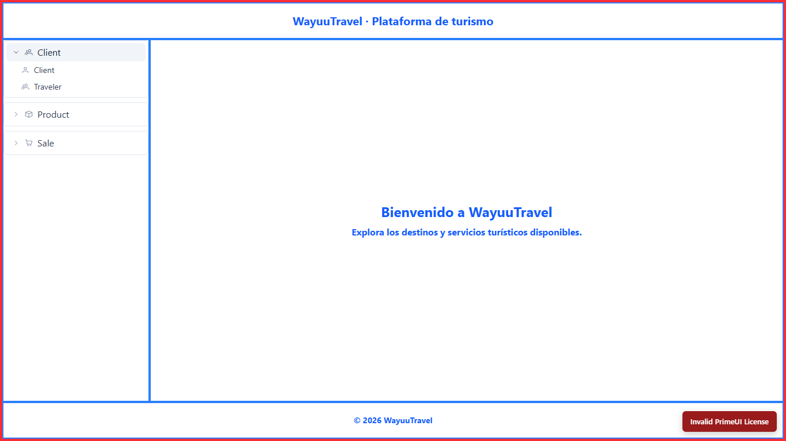

> La etiqueta roja *Invalid PrimeUI License* de la esquina inferior derecha la inserta PrimeNG 22 cuando no se configura una clave de licencia. Es un aviso de la librería y no afecta al funcionamiento.

### Explicación

- **Tailwind 4** ya no necesita `tailwind.config.js`: basta el plugin de PostCSS y `@import "tailwindcss"`.
- **Componentes standalone**: cada componente declara en `imports` lo que usa (`RouterOutlet`, `PanelMenu`, …). No hay `NgModule`.
- **`providePrimeNG`** inyecta el tema Aura como variables CSS. `darkModeSelector: false` fija el modo claro.
- El `<router-outlet />` del área central es el único punto donde cambian las pantallas. Header, aside y footer quedan fijos.

### Criterios de aceptación

- AC-26-01: `ng build` compila sin errores.
- AC-26-02: las clases de Tailwind se aplican (bordes, flex, colores).
- AC-26-03: el layout muestra las cuatro zonas: header, aside, contenido y footer.
- AC-26-04: el `PanelMenu` de PrimeNG muestra los grupos Client, Product y Sale con iconos `pi`.

### Verificación

**1. Versiones instaladas.** `ng version` confirma Angular CLI 22.2.4 y los paquetes del proyecto:

``` bash
ng version
```

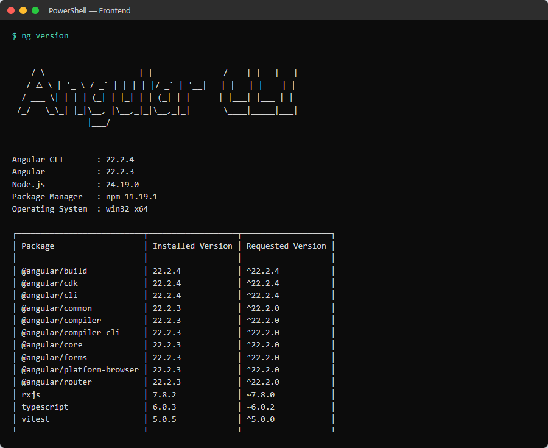

**2. Compilación.** `ng build` termina con *Application bundle generation complete* y sin errores. El `styles.css` de 31 kB incluye Tailwind y PrimeIcons:

``` bash
ng build --configuration development
```

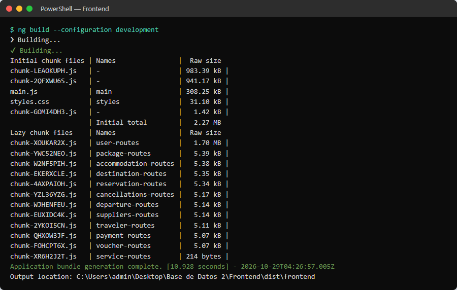

**3. Navegador.** Con `ng s` en `http://localhost:4200` se ven las cuatro zonas del layout (captura `01-layout-inicio.png`). Al pulsar **Client** en el menú se despliegan sus submódulos (captura `02-menu-panelmenu.png`).

### Evidencias

- **EVI-26-00**: captura `v26-ng-version.png`.

  

- **EVI-26-01**: captura `v26-ng-build.png`, salida de `ng build` sin errores.

  

- **EVI-26-02 / EVI-26-03**: captura `01-layout-inicio.png`.

  

- **EVI-26-04**: captura `02-menu-panelmenu.png`.

  

### GATE

| **AC**   | **Verificación**         | **Evidencia**        | **Resultado** |
|:---------|:-------------------------|:---------------------|:--------------|
| AC-26-01 | `ng version`, `ng build` | EVI-26-00, EVI-26-01 | PASS          |
| AC-26-02 | navegador                | EVI-26-02            | PASS          |
| AC-26-03 | navegador                | EVI-26-03            | PASS          |
| AC-26-04 | navegador, clic menú     | EVI-26-04            | PASS          |

------------------------------------------------------------------------

## ISS-01 — Componentes y rutas de Client, Product y Sale

### Narrativa

Angular es una SPA: el navegador carga una sola página y el router decide qué componente dibujar según la URL. En esta unidad se generan los cuatro componentes de cada CRUD (`getall`, `create`, `update`, `delete`) y se registran sus rutas, de modo que cada entrada del menú lateral lleve a su listado.

La guía coloca todas las rutas en `app.routes.ts` e importa cada componente con un alias (`Getall as ClientGetall`, `Getall as ProductGetall`, …) para evitar choques de nombres. En WayuuTravel hay nueve submódulos, así que cada uno tiene su propio archivo `*.routes.ts` y `app.routes.ts` los carga con `loadChildren`. El resultado es el mismo y no hacen falta alias, porque cada archivo importa solo sus cuatro componentes. Además, cada módulo se descarga solo cuando el usuario entra en él.

### Objetivo

Registrar, para cada módulo, las rutas `listado`, `new`, `edit/:id` y `delete/:id`, y enlazarlas desde el `PanelMenu`.

### Requisitos

- ISS-26 superado.

### Construcción

**Paso 1. Generar los componentes**

Client (`apps/client`):

``` bash
ng g c components/client/client/getall
ng g c components/client/client/create
ng g c components/client/client/update
ng g c components/client/client/delete

ng g c components/client/traveler/getall
ng g c components/client/traveler/create
ng g c components/client/traveler/update
ng g c components/client/traveler/delete
```

Product (`apps/product`):

``` bash
ng g c components/product/package/getall      # y create, update, delete
ng g c components/product/departure/getall    # y create, update, delete
ng g c components/product/suppliers/getall    # y create, update, delete
```

Sale (`apps/sale`):

``` bash
ng g c components/sale/booking/getall         # y create, update, delete
ng g c components/sale/payment/getall         # y create, update, delete
ng g c components/sale/cancellations/getall   # y create, update, delete
ng g c components/sale/voucher/getall         # y create, update, delete
```

**Paso 2. Rutas de cada módulo**

`Frontend/src/app/components/client/client/user.routes.ts`. Es el mismo mapa que da la guía para `clients`, `clients/new`, `clients/edit/:id` y `clients/delete/:id`, pero relativo al prefijo que pone `app.routes.ts`:

``` typescript
import { Routes } from '@angular/router';

import { Getall } from './getall/getall';
import { Create } from './create/create';
import { Update } from './update/update';
import { Delete } from './delete/delete';

export const USER_ROUTES: Routes = [
  { path: '', component: Getall },
  { path: 'new', component: Create },
  { path: 'edit/:id', component: Update },
  { path: 'delete/:id', component: Delete }
];
```

Los demás módulos repiten el patrón (`PACKAGE_ROUTES`, `DEPARTURE_ROUTES`, `SUPPLIERS_ROUTES`, `RESERVATION_ROUTES`, `PAYMENT_ROUTES`, `CANCELLATIONS_ROUTES`, `VOUCHER_ROUTES`, `TRAVELER_ROUTES`).

**Paso 3. Rutas principales** — `Frontend/src/app/app.routes.ts`

``` typescript
import { Routes } from '@angular/router';
import { Home } from './components/home/home';
import { Login } from './components/login/login';
import { Admin } from './components/admin/admin';

export const routes: Routes = [
  { path: '', redirectTo: 'inicio', pathMatch: 'full' },
  { path: 'inicio', component: Home },
  { path: 'admin', component: Admin },
  { path: 'login', component: Login },
  { path: 'clientes', loadChildren: () => import('./components/client/client/user.routes').then(m => m.USER_ROUTES) },
  { path: 'viajeros', loadChildren: () => import('./components/client/traveler/traveler.routes').then(m => m.TRAVELER_ROUTES) },
  { path: 'paquetes', loadChildren: () => import('./components/product/package/package.routes').then(m => m.PACKAGE_ROUTES) },
  { path: 'salidas', loadChildren: () => import('./components/product/departure/departure.routes').then(m => m.DEPARTURE_ROUTES) },
  { path: 'proveedores', loadChildren: () => import('./components/product/suppliers/suppliers.routes').then(m => m.SUPPLIERS_ROUTES) },
  { path: 'reservas', loadChildren: () => import('./components/sale/booking/reservation.routes').then(m => m.RESERVATION_ROUTES) },
  { path: 'pagos', loadChildren: () => import('./components/sale/payment/payment.routes').then(m => m.PAYMENT_ROUTES) },
  { path: 'cancelaciones', loadChildren: () => import('./components/sale/cancellations/cancellations.routes').then(m => m.CANCELLATIONS_ROUTES) },
  { path: 'vouchers', loadChildren: () => import('./components/sale/voucher/voucher.routes').then(m => m.VOUCHER_ROUTES) },
  { path: '**', redirectTo: 'inicio' }
];
```

(Se omiten aquí `destinos`, `alojamientos`, `usuarios` y `servicios`, que siguen el mismo patrón.)

**Paso 4. Enlazar el menú**

En `aside.ts`, cada entrada tiene su `routerLink` (ver ISS-26, paso 10). La entrada **Client → Client** apuntaba a `/login`. Se corrigió a `/clientes`, como indica la guía.

``` typescript
{ label: 'Client', icon: 'pi pi-fw pi-user', routerLink: '/clientes' },
```

### Resultado

`ng build` genera un *chunk* diferido por módulo, lo que confirma que cada `loadChildren` quedó registrado:

``` text
Lazy chunk files    | Names                |  Raw size
chunk-FZLLU22D.js   | user-routes          |   1.70 MB |
chunk-YWC52NEO.js   | package-routes       |   5.39 kB |
chunk-4AXPAIOH.js   | reservation-routes   |   5.34 kB |
chunk-YZL36YZG.js   | cancellations-routes |   5.17 kB |
chunk-WJHENFEU.js   | departure-routes     |   5.14 kB |
chunk-EUXIDC4K.js   | suppliers-routes     |   5.14 kB |
chunk-2YKOI5CN.js   | traveler-routes      |   5.11 kB |
chunk-QHXOW3JF.js   | payment-routes       |   5.07 kB |
chunk-FOHCPT6X.js   | voucher-routes       |   5.07 kB |
```

Al pulsar **Client → Client** en el menú, el router carga `/clientes` y dibuja el componente `Getall` en el área de contenido:

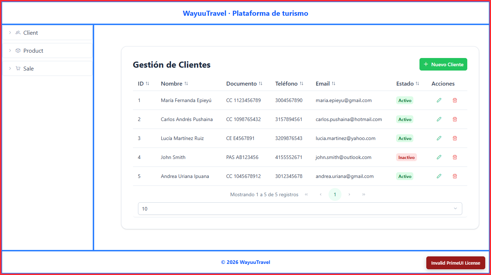

La ruta con parámetro `/clientes/delete/:id` dibuja el componente `Delete` con el `id` de la URL:

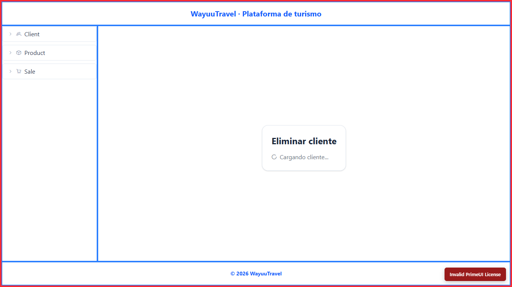

### Explicación

- `loadChildren` difiere la descarga del módulo hasta que se visita su ruta. Por eso `user-routes` aparece como *lazy chunk*.
- `:id` es un parámetro de ruta. El componente lo lee con `ActivatedRoute.snapshot.paramMap.get('id')`.
- `{ path: '**', redirectTo: 'inicio' }` va al final: cualquier URL desconocida vuelve al inicio.

### Criterios de aceptación

- AC-27-01: existen los cuatro componentes CRUD de cada submódulo.
- AC-27-02: cada submódulo tiene rutas `''`, `new`, `edit/:id` y `delete/:id`.
- AC-27-03: el menú lateral navega a `/clientes` y el área central muestra el listado.
- AC-27-04: una ruta con `:id` dibuja su componente.

### Verificación

**1. Componentes y archivos de rutas.** Cada submódulo de Client, Product y Sale tiene sus cuatro componentes y su `*.routes.ts`:

``` bash
cd Frontend/src/app
find components/{client,product,sale} -name "*.ts" ! -name "*.spec.ts" | sort
```

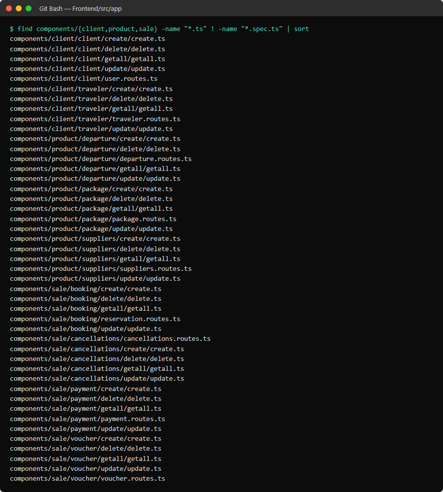

**2. Rutas registradas.** En la misma salida de `ng build` de la ISS-26, la tabla *Lazy chunk files* tiene un chunk por cada `loadChildren`: `user-routes`, `traveler-routes`, `package-routes`, `departure-routes`, `suppliers-routes`, `reservation-routes`, `payment-routes`, `cancellations-routes` y `voucher-routes`.


**3. Navegación.** Desde **Client → Client** se llega a `/clientes` (captura `05-clientes-lista.png`). Escribiendo `/clientes/delete/1` en la barra de direcciones se abre el componente `Delete` del cliente 1 (captura `14-ruta-delete.png`).

### Evidencias

- **EVI-27-01**: captura `v27-componentes.png`, árbol `components/{client,product,sale}/*/{getall,create,update,delete}`.

  

- **EVI-27-02**: captura `v26-ng-build.png`, *lazy chunks* de `ng build`.

  

- **EVI-27-03**: captura `05-clientes-lista.png`.

  

- **EVI-27-04**: captura `14-ruta-delete.png`.

  

### GATE

| **AC**   | **Verificación**  | **Evidencia** | **Resultado** |
|:---------|:------------------|:--------------|:--------------|
| AC-27-01 | árbol de archivos | EVI-27-01     | PASS          |
| AC-27-02 | `ng build`        | EVI-27-02     | PASS          |
| AC-27-03 | navegador         | EVI-27-03     | PASS          |
| AC-27-04 | navegador         | EVI-27-04     | PASS          |

------------------------------------------------------------------------

## ISS-02— CRUD del modelo Client contra Django

### Narrativa

Con las rutas listas, el módulo de clientes se conecta a la API `api/clients/` publicada en la ISS-08. Se define la interfaz TypeScript con los mismos campos que devuelve `ClientSerializer`, un servicio que encapsula las llamadas HTTP y cuatro componentes: listado con tabla paginada, alta, edición y baja.

Desde la ISS-22 la API exige autenticación JWT y permisos RBAC, así que el servicio adjunta en cada petición el token `access` que guarda el login (`/api/auth/login/`). Sin token, la API responde 401 y la tabla muestra un aviso.

### Objetivo

Listar, crear, editar y eliminar (baja lógica) clientes de WayuuTravel desde Angular, con validación en el formulario y notificaciones de éxito o error.

### Requisitos

- ISS-27 superado.
- Backend en marcha en `http://127.0.0.1:8000` con CORS habilitado (`CORS_ALLOW_ALL_ORIGINS`, ISS-01).
- Usuario con el rol `admin` y la matriz RBAC sembrada:

``` bash
python manage.py seed_rbac --username admin
```

### Construcción

**Paso 1. Modelo** — `Frontend/src/app/models/business/client.ts`

La guía define `address` y `password`, que el modelo `Client` de WayuuTravel no tiene. La interfaz copia los campos de `ClientSerializer` en camelCase, porque `djangorestframework-camel-case` (ISS-07) convierte `document_type` en `documentType`.

``` typescript
// Campos del ClientSerializer de Django. La API responde en camelCase
// (djangorestframework-camel-case), por eso document_type llega como documentType.
export type ClientStatus = "active" | "inactive";

export interface ClientI {
  id?: number;
  documentType: string;
  documentNumber: string;
  name: string;
  phone?: string | null;
  email?: string | null;
  status: ClientStatus;
}

export interface ClientResponseI {
  id?: number;
  documentType: string;
  documentNumber: string;
  name: string;
  phone: string | null;
  email: string | null;
  status: ClientStatus;
  createdAt?: string;
  updatedAt?: string;
}
```

**Paso 2. Servicio** — `Frontend/src/app/service/business/client.ts`

Sigue la estructura de la guía: un `BehaviorSubject` mantiene la lista en memoria y cada operación de escritura llama a `refreshClients()`. Hay dos adaptaciones: la URL base es la de WayuuTravel y se añade la cabecera `Authorization`. `normalizeClientsResponse` acepta tanto un arreglo como una respuesta paginada de DRF (`results`). WayuuTravel tiene `DEFAULT_PAGINATION_CLASS = None`, pero si se activa la paginación el servicio sigue funcionando.

``` typescript
@Injectable({ providedIn: 'root' })
export class Client {
  private baseUrl = 'http://127.0.0.1:8000/api/clients/';

  private clientsSubject = new BehaviorSubject<ClientResponseI[]>([]);
  public clients$ = this.clientsSubject.asObservable();

  constructor(private http: HttpClient) {}

  private getAuthHeaders(): HttpHeaders {
    const token =
      localStorage.getItem('access') ??
      localStorage.getItem('access_token') ??
      sessionStorage.getItem('access') ??
      sessionStorage.getItem('access_token');

    if (!token) {
      console.error('No se encontró el token de acceso. Verifica el inicio de sesión.');
      return new HttpHeaders();
    }
    return new HttpHeaders({ Authorization: `Bearer ${token}` });
  }

  private normalizeClientsResponse(
    response: PaginatedResponse<ClientResponseI> | ClientResponseI[]
  ): ClientResponseI[] {
    return Array.isArray(response) ? response : response.results ?? [];
  }

  getAllClients(): Observable<ClientResponseI[]> {
    return this.http
      .get<PaginatedResponse<ClientResponseI> | ClientResponseI[]>(this.baseUrl, { headers: this.getAuthHeaders() })
      .pipe(
        map(response => this.normalizeClientsResponse(response)),
        tap(clients => this.clientsSubject.next(clients)),
        catchError(error => throwError(() => error))
      );
  }

  getClientById(id: number): Observable<ClientResponseI> {
    return this.http.get<ClientResponseI>(`${this.baseUrl}${id}/`, { headers: this.getAuthHeaders() });
  }

  createClient(client: ClientI): Observable<ClientResponseI> {
    return this.http
      .post<ClientResponseI>(this.baseUrl, client, { headers: this.getAuthHeaders() })
      .pipe(tap(() => this.refreshClients()));
  }

  updateClient(id: number, client: Partial<ClientI>): Observable<ClientResponseI> {        // PUT
    return this.http
      .put<ClientResponseI>(`${this.baseUrl}${id}/`, client, { headers: this.getAuthHeaders() })
      .pipe(tap(() => this.refreshClients()));
  }

  partialUpdateClient(id: number, client: Partial<ClientI>): Observable<ClientResponseI> { // PATCH
    return this.http
      .patch<ClientResponseI>(`${this.baseUrl}${id}/`, client, { headers: this.getAuthHeaders() })
      .pipe(tap(() => this.refreshClients()));
  }

  deleteClient(id: number): Observable<void> {
    return this.http
      .delete<void>(`${this.baseUrl}${id}/`, { headers: this.getAuthHeaders() })
      .pipe(tap(() => this.refreshClients()));
  }

  updateLocalClients(clients: ClientResponseI[]): void {
    this.clientsSubject.next(clients);
  }

  refreshClients(): void {
    this.getAllClients().subscribe();
  }
}
```

(Se resumen los `catchError` y `console.log` del archivo real.)

**Paso 3. Listado** — `components/client/client/getall/getall.ts`

``` typescript
@Component({
  selector: 'app-client-getall',
  standalone: true,
  imports: [CommonModule, RouterModule, TableModule, ConfirmDialogModule, Button, Toast, Tooltip, Tag],
  providers: [ConfirmationService, MessageService],
  templateUrl: './getall.html',
  styleUrl: './getall.css'
})
export class Getall implements OnInit, OnDestroy {
  clients$: Observable<ClientResponseI[]>;
  loading = false;
  private subscription = new Subscription();

  constructor(
    private clientService: Client,
    private confirmationService: ConfirmationService,
    private messageService: MessageService
  ) {
    this.clients$ = this.clientService.clients$;
  }

  ngOnInit(): void { this.loadClients(); }
  ngOnDestroy(): void { this.subscription.unsubscribe(); }

  loadClients(): void {
    this.loading = true;
    this.subscription.add(
      this.clientService.getAllClients().subscribe({
        next: () => (this.loading = false),
        error: (error) => {
          this.messageService.add({
            severity: 'error',
            summary: 'Error',
            detail: error.status === 401
              ? 'Debes iniciar sesión para consultar los clientes.'
              : 'No se pudieron cargar los clientes.'
          });
          this.loading = false;
        }
      })
    );
  }

  confirmDelete(client: ClientResponseI): void {
    this.confirmationService.confirm({
      message: `¿Está seguro de que desea eliminar a ${client.name}?`,
      header: 'Confirmar eliminación',
      icon: 'pi pi-exclamation-triangle',
      acceptLabel: 'Sí, eliminar',
      rejectLabel: 'Cancelar',
      acceptButtonStyleClass: 'p-button-danger',
      accept: () => { if (client.id != null) this.deleteClient(client.id); }
    });
  }

  deleteClient(id: number): void {
    this.subscription.add(
      this.clientService.deleteClient(id).subscribe({
        next: () => {
          this.messageService.add({ severity: 'success', summary: 'Éxito', detail: 'Cliente eliminado correctamente' });
          this.loadClients();
        },
        error: () => this.messageService.add({ severity: 'error', summary: 'Error', detail: 'No se pudo eliminar el cliente.' })
      })
    );
  }
}
```

`getall.html`. **En PrimeNG 22 las plantillas de la tabla se declaran con referencias `#header`, `#body` y `#emptymessage`.** Con la sintaxis `pTemplate="header"` de la guía, la tabla mostraba *"Mostrando 1 a 5 de 5 registros"* pero no dibujaba ni la cabecera ni las filas.

``` html
<div class="card p-8 w-full self-start m-6 font-normal text-slate-800">
  <div class="flex justify-between items-center mb-4">
    <h2 class="text-2xl font-bold">Gestión de Clientes</h2>
    <p-button label="Nuevo Cliente" icon="pi pi-plus"
              [routerLink]="['/clientes/new']" styleClass="p-button-success"></p-button>
  </div>

  <p-table [value]="(clients$ | async) ?? []" [loading]="loading"
           [paginator]="true" [rows]="10" [showCurrentPageReport]="true"
           currentPageReportTemplate="Mostrando {first} a {last} de {totalRecords} registros"
           [rowsPerPageOptions]="[5, 10, 25, 50]" dataKey="id"
           styleClass="p-datatable-striped" [tableStyle]="{'min-width': '50rem'}">

    <ng-template #header>
      <tr>
        <th pSortableColumn="id">ID <p-sorticon field="id"></p-sorticon></th>
        <th pSortableColumn="name">Nombre <p-sorticon field="name"></p-sorticon></th>
        <th pSortableColumn="documentNumber">Documento <p-sorticon field="documentNumber"></p-sorticon></th>
        <th pSortableColumn="phone">Teléfono <p-sorticon field="phone"></p-sorticon></th>
        <th pSortableColumn="email">Email <p-sorticon field="email"></p-sorticon></th>
        <th pSortableColumn="status">Estado <p-sorticon field="status"></p-sorticon></th>
        <th class="text-center">Acciones</th>
      </tr>
    </ng-template>

    <ng-template #body let-client>
      <tr>
        <td>{{ client.id }}</td>
        <td>{{ client.name }}</td>
        <td>{{ client.documentType }} {{ client.documentNumber }}</td>
        <td>{{ client.phone || '—' }}</td>
        <td>{{ client.email || '—' }}</td>
        <td>
          <p-tag [value]="client.status === 'active' ? 'Activo' : 'Inactivo'"
                 [severity]="client.status === 'active' ? 'success' : 'danger'"></p-tag>
        </td>
        <td class="text-center">
          <div class="flex justify-center gap-2">
            <p-button icon="pi pi-pencil" [routerLink]="['/clientes/edit', client.id]"
                      styleClass="p-button-rounded p-button-text p-button-warning"
                      pTooltip="Editar" tooltipPosition="top"></p-button>
            <p-button icon="pi pi-trash" (onClick)="confirmDelete(client)"
                      styleClass="p-button-rounded p-button-text p-button-danger"
                      pTooltip="Eliminar" tooltipPosition="top"></p-button>
          </div>
        </td>
      </tr>
    </ng-template>

    <ng-template #emptymessage>
      <tr>
        <td colspan="7" class="text-center p-4">No se encontraron clientes</td>
      </tr>
    </ng-template>
  </p-table>
</div>

<p-confirmdialog></p-confirmdialog>
<p-toast></p-toast>
```

**Paso 4. Alta** — `components/client/client/create/create.ts`

Formulario reactivo con las mismas reglas que el serializer: `documentNumber` de 3 a 30 caracteres, `name` de 2 a 150, `email` con formato válido y teléfono de 10 a 15 dígitos (la regla de la guía). `phone` y `email` vacíos se envían como `null`, que es lo que acepta `ClientSerializer`.

``` typescript
export const DOCUMENT_TYPES = [
  { label: 'Cédula de ciudadanía', value: 'CC' },
  { label: 'Cédula de extranjería', value: 'CE' },
  { label: 'Pasaporte', value: 'PAS' },
  { label: 'Tarjeta de identidad', value: 'TI' }
];

export const CLIENT_STATUSES = [
  { label: 'Activo', value: 'active' },
  { label: 'Inactivo', value: 'inactive' }
];

@Component({
  selector: 'app-client-create',
  standalone: true,
  imports: [CommonModule, ReactiveFormsModule, RouterModule, Button, InputText, Select, Toast],
  providers: [MessageService],
  styleUrl: './create.css',
  templateUrl: './create.html',
})
export class Create {
  private fb = inject(FormBuilder);
  private router = inject(Router);
  private clientService = inject(Client);
  private messageService = inject(MessageService);

  documentTypes = DOCUMENT_TYPES;
  statuses = CLIENT_STATUSES;
  loading = false;

  form = this.fb.nonNullable.group({
    documentType: ['CC', Validators.required],
    documentNumber: ['', [Validators.required, Validators.minLength(3), Validators.maxLength(30)]],
    name: ['', [Validators.required, Validators.minLength(2), Validators.maxLength(150)]],
    phone: ['', Validators.pattern(/^\d{10,15}$/)],
    email: ['', Validators.email],
    status: ['active' as ClientI['status'], Validators.required]
  });

  isInvalid(field: string): boolean {
    const control = this.form.get(field);
    return !!control && control.invalid && (control.touched || control.dirty);
  }

  onSubmit(): void {
    if (this.form.invalid) {
      this.form.markAllAsTouched();
      this.messageService.add({ severity: 'warn', summary: 'Formulario incompleto', detail: 'Revisa los campos marcados en rojo.' });
      return;
    }

    this.loading = true;
    const raw = this.form.getRawValue();
    const client: ClientI = { ...raw, phone: raw.phone || null, email: raw.email || null };

    this.clientService.createClient(client).subscribe({
      next: () => {
        this.messageService.add({ severity: 'success', summary: 'Éxito', detail: 'Cliente creado correctamente' });
        setTimeout(() => this.router.navigate(['/clientes']), 1000);
      },
      error: (error) => {
        this.loading = false;
        this.messageService.add({
          severity: 'error',
          summary: 'Error',
          detail: error.status === 400
            ? 'Datos inválidos o documento/correo ya registrado.'
            : 'No se pudo crear el cliente.'
        });
      }
    });
  }

  cancel(): void {
    this.router.navigate(['/clientes']);
  }
}
```

`create.html` (fragmento; los demás campos siguen el mismo patrón):

``` html
<form [formGroup]="form" (ngSubmit)="onSubmit()" class="flex flex-col gap-4">
  <div class="grid grid-cols-1 sm:grid-cols-2 gap-4">
    <div class="flex flex-col">
      <label for="documentType" class="field-label">Tipo de documento *</label>
      <p-select inputId="documentType" formControlName="documentType"
                [options]="documentTypes" optionLabel="label" optionValue="value"></p-select>
    </div>

    <div class="flex flex-col">
      <label for="documentNumber" class="field-label">Número de documento *</label>
      <input pInputText id="documentNumber" formControlName="documentNumber" placeholder="Número de documento" />
      @if (isInvalid('documentNumber')) {
        <small class="field-error">Mínimo 3 y máximo 30 caracteres.</small>
      }
    </div>
  </div>
  <!-- name, phone, email, status ... -->
  <div class="flex justify-end gap-3 mt-4">
    <p-button label="Cancelar" icon="pi pi-times" severity="secondary" [outlined]="true" (onClick)="cancel()" />
    <p-button type="submit" label="Guardar cliente" icon="pi pi-check" [loading]="loading" />
  </div>
</form>
<p-toast></p-toast>
```

**Paso 5. Edición** — `components/client/client/update/update.ts`

Lee el `id` de la ruta, carga el cliente con `getClientById` y rellena el formulario con `patchValue`. Al guardar usa `PATCH` (`partialUpdateClient`). La guía quita del cuerpo la contraseña vacía antes del PATCH; WayuuTravel no tiene contraseña en `Client`, así que ese paso no aplica. Reutiliza `DOCUMENT_TYPES` y `CLIENT_STATUSES` de `create.ts`, y su plantilla es la de alta con el título *Editar cliente*.

``` typescript
export class Update implements OnInit {
  // ... mismos inject() y form que Create
  clientId: number | null = null;
  loadingData = true;

  ngOnInit(): void {
    const id = Number(this.route.snapshot.paramMap.get('id'));
    if (!id) {
      this.router.navigate(['/clientes']);
      return;
    }
    this.clientId = id;
    this.loadClient(id);
  }

  loadClient(id: number): void {
    this.clientService.getClientById(id).subscribe({
      next: (client) => {
        this.form.patchValue({
          documentType: client.documentType,
          documentNumber: client.documentNumber,
          name: client.name,
          phone: client.phone ?? '',
          email: client.email ?? '',
          status: client.status
        });
        this.loadingData = false;
      },
      error: () => {
        this.messageService.add({ severity: 'error', summary: 'Error', detail: 'No se pudo cargar el cliente.' });
        setTimeout(() => this.router.navigate(['/clientes']), 1500);
      }
    });
  }

  onSubmit(): void {
    if (this.form.invalid || this.clientId == null) {
      this.form.markAllAsTouched();
      return;
    }
    this.loading = true;
    const raw = this.form.getRawValue();
    const client: Partial<ClientI> = { ...raw, phone: raw.phone || null, email: raw.email || null };

    this.clientService.partialUpdateClient(this.clientId, client).subscribe({
      next: () => {
        this.messageService.add({ severity: 'success', summary: 'Éxito', detail: 'Cliente actualizado correctamente' });
        setTimeout(() => this.router.navigate(['/clientes']), 1000);
      },
      error: () => {
        this.loading = false;
        this.messageService.add({ severity: 'error', summary: 'Error', detail: 'No se pudo actualizar el cliente.' });
      }
    });
  }
}
```

**Paso 6. Baja** — `components/client/client/delete/delete.ts`

La baja se hace normalmente desde el `ConfirmDialog` del listado. La ruta `clientes/delete/:id` existe desde la ISS-27, así que también tiene su propia pantalla de confirmación. En ambos casos el `DELETE` llega a `perform_destroy` de la ISS-08, que **no borra la fila**: la deja con `status = inactive`.

``` typescript
export class Delete implements OnInit {
  client: ClientResponseI | null = null;
  loading = false;

  ngOnInit(): void {
    const id = Number(this.route.snapshot.paramMap.get('id'));
    this.clientService.getClientById(id).subscribe({
      next: (client) => (this.client = client),
      error: () => this.router.navigate(['/clientes'])
    });
  }

  confirm(): void {
    if (this.client?.id == null) return;
    this.loading = true;
    // El backend hace borrado lógico: el cliente queda con status inactive.
    this.clientService.deleteClient(this.client.id).subscribe({
      next: () => {
        this.messageService.add({ severity: 'success', summary: 'Éxito', detail: 'Cliente eliminado correctamente' });
        setTimeout(() => this.router.navigate(['/clientes']), 1000);
      },
      error: () => {
        this.loading = false;
        this.messageService.add({ severity: 'error', summary: 'Error', detail: 'No se pudo eliminar el cliente.' });
      }
    });
  }
}
```

**Paso 7. Ejecutar**

Backend:

``` bash
cd Backend
source .venv/bin/activate
python manage.py runserver
```

Frontend:

``` bash
cd Frontend
ng serve
```

Si los iconos de acción no aparecen, la guía indica instalar `primeicons` e importarlo en `styles.css` (ya hecho en la ISS-26, paso 4).

### Resultado

**1. Sin sesión.** La API responde **401** y el listado muestra el aviso. Esto confirma que el RBAC de la ISS-22 protege la ruta también desde el frontend.

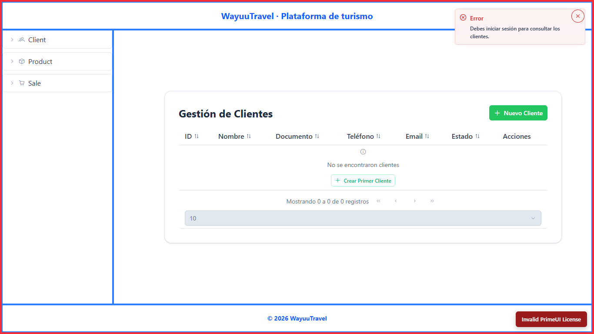

**2. Inicio de sesión.** `/login` llama a `POST /api/auth/login/` y guarda `access` y `refresh` en `localStorage`.

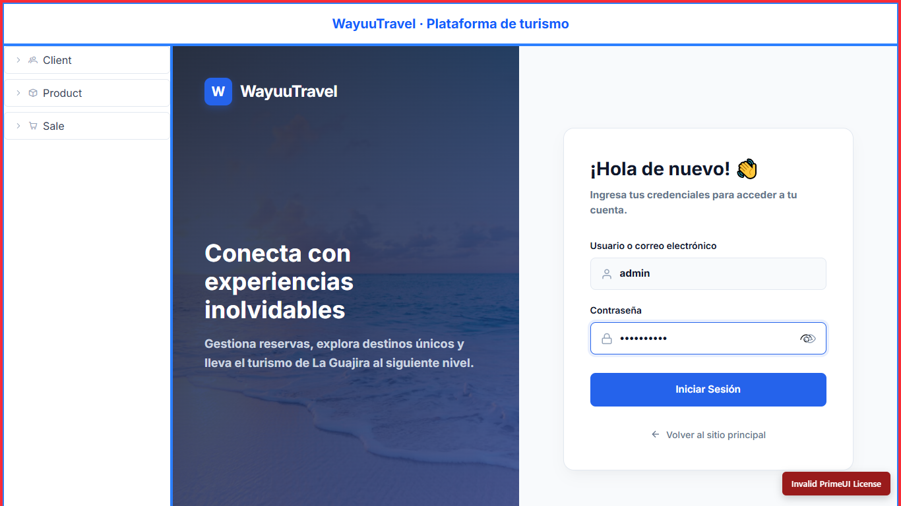

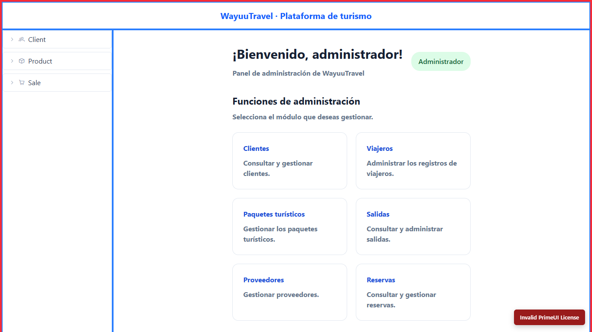

**3. Listado (GET `/api/clients/`).** La tabla muestra los clientes de la base de datos, con orden por columna, paginación y estado.


**4. Alta: validaciones.** Al enviar datos incorrectos, cada campo explica su error y un *toast* avisa de que el formulario está incompleto. No se hace ninguna petición.

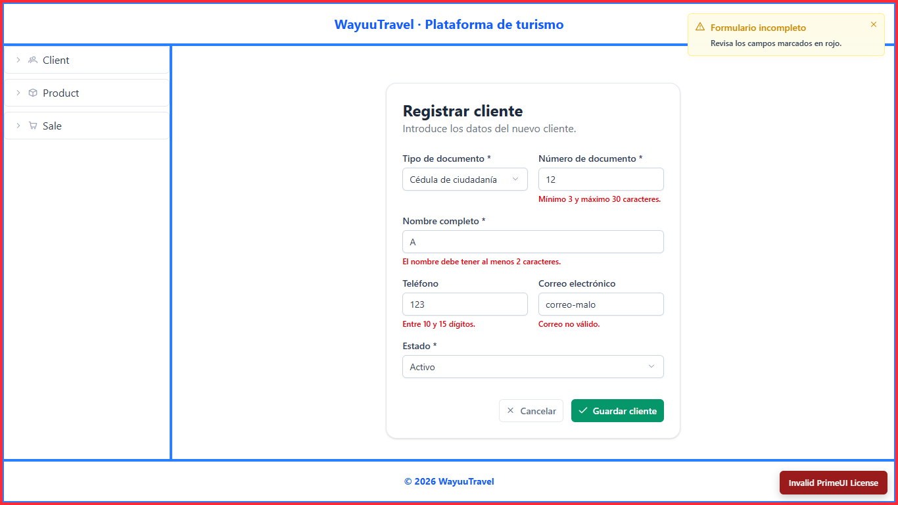

**5. Alta: datos correctos (POST `/api/clients/`).**

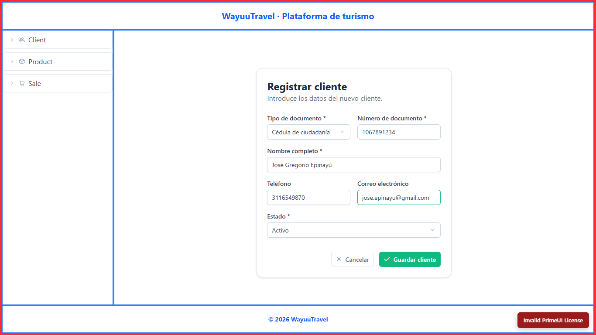


El nuevo cliente aparece con `id` 6 al volver al listado:

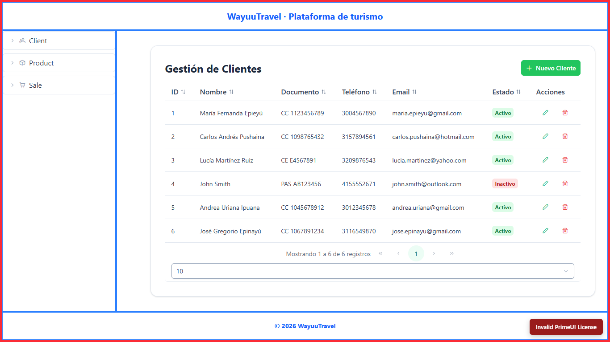

**6. Edición (GET `/api/clients/6/` + PATCH `/api/clients/6/`).** El formulario llega relleno con los datos del servidor. Se cambia el teléfono a `3001112233`.

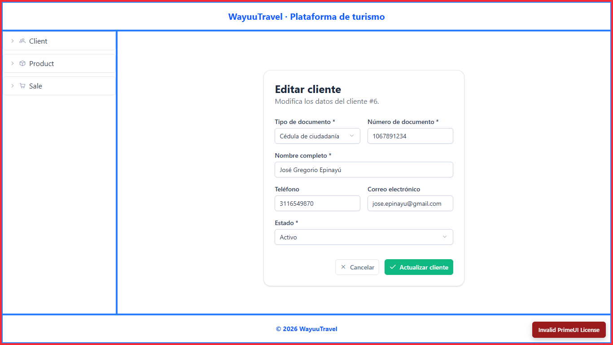

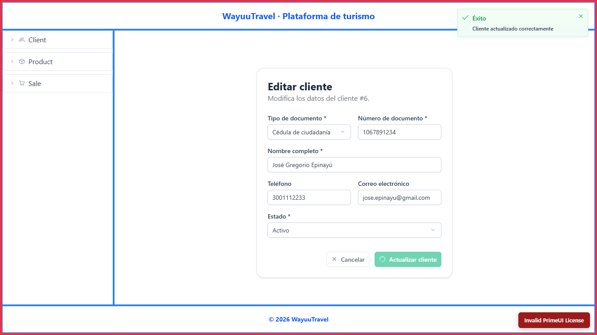

**7. Baja (DELETE `/api/clients/3/`).** El `ConfirmDialog` pide confirmación:

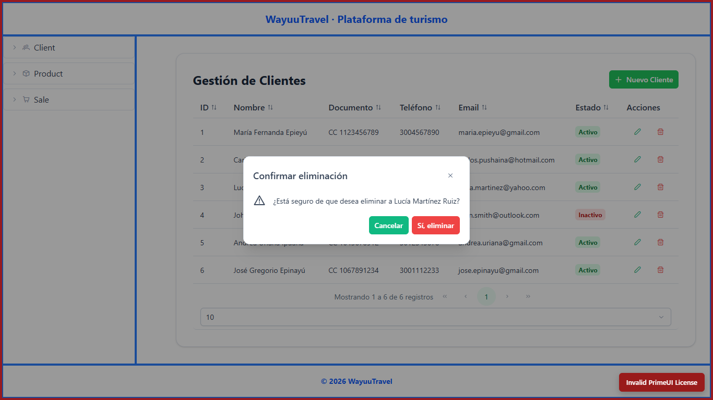

Tras confirmar, *Lucía Martínez Ruiz* sigue en la lista pero con estado **Inactivo** (baja lógica). El teléfono de *José Gregorio Epinayú* muestra el valor editado en el paso anterior.

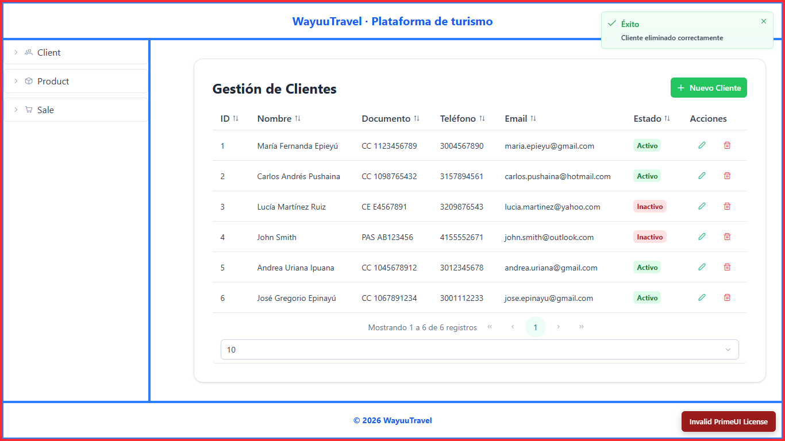

### Explicación

- **`BehaviorSubject` + `async`**: la tabla se suscribe a `clients$`. Cuando el servicio refresca la lista después de un POST, PATCH o DELETE, la tabla se actualiza sin que el componente vuelva a pedir datos.
- **camelCase de extremo a extremo**: el frontend nunca ve `document_number`. El parser y el renderer de `djangorestframework-camel-case` hacen la conversión en el servidor.
- **PATCH frente a PUT**: la edición envía solo los campos del formulario, sin `createdAt` ni `updatedAt` (son `read_only`). `updateClient` (PUT) queda disponible en el servicio.
- **Errores 400**: si el documento o el correo ya existen, los `unique=True` del modelo devuelven 400 y el formulario lo muestra en un *toast*.
- **Baja lógica**: el frontend llama a `DELETE`, pero el registro se conserva con estado `inactive`. Así se mantiene el historial de reservas que dependen del cliente.

### Criterios de aceptación

- AC-28-01: sin token, el listado recibe 401 y lo comunica al usuario.
- AC-28-02: con sesión, el listado muestra los clientes de `api/clients/`.
- AC-28-03: el formulario de alta bloquea datos inválidos antes de llamar a la API.
- AC-28-04: un alta válida devuelve 201 y el cliente aparece en el listado.
- AC-28-05: la edición carga el cliente por `id` y guarda los cambios con PATCH.
- AC-28-06: la baja pide confirmación y deja el cliente con estado `inactive`.

### Verificación

Se hizo el recorrido completo del apartado *Resultado* con `ng serve` en `:4200` y `runserver` en `:8000`, y se comprobó desde tres lugares.

**1. Log del servidor Django.** La terminal de `runserver` registra cada petición del recorrido, en orden:

- el 401 sin sesión;
- el login y la consulta del perfil;
- el listado;
- el `POST` (201);
- el `GET` y el `PATCH` del cliente 6;
- el `DELETE` del cliente 3 (204).

Las peticiones `OPTIONS` son las *preflight* de CORS que hace el navegador antes de las peticiones con cabecera `Authorization`.

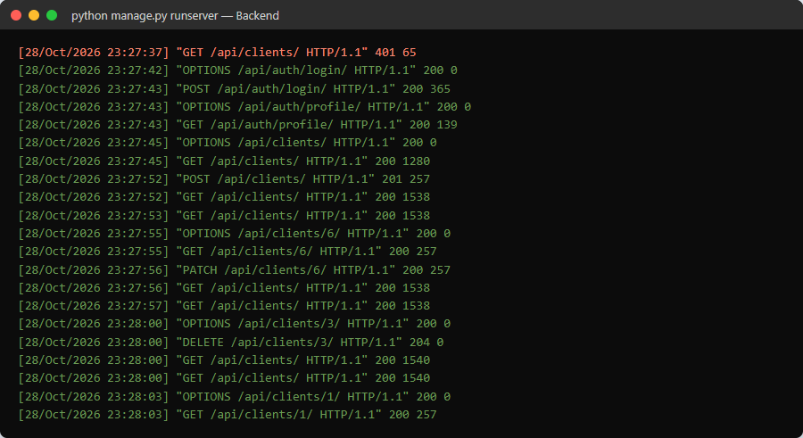

**2. API sin token.** Al abrir `http://127.0.0.1:8000/api/clients/` en la API navegable de DRF sin cabecera `Authorization`, la respuesta es `401 Unauthorized` con `WWW-Authenticate: Bearer`. Es la misma respuesta que recibe el frontend antes de iniciar sesión.

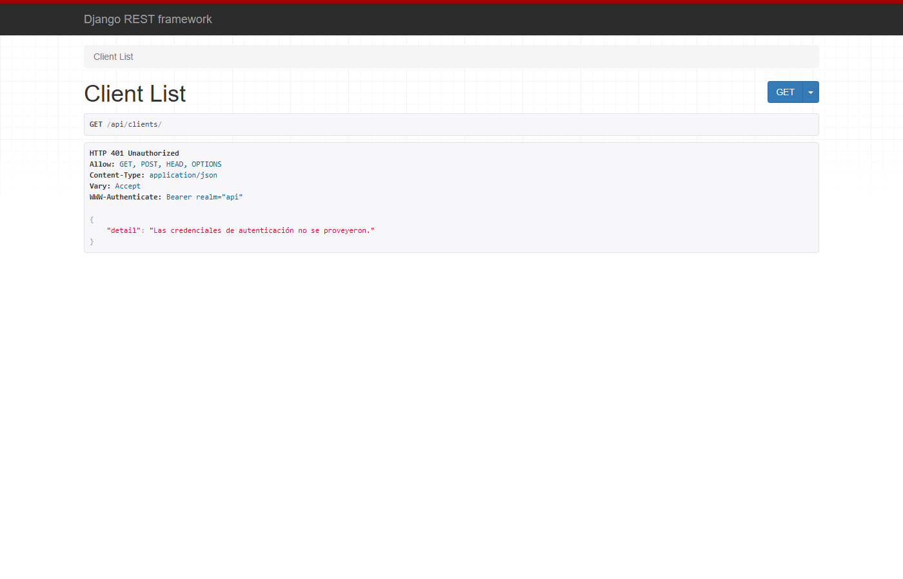

**3. Estado final en la base de datos.** Con el token de `admin`, `GET /api/clients/3/` devuelve a Lucía con `"status": "inactive"`: el `DELETE` del frontend fue una baja lógica y no borró la fila.

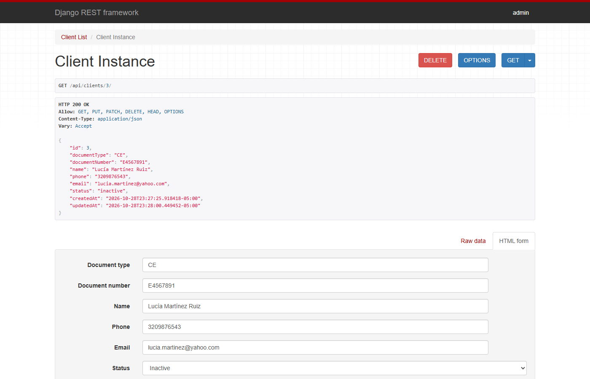

Consulta de los dos registros modificados desde la terminal:

``` bash
TOKEN=$(curl -s -X POST http://127.0.0.1:8000/api/auth/login/ \
  -H "Content-Type: application/json" \
  -d '{"username":"admin","password":"<contraseña>"}' | jq -r .access)

curl -s http://127.0.0.1:8000/api/clients/3/ -H "Authorization: Bearer $TOKEN"
curl -s http://127.0.0.1:8000/api/clients/6/ -H "Authorization: Bearer $TOKEN"
```

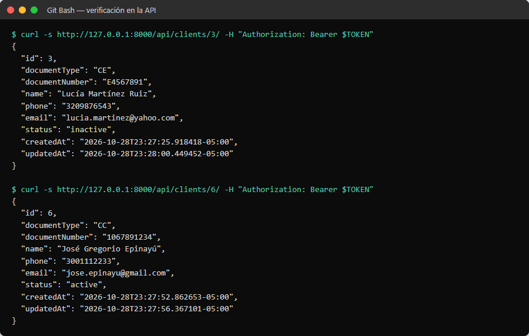

- Cliente 3: `status` = `inactive`, por la baja.
- Cliente 6 (creado desde el formulario): `phone` = `3001112233`, por la edición. Su `updatedAt` es posterior a `createdAt`.

### Evidencias

- **EVI-28-01**: captura `03-clientes-sin-sesion.png`.

  

- **EVI-28-02**: capturas `04-login.png` y `05-clientes-lista.png`.

  

  

- **EVI-28-03**: captura `06-crear-validaciones.png`.

  

- **EVI-28-04**: capturas `08-crear-exito.png` y `09-clientes-con-nuevo.png`.

  

  

- **EVI-28-05**: capturas `10-editar-cargado.png` y `11-editar-exito.png`.

  

  

- **EVI-28-06**: capturas `12-eliminar-confirmacion.png` y `13-eliminar-exito.png`.

  

  

- **EVI-28-07**: captura `v28-log-django.png`, log del servidor con 401, 201, 200 (PATCH) y 204.

  

- **EVI-28-08**: capturas `v28-api-sin-token.png`, `v28-api-con-token.png` y `v28-api-estado.png`.

  

  

  

### GATE

| **AC** | **Verificación** | **Evidencia** | **Resultado** |
|:---------------|:------------------------|:---------------|:---------------|
| AC-28-01 | navegador sin sesión + API sin token | EVI-28-01, EVI-28-08 | PASS |
| AC-28-02 | GET `/api/clients/` + log | EVI-28-02, EVI-28-07 | PASS |
| AC-28-03 | formulario inválido | EVI-28-03 | PASS |
| AC-28-04 | POST `/api/clients/` → 201 | EVI-28-04, EVI-28-07 | PASS |
| AC-28-05 | PATCH `/api/clients/6/` → 200 | EVI-28-05, EVI-28-08 | PASS |
| AC-28-06 | DELETE `/api/clients/3/` → 204 | EVI-28-06, EVI-28-08 | PASS |
