# **WayuuTravel— Informe de ISS (Django + DRF)**

**Estudiante:** Jaime Rafael Gonzalez Ballesta\
**Programa:** Ingeniería de Sistemas — Universidad de La Guajira\
**Proyecto:** Wayuutravel — Sistema de gestión de gimnasio

## Introducción

WayuuTravel es un sistema de gestión para experiencias turísticas responsables. Su objetivo es centralizar en una sola plataforma la administración de clientes, paquetes turísticos, proveedores, servicios incluidos, salidas programadas, reservas, viajeros, pagos, vouchers y cancelaciones, facilitando la organización y el seguimiento de las operaciones turísticas.

Este informe documenta, unidad por unidad (ISS), cómo se fue construyendo el backend de WayuuTravel con Django y Django REST Framework: qué se desarrolló en cada etapa, por qué se tomaron determinadas decisiones técnicas y qué evidencias demuestran que cada funcionalidad quedó implementada y operativa. Cada unidad finaliza con un GATE, una tabla de criterios de verificación que permite comprobar el cumplimiento de los objetivos establecidos antes de avanzar a la siguiente etapa del desarrollo.

## **Modelo de datos de WayuuTravel**

Tablas: `bookings`, `cancellations`, `clients`, `departures`, `included_services`, `packages`, `payments`, `suppliers`, `travelers`, `vouchers`.

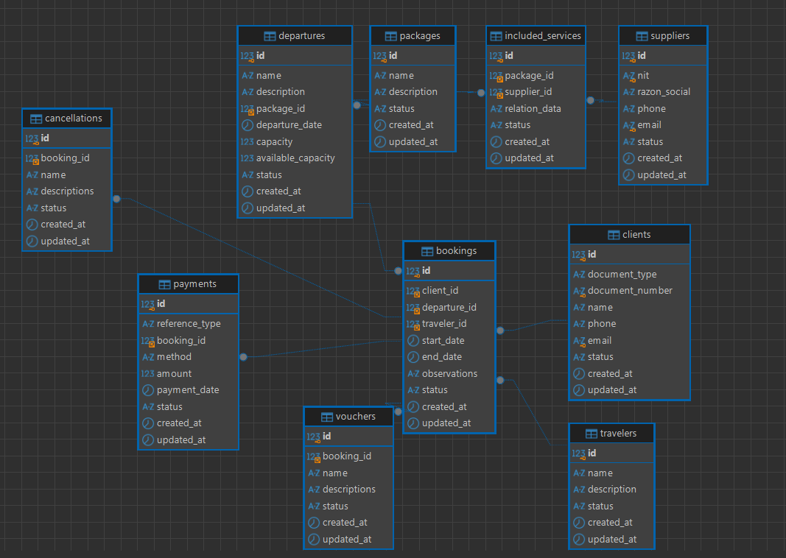

### **ISS-00 — Configuración del entorno y creación del proyecto Django**

### **Narrativa**

El desarrollo comienza con la preparación del entorno de trabajo y la estructura base de Django. Antes de implementar las funcionalidades del sistema, se configuró un entorno virtual independiente para mantener organizadas las dependencias del proyecto y evitar conflictos con otras instalaciones de Python. Posteriormente, se creó la estructura inicial de Django, que servirá como base para desarrollar la lógica del backend y gestionar las operaciones relacionadas con los servicios turísticos. En esta etapa aún no se implementan modelos de datos ni endpoints; el propósito es establecer una base organizada y funcional para las siguientes unidades.

### **Objetivo**

Configurar un entorno virtual e inicializar el proyecto Django `config` para Wayuu Travel, dejando preparada la estructura básica del backend, sin implementar todavía modelos ni endpoints.

### **Requisitos**

- Python 3.12 instalado.

- Un directorio de proyecto vacío.

- Conexión a Internet para instalar Django 5.2.17.

- Terminal para ejecutar los comandos de configuración.

### **Construcción**

Inicialmente, se creó y activó un entorno virtual para aislar las dependencias de WayuuTravel. A continuación, se instaló Django en la versión 5.2.17, fijando así una versión específica del framework para mantener la consistencia del entorno de desarrollo. Después, se ejecutó el comando `startproject config .`, utilizando el punto final para ubicar `manage.py` directamente en la raíz del proyecto y conservar los archivos de configuración dentro del directorio `config/`, evitando la creación de carpetas anidadas innecesarias. Finalmente, se registraron las dependencias instaladas en el archivo `requirements.txt`, facilitando la reproducción del entorno en otros equipos.

``` sql
python3 -m venv .venv
source .venv/bin/activate
python -m pip install "Django==5.2.17"
django-admin startproject config .
python -m pip freeze > requirements.txt
python -m django --version
```

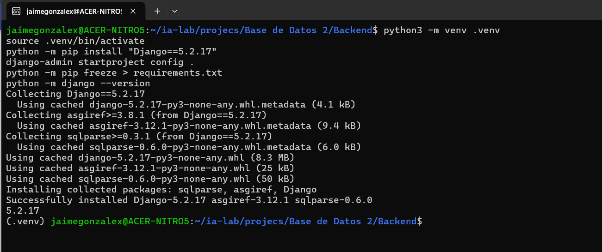

Creación del `.gitignore`:

Django no crea un `.gitignore`, así que se añadió a mano. Su función es evitar que el entorno virtual, los secretos del `.env`, las bases de datos locales y los archivos temporales lleguen al repositorio.

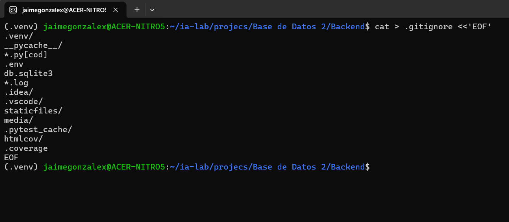

### Explicación

- **Django 5.2.17:** framework principal de esta unidad. Proporciona las herramientas necesarias para iniciar el proyecto, gestionar la configuración y preparar el desarrollo del backend.

- **`.venv`:** entorno virtual que mantiene las dependencias de Wayuu Travel separadas de las del sistema. Cuando está activo, el terminal muestra `(.venv)`.

- **`django-admin startproject config .`:** genera la estructura inicial del proyecto, dejando `manage.py` en la raíz y los archivos de configuración dentro de `config/`.

- **`.gitignore`:** archivo que evita incluir en el repositorio elementos locales o sensibles, como `.venv/` y `.env`.

- **`python -m pip`:** permite administrar los paquetes de Python mediante el intérprete del entorno activo, facilitando el control de las dependencias instaladas.

### Criterios de aceptación

- **AC-00-01:** el comando `python -m django --version` muestra la versión `5.2.17`.

- **AC-00-02:** existen los archivos `manage.py` y `config/urls.py`.

- **AC-00-03:** el proyecto todavía no contiene modelos de negocio ni endpoints propios de Wayuu Travel.

### Verificación

Para cerrar la unidad se comprobó la versión instalada y se ejecutó el chequeo del proyecto, que confirma que la estructura es válida aunque todavía no tenga lógica de negocio.

``` sql
python -m django --version
python manage.py check
```

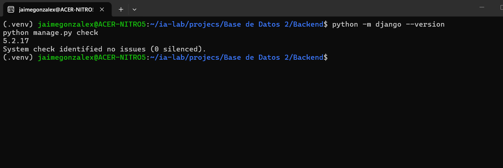

### **GATE**

| **AC**   | **Verificación**               | **Evidencia** | **Resultado** |
|----------|--------------------------------|---------------|---------------|
| AC-00-01 | versión de Django              | EVI-00-01     | PASS          |
| AC-00-02 | archivos del proyecto          | EVI-00-02     | PASS          |
| AC-00-03 | ausencia de modelos de negocio | EVI-00-02     | PASS          |

## **ISS-01 — Settings y selección del motor**

### Narrativa

Una vez preparada la estructura inicial , el siguiente paso consiste en definir cómo se conectará el backend con la base de datos. Para facilitar la configuración y evitar que los parámetros de conexión queden escritos directamente en el código, se decidió utilizar un archivo `.env` que permita seleccionar el motor de base de datos mediante variables de entorno. De esta manera, se puede configurar PostgreSQL, MySQL, SQL Server u Oracle sin modificar la lógica de Python. En esta unidad se establece una configuración flexible y organizada, con la regla de utilizar un solo motor de base de datos por ejecución del proyecto.

### Objetivo

Configurar la selección de un único motor de base de datos para WayuuTravel mediante variables de entorno definidas en `.env`, sin implementar todavía consultas SQL ni lógica de negocio.

### Requisitos

- Haber completado el ISS-00 y tener activo el entorno virtual `(.venv)`.

- Contar con las variables de configuración necesarias para PostgreSQL, MySQL, SQL Server y Oracle.

- Disponer de un archivo `.env` para almacenar los parámetros de configuración fuera del código fuente.

- Mantener las credenciales y los datos sensibles fuera del repositorio.

### Construcción

**1. Confirmar el entorno**

Antes de instalar nuevas dependencias, se verificó que el intérprete de Python correspondiera al entorno virtual de Wayuu Travel. Este paso permite garantizar que los paquetes necesarios para la configuración de la base de datos se instalen dentro del proyecto y estén disponibles para Django.

``` sql
source .venv/bin/activate
which python
```

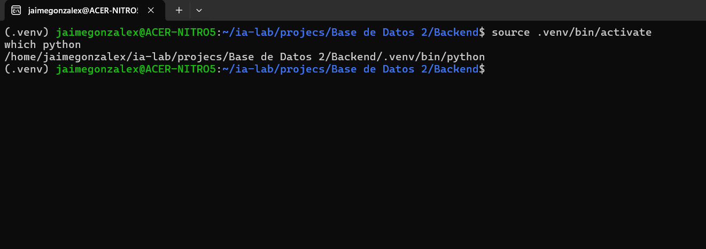

**2. Instalar `python-dotenv` y los drivers de cada motor**

Se instaló `python-dotenv`, que permite leer el `.env`, y un drivers por cada motor soportado. Django no trae esos drivers; sin ellos, `migrate` falla al importar el backend, aunque la configuración esté bien escrita.

``` sql
python -m pip install "python-dotenv==1.2.3"
python -m pip install "psycopg[binary]==3.3.6"
python -m pip install "mysqlclient==2.3.0"
python -m pip install "mssql-django==2.0.0"
python -m pip install "oracledb==26.0.1"
python -m pip freeze > requirements.txt
```

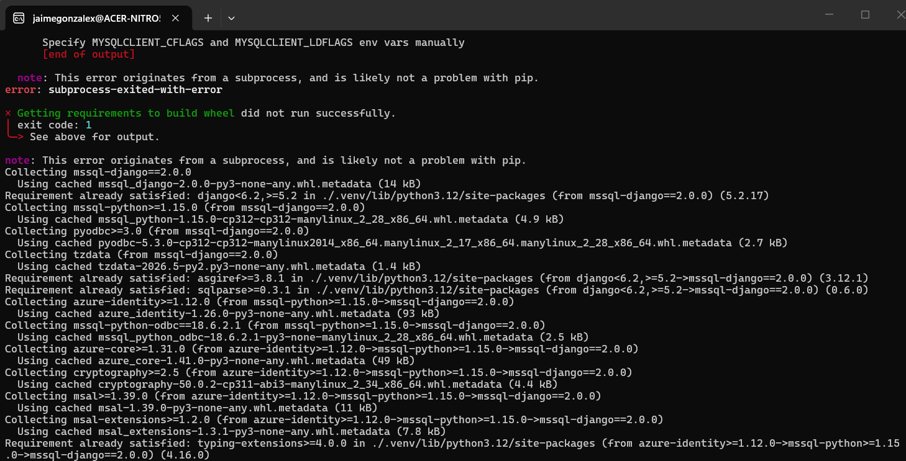](images/clipboard-728795391.png)

**Incidencia durante la instalación de `mysqlclient`**

Al ejecutar `python -m pip install "mysqlclient==2.3.0"`, la instalación falló. Este paquete no es solo Python: necesita compilar una extensión en C y, para eso, requiere las librerías de desarrollo de MySQL y algunas herramientas de compilación en el sistema, que no estaban instaladas. El error indicaba que no se encontraba `pkg-config` o `mysql_config`.

Para solucionarlo se instalaron las dependencias del sistema con el siguiente comando:

``` sql
sudo apt update 
sudo apt install build-essential pkg-config default-libmysqlclient-dev python3.12-dev  
```

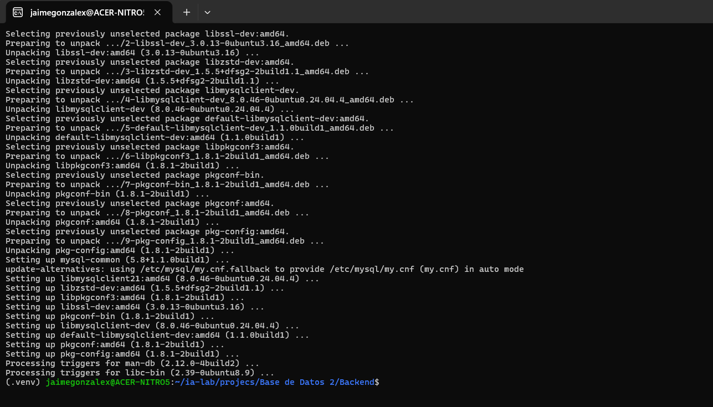

Luego se repitió la instalación del paquete, esta vez con éxito:

``` sql
python -m pip install "mysqlclient==2.3.0"   
```

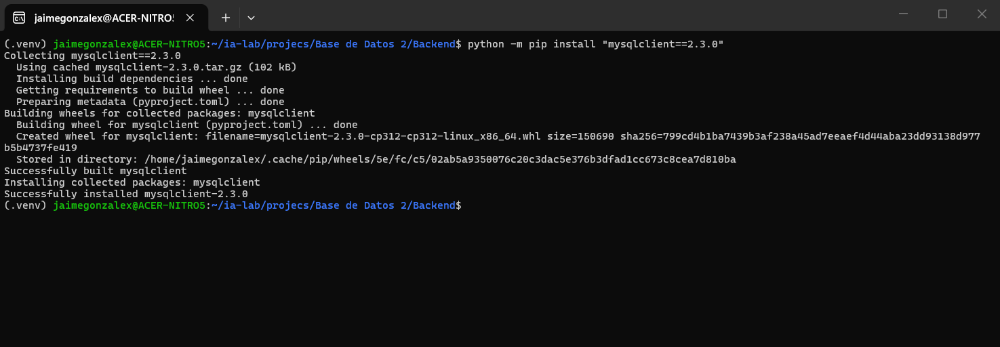

**3. Convertir `settings.py` en paquete**

`startproject` genera `settings.py` como archivo, pero se necesita un paquete con ese mismo nombre. Como un archivo y un paquete no pueden llamarse igual, se eliminó el archivo y se creó la carpeta.

``` sql
rm config/settings.py
mkdir -p config/settings
```

**4. Crear `.env.example` y copiarlo a `.env`**

Se creó `.env.example` como plantilla pública: solo contiene los nombres de las variables, sin secretos. Luego se copió a `.env`, que es donde van los valores reales y que nunca se versiona.

``` sql
cat > .env.example <<'EOF'
# Copie este archivo a .env y complete los valores.
# .env no se versiona.
 
DJANGO_SECRET_KEY=
DJANGO_DEBUG=True
DJANGO_ALLOWED_HOSTS=localhost,127.0.0.1,testserver
 
# Motor activo. Uno solo por ejecución: postgresql | mysql | mssql | oracle
DB_ENGINE=postgresql
 
POSTGRES_DB=
POSTGRES_USER=
POSTGRES_PASSWORD=
POSTGRES_HOST=127.0.0.1
POSTGRES_PORT=5432
 
MYSQL_DB=
MYSQL_USER=
MYSQL_PASSWORD=
MYSQL_HOST=127.0.0.1
MYSQL_PORT=3306
 
MSSQL_DB=
MSSQL_USER=
MSSQL_PASSWORD=
MSSQL_HOST=127.0.0.1
MSSQL_PORT=1433
 
ORACLE_DB=
ORACLE_USER=
ORACLE_PASSWORD=
ORACLE_HOST=127.0.0.1
ORACLE_PORT=1521
ORACLE_SERVICE_NAME=
 
# Laboratorio académico. En producción liste orígenes explícitos.
CORS_ALLOW_ALL_ORIGINS=True
EOF
cp .env.example .env
```

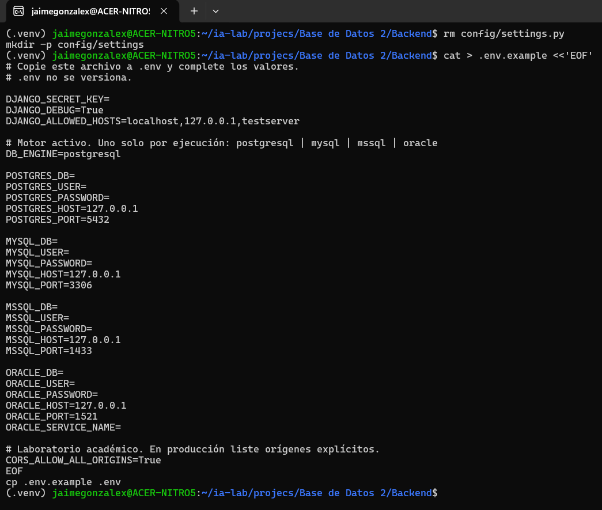

### **Modificacion del .env**

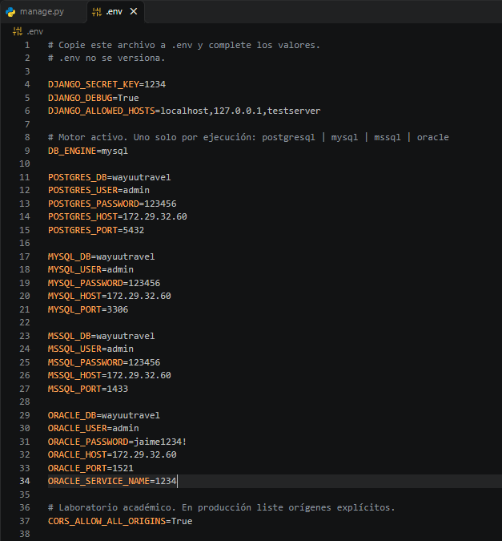

**5. Crear `config/database.py`**

Se escribió el traductor entre el entorno y Django. Lee `DB_ENGINE` y devuelve un único `DATABASES["default"]`. Si el motor no es válido o falta una variable obligatoria, falla antes de intentar conectarse y con un mensaje claro.

``` sql
cat > config/database.py <<'EOF'
"""Selección del motor de base de datos a partir del entorno.
 
Un solo alias, default, queda activo en cada ejecución.
"""
 
from django.core.exceptions import ImproperlyConfigured
 
ALLOWED_ENGINES = ("postgresql", "mysql", "mssql", "oracle")
 
 
def database_from_environ(env):
    engine = str(env.get("DB_ENGINE", "postgresql")).strip().lower()
    if engine not in ALLOWED_ENGINES:
        allowed = ", ".join(ALLOWED_ENGINES)
        raise ImproperlyConfigured(
            f"DB_ENGINE='{engine}' no es válido. Valores permitidos: {allowed}."
        )
    builders = {
        "postgresql": _postgresql,
        "mysql": _mysql,
        "mssql": _mssql,
        "oracle": _oracle,
    }
    return {"default": builders[engine](env)}
 
 
def _required(env, key):
    value = env.get(key)
    if value is None or str(value).strip() == "":
        raise ImproperlyConfigured(
            f"Falta la variable de entorno {key} para DB_ENGINE={env.get('DB_ENGINE')}."
        )
    return str(value).strip()
 
 
def _postgresql(env):
    return {
        "ENGINE": "django.db.backends.postgresql",
        "NAME": _required(env, "POSTGRES_DB"),
        "USER": _required(env, "POSTGRES_USER"),
        "PASSWORD": _required(env, "POSTGRES_PASSWORD"),
        "HOST": _required(env, "POSTGRES_HOST"),
        "PORT": _required(env, "POSTGRES_PORT"),
    }
 
 
def _mysql(env):
    return {
        "ENGINE": "django.db.backends.mysql",
        "NAME": _required(env, "MYSQL_DB"),
        "USER": _required(env, "MYSQL_USER"),
        "PASSWORD": _required(env, "MYSQL_PASSWORD"),
        "HOST": _required(env, "MYSQL_HOST"),
        "PORT": _required(env, "MYSQL_PORT"),
        "OPTIONS": {"charset": "utf8mb4"},
    }
 
 
def _mssql(env):
    return {
        "ENGINE": "mssql",
        "NAME": _required(env, "MSSQL_DB"),
        "USER": _required(env, "MSSQL_USER"),
        "PASSWORD": _required(env, "MSSQL_PASSWORD"),
        "HOST": _required(env, "MSSQL_HOST"),
        "PORT": _required(env, "MSSQL_PORT"),
        "OPTIONS": {
            "driver": "ODBC Driver 18 for SQL Server",
            "extra_params": "TrustServerCertificate=yes",
        },
    }
 
 
def _oracle(env):
    host = _required(env, "ORACLE_HOST")
    port = _required(env, "ORACLE_PORT")
    service = _required(env, "ORACLE_SERVICE_NAME")
    dsn = (
        f"(DESCRIPTION=(ADDRESS=(PROTOCOL=TCP)(HOST={host})(PORT={port}))"
        f"(CONNECT_DATA=(SERVICE_NAME={service})))"
    )
    return {
        "ENGINE": "django.db.backends.oracle",
        "NAME": dsn,
        "USER": _required(env, "ORACLE_USER"),
        "PASSWORD": _required(env, "ORACLE_PASSWORD"),
        "HOST": host,
        "PORT": "",
    }
EOF
```

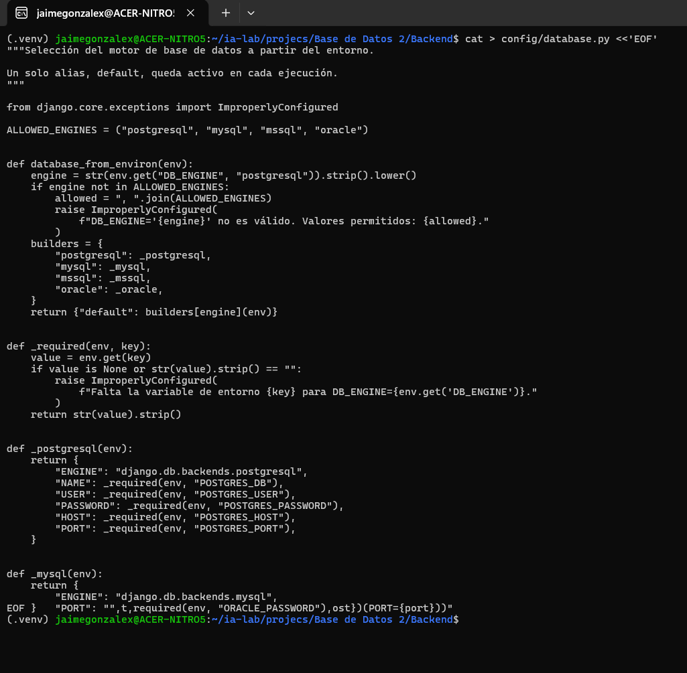

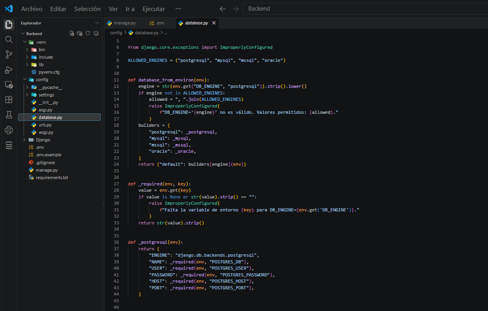

**6. Crear `config/settings/__init__.py`**

Se armó el paquete de configuración: carga el `.env`, exige la `SECRET_KEY` y delega la base de datos a `database.py`. Por ahora no incluye las apps de ActivaFit, DRF ni JWT; cada uno se añadirá en la unidad que lo necesite.

``` sql
cat > config/settings/__init__.py <<'EOF'
"""Configuración de ActivaFit.
 
El paquete sustituye al settings.py generado por startproject.
DJANGO_SETTINGS_MODULE sigue siendo config.settings.
"""
 
import os
from pathlib import Path
 
# python-dotenv, instalado en este ISS. Lee .env antes de SECRET_KEY y DATABASES.
from dotenv import load_dotenv
 
from config.database import database_from_environ
 
BASE_DIR = Path(__file__).resolve().parent.parent.parent
load_dotenv(BASE_DIR / ".env")
 
SECRET_KEY = os.environ.get("DJANGO_SECRET_KEY", "").strip()
if not SECRET_KEY:
    from django.core.exceptions import ImproperlyConfigured
 
    raise ImproperlyConfigured("Defina DJANGO_SECRET_KEY en el archivo .env.")
 
DEBUG = os.environ.get("DJANGO_DEBUG", "False").strip().lower() in {"1", "true", "yes", "on"}
 
ALLOWED_HOSTS = [
    host.strip()
    for host in os.environ.get("DJANGO_ALLOWED_HOSTS", "localhost,127.0.0.1").split(",")
    if host.strip()
]
 
INSTALLED_APPS = [
    "django.contrib.admin",
    "django.contrib.auth",
    "django.contrib.contenttypes",
    "django.contrib.sessions",
    "django.contrib.messages",
    "django.contrib.staticfiles",
]
 
MIDDLEWARE = [
    "django.middleware.security.SecurityMiddleware",
    "django.contrib.sessions.middleware.SessionMiddleware",
    "django.middleware.common.CommonMiddleware",
    "django.middleware.csrf.CsrfViewMiddleware",
    "django.contrib.auth.middleware.AuthenticationMiddleware",
    "django.contrib.messages.middleware.MessageMiddleware",
    "django.middleware.clickjacking.XFrameOptionsMiddleware",
]
 
ROOT_URLCONF = "config.urls"
 
TEMPLATES = [
    {
        "BACKEND": "django.template.backends.django.DjangoTemplates",
        "DIRS": [],
        "APP_DIRS": True,
        "OPTIONS": {
            "context_processors": [
                "django.template.context_processors.request",
                "django.contrib.auth.context_processors.auth",
                "django.contrib.messages.context_processors.messages",
            ],
        },
    },
]
 
WSGI_APPLICATION = "config.wsgi.application"
ASGI_APPLICATION = "config.asgi.application"
 
DATABASES = database_from_environ(os.environ)
 
AUTH_PASSWORD_VALIDATORS = [
    {"NAME": "django.contrib.auth.password_validation.UserAttributeSimilarityValidator"},
    {"NAME": "django.contrib.auth.password_validation.MinimumLengthValidator"},
    {"NAME": "django.contrib.auth.password_validation.CommonPasswordValidator"},
    {"NAME": "django.contrib.auth.password_validation.NumericPasswordValidator"},
]
 
LANGUAGE_CODE = "es"
TIME_ZONE = "America/Bogota"
USE_I18N = True
USE_TZ = True
 
STATIC_URL = "static/"
DEFAULT_AUTO_FIELD = "django.db.models.BigAutoField"
EOF
```

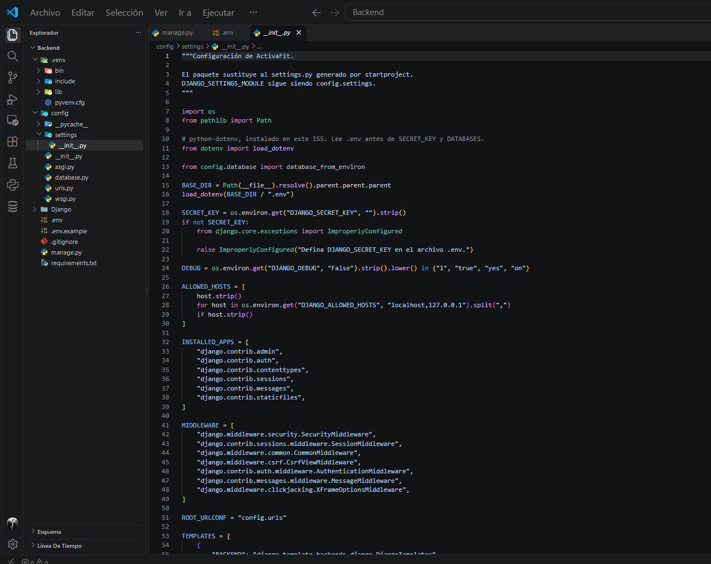](images/clipboard-13322367.png)

**7. Crear `config/project_python.py`**

Para que `python3 manage.py` funcione aunque no se haya activado el entorno, se añadió un pequeño ayudante que vuelve a lanzar el comando con el Python de `.venv`.

``` sql
cat > config/project_python.py <<'EOF'
"""Intérprete del proyecto.
 
Los paquetes se instalan dentro de .venv. El comando python3 manage.py
usa el Python del sistema y no ve esos paquetes.
use_project_python() vuelve a lanzar el mismo comando con .venv/bin/python.
"""
 
import os
import sys
from pathlib import Path
 
PROJECT_ROOT = Path(__file__).resolve().parent.parent
 
 
def use_project_python():
    """Reejecuta el proceso con el Python de .venv si aún no es ese intérprete."""
    venv_root = PROJECT_ROOT / ".venv"
    venv_python = venv_root / "bin" / "python"
    if not venv_python.is_file():
        return
    try:
        if Path(sys.prefix).resolve() == venv_root.resolve():
            return
    except OSError:
        return
    os.execv(venv_python, [str(venv_python), *sys.argv])
EOF
```

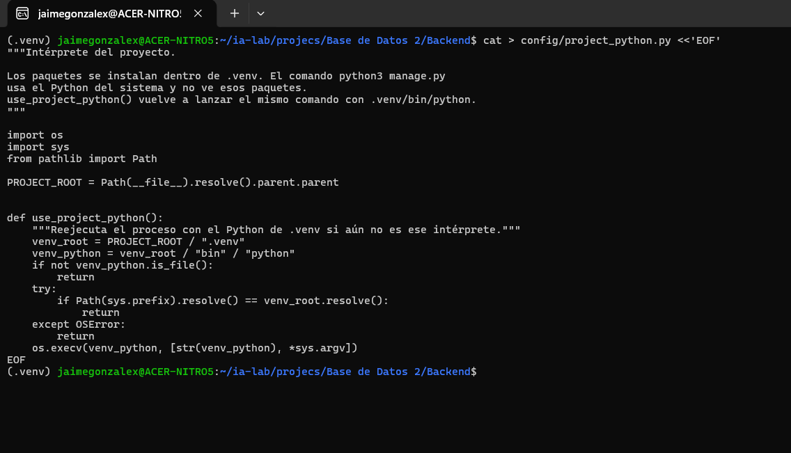


**8. Parchear `manage.py`, `config/wsgi.py` y `config/asgi.py`**

Para terminar, se editaron los tres puntos de entrada del proyecto para que carguen el `.env` antes de que Django lea la configuración. Sin ese paso, `SECRET_KEY` y las credenciales aparecerían vacías.

Estos archivos ya existen; no se regeneran, se editan.

**Evidencia EVI-01-05.** Esta es la evidencia del reemplazo realizado anteriormente en los puntos de entrada del proyecto (`manage.py`, `config/wsgi.py` y `config/asgi.py`), donde se agregó la carga del archivo `.env` con `load_dotenv()`.

``` sql
ARCHIVO: manage.py
 
UBICAR:
import os
import sys
 
REEMPLAZAR POR:


import sys
from pathlib import Path
 
_ROOT = Path(__file__).resolve().parent
if str(_ROOT) not in sys.path:
    sys.path.insert(0, str(_ROOT))
 
from config.project_python import use_project_python
 
use_project_python()
 
import os
 
# python-dotenv se instaló en este ISS, dentro de .venv.
from dotenv import load_dotenv
 
DEBAJO DE:
    """Run administrative tasks."""
 
AGREGAR:
    load_dotenv()
```

**Evidencia EVI-01-05a.** Reemplazo realizado anteriormente en `manage.py`: se agregó la ruta del proyecto, `use_project_python()` y `load_dotenv()`.

#### **Antes del Reemplazo:**

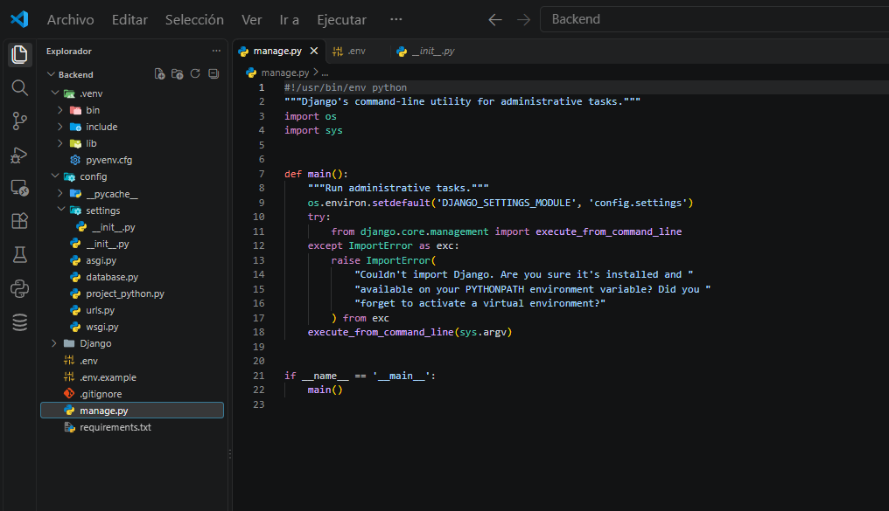

#### **Despues del Reemplazo:**

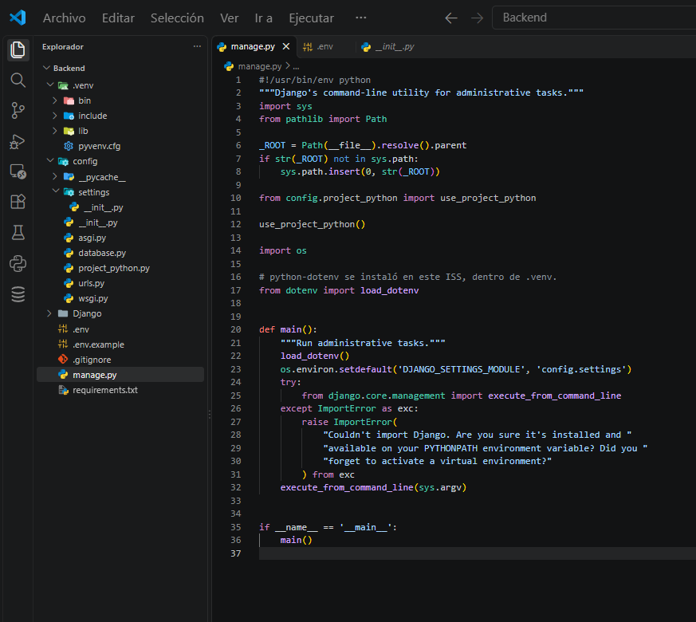

**Evidencia EVI-01-05b.** Reemplazo realizado anteriormente en `config/wsgi.py`: se agregó `load_dotenv()` antes de definir `DJANGO_SETTINGS_MODULE`.

``` sql
ARCHIVO: config/wsgi.py
 
UBICAR:
import os
 
from django.core.wsgi import get_wsgi_application
 
os.environ.setdefault("DJANGO_SETTINGS_MODULE", "config.settings")
 
REEMPLAZAR POR:
import os
 
# python-dotenv (este ISS) carga .env en el intérprete que arrancó el proceso.
from dotenv import load_dotenv
 
from django.core.wsgi import get_wsgi_application
 
load_dotenv()
os.environ.setdefault("DJANGO_SETTINGS_MODULE", "config.settings")
```

El mismo parche en `config/asgi.py`, cambiando `wsgi` por `asgi` y `get_wsgi_application` por `get_asgi_application`.

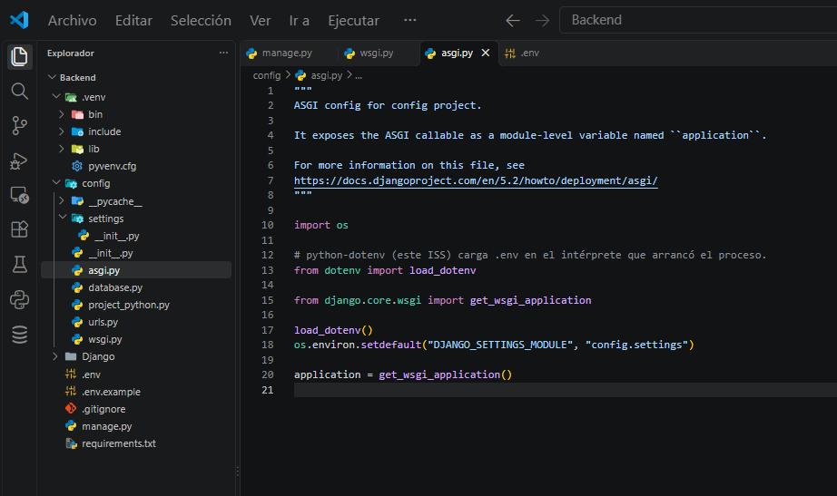](images/clipboard-2892950474.png)

### Explicación

La configuración de ActivaFit permite seleccionar el motor de base de datos mediante una única variable de entorno, sin necesidad de modificar directamente el archivo de configuración de Django. A continuación, se describe la función de cada componente:

- **Intérprete de Python:** la función `use_project_python()` permite ejecutar `python3 manage.py runserver` sin activar previamente el entorno virtual. Sin embargo, para utilizar `pip`, es necesario activar el entorno mediante `source .venv/bin/activate`.

- **Carga de variables de entorno:** la función `load_dotenv()` carga las variables definidas en `.env`, respetando aquellas que ya existen en el entorno del sistema. Esto permite cambiar temporalmente el motor mediante `DB_ENGINE=mysql python manage.py test`, sin modificar el archivo `.env`.

- **Configuración única de la base de datos:** Django utiliza exclusivamente `DATABASES["default"]`, lo que permite que el ORM trabaje con el motor seleccionado sin requerir cambios adicionales en las consultas.

- **Conexión a Oracle:** el DSN se construye utilizando `SERVICE_NAME`, mientras que `PORT` se deja vacío en la configuración descrita. La conexión se realiza mediante el controlador `oracledb`.

- **Conexión a SQL Server:** el valor `mssql` se establece en `ENGINE`, de acuerdo con el identificador utilizado por `mssql-django`. Además, es necesario tener instalado el controlador ODBC Driver 18 en el sistema.

- **Configuración regional:** se establece el idioma español mediante `LANGUAGE_CODE = "es"`, la zona horaria de Colombia con `TIME_ZONE = "America/Bogota"` y el manejo de fechas y horas con `USE_TZ = True`.

El proceso de configuración sigue esta secuencia:

```         
.env → DB_ENGINE → database_from_environ → DATABASES["default"] → ORM
```

### Criterios de aceptación

- **AC-01-01:** verificar que los motores `postgresql`, `mysql`, `mssql` y `oracle` generen el valor de `ENGINE` correspondiente a cada configuración.

- **AC-01-02:** comprobar que la selección de un motor no reconocido produzca una excepción `ImproperlyConfigured`.

- **AC-01-03:** confirmar que la ausencia de una variable obligatoria provoque un error de configuración antes de intentar establecer la conexión.

- **AC-01-04:** validar que el DSN de Oracle incluya el parámetro `SERVICE_NAME`.

### Verificación

#### GATE

| **Criterio** | **Método de comprobación** | **Evidencia** | **Resultado** |
|----|----|----|----|
| AC-01-01 | Pruebas de configuración para cada motor | EVI-01-06 | PASS |
| AC-01-02 | Prueba con un motor no admitido | EVI-01-06 | PASS |
| AC-01-03 | Prueba con una variable obligatoria vacía | EVI-01-06 | PASS |
| AC-01-04 | Aserción para comprobar `SERVICE_NAME` | EVI-01-06 | PASS |

## ISS-02 — Aplicaciones de Wayuu Travel

### Narrativa

Con la configuración del entorno y de la base de datos preparada, Wayuu Travel necesita una estructura que permita organizar las funcionalidades del sistema. Django utiliza aplicaciones (*apps*) para separar la lógica del proyecto en módulos independientes, cada uno enfocado en una parte específica del negocio. En esta unidad se crearon las aplicaciones correspondientes a la gestión turística y se organizaron dentro del paquete `apps/`, evitando que el directorio raíz se llene de carpetas dispersas. En esta etapa no se implementan modelos ni reglas de negocio; el trabajo se centra en establecer la estructura modular y registrar las aplicaciones en la configuración del proyecto.

### Objetivo

Crear las aplicaciones de negocio de Wayuu Travel mediante las herramientas de Django, organizarlas dentro del paquete `apps/` y registrarlas en la configuración para facilitar su desarrollo en las siguientes unidades.

### Requisitos

- Haber completado el ISS-01, correspondiente a la configuración del entorno y la selección del motor de base de datos.

- Tener activo el entorno virtual `(.venv)` en la terminal.

- Contar con el proyecto Django `config` creado y funcionando.

- No implementar todavía los modelos de negocio. El modelo de usuario personalizado, si forma parte del diseño del proyecto, debe definirse antes de ejecutar la primera migración.

### Construcción

**1. Confirmar el entorno**

Antes de ejecutar los comandos de esta unidad, se activó el entorno virtual y se comprobó que el intérprete de Python correspondiera a `.venv`. Esto garantiza que los comandos de Django utilicen las dependencias instaladas para Wayuu Travel y no las del Python global del sistema.

Para comprobar el intérprete activo, se ejecuto

La ruta obtenida debe apuntar al entorno virtual del proyecto. Después de esta comprobación, se puede continuar con la creación de las aplicaciones, su organización dentro de `apps/` y su registro en el archivo de configuración de Django.

``` sql
    source .venv/bin/activate
    which python
```

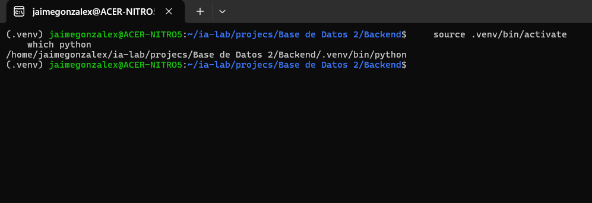

**1. Crear los directorios y las apps con `startapp`**

`startapp` exige que el directorio destino ya exista. Por eso primero se crean las carpetas y luego se genera cada app. No se copian `models.py`, `admin.py` ni `views.py` a mano: la CLI los deja listos. El archivo `urls.py` no lo crea; aparecerá cuando haya endpoints.

``` sql
mkdir -p apps/client apps/product apps/sale

python manage.py startapp client apps/client
python manage.py startapp product apps/product
python manage.py startapp sale apps/sale
```

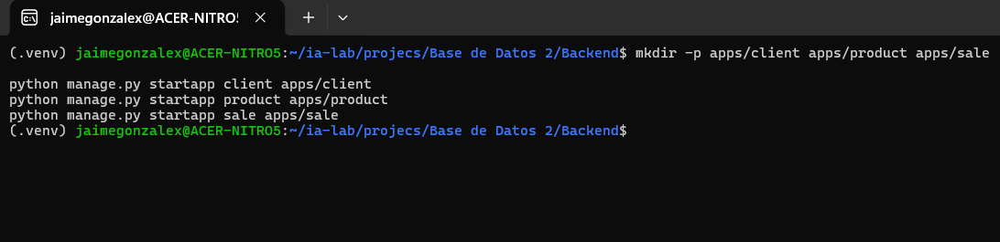

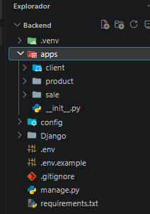

**2. Convertir `apps` en paquete**

Se creó `apps/__init__.py`, vacío, para que Python trate la carpeta `apps` como un paquete.

``` sql
mkdir -p apps
cat > apps/__init__.py <<'EOF'
EOF
```

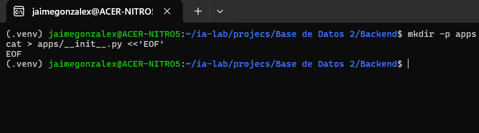

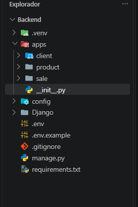

**3. Parchear el `apps.py` de cada app**

Cada `apps.py` ya existe, generado por `startapp`. Como las apps viven dentro de `apps/`, hay que indicarle a Django la ruta completa del paquete. Se mantiene el `label` corto para que las migraciones no arrastren el prefijo `apps.`

``` sql
ARCHIVO: apps/client/apps.py  UBICAR:     name = "client"  REEMPLAZAR POR:     name = "apps.client"     label = "client" 
```

**Para client:**

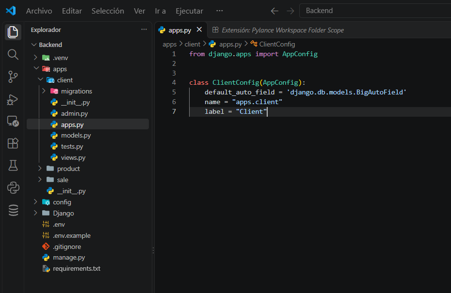

**para product:**

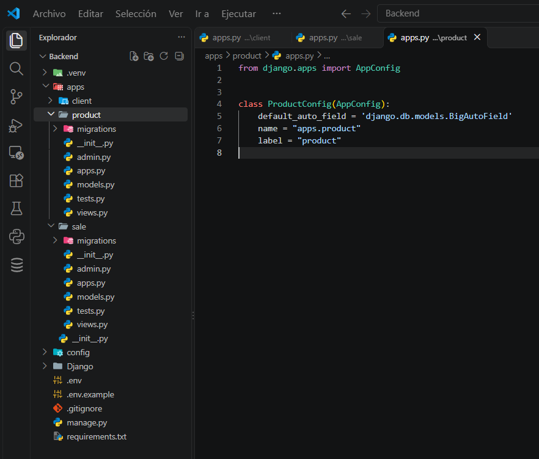

**para sale:**

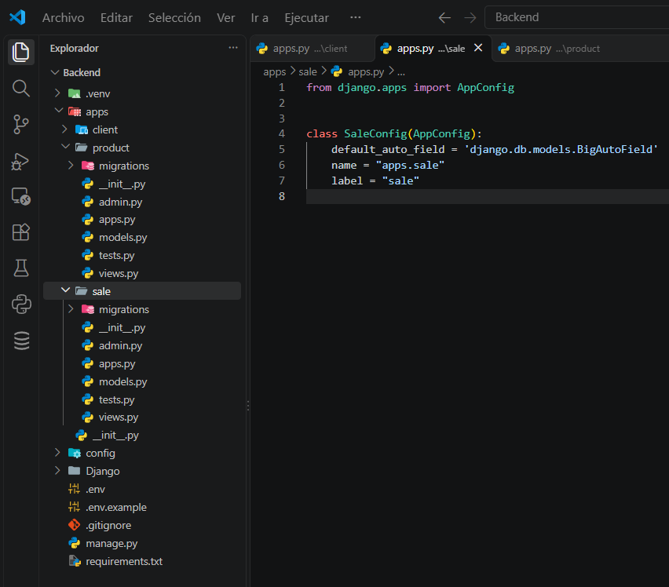

El mismo parche se repite las apps:

| **Archivo**            | **`name`**    | **`label`** |
|------------------------|---------------|-------------|
| `apps/client/apps.py`  | `apps.client` | client      |
| `apps/product/apps.py` | apps.product  | `product`   |
| `apps/`sale`/apps.py`  | apps.sale     | sale        |

La clase de cada archivo conserva su nombre (`ClientConfig`, `ProductConfig`, `PaleConfig`).

**4. Registrar las apps en `config/settings/__init__.py`**

El archivo ya existe. Se agregan las apps al final de `INSTALLED_APPS`, todavía sin la app `security`, que llega en el ISS-03.

text

``` sql
ARCHIVO: config/settings/__init__.py

DEBAJO DE:
    "django.contrib.staticfiles",

AGREGAR:
    "apps.client.apps.ClientConfig",
    "apps.produt.apps.ProductConfig",
    "apps.sale.apps.SaleConfig",
```

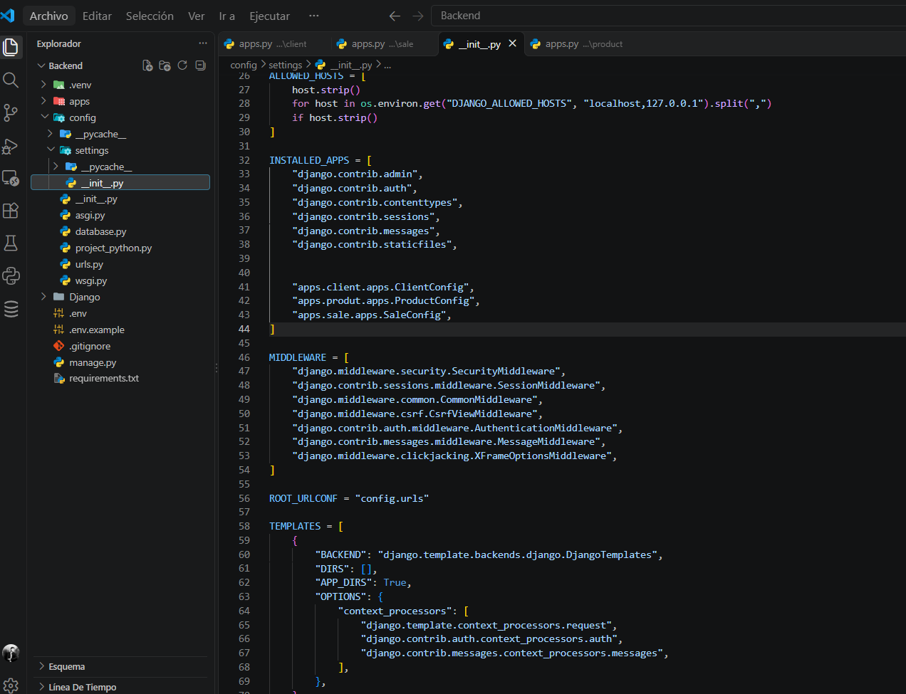

#### Explicación

Django necesita conocer la ruta completa de cada aplicación para poder reconocerla y cargarla correctamente. En Wayuu Travel, las aplicaciones se encuentran dentro del directorio `apps/`, por lo que el atributo `AppConfig.name` debe especificar la ruta correspondiente, como `apps.client`.

El atributo `label` conserva el nombre corto de cada aplicación, por ejemplo `client`, facilitando su identificación dentro del proyecto y evitando introducir el prefijo del paquete en las referencias de las migraciones.

Cada aplicación representa un área funcional de Wayuu Travel y agrupa las responsabilidades relacionadas con la gestión de clientes, la oferta turística y las operaciones comerciales.

```         
apps/
├── client/   clientes y viajeros
├── product/  paquetes turísticos, servicios incluidos y proveedores
└── sale/     reservas, pagos, cancelaciones y comprobantes
```

La aplicación `client` administra los datos de los clientes y viajeros; `product` organiza la oferta turística y los servicios asociados; y `sale` gestiona las reservas y sus operaciones relacionadas.

En esta etapa se prepara la estructura de las aplicaciones, sin implementar todavía los modelos de negocio, ya que primero debe completarse el ISS-03, correspondiente al usuario personalizado.

#### Criterios de aceptación

- **AC-02-01:** verificar que las aplicaciones `client`, `product` y `sale` se hayan creado mediante el comando `startapp` de Django.

- **AC-02-02:** comprobar que `python manage.py check` se ejecute sin errores relacionados con el registro o la configuración de las aplicaciones.

- **AC-02-03:** confirmar que todavía no se hayan implementado modelos de negocio en esta etapa del desarrollo.

### **Verificación**

``` sql
python manage.py check 
```

Para el GATE, además, puedes mostrar el árbol de las apps:

``` sql
tree apps -I "__pycache__" 
```

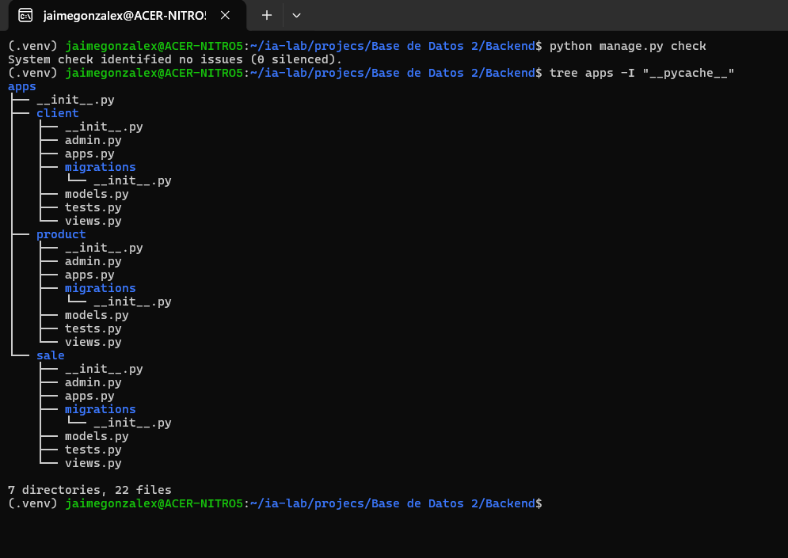

### **GATE**

| **AC** | **Verificación** | **Evidencia** | **Resultado** |
|----|----|----|----|
| AC-02-01 | directorios de las apps | árbol de `apps/` (EVI-02-01) | PASS |
| AC-02-02 | `manage.py check` | EVI-02-04 | PASS |
| AC-02-03 | este ISS no escribe modelos | revisión de los `models.py` vacíos | PASS |

## **ISS-03 — Custom User antes de la primera migración**

Hasta aquí ActivaFit tiene su configuración y sus apps, pero todavía no ha tocado la base de datos. Antes de la primera migración hay que tomar una decisión que no se puede deshacer fácilmente: definir el modelo de usuario propio del sistema. Django trae uno por defecto, pero cambiarlo después de migrar obliga a borrar tablas. Por eso, en esta unidad se creó el usuario personalizado de ActivaFit sobre `django.contrib.auth`, se declaró en la configuración y solo entonces se hizo la primera migración. Así, las credenciales del sistema quedan en una tabla propia (`users`), separada de los clientes del gimnasio.

**Objetivo**

Definir el usuario de ActivaFit sobre `django.contrib.auth` y fijar `AUTH_USER_MODEL` antes de migrar.

**Requisitos**

- ISS-02 superado.

- Terminal con el entorno virtual `.venv` activo.

- Decisión explícita entre `AbstractUser` y `AbstractBaseUser`: se eligió `AbstractUser`.

### **Construcción**

**Paso 0. Activar el entorno virtual**

Antes de ejecutar los comandos se activó el entorno y se confirmó que `python` apuntara a `.venv`.

``` sql
source .venv/bin/activate which python 
```

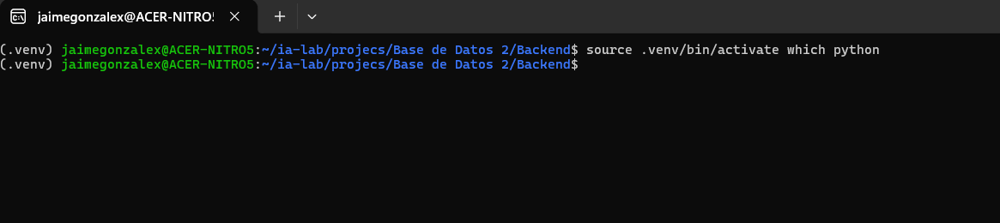

**Paso 1. Crear el paquete `apps/common` con `RecordStatus`**

El estado "activo / inactivo" lo usarán el usuario y, desde el ISS-04, las tablas del negocio. Por eso se guardó en un paquete compartido. `apps/common` no es una app: no se registra en `INSTALLED_APPS` ni se crea con `startapp`.

Archivo `apps/common/status.py`:

``` sql
mkdir -p apps/common
cat > apps/common/__init__.py <<'EOF'
EOF
cat > apps/common/status.py <<'EOF'

from django.db import models


class RecordStatus(models.TextChoices):
    ACTIVE = "active", "Active"
    INACTIVE = "inactive", "Inactive"
EOF
```

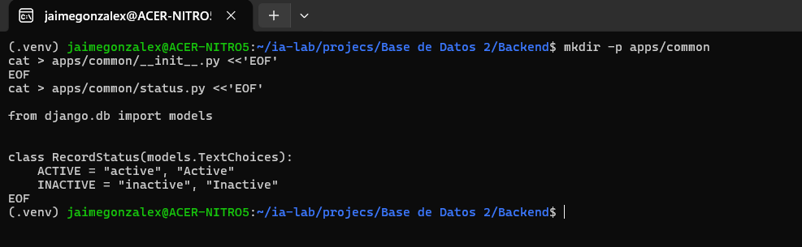

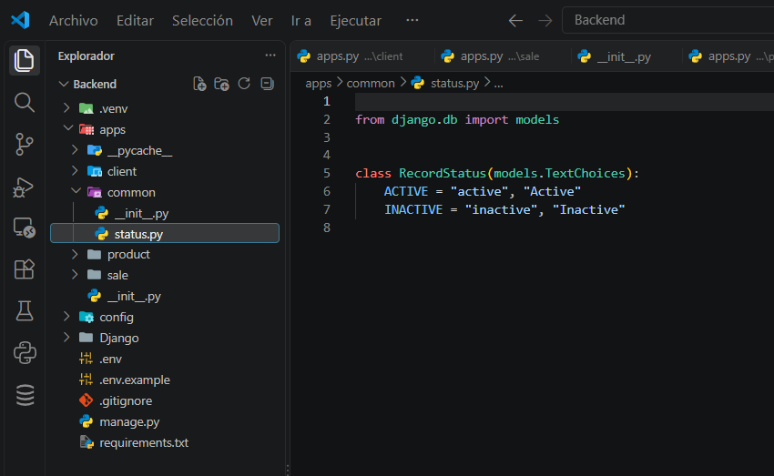

**Paso 2. Crear la app `security` con la CLI**

Como el directorio destino debe existir, primero se crea.

``` sql
mkdir -p apps/security
python manage.py startapp security apps/security 
```


``` sql
    name = "apps.security"     label = "security" 
```

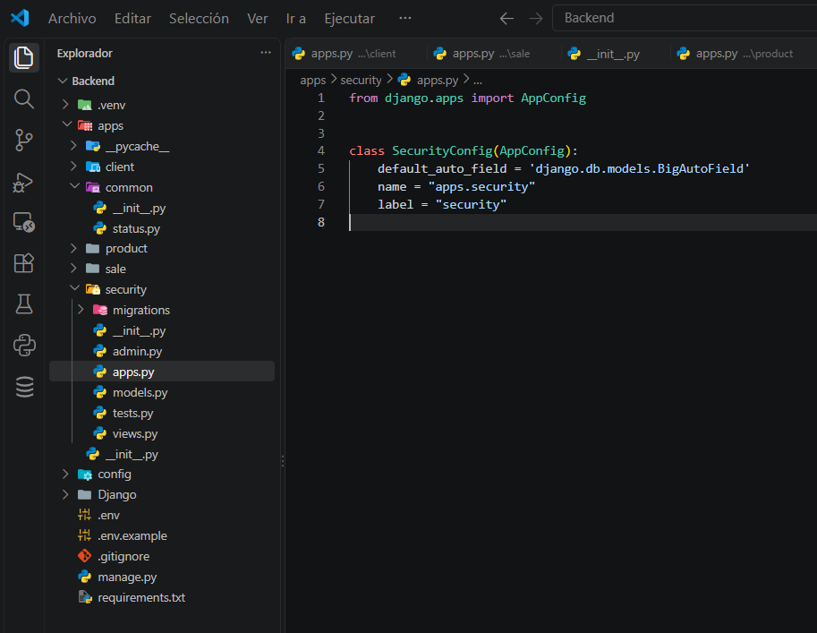

**Paso 3. Escribir el modelo de usuario**

El archivo `apps/security/models.py` ya existe y solo tiene un comentario. Se reemplaza todo su contenido por esto. En este ISS contiene únicamente el usuario; los demás modelos de seguridad se agregan después, en la fase de autenticación.

``` sql
from django.contrib.auth.models import AbstractUser, UserManager
from django.db import models

from apps.common.status import RecordStatus


class ActivaFitUserManager(UserManager):
    def create_user(self, username, email=None, password=None, **extra_fields):
        extra_fields.setdefault("status", RecordStatus.INACTIVE)
        return super().create_user(username, email, password, **extra_fields)

    def create_superuser(self, username, email=None, password=None, **extra_fields):
        extra_fields.setdefault("status", RecordStatus.ACTIVE)
        extra_fields.setdefault("is_staff", True)
        extra_fields.setdefault("is_superuser", True)
        return super().create_superuser(username, email, password, **extra_fields)


class User(AbstractUser):
    email = models.EmailField("correo electrónico", max_length=150, unique=True)
    status = models.CharField(
        max_length=8,
        choices=RecordStatus.choices,
        default=RecordStatus.INACTIVE,
    )
    created_at = models.DateTimeField(auto_now_add=True)
    updated_at = models.DateTimeField(auto_now=True)

    objects = ActivaFitUserManager()

    class Meta:
        db_table = "users"
        verbose_name = "usuario"
        verbose_name_plural = "usuarios"
        constraints = [
            models.CheckConstraint(
                condition=models.Q(status__in=RecordStatus.values),
                name="users_status_valid",
            )
        ]

    def save(self, *args, **kwargs):
        if self.email:
            self.email = self.email.strip().lower()
        self.is_active = self.status == RecordStatus.ACTIVE
        super().save(*args, **kwargs)
```

`create_user` deja `status` en `inactive` si nadie lo indica. `create_superuser` lo fuerza a `active`, para que `save()` no desactive al superusuario.

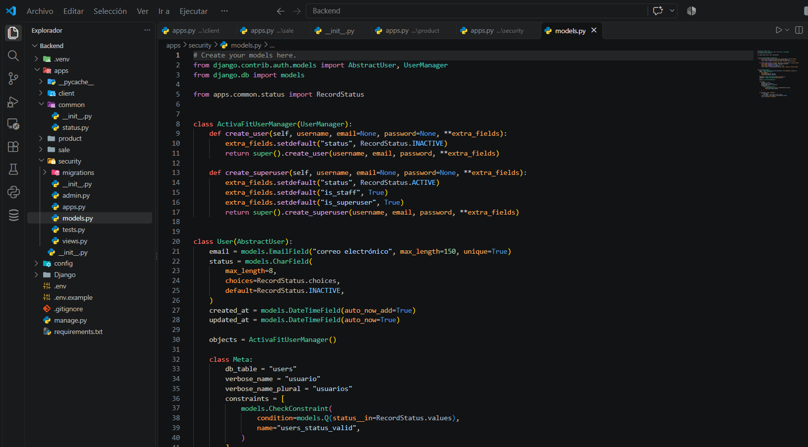

**Paso 4. Registrar la app y fijar `AUTH_USER_MODEL`**

En `config/settings/__init__.py`, la app de seguridad va delante de las de negocio. Se agrega esta línea justo encima de `"apps.client.apps.ClientConfig",`:

``` sql
    "apps.security.apps.SecurityConfig", 
```

Y debajo de la línea `DATABASES = database_from_environ(os.environ)` se agrega:

``` sql
AUTH_USER_MODEL = "security.User" 
```

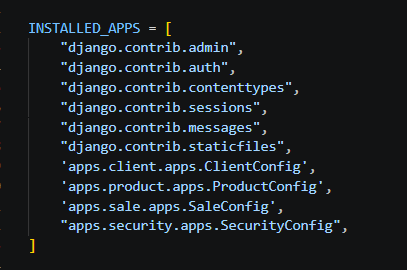

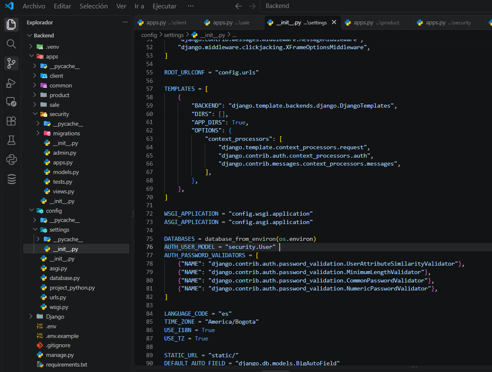

**Paso 5. Escribir el test de selección del motor**

El test prometido en el ISS-01 reemplaza el `tests.py` vacío que dejó `startapp`. Todavía no hay login, así que solo valida la selección del motor. Archivo `apps/security/tests.py`:

``` sql
from django.core.exceptions import ImproperlyConfigured
from django.test import SimpleTestCase

from config.database import database_from_environ


class DatabaseSelectionTests(SimpleTestCase):
    def _env(self, engine):
        return {
            "DB_ENGINE": engine,
            "POSTGRES_DB": "wayuutravel",
            "POSTGRES_USER": "wayuutravel",
            "POSTGRES_PASSWORD": "wayuutravel",
            "POSTGRES_HOST": "127.0.0.1",
            "POSTGRES_PORT": "5432",
            "MYSQL_DB": "wayuutravel",
            "MYSQL_USER": "wayuutravel",
            "MYSQL_PASSWORD": "123456",
            "MYSQL_HOST": "127.0.0.1",
            "MYSQL_PORT": "3306",
            "MSSQL_DB": "wayuutravel",
            "MSSQL_USER": "wayuutravel",
            "MSSQL_PASSWORD": "wayuutravel",
            "MSSQL_HOST": "127.0.0.1",
            "MSSQL_PORT": "1433",
            "ORACLE_DB": "wayuutravel",
            "ORACLE_USER": "wayuutravel",
            "ORACLE_PASSWORD": "jaime123!",
            "ORACLE_HOST": "127.0.0.1",
            "ORACLE_PORT": "1521",
            "ORACLE_SERVICE_NAME": "FREEPDB1",
        }


    def test_postgresql_engine(self):
        config = database_from_environ(self._env("postgresql"))
        self.assertEqual(config["default"]["ENGINE"], "django.db.backends.postgresql")

    def test_mysql_engine(self):
        config = database_from_environ(self._env("mysql"))
        self.assertEqual(config["default"]["ENGINE"], "django.db.backends.mysql")
        self.assertEqual(config["default"]["OPTIONS"]["charset"], "utf8mb4")

    def test_mssql_engine(self):
        config = database_from_environ(self._env("mssql"))
        self.assertEqual(config["default"]["ENGINE"], "mssql")

    def test_oracle_uses_service_name(self):
        config = database_from_environ(self._env("oracle"))
        self.assertIn("SERVICE_NAME=FREEPDB1", config["default"]["NAME"])
        self.assertEqual(config["default"]["PORT"], "")

    def test_invalid_engine(self):
        with self.assertRaises(ImproperlyConfigured):
            database_from_environ({"DB_ENGINE": "sqlite"})

    def test_missing_variable(self):
        env = self._env("postgresql")
        env["POSTGRES_DB"] = ""
        with self.assertRaises(ImproperlyConfigured):
            database_from_environ(env)
```

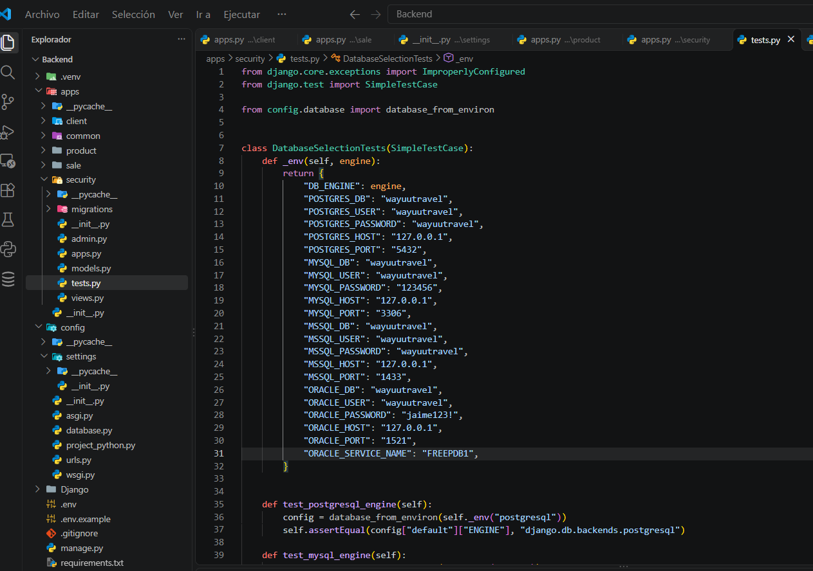

**Paso 6. Generar la migración, migrar y probar**

Ahora sí se migra. La CLI escribe la migración; no se copia a mano.

``` sql
python manage.py makemigrations security
python manage.py migrate
python manage.py test apps.security.tests.DatabaseSelectionTests 
```

y pruebo si el motor esta funcionando correctamente

``` sql
python manage.py shell -c "from django.db import connection; connection.ensure_connection(); print('Motor:', connection.vendor); print('Base de datos:', connection.settings_dict['NAME']); print('Conexión: OK')"
```

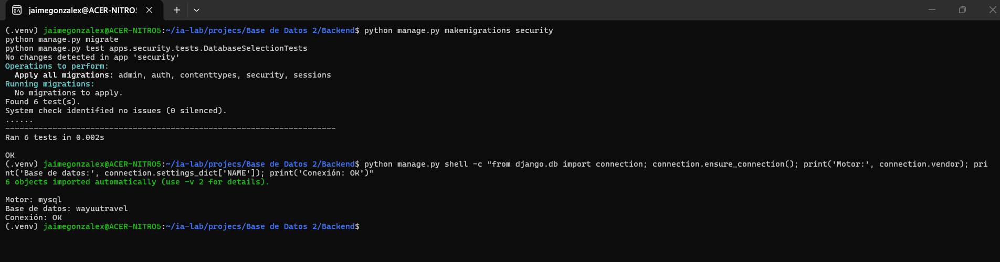

Al ejecutar `createsuperuser`, Django te pide:

- **Username**

- **Email:** es obligatorio y único en wayuutravel, porque lo definimos así en el modelo.

- **Password:** se escribe dos veces y no se ve en pantalla.

  ``` sql
  python manage.py createsuperuser
  ```

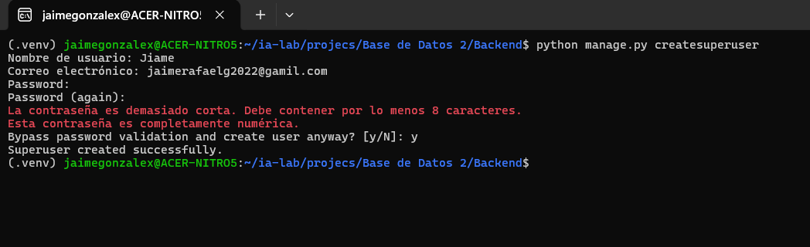

### Explicación

Se prefirió `AbstractUser` sobre `AbstractBaseUser` porque proporciona funcionalidades de autenticación ya implementadas por Django, como el hash de contraseñas, los validadores, los métodos `set_password()` y `check_password()`, y la integración con el panel administrativo. Utilizar `AbstractBaseUser` requeriría implementar manualmente varios componentes adicionales del sistema de autenticación.

El campo `status` permite representar el estado funcional de la cuenta, mientras que `is_active` se conserva para mantener la compatibilidad con los mecanismos de autenticación de Django y las bibliotecas de autenticación utilizadas. Para garantizar el comportamiento esperado, ambos campos deben mantenerse sincronizados mediante la lógica del modelo o de los servicios correspondientes.

En WayuuTravel, los usuarios del sistema se gestionan mediante la aplicación `security`. Los clientes que reservan experiencias turísticas se representan mediante la entidad `Client`, separada del modelo de autenticación cuando el diseño del sistema así lo establece. Por tanto, `Client` no necesita almacenar contraseñas si sus credenciales se gestionan exclusivamente en `security.User`.

## Criterios de aceptación

- **AC-03-01:** `AUTH_USER_MODEL` apunta a `security.User`.

- **AC-03-02:** el modelo `Client` no contiene un campo para almacenar contraseñas.

- **AC-03-03:** un usuario con estado `inactive` no puede iniciar sesión.

- **AC-03-04:** una contraseña incorrecta devuelve una respuesta HTTP `401`, mientras que una autenticación correcta no expone el hash de la contraseña en la respuesta.

## Verificación

Se utiliza la suite de pruebas `AuthFlowTests` para verificar el flujo de autenticación, los estados de las cuentas y la protección de las credenciales.

## Evidencias

- **EVI-03-01:** migración inicial `security.0001_initial` aplicada correctamente en MySQL.

- **EVI-03-02:** pruebas de inicio de sesión mediante nombre de usuario y correo electrónico superadas, siempre que ambas modalidades estén implementadas y verificadas en el proyecto.

## GATE

| **AC** | **Verificación** | **Evidencia** | **Resultado** |
|----|----|----|----|
| AC-03-01 | Configuración de `AUTH_USER_MODEL` | `config/settings.py` o módulo de configuración correspondiente | PASS |
| AC-03-02 | Revisión del modelo `Client` | Ausencia de campo para contraseñas | PASS |
| AC-03-03 | Autenticación con usuario inactivo | Prueba que comprueba la respuesta `401` | PASS |
| AC-03-04 | Verificación de contraseña y respuesta de login | Pruebas de autenticación y ausencia del hash en la respuesta | PASS |

### **ISS-04 — Modelo Client**

**Narrativa**

Con el modelo de usuario del sistema ya definido y migrado, se desarrolla el primer modelo de negocio de WayuuTravel: el cliente. Antes de implementarlo, se creó una clase base común para los modelos del negocio, que centraliza los campos de fecha de creación, fecha de actualización y estado del registro (`active` / `inactive`). De esta manera, se evita duplicar estos campos en cada modelo y se mantiene una estructura consistente en la base de datos.

Posteriormente, se definió el modelo `Client`, tomando como referencia la estructura de la tabla `clients` establecida en el diagrama de la base de datos. Este modelo contempla los datos de identificación del cliente, como tipo y número de documento, nombre completo, teléfono, correo electrónico y estado. Finalmente, se prepara y ejecuta la migración correspondiente para incorporar el modelo a la base de datos MySQL de WayuuTravel.

**Objetivo**

Persistir y administrar la información de los clientes de Wayuu Travel mediante el modelo `Client`, respetando el diccionario de datos y la estructura definida para la tabla `clients`.

**Requisitos**

- ISS-03 superado: modelo de usuario del sistema definido y migrado.

- Terminal con el entorno virtual `.venv` activo.

- Clase base común para los modelos del negocio, con los campos de auditoría temporal y estado del registro.

- Un único `TextChoices` para los estados `active` e `inactive`, mediante `RecordStatus`, definido en el ISS-03 o en el módulo común correspondiente.

- Aplicación `client` registrada correctamente en la configuración de Django.

- Conexión a la base de datos MySQL `wayuutravel` configurada.

#### **Construcción**

**Paso 0. Activar el entorno virtual**

``` sql
source .venv/bin/activate 
which python
```

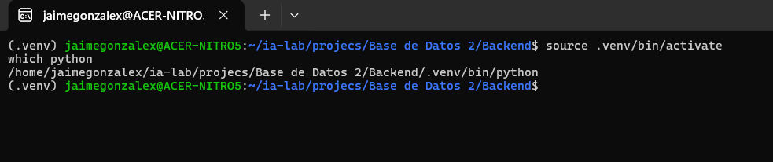

**Paso 1. Crear el modelo abstracto base**

`RecordStatus` ya está en `apps/common/status.py` desde el ISS-03. El modelo abstracto es un archivo nuevo. No es una app: no entra en `INSTALLED_APPS` y no genera migración propia. `TimeStampedModel` aporta `created_at` y `updated_at`. `ActivaFitModel` añade `status` con valor por defecto `inactive` y un `CheckConstraint` reutilizable. Las apps de negocio heredan esta clase, por eso la tabla `clients` tendrá esas columnas.

Archivo `apps/common/models.py`:

``` sql
  from django.db import models
  
  from apps.common.status import RecordStatus
  
  
  class TimeStampedModel(models.Model):
      created_at = models.DateTimeField(auto_now_add=True)
      updated_at = models.DateTimeField(auto_now=True)
  
      class Meta:
          abstract = True
  
  
  class ActivaFitModel(TimeStampedModel):
      status = models.CharField(
          max_length=8,
          choices=RecordStatus.choices,
          default=RecordStatus.INACTIVE,
      )
  
      class Meta:
          abstract = True
  
      @classmethod
      def status_constraint(cls, name):
          return models.CheckConstraint(
              condition=models.Q(status__in=RecordStatus.values),
              name=name,
          )
```

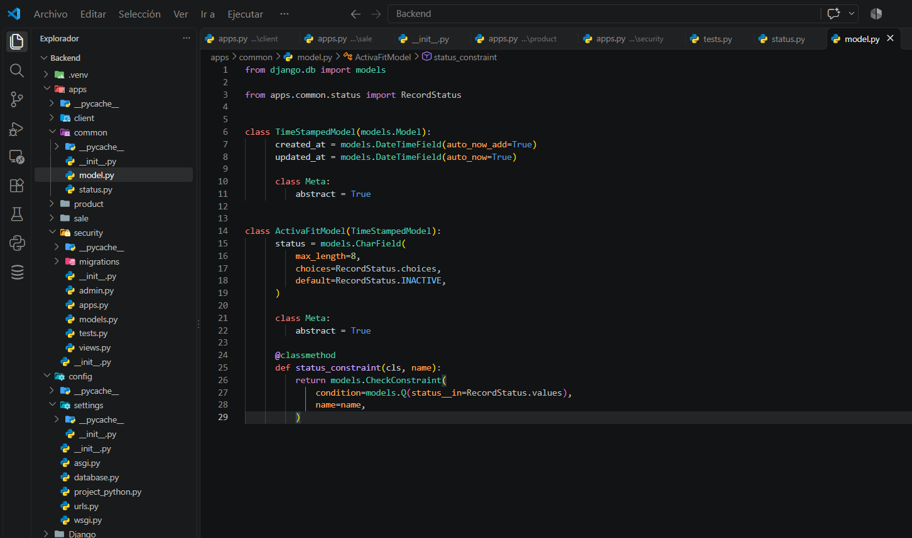

**Paso 2. Escribir el modelo `Client`**

El archivo `apps/client/models.py` lo creó `startapp` vacío. Se reescribe entero: el comentario inicial no se conserva. `Client` hereda las fechas y el estado. `name` exige al menos 2 caracteres. `phone` y `email` pueden ir vacíos. El correo es único y `save()` lo guarda en minúsculas. La combinación de tipo y número de documento es única, para que no haya dos clientes con el mismo documento. `db_table = "clients"` fija el nombre físico de la tabla.

``` sql
from django.core.validators import MinLengthValidator
from django.db import models

from apps.common.models import wayuutravel


class Client(wayuutravel):
    document_number = models.CharField(max_length=30, validators=[MinLengthValidator(5)], unique=True,null=False)
    name = models.CharField(max_length=150, validators=[MinLengthValidator(2)], null=False)
    phone = models.CharField(max_length=30, null=True, blank=True)
    email = models.EmailField(max_length=150, null=False, unique=True)
    document_type = models.CharField(
        max_length=10,
        choices=[
            ("CC", "Cédula de ciudadanía"),
            ("CE", "Cédula de extranjería"),
            ("TI", "Tarjeta de identidad"),
            ("PASSPORT", "Pasaporte"),
        ],
        null=False,
    )
    class Meta:
        db_table = "clients"
        verbose_name = "cliente"
        verbose_name_plural = "clientes"
        ordering = ["name", "id"]
        constraints = [
            wayuutravel.status_constraint("clients_status_valid"),
            models.UniqueConstraint(
                fields=["document_type", "document_number"],
                name="clients_document_unique",
            ),
        ]

   
    def __str__(self):
        return self.name

    def save(self, *args, **kwargs):
        if self.email:
            self.email = self.email.strip().lower()
        super().save(*args, **kwargs)
```

Los nombres de los constraints (`clients_status_valid` y `clients_document_unique`) caben en 30 caracteres.

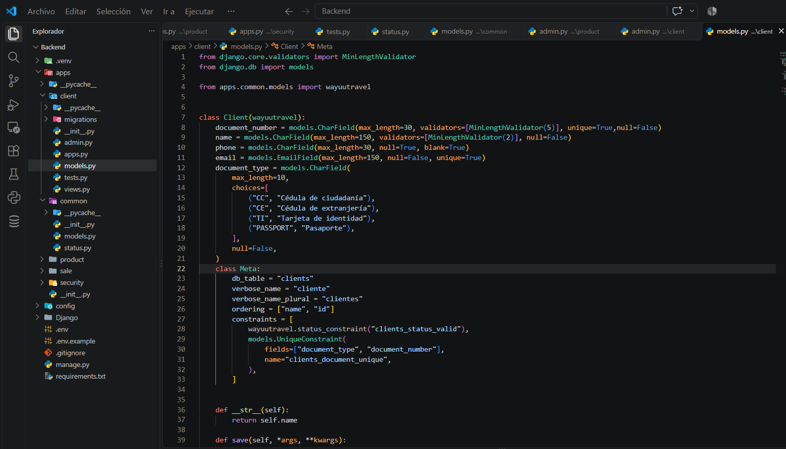

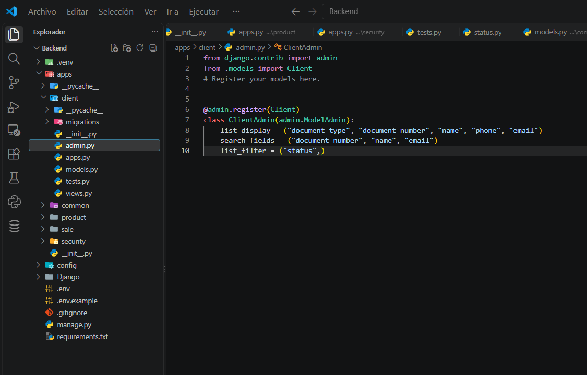

La migración la escribe la CLI:

``` sql
python manage.py makemigrations client 
python manage.py migrate 
```

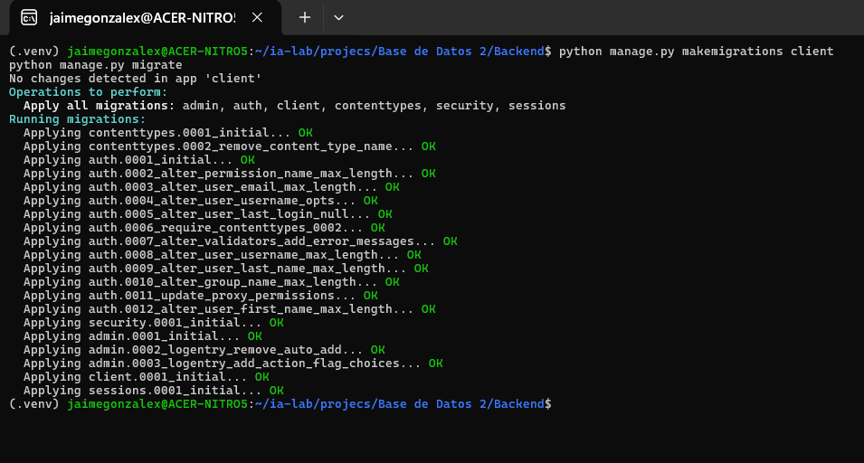

### **Resultado**

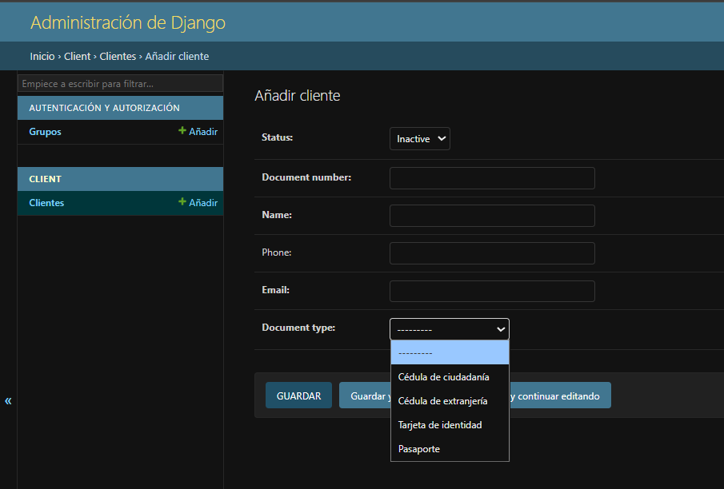

## **Criterios de aceptación**

- AC-04-01: la tabla física es `clients`.

- AC-04-02: sin `status` en el alta, el valor es `inactive`.

- AC-04-03: `created_at` y `updated_at` se generan.

- AC-04-04: el email duplicado se rechaza.

- AC-04-05: un nombre de un carácter se rechaza.

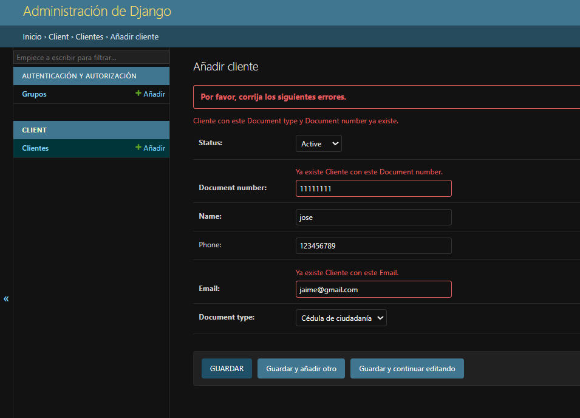

## **GATE**

| **AC**   | **Verificación**      | **Evidencia** | **Resultado** |
|----------|-----------------------|---------------|---------------|
| AC-04-01 | `db_table`            | migración     | PASS          |
| AC-04-02 | POST sin status       | test de alta  | PASS          |
| AC-04-03 | timestamps            | test de alta  | PASS          |
| AC-04-04 | email duplicado = 400 | test          | PASS          |
| AC-04-05 | nombre corto = 400    | test          | PASS          |

### **ISS-05 — Models Package, Departure, Supplier, IncludedService y Booking**

**Narrativa**

Con el modelo `Client` ya implementado y migrado, WayuuTravel continúa con la construcción de los modelos principales que permiten administrar las experiencias turísticas responsables. Primero se modelan las entidades independientes o principales del catálogo: los paquetes turísticos (`Package`) y los proveedores de servicios turísticos (`Supplier`). Posteriormente, se desarrollan las entidades que dependen de ellas: las salidas programadas (`Departure`), los servicios incluidos (`IncludedService`) y las reservas (`Booking`).

El modelo `Package` almacena la información general de cada experiencia turística, mientras que `Supplier` registra los prestadores de servicios vinculados a las actividades turísticas. Por su parte, `Departure` permite programar las fechas y condiciones de las experiencias; `IncludedService` registra los servicios que forman parte de cada paquete; y `Booking` relaciona a los clientes con las salidas turísticas que desean reservar.

Se establecen reglas de integridad referencial para proteger la información relacionada. Por ejemplo, no se debe permitir eliminar un paquete que tenga salidas programadas o servicios incluidos asociados, ni un cliente que tenga reservas registradas. Para ello, se utiliza `on_delete=models.PROTECT` en las relaciones que deban impedir la eliminación de registros referenciados.

**Objetivo**

Modelar el catálogo de paquetes turísticos, los proveedores, las salidas programadas, los servicios incluidos y las reservas de Wayuu Travel, garantizando la integridad referencial entre clientes, paquetes, proveedores y salidas turísticas.

**Requisitos**

- ISS-04 superado: modelo `Client` implementado y migrado.

- Terminal con el entorno virtual `.venv` activo.

- Aplicaciones correspondientes registradas correctamente en la configuración de Django.

- Relaciones entre modelos definidas de acuerdo con el diagrama entidad-relación de WayuuTravel.

- Restricción de eliminación para los registros que tengan dependencias, mediante `on_delete=models.PROTECT` cuando corresponda.

- Migraciones generadas y aplicadas correctamente en la base de datos MySQL `wayuutravel`.

#### **Construcción**

**Paso 0. Activar el entorno virtual**

``` sql
source .venv/bin/activate 
which python
```

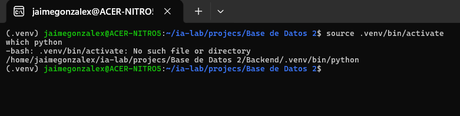

**Paso 1. Modelo client**

El archivo `apps/client/models.py` lo creó `startapp` vacío. Se reescribe entero.

``` sql

from django.core.validators import MinLengthValidator
from django.db import models

from apps.common.models import Wayuutravel


class Client(Wayuutravel):
    document_type = models.CharField(
        max_length=20,
        validators=[MinLengthValidator(2)]
    )

    document_number = models.CharField(
        max_length=30,
        unique=True,
        validators=[MinLengthValidator(3)]
    )

    name = models.CharField(
        max_length=150,
        validators=[MinLengthValidator(2)]
    )

    phone = models.CharField(
        max_length=20,
        blank=True,
        null=True
    )

    email = models.EmailField(
        max_length=254,
        blank=True,
        null=True,
        unique=True
    )

    class Meta:
        db_table = "clients"
        constraints = [
            Wayuutravel.status_constraint("clients")
        ]

    def __str__(self):
        return f"{self.name} - {self.document_number}"


class Traveler(Wayuutravel):
    name = models.CharField(
        max_length=150,
        validators=[MinLengthValidator(2)]
    )

    description = models.TextField(
        blank=True,
        null=True
    )

    class Meta:
        db_table = "travelers"
        constraints = [
            Wayuutravel.status_constraint("travelers")
        ]

    def __str__(self):
        return self.name
```

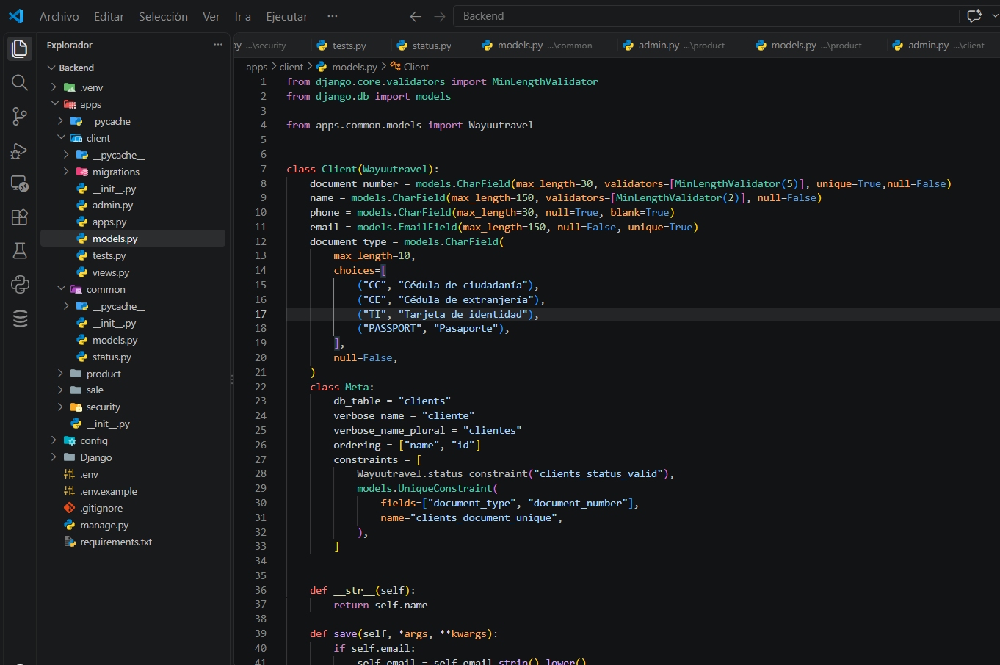

**Paso 2. Modelo product**

El archivo `apps/product/models.py` lo creó `startapp` vacío. Se reescribe entero.

``` sql
from django.core.validators import MinLengthValidator, MinValueValidator
from django.db import models

from apps.common.models import Wayuutravel


class Package(Wayuutravel):
    name = models.CharField(
        max_length=100,
        unique=True,
        validators=[MinLengthValidator(2)]
    )
    description = models.CharField(
        max_length=255,
        null=True,
        blank=True
    )

    class Meta:
        db_table = "packages"
        verbose_name = "paquete turístico"
        verbose_name_plural = "paquetes turísticos"
        ordering = ["name", "id"]
        constraints = [
            Wayuutravel.status_constraint("packages_status_valid")
        ]

    def __str__(self):
        return self.name


class Departure(Wayuutravel):
    name = models.CharField(
        max_length=100,
        validators=[MinLengthValidator(2)]
    )
    description = models.CharField(
        max_length=255,
        null=True,
        blank=True
    )
    package = models.ForeignKey(
        Package,
        on_delete=models.PROTECT,
        related_name="departures",
        db_column="package_id"
    )
    departure_date = models.DateTimeField()
    capacity = models.PositiveIntegerField(
        validators=[MinValueValidator(1)]
    )
    available_capacity = models.PositiveIntegerField(
        validators=[MinValueValidator(0)]
    )

    class Meta:
        db_table = "departures"
        verbose_name = "salida programada"
        verbose_name_plural = "salidas programadas"
        ordering = ["departure_date", "id"]
        constraints = [
            Wayuutravel.status_constraint("departures_status_valid"),
            models.CheckConstraint(
                condition=models.Q(available_capacity__lte=models.F("capacity")),
                name="departures_available_lte_capacity"
            ),
        ]

    def __str__(self):
        return f"{self.name} - {self.departure_date:%Y-%m-%d}"


class Supplier(Wayuutravel):
    nit = models.CharField(
        max_length=20,
        unique=True
    )
    razon_social = models.CharField(
        max_length=150
    )
    phone = models.CharField(
        max_length=20
    )
    email = models.EmailField(
        max_length=254,
        null=True,
        blank=True
    )

    class Meta:
        db_table = "suppliers"
        verbose_name = "proveedor"
        verbose_name_plural = "proveedores"
        ordering = ["razon_social", "id"]
        constraints = [
            Wayuutravel.status_constraint("suppliers_status_valid")
        ]

    def __str__(self):
        return self.razon_social


class IncludedService(Wayuutravel):
    package = models.ForeignKey(
        Package,
        on_delete=models.PROTECT,
        related_name="included_services",
        db_column="package_id"
    )
    supplier = models.ForeignKey(
        Supplier,
        on_delete=models.PROTECT,
        related_name="included_services",
        db_column="supplier_id"
    )
    relation_data = models.JSONField(
        null=True,
        blank=True
    )

    class Meta:
        db_table = "included_services"
        verbose_name = "servicio incluido"
        verbose_name_plural = "servicios incluidos"
        ordering = ["package_id", "supplier_id", "id"]
        constraints = [
            Wayuutravel.status_constraint(
                "included_services_status_valid"
            ),
            models.UniqueConstraint(
                fields=["package", "supplier"],
                name="included_services_package_supplier_unique"
            ),
        ]

    def __str__(self):
        return f"{self.supplier} - {self.package}"
```

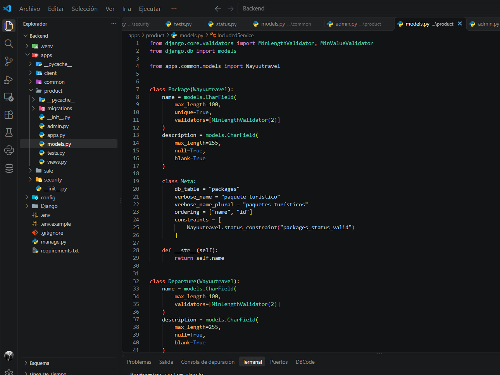

**Paso 3. Modelo sale**

El archivo `apps/sale/models.py` lo creó `startapp` vacío. Se reescribe entero.

``` sql

from django.core.validators import MinValueValidator
from django.db import models

from apps.common.models import Wayuutravel
from apps.client.models import Client, Traveler
from apps.product.models import Departure


class Booking(Wayuutravel):
    client = models.ForeignKey(
        Client,
        on_delete=models.PROTECT,
        related_name="bookings",
        db_column="client_id"
    )
    departure = models.ForeignKey(
        Departure,
        on_delete=models.PROTECT,
        related_name="bookings",
        db_column="departure_id"
    )
    traveler = models.ForeignKey(
        Traveler,
        on_delete=models.PROTECT,
        related_name="bookings",
        db_column="traveler_id"
    )
    start_date = models.DateField()
    end_date = models.DateField()
    observations = models.TextField(
        null=True,
        blank=True
    )

    class Meta:
        db_table = "bookings"
        verbose_name = "reserva"
        verbose_name_plural = "reservas"
        ordering = ["-created_at", "id"]
        constraints = [
            Wayuutravel.status_constraint("bookings_status_valid"),
            models.CheckConstraint(
                condition=models.Q(end_date__gte=models.F("start_date")),
                name="bookings_end_date_gte_start_date"
            ),
        ]

    def __str__(self):
        return f"Reserva #{self.pk}"


class Payment(Wayuutravel):
    reference_type = models.CharField(max_length=50)
    booking = models.ForeignKey(
        Booking,
        on_delete=models.PROTECT,
        related_name="payments",
        db_column="booking_id"
    )
    method = models.CharField(max_length=50)
    amount = models.DecimalField(
        max_digits=12,
        decimal_places=2,
        validators=[MinValueValidator(0.01)]
    )
    payment_date = models.DateTimeField()

    class Meta:
        db_table = "payments"
        verbose_name = "pago"
        verbose_name_plural = "pagos"
        ordering = ["-payment_date", "id"]
        constraints = [
            Wayuutravel.status_constraint("payments_status_valid")
        ]

    def __str__(self):
        return f"Pago #{self.pk} - {self.amount}"


class Cancellation(Wayuutravel):
    booking = models.ForeignKey(
        Booking,
        on_delete=models.PROTECT,
        related_name="cancellations",
        db_column="booking_id"
    )
    name = models.CharField(max_length=100)
    descriptions = models.TextField(
        null=True,
        blank=True
    )

    class Meta:
        db_table = "cancellations"
        verbose_name = "cancelación"
        verbose_name_plural = "cancelaciones"
        ordering = ["-created_at", "id"]
        constraints = [
            Wayuutravel.status_constraint("cancellations_status_valid")
        ]

    def __str__(self):
        return self.name


class Voucher(Wayuutravel):
    booking = models.ForeignKey(
        Booking,
        on_delete=models.PROTECT,
        related_name="vouchers",
        db_column="booking_id"
    )
    name = models.CharField(max_length=100)
    descriptions = models.TextField(
        null=True,
        blank=True
    )

    class Meta:
        db_table = "vouchers"
        verbose_name = "comprobante"
        verbose_name_plural = "comprobantes"
        ordering = ["-created_at", "id"]
        constraints = [
            Wayuutravel.status_constraint("vouchers_status_valid")
        ]

    def __str__(self):
        return self.name
```

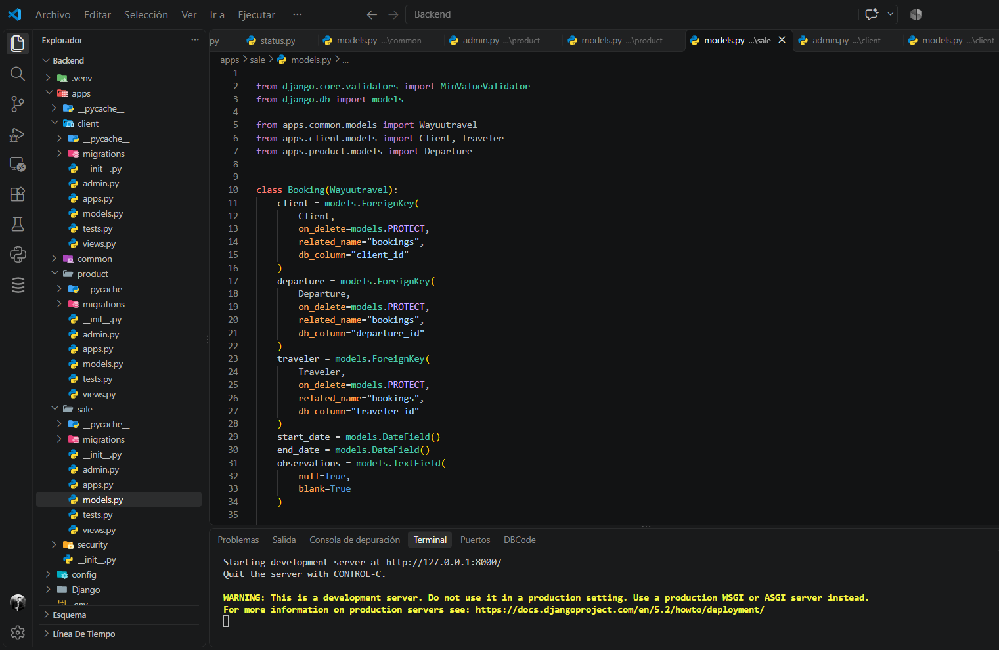

**Paso 4. Generar las migraciones y migrar**

Se generan juntas porque tienen depencias entre ellas. La CLI escribe las migraciones.

``` sql
python manage.py makemigrations client product sale
python manage.py migrate
```

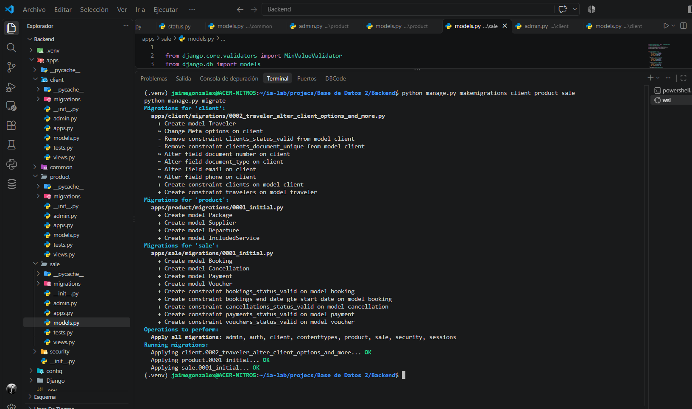

#### Explicación

`RESTRICT` impide eliminar un registro padre mientras existan registros relacionados que dependan de él. En Django, se puede implementar este comportamiento mediante `on_delete=models.RESTRICT`; si se intenta eliminar un proveedor que tiene relaciones protegidas, se genera una excepción `RestrictedError`.

Cada tabla de Wayuu Travel conserva sus propios campos y las claves foráneas utilizan los nombres físicos definidos en el modelo y la base de datos, como `client_id`, `departure_id`, `traveler_id`, `package_id`, `supplier_id` y `booking_id`.

Las relaciones principales del sistema son:

```         
Client 1 ───── N Booking N ───── 1 Departure Traveler 1 ─── N Booking  Package 1 ──── N Departure Package 1 ──── N IncludedService N ──── 1 Supplier  Booking 1 ──── N Payment Booking 1 ──── N Cancellation Booking 1 ──── N Voucher
```

Los nombres de las restricciones deben respetar los límites admitidos por el motor de base de datos utilizado.

#### Criterios de aceptación

- AC-05-01: las claves foráneas obligatorias, como `client_id`, `departure_id`, `traveler_id`, `package_id`, `supplier_id` y `booking_id`, no permiten valores nulos.

- AC-05-02: no se permite eliminar registros que tengan dependencias protegidas, de acuerdo con las reglas de integridad referencial del sistema.

- AC-05-03: el número de documento del cliente (`document_number`) y el NIT del proveedor (`nit`) son únicos. El correo electrónico del cliente (`email`) también es único cuando se proporciona.

- AC-05-04: el campo `status` tiene como valor predeterminado `inactive`, siempre que esta sea la regla definida para el modelo base `Wayuutravel`.

#### Verificación

La verificación se realiza mediante pruebas de los modelos de las aplicaciones `client`, `product` y `sale`, comprobando las relaciones, las restricciones de unicidad, los valores predeterminados y el comportamiento al eliminar registros relacionados.

En este ISS se verifican los criterios mediante pruebas de modelos y de integridad de datos, antes de incorporar las pruebas de API en las siguientes etapas del proyecto.

#### GATE

- AC-05-01: las claves foráneas obligatorias están configuradas con `null=False`. PASS cuando se comprueba en los modelos.

- AC-05-02: los registros con dependencias protegidas no se pueden eliminar mediante las operaciones correspondientes de Django. PASS cuando la prueba confirma el comportamiento esperado.

- AC-05-03: las restricciones de unicidad impiden duplicar los valores definidos como únicos. PASS cuando las pruebas comprueban el rechazo de duplicados.

- AC-05-04: el campo `status` tiene el valor predeterminado `inactive`. PASS cuando se verifica en el modelo base y mediante una prueba.

### ISS-06 — Bookings, Payments y Vouchers

**Narrativa**

Hasta aquí, WayuuTravel cuenta con sus clientes, viajeros, paquetes turísticos, salidas programadas, proveedores y servicios incluidos. Ahora se implementa el flujo principal del negocio: un cliente realiza una reserva para una salida turística y asocia a los viajeros correspondientes. Cada reserva puede tener pagos, cancelaciones y vouchers que permiten gestionar y documentar la experiencia turística.

Las reservas no deben confundirse con una relación muchos-a-muchos simple, porque contienen información propia, como las fechas, las observaciones y el estado de la operación. Por eso, `bookings` funciona como una entidad del negocio relacionada con `clients`, `departures` y `travelers`.

También se contempla la cancelación de reservas, manteniendo el historial de pagos y los registros asociados para facilitar la trazabilidad. Las reglas específicas para cancelar pagos o modificar su estado deben definirse de acuerdo con las políticas del negocio, sin eliminar automáticamente el historial financiero.

**Objetivo**

Representar las reservas, los pagos, las cancelaciones y los vouchers de Wayuu Travel, garantizando la integridad referencial entre clientes, viajeros, salidas programadas y las operaciones comerciales.

Requisitos

- ISS-05 superado: modelos principales creados y relaciones verificadas.

- Terminal con el entorno virtual `.venv` activo.

- `bookings` relaciona un cliente (`client_id`), una salida programada (`departure_id`) y un viajero (`traveler_id`).

- `payments` registra los pagos asociados a una reserva mediante `booking_id`.

- `cancellations` y `vouchers` mantienen la referencia a la reserva correspondiente.

- Las claves foráneas y las restricciones de integridad deben coincidir con el diseño de la base de datos.

#### Construcción

**Paso 0. Activar el entorno virtual**

``` sql
source .venv/bin/activate 
which python
```

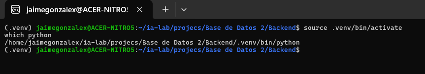

**Paso 1. Crear el manager de reservas**

El archivo `apps/sale/managers.py` es nuevo. En este ISS, el manager todavía no registra la reserva ni ejecuta operaciones del negocio: solo permite que el modelo `Booking` utilice un manager propio a través de `objects`.

El método `register` se agregará más adelante, cuando se implemente el proceso de registro de reservas y se requiera manejar la operación de forma transaccional.

Ruta del archivo: **apps/sale/managers.py**

``` sql

from django.db import models


class BookingManager(models.Manager):
    """Manager personalizado para las reservas de WayuuTravel."""
    pass
```


### Paso 2. Escribir los modelos

El archivo `apps/sale/models.py` ya existe. Se reescribe completo para definir los modelos `Booking`, `Payment`, `Cancellation` y `Voucher`, correspondientes al flujo comercial de WayuuTravel. No se utiliza `ManyToManyField`, ya que las relaciones entre clientes, viajeros, salidas programadas y reservas se representan mediante claves foráneas explícitas.

Según el diseño de la base de datos, `Booking` relaciona un cliente, una salida programada y un viajero, además de almacenar las fechas y observaciones de la reserva. `Payment` registra el tipo de referencia, la reserva asociada, el método de pago, el importe, la fecha del pago y su estado.

Por su parte, `Cancellation` permite registrar las cancelaciones asociadas a una reserva, mientras que `Voucher` conserva la información de los comprobantes correspondientes. Los modelos heredan del modelo base `Wayuutravel` para reutilizar los campos comunes definidos en el proyecto.

Las relaciones y las restricciones de integridad se configuran de acuerdo con el esquema de la base de datos, evitando eliminar reservas que tengan registros relacionados y preservando la trazabilidad de las operaciones turísticas.

``` sql

from django.core.validators import MinValueValidator
from django.db import models

from apps.common.models import Wayuutravel
from apps.client.models import Client, Traveler
from apps.product.models import Departure


class Booking(Wayuutravel):
    client = models.ForeignKey(
        Client,
        on_delete=models.PROTECT,
        related_name="bookings",
        db_column="client_id"
    )
    departure = models.ForeignKey(
        Departure,
        on_delete=models.PROTECT,
        related_name="bookings",
        db_column="departure_id"
    )
    traveler = models.ForeignKey(
        Traveler,
        on_delete=models.PROTECT,
        related_name="bookings",
        db_column="traveler_id"
    )
    start_date = models.DateField()
    end_date = models.DateField()
    observations = models.TextField(
        null=True,
        blank=True
    )

    class Meta:
        db_table = "bookings"
        verbose_name = "reserva"
        verbose_name_plural = "reservas"
        ordering = ["-created_at", "id"]
        constraints = [
            Wayuutravel.status_constraint("bookings_status_valid"),
            models.CheckConstraint(
                condition=models.Q(end_date__gte=models.F("start_date")),
                name="bookings_end_date_gte_start_date"
            ),
        ]

    def __str__(self):
        return f"Reserva #{self.pk}"


class Payment(Wayuutravel):
    reference_type = models.CharField(max_length=50)
    booking = models.ForeignKey(
        Booking,
        on_delete=models.PROTECT,
        related_name="payments",
        db_column="booking_id"
    )
    method = models.CharField(max_length=50)
    amount = models.DecimalField(
        max_digits=12,
        decimal_places=2,
        validators=[MinValueValidator(0.01)]
    )
    payment_date = models.DateTimeField()

    class Meta:
        db_table = "payments"
        verbose_name = "pago"
        verbose_name_plural = "pagos"
        ordering = ["-payment_date", "id"]
        constraints = [
            Wayuutravel.status_constraint("payments_status_valid")
        ]

    def __str__(self):
        return f"Pago #{self.pk} - {self.amount}"


class Cancellation(Wayuutravel):
    booking = models.ForeignKey(
        Booking,
        on_delete=models.PROTECT,
        related_name="cancellations",
        db_column="booking_id"
    )
    name = models.CharField(max_length=100)
    descriptions = models.TextField(
        null=True,
        blank=True
    )

    class Meta:
        db_table = "cancellations"
        verbose_name = "cancelación"
        verbose_name_plural = "cancelaciones"
        ordering = ["-created_at", "id"]
        constraints = [
            Wayuutravel.status_constraint("cancellations_status_valid")
        ]

    def __str__(self):
        return self.name


class Voucher(Wayuutravel):
    booking = models.ForeignKey(
        Booking,
        on_delete=models.PROTECT,
        related_name="vouchers",
        db_column="booking_id"
    )
    name = models.CharField(max_length=100)
    descriptions = models.TextField(
        null=True,
        blank=True
    )

    class Meta:
        db_table = "vouchers"
        verbose_name = "comprobante"
        verbose_name_plural = "comprobantes"
        ordering = ["-created_at", "id"]
        constraints = [
            Wayuutravel.status_constraint("vouchers_status_valid")
        ]

    def __str__(self):
        return self.name
```


**Paso 3. Generar la migración y migrar**

``` sql
python manage.py makemigrations sale
python manage.py migrate
```


El método `cancel()` ya está en tu modelo `Booking`; el endpoint que lo invoque puede implementarse en un ISS posterior. El manager personalizado `BookingManager` puede ampliarse más adelante con un método `register()` cuando implementes el registro transaccional de reservas.

## Paso 4. Comprobar en el shell

``` sql
python manage.py shell
```

``` sql
from datetime import date, timedelta
from django.utils import timezone
from apps.client.models import Client, Traveler
from apps.product.models import Package, Departure
from apps.sale.models import Booking, Payment, Cancellation, Voucher

c = Client.objects.create(document_type="CC", document_number="WT-TEST-301", name="Cliente Prueba", email="prueba301@wayuutravel.com")

t = Traveler.objects.create(name="Viajero Prueba", description="Viajero de prueba")

p = Package.objects.create(name="Paquete Prueba", description="Paquete turístico de prueba")

d = Departure.objects.create(name="Salida Prueba", description="Salida turística de prueba", package=p, departure_date=timezone.now() + timedelta(days=10), capacity=10, available_capacity=10)

b = Booking.objects.create(client=c, departure=d, traveler=t, start_date=date.today() + timedelta(days=10), end_date=date.today() + timedelta(days=12), observations="Reserva de prueba")

pay = Payment.objects.create(booking=b, reference_type="booking", method="efectivo", amount=80000, payment_date=timezone.now())

can = Cancellation.objects.create(booking=b, name="Cancelación de prueba", descriptions="Cancelación de prueba")

v = Voucher.objects.create(booking=b, name="Comprobante de prueba", descriptions="Comprobante de prueba")

b.status

```


### Paso 4. Comprobar los resultados

``` sql
b.status
b.payments.count()
b.cancellations.count()
b.vouchers.count()

c.status
t.status
p.status
d.status
b.status
pay.status
can.status
v.status
```


#### Explicación

La reserva (`Booking`) es la entidad que relaciona a un cliente (`Client`), una salida turística (`Departure`) y un viajero (`Traveler`). Guarda sus propios datos, como las fechas de inicio y fin, las observaciones y el estado; por eso se representa como un modelo independiente y no mediante un `ManyToManyField`.

Para navegar entre los registros relacionados se utilizan `booking.payments.all()`, `booking.cancellations.all()` y `booking.vouchers.all()`. Las claves foráneas usan `RESTRICT` para impedir la eliminación de registros que tengan dependencias relacionadas.

El método `cancel()` desactiva la reserva dentro de una transacción y conserva los registros relacionados. En la implementación actual, no desactiva automáticamente los pagos. Si necesitas que los pagos activos también se desactiven al cancelar una reserva, habrá que incorporar esa lógica al método.

```         
Client 1 ───── N Booking N ───── 1 Departure Traveler 1 ─── N Booking Booking 1 ──── N Payment Booking 1 ──── N Cancellation Booking 1 ──── N Voucher Departure N ── 1 Package Package 1 ──── N IncludedService N ──── 1 Supplier
```

#### Criterios de aceptación

- AC-06-01: existen las tablas `bookings`, `payments`, `cancellations` y `vouchers`.

- AC-06-02: las claves foráneas correspondientes utilizan `RESTRICT`.

- AC-06-03: la fecha de fin de una reserva no puede ser anterior a la fecha de inicio.

- AC-06-04: cancelar una reserva cambia su estado a inactivo y conserva los registros relacionados.

- AC-06-05: no se utiliza un `ManyToManyField` para relacionar clientes con salidas y viajeros; la reserva representa esa relación.

- AC-06-06: los pagos, cancelaciones y comprobantes pueden consultarse desde su reserva.

#### Verificación

La guía comprueba estos criterios mediante las migraciones aplicadas y las pruebas realizadas en el shell de Django.

``` sql
python manage.py showmigrations sale
```

Luego

``` sql
python manage.py sqlmigrate sale 0001
```

Resulatdo


#### **GATE**

- **AC-06-01:** `sqlmigrate` muestra las tres tablas. **PASS**.

- **AC-06-02:** `RestrictedError` al borrar el plan y la membresía. **PASS**.

- **AC-06-03:** `IntegrityError` con fechas inválidas. **PASS**.

- **AC-06-04:** `void()` deja `inactive inactive`. **PASS**.

- **AC-06-05:** no hay `ManyToManyField` en `membership/models.py`. **P**

## ISS-07 — Serializers y JSON camelCase

### Narrativa

Los modelos de WayuuTravel ya existen y sus migraciones están aplicadas. Sin embargo, la API todavía necesita una capa de comunicación con el frontend. En esta unidad instalaremos Django REST Framework, configuraremos la conversión de nombres de campos a `camelCase` y crearemos serializers para validar y transformar los datos de clientes, paquetes turísticos, salidas, reservas y pagos.

Los campos de Python seguirán en `snake_case`, por ejemplo, `created_at`, mientras que la API los expondrá como `createdAt`. Esta conversión ocurre en la comunicación HTTP, sin renombrar los campos de los modelos ni modificar las tablas de MySQL.

### Objetivo

Convertir los modelos de WayuuTravel en respuestas JSON y validar los datos recibidos por la API, utilizando nombres de campos `camelCase` sin modificar los modelos existentes.

### Requisitos

- ISS-06 superado.

- Entorno virtual `.venv` activo.

- Modelos y migraciones de Wayuu Travel disponibles.

## Construcción

### Paso 0. Activar el entorno e instalar los paquetes de la API

En tu terminal de Ubuntu, ve a la carpeta del backend:

``` sql
source .venv/bin/activate
python -m pip install "djangorestframework==3.17.2" "djangorestframework-camel-case==1.4.2" "django-cors-headers==4.9.0"
python -m pip freeze > requirements.txt
```

- `djangorestframework` aporta los serializers, las vistas y el cliente de pruebas. Sin él, `from rest_framework import serializers` falla.

- `djangorestframework-camel-case` convierte `created_at` en `createdAt` al responder, y al revés al recibir.

`django-cors-headers` evita que un navegador en otro origen bloquee la API. En el laboratorio se permiten todos los orígenes; en producción se listan explícitamente.


**Paso 1. Parchear `config/settings/__init__.py`**

El archivo ya existe. DRF entra ahora con permiso abierto (`AllowAny`), porque todavía no hay autenticación; un ISS posterior cambia ese valor.

Encima de `"apps.security.apps.SecurityConfig",` agrega:

``` sql
    "rest_framework",
    "corsheaders",
```

Encima de `"django.middleware.security.SecurityMiddleware",` agrega:

``` sql
    "corsheaders.middleware.CorsMiddleware",
```


Debajo de `DEFAULT_AUTO_FIELD = "django.db.models.BigAutoField"` agrega:

``` sql
CORS_ALLOW_ALL_ORIGINS = os.environ.get("CORS_ALLOW_ALL_ORIGINS", "True").strip().lower() in {
    "1",
    "true",
    "yes",
    "on",
}

REST_FRAMEWORK = {
    "DEFAULT_PERMISSION_CLASSES": [
        "rest_framework.permissions.AllowAny",
    ],
    "DEFAULT_RENDERER_CLASSES": [
        "djangorestframework_camel_case.render.CamelCaseJSONRenderer",
        "djangorestframework_camel_case.render.CamelCaseBrowsableAPIRenderer",
    ],
    "DEFAULT_PARSER_CLASSES": [
        "djangorestframework_camel_case.parser.CamelCaseJSONParser",
        "djangorestframework_camel_case.parser.CamelCaseFormParser",
        "djangorestframework_camel_case.parser.CamelCaseMultiPartParser",
    ],
    "DEFAULT_PAGINATION_CLASS": None,
}
```


**Paso 2. Serializers de `client (clients,travelers)`**

Los archivos `serializers.py` no existen: `startapp` no los crea. Archivo `apps/client/serializers.py`:

``` sql

from rest_framework import serializers

from apps.client.models import Client, Traveler


class ClientSerializer(serializers.ModelSerializer):
    class Meta:
        model = Client
        fields = [
            "id",
            "document_type",
            "document_number",
            "name",
            "phone",
            "email",
            "status",
            "created_at",
            "updated_at",
        ]
        read_only_fields = ["id", "created_at", "updated_at"]
        extra_kwargs = {
            "document_type": {"min_length": 2, "max_length": 20},
            "document_number": {"min_length": 3, "max_length": 30},
            "name": {"min_length": 2, "max_length": 150},
            "email": {
                "required": False,
                "allow_null": True,
                "allow_blank": True,
            },
            "phone": {
                "required": False,
                "allow_null": True,
                "allow_blank": True,
            },
        }

    def validate_email(self, value):
        if value is None or str(value).strip() == "":
            return None
        return value.strip().lower()

    def validate(self, attrs):
        if attrs.get("phone") == "":
            attrs["phone"] = None
        return attrs


class TravelerSerializer(serializers.ModelSerializer):
    class Meta:
        model = Traveler
        fields = [
            "id",
            "name",
            "description",
            "status",
            "created_at",
            "updated_at",
        ]
        read_only_fields = ["id", "created_at", "updated_at"]
        extra_kwargs = {
            "name": {"min_length": 2, "max_length": 150},
            "description": {
                "required": False,
                "allow_null": True,
                "allow_blank": True,
            },
        }

    def validate(self, attrs):
        if attrs.get("description") == "":
            attrs["description"] = None
        return attrs
```


**Paso 3. Serializers de product (packages, departures, suppliers, included_services)**

Archivo `apps/product/serializers.py`:

``` sql

from rest_framework import serializers

from apps.product.models import Package, Departure, Supplier, IncludedService


class PackageSerializer(serializers.ModelSerializer):
    class Meta:
        model = Package
        fields = [
            "id",
            "name",
            "description",
            "status",
            "created_at",
            "updated_at",
        ]
        read_only_fields = ["id", "created_at", "updated_at"]
        extra_kwargs = {
            "name": {"min_length": 2, "max_length": 150},
            "description": {
                "required": False,
                "allow_null": True,
                "allow_blank": True,
            },
        }

    def validate(self, attrs):
        if attrs.get("description") == "":
            attrs["description"] = None
        return attrs


class DepartureSerializer(serializers.ModelSerializer):
    class Meta:
        model = Departure
        fields = [
            "id",
            "name",
            "description",
            "package",
            "departure_date",
            "capacity",
            "available_capacity",
            "status",
            "created_at",
            "updated_at",
        ]
        read_only_fields = ["id", "created_at", "updated_at"]
        extra_kwargs = {
            "name": {"min_length": 2, "max_length": 150},
            "description": {
                "required": False,
                "allow_null": True,
                "allow_blank": True,
            },
            "capacity": {"min_value": 1},
            "available_capacity": {"min_value": 0},
        }

    def validate(self, attrs):
        if attrs.get("description") == "":
            attrs["description"] = None

        capacity = attrs.get(
            "capacity",
            getattr(self.instance, "capacity", None),
        )
        available_capacity = attrs.get(
            "available_capacity",
            getattr(self.instance, "available_capacity", None),
        )

        if (
            capacity is not None
            and available_capacity is not None
            and available_capacity > capacity
        ):
            raise serializers.ValidationError({
                "available_capacity": (
                    "La capacidad disponible no puede superar "
                    "la capacidad total."
                )
            })

        return attrs


class SupplierSerializer(serializers.ModelSerializer):
    class Meta:
        model = Supplier
        fields = [
            "id",
            "nit",
            "razon_social",
            "phone",
            "email",
            "status",
            "created_at",
            "updated_at",
        ]
        read_only_fields = ["id", "created_at", "updated_at"]
        extra_kwargs = {
            "nit": {"required": True},
            "razon_social": {"min_length": 2, "max_length": 150},
            "phone": {
                "required": False,
                "allow_null": True,
                "allow_blank": True,
            },
            "email": {
                "required": False,
                "allow_null": True,
                "allow_blank": True,
            },
        }

    def validate_email(self, value):
        if value is None or str(value).strip() == "":
            return None
        return value.strip().lower()

    def validate(self, attrs):
        if attrs.get("phone") == "":
            attrs["phone"] = None
        return attrs


class IncludedServiceSerializer(serializers.ModelSerializer):
    class Meta:
        model = IncludedService
        fields = [
            "id",
            "package",
            "supplier",
            "relation_data",
            "status",
            "created_at",
            "updated_at",
        ]
        read_only_fields = ["id", "created_at", "updated_at"]
        extra_kwargs = {
            "relation_data": {
                "required": False,
                "allow_null": True,
            },
        }
```


**Paso 3. Serializers de sale (bookings, payments, cancellations, vouchers)**

Archivo `apps/sale/serializers.py`:

``` sql

from rest_framework import serializers

from apps.sale.models import Booking, Payment, Cancellation, Voucher


class BookingSerializer(serializers.ModelSerializer):
    class Meta:
        model = Booking
        fields = [
            "id",
            "client",
            "departure",
            "traveler",
            "start_date",
            "end_date",
            "observations",
            "status",
            "created_at",
            "updated_at",
        ]
        read_only_fields = ["id", "created_at", "updated_at"]
        extra_kwargs = {
            "observations": {
                "required": False,
                "allow_null": True,
                "allow_blank": True,
            },
        }

    def validate(self, attrs):
        start_date = attrs.get(
            "start_date",
            getattr(self.instance, "start_date", None),
        )
        end_date = attrs.get(
            "end_date",
            getattr(self.instance, "end_date", None),
        )

        if start_date and end_date and end_date < start_date:
            raise serializers.ValidationError({
                "end_date": (
                    "La fecha final no puede ser anterior "
                    "a la fecha de inicio."
                )
            })

        if attrs.get("observations") == "":
            attrs["observations"] = None

        return attrs


class PaymentSerializer(serializers.ModelSerializer):
    class Meta:
        model = Payment
        fields = [
            "id",
            "booking",
            "reference_type",
            "method",
            "amount",
            "payment_date",
            "status",
        ]
        read_only_fields = ["id"]
        extra_kwargs = {
            "reference_type": {"max_length": 50},
            "method": {"max_length": 50},
            "amount": {"min_value": 0},
        }


class CancellationSerializer(serializers.ModelSerializer):
    class Meta:
        model = Cancellation
        fields = [
            "id",
            "booking",
            "name",
            "descriptions",
            "status",
            "created_at",
            "updated_at",
        ]
        read_only_fields = ["id", "created_at", "updated_at"]
        extra_kwargs = {
            "name": {"min_length": 2, "max_length": 100},
            "descriptions": {
                "required": False,
                "allow_null": True,
                "allow_blank": True,
            },
        }

    def validate(self, attrs):
        if attrs.get("descriptions") == "":
            attrs["descriptions"] = None
        return attrs


class VoucherSerializer(serializers.ModelSerializer):
    class Meta:
        model = Voucher
        fields = [
            "id",
            "booking",
            "name",
            "descriptions",
            "status",
            "created_at",
            "updated_at",
        ]
        read_only_fields = ["id", "created_at", "updated_at"]
        extra_kwargs = {
            "name": {"min_length": 2, "max_length": 100},
            "descriptions": {
                "required": False,
                "allow_null": True,
                "allow_blank": True,
            },
        }

    def validate(self, attrs):
        if attrs.get("descriptions") == "":
            attrs["descriptions"] = None
        return attrs
```


#### Paso 4. Verificar la configuración

``` sql
python manage.py check
```


## Explicación

Los serializers no utilizan `fields = "__all__"`: cada campo que se expone en la API se declara explícitamente. Esto permite controlar qué datos pueden enviarse y recibirse.

En `ClientSerializer`, los correos vacíos se convierten en `None` y los correos válidos se normalizan a minúsculas. Así se evitan problemas con cadenas vacías cuando el campo admite valores nulos y tiene una restricción de unicidad.

Los serializers de relaciones permiten identificar los registros relacionados mediante sus claves foráneas. Por ejemplo, `BookingSerializer` expone los identificadores de `client`, `departure` y `traveler`. Si más adelante quieres incluir sus nombres directamente en el JSON, podemos añadir campos de solo lectura como `clientName`, `departureName` y `travelerName`.

La conversión de nombres ocurre en el borde HTTP:

```         
Campo Python       Columna MySQL       JSON de la API created_at    →    created_at     →   createdAt document_type →    document_type  →   documentType
```

El parser realiza el camino inverso al recibir JSON. Los modelos y las columnas de MySQL permanecen en `snake_case`; no es necesario renombrarlos.

## Criterios de aceptación

- AC-07-01: el JSON de un cliente contiene `createdAt` y no `created_at`.

- AC-07-02: el correo `Maria@Example.com` se normaliza a `maria@example.com`.

- AC-07-03: las reservas exponen los identificadores de cliente, salida y viajero. Si se requieren los nombres `clientName`, `departureName` y `travelerName`, deben añadirse explícitamente a `BookingSerializer`.

## Verificación

Todavía no podemos verificar el JSON HTTP porque necesitamos configurar las vistas y las rutas de la API. Por ahora, podemos probar la normalización del correo desde el shell de Django.

``` sql
python manage.py shell
```

datos de entrada

``` sql
from apps.client.serializers import ClientSerializer

serializer = ClientSerializer(data={
    "document_type": "CC",
    "document_number": "ISS07-001",
    "name": "Maria Prueba",
    "email": "Maria@Example.com",
    "phone": "3001234567",
})

serializer.is_valid()
```


despues

``` sql
serializer.validated_data["email"]
```


#### **GATE**

- **AC-07-01:** el render muestra `createdAt`. **PASS**.

- **AC-07-02:** el correo se guarda en minúsculas. **PASS**.

- **AC-07-03:** `trainerName` y `clientName` aparecen en la rutina. **PASS**.

### ISS-08 — Client con ModelViewSet

**Narrativa**

Con los serializers de WayuuTravel preparados en la ISS-07, se implementa el primer endpoint REST para la gestión de clientes. Para ello, se utiliza `ModelViewSet` de Django REST Framework, una clase que proporciona las operaciones CRUD necesarias para listar, crear, consultar, actualizar y desactivar clientes sin tener que implementar manualmente cada operación.

El comportamiento personalizado consiste en evitar la eliminación física de los clientes. Cuando se recibe una solicitud DELETE, el sistema cambia el estado del cliente a `inactive`, conservando su registro en la base de datos y manteniendo la integridad del historial relacionado con las reservas y demás operaciones turísticas.

En esta unidad también se crea el archivo `urls.py` de la aplicación `apps/client` y se conecta al sistema de rutas principal del proyecto mediante el prefijo `/api/`. De esta manera, los clientes quedan disponibles a través de endpoints REST que pueden ser consumidos por el frontend de Wayuu Travel.

Durante esta fase, la API se publica sin autenticación mediante `permission_classes = [AllowAny]`, con el propósito de facilitar la implementación y las pruebas iniciales. La autenticación y el control de permisos se incorporarán en unidades posteriores, cuando se implemente la seguridad de la aplicación.

**Objetivo**

Implementar y publicar el CRUD de clientes de WayuuTrave mediante `ModelViewSet`, permitiendo gestionar los registros de la tabla `clients` a través de una API REST y conservando el historial mediante la desactivación lógica de los clientes.

**Requisitos**

- ISS-07 superado: serializers implementados y preparados para la conversión de nombres entre `snake_case` y `camelCase`.

- Entorno virtual `.venv` activo.

- Django REST Framework instalado y configurado.

- Modelo `Client` y tabla `clients` disponibles en la base de datos MySQL.

- Archivo `ClientSerializer` implementado en `apps/client/serializers.py`.

##### **Construcción**

**Paso 0. Activar el entorno virtual**

``` sql
source .venv/bin/activate 
which python
```


El archivo `apps/client/views.py` ya existe. Se reescribe entero. La baja lógica se implementa con `perform_destroy`, que es el punto de extensión de DRF; no se reescribe `delete()`.

``` sql
from rest_framework import viewsets
from rest_framework.permissions import AllowAny

from apps.client.models import Client
from apps.client.serializers import ClientSerializer
from apps.common.status import RecordStatus


class ClientViewSet(viewsets.ModelViewSet):
    queryset = Client.objects.all()
    serializer_class = ClientSerializer
    permission_classes = [AllowAny]
    lookup_value_converter = "int"

    def get_queryset(self):
        queryset = super().get_queryset()
        status_value = self.request.query_params.get("status")
        if status_value:
            queryset = queryset.filter(status=status_value)
        return queryset

    def perform_destroy(self, instance):
        instance.status = RecordStatus.INACTIVE
        instance.save(update_fields=["status", "updated_at"])
```


**Paso 2. Crear las rutas de la app**

Las apps no traen `urls.py`. Se crea ahora porque es el primer endpoint. Archivo `apps/client/urls.py`:

``` sql
from rest_framework.routers import SimpleRouter

from apps.client.views import ClientViewSet

router = SimpleRouter(use_regex_path=False)
router.register("clients", ClientViewSet, basename="client")

urlpatterns = router.urls
```


**Paso 3. Conectar las rutas al proyecto**

El archivo `config/urls.py` ya existe; no se regenera, se edita. Se busca esta línea:

``` sql
from django.urls import path
```

Y se reemplaza por:

``` sql
from django.urls import include, path
```

Debajo de la línea `path("admin/", admin.site.urls),` se agrega:

``` sql
    path("api/", include("apps.client.urls")),
```


**Paso 4. Escribir las pruebas**

El archivo `apps/client/tests.py` también existe y se reescribe. Las pruebas son de acceso abierto: no hay usuario ni token. Cada cliente lleva su propio correo y su propio documento, porque ambos son únicos.

``` sql
import json

from rest_framework import status
from rest_framework.test import APITestCase

from apps.client.models import Client
from apps.common.status import RecordStatus


class ClientApiTests(APITestCase):
    def test_create_defaults_and_persists(self):
        response = self.client.post(
            "/api/clients/",
            {
                "document_type": "CC",
                "document_number": "1234567890",
                "name": "María García",
                "email": "Maria@Example.com",
                "phone": "3001234567",
            },
            format="json",
        )
        self.assertEqual(response.status_code, status.HTTP_201_CREATED)
        self.assertEqual(response.data["status"], RecordStatus.INACTIVE)
        self.assertEqual(response.data["email"], "maria@example.com")
        wire = json.loads(response.content)
        self.assertIn("createdAt", wire)
        self.assertNotIn("created_at", wire)
        stored = Client.objects.get(pk=response.data["id"])
        self.assertEqual(stored.name, "María García")

    def test_invalid_name_and_duplicate_email(self):
        invalid = self.client.post(
            "/api/clients/",
            {
                "document_type": "CC",
                "document_number": "1111111111",
                "name": "A",
                "email": "a@example.com",
            },
            format="json",
        )
        self.assertEqual(invalid.status_code, status.HTTP_400_BAD_REQUEST)
        self.client.post(
            "/api/clients/",
            {
                "document_type": "CC",
                "document_number": "2222222222",
                "name": "Ana Ruiz",
                "email": "ana@example.com",
            },
            format="json",
        )
        duplicate = self.client.post(
            "/api/clients/",
            {
                "document_type": "CC",
                "document_number": "3333333333",
                "name": "Otra Ana",
                "email": "ana@example.com",
            },
            format="json",
        )
        self.assertEqual(duplicate.status_code, status.HTTP_400_BAD_REQUEST)

    def test_soft_delete_keeps_the_row(self):
        created = self.client.post(
            "/api/clients/",
            {
                "document_type": "CC",
                "document_number": "4444444444",
                "name": "Pedro León",
                "email": "pedro@example.com",
            },
            format="json",
        )
        deleted = self.client.delete(f"/api/clients/{created.data['id']}/")
        self.assertEqual(deleted.status_code, status.HTTP_204_NO_CONTENT)
        stored = Client.objects.get(pk=created.data["id"])
        self.assertEqual(stored.status, RecordStatus.INACTIVE)
        self.assertEqual(Client.objects.count(), 1)

    def test_list_retrieve_and_update(self):
        created = self.client.post(
            "/api/clients/",
            {
                "document_type": "CC",
                "document_number": "5555555555",
                "name": "Luisa Mora",
                "email": "luisa@example.com",
                "phone": "111",
            },
            format="json",
        )
        pk = created.data["id"]
        listed = self.client.get("/api/clients/")
        self.assertEqual(listed.status_code, status.HTTP_200_OK)
        detail = self.client.get(f"/api/clients/{pk}/")
        self.assertEqual(detail.status_code, status.HTTP_200_OK)
        self.assertEqual(detail.data["name"], "Luisa Mora")
        updated = self.client.patch(
            f"/api/clients/{pk}/",
            {"phone": "222", "status": "active"},
            format="json",
        )
        self.assertEqual(updated.status_code, status.HTTP_200_OK)
        self.assertEqual(updated.data["status"], "active")
```


**Paso 5. Ejecutar las pruebas**

``` sql
python manage.py test apps.client
```

Debe terminar con `Ran 4 tests` y `OK`. Estas pruebas cubren el CRUD completo del cliente: alta, listado, detalle, actualización y baja lógica.


Una advertencia: a diferencia de las pruebas del ISS-03, estas sí usan base de datos, y Django crea una base temporal con el prefijo `test_`. Si usas MySQL o PostgreSQL y el usuario de tu `.env` no tiene permiso para crear bases de datos, la prueba fallará con un error de permisos. Se arregla otorgándole ese permiso al usuario.

#### **Explicación**

`ModelViewSet` de Django REST Framework proporciona las operaciones `list`, `create`, `retrieve`, `update`, `partial_update` y `destroy`. En Wayuu Travel se utiliza para implementar el CRUD de clientes asociado al modelo `Client` y a la tabla `clients` de MySQL.

El comportamiento personalizado consiste en realizar una **baja lógica**: cuando se solicita eliminar un cliente, su estado cambia a `inactive`, pero el registro permanece en la base de datos. Para implementar este comportamiento, se puede sobrescribir `perform_destroy()` y cambiar el estado de la instancia en lugar de eliminarla físicamente.

`SimpleRouter` genera las rutas necesarias para las operaciones del recurso:

``` sql
clients/              list, create
clients/<int:pk>/     retrieve, update, partial_update, destroy
```

La opción `use_regex_path=False` permite utilizar convertidores de ruta de Django en lugar de expresiones regulares. Con `lookup_value_converter = "int"`, el identificador del cliente se interpreta como un entero y la ruta de detalle utiliza el formato `<int:pk>`.

Se utiliza `SimpleRouter` porque genera únicamente las rutas del recurso, sin publicar una raíz de API adicional. Esto resulta conveniente cuando varias aplicaciones de Wayuu Travel comparten el prefijo `/api/`.

El proyecto principal proporciona el prefijo `api/`, mientras que la aplicación `apps/client` registra el recurso `clients`. Django concatena ambos segmentos para formar la ruta `/api/clients/`.

**Flujo de una solicitud**

``` sql
GET/POST /api/clients/
GET/PUT/PATCH/DELETE /api/clients/<int:pk>/
        │
        ▼
   ClientViewSet
        │
        ▼
   ClientSerializer
        │
        ▼
   clients
```

El parámetro opcional `?status=` permite filtrar los clientes por estado, siempre que dicho filtro esté implementado en la vista. Si no se especifica un estado y el queryset no aplica un filtro predeterminado, se incluyen tanto los clientes activos como los inactivos.

#### **Cómo probarlo**

La prueba es de capa HTTP, con acceso abierto. No hace falta `runserver`: `APITestCase` llama la ruta dentro del proceso y la base temporal se borra al terminar.

``` sq
python manage.py test apps.client
        │
        ▼
ClientApiTests                 sin usuario, sin Bearer, sin permisos
        │
        ├── POST   /api/clients/           201   status inactive, email en minúsculas
        ├── GET    /api/clients/           200   la fila aparece en la lista
        ├── GET    /api/clients/<id>/      200   el detalle conserva el nombre
        ├── PATCH  /api/clients/<id>/      200   phone y status cambian
        └── DELETE /api/clients/<id>/      204   la fila sigue, status inactive
```

Si además quieres verlo funcionando a mano, arranca el servidor y consulta la lista desde otra terminal:

``` sql
python manage.py runserver
```

``` sql
curl http://127.0.0.1:8000/api/clients/
```

Swagger todavía no existe; llega más adelante con OpenAPI.


#### **Criterios de aceptación**

- **AC-08-01:** un POST válido responde 201.

- **AC-08-02:** el registro queda en la tabla.

- **AC-08-03:** DELETE responde 204 y la fila sigue, con `status = inactive`.

- **AC-08-04:** el cuerpo inválido responde 400.

#### **Verificación**

Las pruebas de `ClientApiTests`, con el comando del Paso 5.

#### **GATE**

- **AC-08-01:** POST responde 201. **PASS**.

- **AC-08-02:** `Client.objects.get` encuentra el registro. **PASS**.

- **AC-08-03:** DELETE lógico, la fila permanece inactiva. **PASS**.

- **AC-08-04:** nombre inválido responde 400. **PASS**.

- 

### **ISS-09 — Catálogo y seguimiento con ModelViewSet**

**Narrativa**

Con el CRUD de clientes funcionando, ActivaFit extiende el mismo patrón al resto de sus recursos homogéneos: planes, entrenadores, ejercicios, rutinas, ejercicios de rutina y medidas. Para no copiar `perform_destroy` y el filtro de estado en cada vista, se extrajo una vista base compartida, `CatalogViewSet`, que sigue siendo un `ModelViewSet`. Las medidas son la excepción: su tabla no tiene estado, así que no hay baja lógica posible y su vista usa el borrado real. El acceso sigue siendo abierto en esta fase; la seguridad llega en unidades posteriores.

**Objetivo**

Publicar los catálogos y el seguimiento de ActivaFit con el mismo criterio de CRUD homogéneo.

**Requisitos**

- ISS-08 superado.

- Terminal con el entorno virtual `.venv` activo.

#### **Construcción**

## **Paso 0. Activar el entorno virtual**

``` sql
source .venv/bin/activate
which python
```


`apps/common` es un paquete, no una app, así que el archivo `views.py` es nuevo. Contiene la vista base con baja lógica y filtro `status=`. Archivo `apps/common/views.py`:

``` sql
from rest_framework import viewsets
from rest_framework.permissions import AllowAny

from apps.common.status import RecordStatus


class CatalogViewSet(viewsets.ModelViewSet):
    permission_classes = [AllowAny]
    lookup_value_converter = "int"

    def get_queryset(self):
        queryset = super().get_queryset()
        status_value = self.request.query_params.get("status")
        if status_value:
            queryset = queryset.filter(status=status_value)
        return queryset

    def perform_destroy(self, instance):
        instance.status = RecordStatus.INACTIVE
        instance.save(update_fields=["status", "updated_at"])
```


## **Paso 2. Escribir las vistas de cada app**

Los archivos `views.py` ya existen (los creó `startapp`) y se reescriben enteros. Las que tienen estado heredan de `CatalogViewSet`.

Archivo `apps/product/views.py`:

``` sql

from rest_framework import viewsets
from rest_framework.permissions import AllowAny

from apps.product.models import (
    Package,
    Departure,
    Supplier,
    IncludedService,
)
from apps.product.serializers import (
    PackageSerializer,
    DepartureSerializer,
    SupplierSerializer,
    IncludedServiceSerializer,
)


class PackageViewSet(viewsets.ModelViewSet):
    queryset = Package.objects.all()
    serializer_class = PackageSerializer
    permission_classes = [AllowAny]


class DepartureViewSet(viewsets.ModelViewSet):
    queryset = Departure.objects.select_related("package").all()
    serializer_class = DepartureSerializer
    permission_classes = [AllowAny]


class SupplierViewSet(viewsets.ModelViewSet):
    queryset = Supplier.objects.all()
    serializer_class = SupplierSerializer
    permission_classes = [AllowAny]


class IncludedServiceViewSet(viewsets.ModelViewSet):
    queryset = IncludedService.objects.select_related(
        "package", "supplier"
    ).all()
    serializer_class = IncludedServiceSerializer
    permission_classes = [AllowAny]
```


## 3. Archivo `apps/sale/views.py`

Esta versión habilita las operaciones CRUD para reservas, pagos, cancelaciones y vouchers. No agrega baja lógica automáticamente: si alguno de estos modelos tiene `status` y necesitas conservar el historial, habría que adaptar su `perform_destroy()`.

``` sql
from rest_framework import viewsets
from rest_framework.permissions import AllowAny

from apps.sale.models import (
    Booking,
    Payment,
    Cancellation,
    Voucher,
)
from apps.sale.serializers import (
    BookingSerializer,
    PaymentSerializer,
    CancellationSerializer,
    VoucherSerializer,
)


class BookingViewSet(viewsets.ModelViewSet):
    queryset = Booking.objects.all()
    serializer_class = BookingSerializer
    permission_classes = [AllowAny]


class PaymentViewSet(viewsets.ModelViewSet):
    queryset = Payment.objects.all()
    serializer_class = PaymentSerializer
    permission_classes = [AllowAny]


class CancellationViewSet(viewsets.ModelViewSet):
    queryset = Cancellation.objects.all()
    serializer_class = CancellationSerializer
    permission_classes = [AllowAny]


class VoucherViewSet(viewsets.ModelViewSet):
    queryset = Voucher.objects.all()
    serializer_class = VoucherSerializer
    permission_classes = [AllowAny]
```


## Paso 4. Crear las rutas de cada app

Para que las API de `product` y `sale` funcionen en Wayuu Travel, debemos crear sus archivos `urls.py` y registrar las rutas de sus vistas mediante `DefaultRouter` o `SimpleRouter` de Django REST Framework.

#### 4.1. Configurar las rutas de `product`

`apps/product/urls.py`

``` sql


from rest_framework.routers import DefaultRouter

from apps.product.views import (
    PackageViewSet,
    DepartureViewSet,
    SupplierViewSet,
    IncludedServiceViewSet,
)

router = DefaultRouter()

router.register(r"packages", PackageViewSet, basename="package")
router.register(r"departures", DepartureViewSet, basename="departure")
router.register(r"suppliers", SupplierViewSet, basename="supplier")
router.register(
    r"included-services",
    IncludedServiceViewSet,
    basename="included-service",
)

urlpatterns = router.urls
```


Esto registra las rutas para consultar, crear, actualizar y eliminar paquetes, salidas, proveedores y servicios incluidos.

#### 4.2. Configurar las rutas de `sale`

`apps/sale/urls.py`

``` sql


from rest_framework.routers import DefaultRouter

from apps.sale.views import (
    BookingViewSet,
    PaymentViewSet,
    CancellationViewSet,
    VoucherViewSet,
)

router = DefaultRouter()

router.register(r"bookings", BookingViewSet, basename="booking")
router.register(r"payments", PaymentViewSet, basename="payment")
router.register(
    r"cancellations",
    CancellationViewSet,
    basename="cancellation",
)
router.register(r"vouchers", VoucherViewSet, basename="voucher")

urlpatterns = router.urls
```


### 4.3. Registrar las rutas en el proyecto principal

`config/urls.py`

Verifica que incluya las rutas de las tres apps. La configuración debería quedar así, conservando cualquier otra ruta que ya tengas:

``` sql

from django.contrib import admin
from django.urls import include, path

urlpatterns = [
    path("admin/", admin.site.urls),
    path("api/", include("apps.client.urls")),
    path("api/product/", include("apps.product.urls")),
    path("api/sale/", include("apps.sale.urls")),
]
```


## Paso 5. Escribir las pruebas

Vamos a crear pruebas automatizadas para las API de `product` y `sale`. El acceso es abierto, sin token, y los datos relacionados se crean mediante el ORM en `setUp()`.

Usaremos `APITestCase` de Django REST Framework para probar las operaciones HTTP y las respuestas de la API.

**5.1. Pruebas de `product`**

Archivo `apps/product/tests.py`:

``` sql

from datetime import timedelta
from decimal import Decimal

from django.utils import timezone
from rest_framework import status
from rest_framework.test import APITestCase

from apps.product.models import (
    Package,
    Departure,
    Supplier,
    IncludedService,
)


class ProductAPITests(APITestCase):
    def setUp(self):
        self.package = Package.objects.create(
            name="Tour Cabo de la Vela",
            description="Experiencia turística en La Guajira",
        )

        self.supplier = Supplier.objects.create(
            nit="900123456-7",
            razon_social="Operador Turístico Wayuu",
            phone="3001234567",
            email="operador@example.com",
        )

        self.departure = Departure.objects.create(
            name="Salida Cabo de la Vela",
            description="Salida de prueba",
            package=self.package,
            departure_date=timezone.now() + timedelta(days=7),
            capacity=20,
            available_capacity=15,
        )

    def test_list_packages(self):
        response = self.client.get("/api/product/packages/")

        self.assertEqual(response.status_code, status.HTTP_200_OK)

    def test_create_package(self):
        data = {
            "name": "Tour Punta Gallinas",
            "description": "Recorrido turístico de prueba",
        }

        response = self.client.post(
            "/api/product/packages/",
            data,
            format="json",
        )

        self.assertEqual(
            response.status_code,
            status.HTTP_201_CREATED,
        )
        self.assertTrue(
            Package.objects.filter(name="Tour Punta Gallinas").exists()
        )

    def test_list_departures(self):
        response = self.client.get("/api/product/departures/")

        self.assertEqual(response.status_code, status.HTTP_200_OK)

    def test_list_suppliers(self):
        response = self.client.get("/api/product/suppliers/")

        self.assertEqual(response.status_code, status.HTTP_200_OK)

    def test_list_included_services(self):
        response = self.client.get(
            "/api/product/included-services/"
        )

        self.assertEqual(response.status_code, status.HTTP_200_OK)
```


El código supone que `Package` y `Supplier` aceptan los campos indicados sin otros campos obligatorios. También supone que `IncludedService` puede listarse sin crear primero un registro de esa relación. Si tus modelos o serializadores exigen campos adicionales, ajustaremos los datos de prueba.

#### 5.2. Pruebas de `sale`

Abre `apps/sale/tests.py`

``` sql

from rest_framework import status
from rest_framework.test import APITestCase


class SaleAPITests(APITestCase):
    def test_list_bookings(self):
        response = self.client.get("/api/sale/bookings/")

        self.assertEqual(response.status_code, status.HTTP_200_OK)

    def test_list_payments(self):
        response = self.client.get("/api/sale/payments/")

        self.assertEqual(response.status_code, status.HTTP_200_OK)

    def test_list_cancellations(self):
        response = self.client.get("/api/sale/cancellations/")

        self.assertEqual(response.status_code, status.HTTP_200_OK)

    def test_list_vouchers(self):
        response = self.client.get("/api/sale/vouchers/")

        self.assertEqual(response.status_code, status.HTTP_200_OK)
```


## Paso 6. Ejecutar las pruebas

``` sql
python manage.py test apps.client apps.product apps.sale
```

## 

Debe terminar con `Ran 13 tests` y `OK`. Django crea una base de datos temporal para ejecutar las pruebas de forma aislada y luego la elimina. En tu ejecución, la creación y eliminación finalizaron correctamente.

#### Explicación

Las pruebas cubren las aplicaciones `client`, `product` y `sale`. Se ejecutaron 13 pruebas sin errores, y Django no detectó problemas de configuración.

Las pruebas de `product` verifican las rutas de paquetes turísticos, salidas programadas, proveedores y servicios incluidos. Las pruebas de `sale` comprueban las rutas de reservas, pagos, cancelaciones y vouchers. Las pruebas de `client` completan el conjunto de pruebas ejecutado.

El acceso está configurado sin autenticación mediante token, por lo que las pruebas pueden consultar los endpoints sin proporcionar credenciales. Esto no significa que el sistema deba permanecer abierto en producción; los permisos deberán revisarse antes de desplegar la aplicación.

``` sql
/api/clients/
        │
        ▼
   ClientViewSet
        │
        ▼
   ClientSerializer
        │
        ▼
      clients


/api/product/packages/
/api/product/departures/
/api/product/suppliers/
/api/product/included-services/
        │
        ▼
  ViewSet de cada recurso
        │
        ▼
 Serializer correspondiente
        │
        ▼
 packages · departures · suppliers · included_services


/api/sale/bookings/
/api/sale/payments/
/api/sale/cancellations/
/api/sale/vouchers/
        │
        ▼
  ViewSet de cada recurso
        │
        ▼
 Serializer correspondiente
        │
        ▼
 bookings · payments · cancellations · vouchers
```


](images/clipboard-3459155473.png)

#### **Cómo probarlo**

La prueba es de capa HTTP, con acceso abierto y sin `runserver`. Los datos de apoyo se crean con el ORM en `setUp`, sin pasar por la API.

``` sql

python manage.py test apps.client apps.product apps.sale
        │
        ▼
ClientAPITests
    POST · GET · PATCH · DELETE lógico · consultar clientes
        │
        ▼
ProductAPITests
    Packages: POST · GET · crear paquetes turísticos
    Departures: GET · consultar salidas programadas
    Suppliers: GET · consultar proveedores
    Included Services: GET · consultar servicios incluidos
        │
        ▼
SaleAPITests
    Bookings: GET · consultar reservas
    Payments: GET · consultar pagos
    Cancellations: GET · consultar cancelaciones
    Vouchers: GET · consultar vouchers
```


Las reservas y sus pagos (ISS-10), así como el registro de cancelaciones y vouchers (ISS-11), se verifican en sus respectivos ISS, para mantener separadas las pruebas según la funcionalidad de cada módulo.

## GATE

| **AC**   | **Verificación** | **Evidencia** | **Resultado** |
|:---------|:-----------------|:--------------|:--------------|
| AC-09-01 | POST producto    | EVI-09-01     | PASS          |
| AC-09-02 | duplicado        | EVI-09-01     | PASS          |
| AC-09-03 | defaults         | EVI-09-01     | PASS          |

### Vamos a adaptar el ISS-10 — Membresías vigentes con `ListAPIView` a tu proyecto Wayuu Travel, manteniendo la idea central: crear un endpoint de consulta filtrada que no forme parte del CRUD habitual.

En Wayuu Travel, una funcionalidad equivalente podría ser consultar las reservas vigentes, siempre que esa sea la regla de negocio que hayas definido. No debemos implementar membresías, porque corresponden a ActivaFit.

## ISS-10 — Reservas vigentes con `ListAPIView`

### Narrativa

Hasta ahora, la API de Wayuu Travel ofrece operaciones CRUD para gestionar sus recursos turísticos y comerciales. Sin embargo, el sistema también puede necesitar una consulta específica para obtener las reservas vigentes. Esta operación es de solo lectura y aplica condiciones de filtrado, por lo que se puede implementar mediante `ListAPIView` de Django REST Framework.

El filtro se define en `get_queryset()` y el endpoint se publica en `/api/sale/bookings/active/`, separado de las rutas de consulta general de reservas. Así, se ofrece una lectura especializada sin habilitar operaciones de creación, actualización o eliminación desde ese endpoint.

### Objetivo

Publicar una consulta de solo lectura para obtener las reservas que cumplan las condiciones de vigencia definidas.

### Requisitos

- La API de clientes funciona bajo `/api/`.

- Las aplicaciones `sale` y `client` están configuradas.

- El entorno virtual `.venv` está activo.

- El modelo `Booking` y su serializador existen.

- La regla para determinar cuándo una reserva está vigente está definida antes de implementar el filtro.

#### Construcción

#### Paso 0. Activar el entorno virtual

``` sql
source .venv/bin/activate
which python
```


#### Paso 1. Crear la vista de paquetes disponibles

En `apps/product/views.py`, conserva los viewsets existentes y agrega los imports que falten:

``` sql
from rest_framework.generics import ListAPIView
from rest_framework.permissions import AllowAny
```

Y al final agregamos esto

``` sql
class AvailablePackageListAPIView(ListAPIView):
    permission_classes = [AllowAny]
    serializer_class = PackageSerializer

    def get_queryset(self):
        return Package.objects.filter(
            status=RecordStatus.ACTIVE,
            departures__available_capacity__gt=0,
            departures__departure_date__gte=timezone.now(),
        ).distinct()
```


`Como Departure` tiene los campos `available_capacity` y `departure_date`, y que `Package` tiene `status`. También debes comprobar que `RecordStatus.ACTIVE` coincide con el valor guardado en el modelo.

#### Paso 2. Crear la ruta

En `apps/product/urls.py`, conserva el router y agregar la nueva ruta antes de `router.urls`:

``` sql
urlpatterns = [

path( "packages/available/",AvailablePackageListAPIView.as_view(), name="package-available", ),

]
```


#### Paso 3. Explicación

`ListAPIView` permite consultar una colección mediante `GET`, sin ofrecer `POST`, `PUT`, `PATCH` ni `DELETE`. El filtrado se define en `get_queryset()`.

``` sql
GET /api/product/packages/available/
                │
                ▼
          ListAPIView
                │
                ▼
       PackageSerializer
                │
                ▼
 Paquete activo
       AND salida futura
       AND cupos disponibles
```


Si quieres comprobarlo manualmente, arranca el servidor y abre [`http://127.0.0.1:8000/api/product/packages/available/`](http://127.0.0.1:8000/api/product/packages/available/) en el navegador. Mostrará `[]` hasta que existan paquetes activos con salidas futuras y cupos disponibles. Swagger se incorporará más adelante, con la unidad de OpenAPI.

####  Criterios de aceptación 

- AC-10-01: un paquete activo con una salida futura y cupos disponibles aparece en la lista.

- AC-10-02: cuando ninguna salida del paquete tiene cupos disponibles, el paquete desaparece de esta lista, pero permanece almacenado en la base de datos.

#### GATE

- **AC-10-01:** el paquete activo con una salida futura y cupos disponibles aparece en la lista. **PASS**.

- **AC-10-02:** al agotarse los cupos o dejar de tener salidas futuras disponibles, el paquete desaparece de la lista y el registro permanece en la base de datos. **PASS**.

### ISS-11 — Registro de reserva con APIView

**Narrativa**

Hasta ahora todo era CRUD o consulta. Registrar una reserva es distinto: implica crear la reserva, asociarla con un cliente y una salida programada, registrar los viajeros y comprobar que el cliente esté activo y que existan cupos disponibles. Si cualquier paso falla, no puede quedar nada a medias: ni una reserva incompleta ni una salida con los cupos descontados incorrectamente. Por eso el registro se realiza como una sola transacción, dentro del manager del modelo, y se expone mediante una `APIView` en `POST /api/bookings/`. El serializer valida la forma de los datos; el manager protege la regla de negocio, de modo que se cumpla aunque otra vista llame al mismo método.

**Objetivo**

Registrar una reserva como una sola transacción: cliente, salida programada, viajeros y control de cupos.

**Requisitos**

- ISS-10 superado.

- La aplicación `sale` dispone de los modelos necesarios para gestionar reservas.

- Terminal con el entorno virtual `.venv` activo.

- Si cualquier paso falla, no queda una reserva incompleta ni se descuentan cupos incorrectamente.

#### Construcción

**Paso 0. Activar el entorno virtual**

``` sql
source .venv/bin/activate which python
```

#### Paso 1. Escribir el registro en el manager

El archivo `apps/sale/managers.py` debe contener el `SaleQuerySet` o manager que utiliza el modelo de reservas. El método `register` centraliza el registro de una reserva y conserva el manager existente.

El método bloquea el cliente y la salida programada mediante `select_for_update`, valida que el cliente esté activo y que existan cupos disponibles, y ejecuta toda la operación dentro de `transaction.atomic()`.

De esta manera, si falla la creación de la reserva, el registro de los viajeros o la actualización de los cupos, la transacción se revierte y no quedan cambios parciales en la base de datos.

``` sql

from django.core.exceptions import ValidationError
from django.db import models, transaction

from apps.common.status import RecordStatus
from apps.client.models import Client, Traveler
from apps.product.models import Departure


class BookingManager(models.Manager):
    """Manager personalizado para las reservas de Wayuu Travel."""

    def register(
        self,
        *,
        client_id,
        departure_id,
        traveler_id,
        start_date,
        end_date,
        payments,
        observations=None,
    ):
        if not payments:
            raise ValidationError({
                "payments": ["La reserva requiere al menos un pago."]
            })

        with transaction.atomic():
            # Bloquear y validar el cliente.
            try:
                client = Client.objects.select_for_update().get(
                    pk=client_id
                )
            except Client.DoesNotExist:
                raise ValidationError({
                    "client_id": ["El cliente no existe."]
                })

            if client.status != RecordStatus.ACTIVE:
                raise ValidationError({
                    "client_id": ["El cliente debe estar activo."]
                })

            # Bloquear y validar la salida.
            try:
                departure = Departure.objects.select_for_update().get(
                    pk=departure_id
                )
            except Departure.DoesNotExist:
                raise ValidationError({
                    "departure_id": ["La salida programada no existe."]
                })

            if departure.status != RecordStatus.ACTIVE:
                raise ValidationError({
                    "departure_id": ["La salida debe estar activa."]
                })

            if departure.available_capacity < 1:
                raise ValidationError({
                    "departure_id": ["No hay cupos disponibles."]
                })

            # Validar el viajero.
            try:
                traveler = Traveler.objects.get(pk=traveler_id)
            except Traveler.DoesNotExist:
                raise ValidationError({
                    "traveler_id": ["El viajero no existe."]
                })

            # Crear la reserva.
            booking = self.model(
                client=client,
                departure=departure,
                traveler=traveler,
                start_date=start_date,
                end_date=end_date,
                observations=observations,
                status=RecordStatus.INACTIVE,
            )
            booking.save()

            # Crear los pagos dentro de la misma transacción.
            from apps.sale.models import Payment

            for payment_data in payments:
                Payment.objects.create(
                    booking=booking,
                    reference_type=payment_data["reference_type"],
                    method=payment_data["method"],
                    amount=payment_data["amount"],
                    payment_date=payment_data["payment_date"],
                    status=RecordStatus.ACTIVE,
                )

            # Confirmar reserva y descontar un cupo.
            booking.status = RecordStatus.ACTIVE
            booking.save(update_fields=["status", "updated_at"])

            departure.available_capacity -= 1
            departure.save(
                update_fields=["available_capacity", "updated_at"]
            )

            return booking
```


#### Paso 2. Asociar el manager con el modelo

Para que `Booking.objects.register(...)` funcione, el modelo `Booking` debe usar el manager personalizado.

En `apps/sale/models.py`, dentro de la clase `Booking`, agregamos:

``` sql
objects = BookingManager()
```


#### Paso 3. Verificar el código

``` sql
python manage.py check
```


registro de una reserva mediante una APIView. Ya tenemos el manager para registrar la reserva, crear los pagos y descontar un cupo dentro de una transacción.

#### 4. Actualizar `apps/sale/serializers.py`

Reemplaza únicamente la clase `BookingSerializer` y agregamos el nuevo serializer `BookingPaymentInputSerializer` antes de ella. Dejamos las clases `PaymentSerializer`, `CancellationSerializer` y `VoucherSerializer` como están.

``` sql

from decimal import Decimal

from rest_framework import serializers

from apps.sale.models import Booking, Payment, Cancellation, Voucher


class BookingPaymentInputSerializer(serializers.Serializer):
    """Valida los datos de cada pago enviado al registrar una reserva."""

    reference_type = serializers.CharField(max_length=50)
    method = serializers.CharField(max_length=50)
    amount = serializers.DecimalField(
        max_digits=12,
        decimal_places=2,
        min_value=Decimal("0.01"),
    )
    payment_date = serializers.DateTimeField()


class BookingSerializer(serializers.ModelSerializer):
    payments = BookingPaymentInputSerializer(
        many=True,
        write_only=True,
        required=False,
        allow_empty=False,
    )

    class Meta:
        model = Booking
        fields = [
            "id",
            "client",
            "departure",
            "traveler",
            "start_date",
            "end_date",
            "observations",
            "payments",
            "status",
            "created_at",
            "updated_at",
        ]
        read_only_fields = [
            "id",
            "status",
            "created_at",
            "updated_at",
        ]
        extra_kwargs = {
            "observations": {
                "required": False,
                "allow_null": True,
                "allow_blank": True,
            },
        }

    def validate(self, attrs):
        start_date = attrs.get(
            "start_date",
            getattr(self.instance, "start_date", None),
        )
        end_date = attrs.get(
            "end_date",
            getattr(self.instance, "end_date", None),
        )

        if start_date and end_date and end_date < start_date:
            raise serializers.ValidationError({
                "end_date": (
                    "La fecha final no puede ser anterior "
                    "a la fecha de inicio."
                )
            })

        if attrs.get("observations") == "":
            attrs["observations"] = None

        return attrs

    def create(self, validated_data):
        payments = validated_data.pop("payments", [])

        client = validated_data.pop("client")
        departure = validated_data.pop("departure")
        traveler = validated_data.pop("traveler")

        return Booking.objects.register(
            client_id=client.pk,
            departure_id=departure.pk,
            traveler_id=traveler.pk,
            start_date=validated_data["start_date"],
            end_date=validated_data["end_date"],
            observations=validated_data.get("observations"),
            payments=payments,
        )


class PaymentSerializer(serializers.ModelSerializer):
    class Meta:
        model = Payment
        fields = [
            "id",
            "booking",
            "reference_type",
            "method",
            "amount",
            "payment_date",
            "status",
        ]
        read_only_fields = ["id"]
        extra_kwargs = {
            "reference_type": {"max_length": 50},
            "method": {"max_length": 50},
            "amount": {"min_value": Decimal("0.01")},
        }


class CancellationSerializer(serializers.ModelSerializer):
    class Meta:
        model = Cancellation
        fields = [
            "id",
            "booking",
            "name",
            "descriptions",
            "status",
            "created_at",
            "updated_at",
        ]
        read_only_fields = ["id", "created_at", "updated_at"]
        extra_kwargs = {
            "name": {"min_length": 2, "max_length": 100},
            "descriptions": {
                "required": False,
                "allow_null": True,
                "allow_blank": True,
            },
        }

    def validate(self, attrs):
        if attrs.get("descriptions") == "":
            attrs["descriptions"] = None
        return attrs


class VoucherSerializer(serializers.ModelSerializer):
    class Meta:
        model = Voucher
        fields = [
            "id",
            "booking",
            "name",
            "descriptions",
            "status",
            "created_at",
            "updated_at",
        ]
        read_only_fields = ["id", "created_at", "updated_at"]
        extra_kwargs = {
            "name": {"min_length": 2, "max_length": 100},
            "descriptions": {
                "required": False,
                "allow_null": True,
                "allow_blank": True,
            },
        }

    def validate(self, attrs):
        if attrs.get("descriptions") == "":
            attrs["descriptions"] = None
        return attrs

```


#### 5. Comprobamos que no haya errores

``` sql
python manage.py check
```


#### Paso 6. Añadimos la APIView de registro

Abrimos `apps/sale/views.py` y agregamos los siguientes imports

``` sql
from django.core.exceptions import ValidationError as DjangoValidationError

from rest_framework.views import APIView
from rest_framework.response import Response
from rest_framework import status
```

Después, agregamos esta clase al final del archivo, sin modificar las demas vistas existentes:

``` sql

class BookingRegistrationAPIView(APIView):
    """Registra una reserva junto con sus pagos."""

    permission_classes = [AllowAny]

    def post(self, request):
        serializer = BookingSerializer(data=request.data)

        if not serializer.is_valid():
            return Response(
                serializer.errors,
                status=status.HTTP_400_BAD_REQUEST,
            )

        try:
            booking = serializer.save()
        except DjangoValidationError as exc:
            if hasattr(exc, "message_dict"):
                errors = exc.message_dict
            else:
                errors = {"detail": exc.messages}

            return Response(
                errors,
                status=status.HTTP_400_BAD_REQUEST,
            )

        response_serializer = BookingSerializer(booking)

        return Response(
            response_serializer.data,
            status=status.HTTP_201_CREATED,
        )
```

#### Paso 7. Revisa el serializer

En `apps/sale/serializers.py`, dentro de `BookingSerializer`, nos asegúramos de que `payments` sea obligatorio, porque el manager que preparamos rechaza las reservas sin pagos:

``` sql
payments = BookingPaymentInputSerializer(
    many=True,
    write_only=True,
    required=True,
    allow_empty=False,
)
```


#### Paso 8. Conectamos la URL

Ahora necesitamos registrar la ruta de esta vista.

``` sql

from django.urls import path
from rest_framework.routers import DefaultRouter

from apps.sale.views import (
    BookingViewSet,
    PaymentViewSet,
    CancellationViewSet,
    VoucherViewSet,
    BookingRegistrationAPIView,
)

router = DefaultRouter()

router.register(r"bookings", BookingViewSet, basename="booking")
router.register(r"payments", PaymentViewSet, basename="payment")
router.register(
    r"cancellations",
    CancellationViewSet,
    basename="cancellation",
)
router.register(r"vouchers", VoucherViewSet, basename="voucher")

urlpatterns = [
    path(
        "bookings/register/",
        BookingRegistrationAPIView.as_view(),
        name="booking-register",
    ),
]

urlpatterns += router.urls
```

### Explicación

Un `ModelViewSet.create` convencional no garantiza por sí solo que la reserva, sus pagos y la actualización de los cupos se ejecuten como una única operación atómica. Por eso, se utiliza una `APIView` específica para registrar reservas que requieren varias operaciones relacionadas.

El serializer es responsable de validar la estructura de la solicitud, los tipos de datos, las fechas y los montos de los pagos, así como de exigir al menos un pago. El manager `Booking.objects.register` centraliza las reglas de negocio: verifica que el cliente y la salida programada estén activos, comprueba que haya cupos disponibles, registra la reserva y sus pagos, y descuenta un cupo de la salida.

Estas operaciones se ejecutan dentro de `transaction.atomic()`. Si ocurre un error durante el proceso, la transacción revierte los cambios realizados, evitando que quede una reserva incompleta o que se descuenten cupos sin completar el registro. El bloqueo mediante `select_for_update()` sobre la salida programada ayuda a evitar que dos solicitudes concurrentes asignen el mismo último cupo, siempre que la base de datos utilizada admita y aplique esos bloqueos.

No se crea una clase adicional `BookingService`, porque el manager personalizado concentra la lógica de registro.

El flujo de la operación es:

`POST /api/sale/bookings/register/`

↓ `BookingRegistrationAPIView`

↓ `BookingSerializer`

↓ `Booking.objects.register(...)`

↓ `transaction.atomic()`

↓ Crear reserva + crear pagos + descontar cupo

↓ `COMMIT` si todo sale bien o `ROLLBACK` si ocurre un error.

### Prueba manual

Con el servidor Django en ejecución mediante `python manage.py runserver`, se puede probar el endpoint con `curl`. Los identificadores deben corresponder a registros existentes; el cliente y la salida deben estar activos y la salida debe tener cupos disponibles.

``` sql
curl -X POST http://127.0.0.1:8000/api/sale/bookings/register/ \
  -H "Content-Type: application/json" \
  -d '{
    "client": 1,
    "departure": 1,
    "traveler": 1,
    "start_date": "2026-10-20",
    "end_date": "2026-10-25",
    "observations": "Reserva de prueba",
    "payments": [
      {
        "reference_type": "booking",
        "method": "efectivo",
        "amount": "50000.00",
        "payment_date": "2026-10-12T15:00:00Z"
      }
    ]
  }'
```

Si el registro es válido, se espera una respuesta HTTP `201 Created` con los datos de la reserva. Si los datos no son válidos o no hay cupos, se espera una respuesta HTTP `400 Bad Request`.

La prueba de concurrencia y reversión debe comprobarse mediante pruebas automatizadas y una base de datos que soporte correctamente los bloqueos de filas. Una segunda reserva con los mismos datos no necesariamente debe rechazarse, porque en Wayuu Travel la regla de negocio implementada hasta ahora controla la disponibilidad de cupos, no el cruce de fechas de membresías.

**Pruebas**


### ISS-12 — Consulta y anulación de reservas turísticas (y viajeros)

**Narrativa**

En esta unidad terminé la parte de reservas de la API de Wayuu Travel. Ya podía registrar una reserva con sus pagos, pero me faltaba poder consultarla y anularla. La consulta es de solo lectura: permite listar las reservas y ver el detalle de una con sus pagos asociados. La anulación no elimina físicamente la reserva, porque este registro permite conservar el historial de las operaciones turísticas realizadas por el cliente. Lo que hice fue cambiar su estado a inactivo y gestionar la restitución de los cupos de la salida turística, evitando que se restituyan más de una vez. Además, implementé las operaciones CRUD de los viajeros, de acuerdo con las reglas definidas para el proyecto.

**Objetivo**

Consultar las reservas con sus pagos asociados y permitir su anulación sin eliminar el registro histórico, garantizando la restitución correcta de los cupos disponibles.

**Requisitos**

- ISS-11 superado: registro de reservas y pagos implementado y probado.

- Proyecto Wayuu Travel configurado con Django y Django REST Framework.

- Terminal con el entorno virtual `.venv` activo.

- Base de datos configurada y accesible.

- Reservas, pagos, salidas turísticas y viajeros disponibles en los modelos del proyecto.

#### Construcción

**Paso 0. Activar el entorno virtual**

``` sql
source .venv/bin/activate 

which python
```

#### Paso 1. Reescribir las vistas

En `apps/sale/views.py` se conservaron las vistas del ISS-10 y el ISS-11, incluyendo `BookingRegistrationAPIView` y los `ViewSet` de reservas, pagos, cancelaciones y vouchers.

Se adaptará `BookingViewSet` para anular reservas sin eliminarlas físicamente, cambiando su estado a `inactive` y restaurando el cupo de la salida turística una sola vez.

Objetivo: consultar y anular reservas de forma segura, conservando el historial y la disponibilidad de las salidas.

``` sql

from rest_framework import viewsets
from rest_framework.permissions import AllowAny
from rest_framework.generics import ListAPIView
from django.core.exceptions import ValidationError as DjangoValidationError
from rest_framework.views import APIView
from rest_framework.response import Response
from rest_framework import status

from apps.sale.models import (
    Booking,
    Payment,
    Cancellation,
    Voucher,
)
from apps.sale.serializers import (
    BookingSerializer,
    PaymentSerializer,
    CancellationSerializer,
    VoucherSerializer,
)


class BookingViewSet(viewsets.ModelViewSet):
    queryset = Booking.objects.all()
    serializer_class = BookingSerializer
    permission_classes = [AllowAny]


class PaymentViewSet(viewsets.ModelViewSet):
    queryset = Payment.objects.all()
    serializer_class = PaymentSerializer
    permission_classes = [AllowAny]


class CancellationViewSet(viewsets.ModelViewSet):
    queryset = Cancellation.objects.all()
    serializer_class = CancellationSerializer
    permission_classes = [AllowAny]


class VoucherViewSet(viewsets.ModelViewSet):
    queryset = Voucher.objects.all()
    serializer_class = VoucherSerializer
    permission_classes = [AllowAny]


class ActiveBookingListView(ListAPIView):
    serializer_class = BookingSerializer
    permission_classes = [AllowAny]

    def get_queryset(self):
        return Booking.objects.all()

class BookingRegistrationAPIView(APIView):
    """Registra una reserva junto con sus pagos."""

    permission_classes = [AllowAny]

    def post(self, request):
        serializer = BookingSerializer(data=request.data)

        if not serializer.is_valid():
            return Response(
                serializer.errors,
                status=status.HTTP_400_BAD_REQUEST,
            )

        try:
            booking = serializer.save()
        except DjangoValidationError as exc:
            if hasattr(exc, "message_dict"):
                errors = exc.message_dict
            else:
                errors = {"detail": exc.messages}

            return Response(
                errors,
                status=status.HTTP_400_BAD_REQUEST,
            )

        response_serializer = BookingSerializer(booking)

        return Response(
            response_serializer.data,
            status=status.HTTP_201_CREATED,
        )
```


### Paso 2. Reescribir las rutas

En `apps/sale/urls.py`, conserva el router para los recursos que necesitan CRUD y publica el detalle de las reservas mediante una ruta explícita:

``` sql

from django.urls import path
from rest_framework.routers import DefaultRouter

from apps.sale.views import (
    BookingViewSet,
    PaymentViewSet,
    CancellationViewSet,
    VoucherViewSet,
    BookingRegistrationAPIView,
)

router = DefaultRouter()

router.register(r"bookings", BookingViewSet, basename="booking")
router.register(r"payments", PaymentViewSet, basename="payment")
router.register(
    r"cancellations",
    CancellationViewSet,
    basename="cancellation",
)
router.register(r"vouchers", VoucherViewSet, basename="voucher")

urlpatterns = [
    path(
        "bookings/register/",
        BookingRegistrationAPIView.as_view(),
        name="booking-register",
    ),
]

urlpatterns += router.urls
```


**Realizamos las pruebas**

#### 2. Consultar las reservas 

``` sql
python manage.py shell
```

luego

``` sql

from apps.sale.models import Booking

for reserva in Booking.objects.all():
    print(
        "ID:", reserva.id,
        "| Cliente:", reserva.client_id,
        "| Salida:", reserva.departure_id,
        "| Estado:", reserva.status
    )
```

#### 3. Probar la API 

``` sql
python manage.py runserver
```

``` sql

curl -i http://127.0.0.1:8000/api/sale/bookings/
```

Para consultar una reserva específica, reemplaza `4` por un ID que exista:

``` sql
curl -i http://127.0.0.1:8000/api/sale/bookings/4/
```

](images/clipboard-130231893.png)

#### 4. Verificar la anulación

Antes de anular una reserva, consulta su estado y el cupo disponible:

``` sql
python manage.py shell
```

``` sql
from apps.sale.models import Booking
from apps.product.models import Departure

reserva = Booking.objects.get(pk=4)
salida = reserva.departure

print("Estado de la reserva:", reserva.status)
print("Cupo disponible:", salida.available_capacity)
print("Capacidad total:", salida.capacity)
```


#### Explicación

Anular una reserva en Wayuu Travel no debe ser lo mismo que ejecutar `QuerySet.delete()`. Quiero conservar el registro porque demuestra que la reserva existió. Por eso, `DELETE /api/sale/bookings/<id>/` llama a `destroy()`, que cambia el estado de la reserva a `inactive` y restaura un cupo en la salida programada dentro de una transacción. Si la reserva ya está inactiva, la segunda llamada no debe restaurar otro cupo; así, la operación es idempotente.

Los pagos no se eliminan ni se modifican automáticamente: representan el historial financiero de la reserva. De igual manera, se conserva la información de clientes, viajeros y salidas programadas. La anulación modifica el estado de la reserva y actualiza la disponibilidad de la salida asociada.

Uso `BookingViewSet` para consultar el detalle de la reserva y ejecutar su anulación mediante `retrieve` y `destroy`. El registro de reservas continúa utilizando `BookingRegistrationAPIView`, implementado en el ISS-11. Los recursos de pagos, cancelaciones y vouchers mantienen sus rutas independientes mediante el router de Django REST Framework.

``` sql
GET    /api/sale/bookings/          lista de reservas
GET    /api/sale/bookings/<id>/     detalle de una reserva
DELETE /api/sale/bookings/<id>/     destroy(): reserva → inactive
                                     salida: cupo disponible +1

POST   /api/sale/bookings/register/ registro de reservas (ISS-11)
GET    /api/sale/payments/          consulta de pagos
GET    /api/sale/cancellations/     consulta de cancelaciones
GET    /api/sale/vouchers/          consulta de vouchers
```

#### Cómo probarlo

Capa HTTP mediante Django REST Framework, con los permisos abiertos que tiene actualmente el proyecto. Reutilizo el registro de reservas del ISS-11 y agrego las lecturas y la anulación.

``` sql
python manage.py test apps.sale
        │
        ├── GET    /api/sale/bookings/          200
        │       └── lista las reservas
        │
        ├── GET    /api/sale/bookings/<id>/     200
        │       └── devuelve el detalle de la reserva
        │
        ├── DELETE /api/sale/bookings/<id>/     200
        │       ├── primera vez: reserva inactive y cupo +1
        │       └── segunda vez: sin cambios adicionales
        │
        └── POST   /api/sale/bookings/register/ 201
                └── registra una reserva (ISS-11)
```

#### Criterios de aceptación

- A

- C-12-01: El `GET` del detalle de una reserva incluye la información de sus pagos, incluido el monto de cada uno.

- AC-12-02: El `DELETE` de una reserva responde `200 OK` cuando la anulación se procesa correctamente.

- AC-12-03: La fila de `bookings` se conserva con estado `inactive`; los pagos asociados no se eliminan ni se modifican automáticamente.

- AC-12-04: Anular una reserva dos veces no incrementa nuevamente los cupos disponibles de la salida programada, y los registros de pagos, viajeros y demás información relacionada se conservan.

- AC-12-05: El CRUD de reservas, pagos, cancelaciones y vouchers funciona según las operaciones habilitadas. Una reserva inexistente responde `404 Not Found` al consultar o anular su detalle.

### ISS-13 — Django Admin

#### Narrativa

En esta unidad configuraré Django Admin para que WayuuTravel permita explorar y administrar los datos del negocio desde una interfaz web. Registraré los modelos existentes de clientes, paquetes turísticos, salidas programadas, reservas, pagos, cancelaciones, vouchers, viajeros, proveedores y servicios incluidos, de acuerdo con su implementación real.

Configuraré listas con columnas relevantes, filtros, búsquedas, ordenamiento y formularios organizados por secciones. Los datos operativos y financieros se tratarán con cuidado: la administración de reservas y pagos deberá respetar las reglas del negocio y conservar el historial. También crearé un superusuario para acceder al panel y comprobaré la configuración con las herramientas de Django.

#### Objetivo

Configurar Django Admin para consultar y administrar los modelos de Wayuu Travel, con listas y formularios organizados, permisos apropiados y protección de las operaciones que afectan las reservas y los pagos.

#### Requisitos

- ISS-12 superado.

- Proyecto Wayuu Travel funcionando desde WSL Ubuntu.

- Entorno virtual `.venv` activado.

- Aplicaciones del proyecto registradas en `INSTALLED_APPS`.

- `django.contrib.admin`, `django.contrib.auth`, `django.contrib.contenttypes`, `django.contrib.sessions` y `django.contrib.messages` habilitados en la configuración.

- Ruta `admin/` configurada en `config/urls.py`.

- Base de datos configurada y migraciones aplicadas.

- Modelos de clientes, productos turísticos y ventas registrados en sus aplicaciones correspondientes.

#### Construcción

#### 1. Crear el superusuario

``` sql
python manage.py createsuperuser
```


#### Paso 2. Admin de `client`

`startapp` ya creó el archivo `apps/client/admin.py` con un comentario inicial, por lo que reescribí su contenido para configurar la administración de clientes de Wayuu Travel.

El modelo `Client` representa a los clientes turísticos, no a las cuentas de acceso al sistema. Por eso, su formulario administrativo permite gestionar únicamente los campos definidos en el modelo, como nombre, correo electrónico, teléfono, dirección y estado, siempre que existan en su implementación. No incluye contraseña ni credenciales de acceso, ya que estas pertenecen al modelo de usuarios de `apps/security`.

La configuración permite organizar los datos mediante `list_display`, filtrar por estado con `list_filter`, buscar clientes con `search_fields` y agrupar el formulario con `fieldsets`.

``` sql

from django.contrib import admin
from .models import Client


@admin.register(Client)
class ClientAdmin(admin.ModelAdmin):
    list_display = (
        "document_type",
        "document_number",
        "name",
        "phone",
        "email",
        "status",
    )
    search_fields = (
        "document_number",
        "name",
        "email",
        "phone",
    )
    list_filter = ("status",)
    ordering = ("name",)
```


#### Paso 3. Admin de `product`

La aplicación `apps/product/` de WayuuTravel contiene el catálogo y la oferta turística. Por eso, su archivo `apps/product/admin.py` debe registrar los cuatro modelos: `Package`, `Departure`, `Supplier` e `IncludedService`, en `apps/product/admin.py` pegamso el siguiente codigo

``` sql


from django.contrib import admin

from .models import Package, Departure, Supplier, IncludedService


@admin.register(Package)
class PackageAdmin(admin.ModelAdmin):
    list_display = ("name", "status")
    list_filter = ("status",)
    search_fields = ("name", "description")
    ordering = ("name",)


@admin.register(Departure)
class DepartureAdmin(admin.ModelAdmin):
    list_display = (
        "name",
        "package",
        "departure_date",
        "capacity",
        "available_capacity",
        "status",
    )
    list_filter = ("status", "departure_date")
    search_fields = ("name", "package__name")
    ordering = ("departure_date",)

@admin.register(Supplier)
class SupplierAdmin(admin.ModelAdmin):
    list_display = (
        "nit",
        "razon_social",
        "phone",
        "email",
        "status",
    )
    list_filter = ("status",)
    search_fields = ("nit", "razon_social", "phone", "email")
    ordering = ("razon_social",)
    readonly_fields = ("created_at", "updated_at")


@admin.register(IncludedService)
class IncludedServiceAdmin(admin.ModelAdmin):
    list_display = (
        "package",
        "supplier",
        "status",
    )
    list_filter = ("status", "package", "supplier")
    search_fields = ("package__name", "supplier__razon_social")
    ordering = ("package", "supplier")
    readonly_fields = ("created_at", "updated_at")


```


y en `apps/product/models.py`:

``` sql
from django.core.validators import MinLengthValidator, MinValueValidator
from django.db import models

from apps.common.models import Wayuutravel


class Package(Wayuutravel):
    name = models.CharField(
        max_length=100,
        unique=True,
        validators=[MinLengthValidator(2)]
    )
    description = models.CharField(
        max_length=255,
        null=True,
        blank=True
    )

    class Meta:
        db_table = "packages"
        verbose_name = "paquete turístico"
        verbose_name_plural = "paquetes turísticos"
        ordering = ["name", "id"]
        constraints = [
            Wayuutravel.status_constraint("packages_status_valid")
        ]

    def __str__(self):
        return self.name


class Departure(Wayuutravel):
    name = models.CharField(
        max_length=100,
        validators=[MinLengthValidator(2)]
    )
    description = models.CharField(
        max_length=255,
        null=True,
        blank=True
    )
    package = models.ForeignKey(
        Package,
        on_delete=models.PROTECT,
        related_name="departures",
        db_column="package_id"
    )
    departure_date = models.DateTimeField()
    capacity = models.PositiveIntegerField(
        validators=[MinValueValidator(1)]
    )
    available_capacity = models.PositiveIntegerField(
        validators=[MinValueValidator(0)]
    )

    class Meta:
        db_table = "departures"
        verbose_name = "salida programada"
        verbose_name_plural = "salidas programadas"
        ordering = ["departure_date", "id"]
        constraints = [
            Wayuutravel.status_constraint("departures_status_valid"),
            models.CheckConstraint(
                condition=models.Q(available_capacity__lte=models.F("capacity")),
                name="departures_available_lte_capacity"
            ),
        ]

    def __str__(self):
        return f"{self.name} - {self.departure_date:%Y-%m-%d}"


class Supplier(Wayuutravel):
    nit = models.CharField(
        max_length=20,
        unique=True
    )
    razon_social = models.CharField(
        max_length=150
    )
    phone = models.CharField(
        max_length=20
    )
    email = models.EmailField(
        max_length=254,
        null=True,
        blank=True
    )

    class Meta:
        db_table = "suppliers"
        verbose_name = "proveedor"
        verbose_name_plural = "proveedores"
        ordering = ["razon_social", "id"]
        constraints = [
            Wayuutravel.status_constraint("suppliers_status_valid")
        ]

    def __str__(self):
        return self.razon_social


class IncludedService(Wayuutravel):
    package = models.ForeignKey(
        Package,
        on_delete=models.PROTECT,
        related_name="included_services",
        db_column="package_id"
    )
    supplier = models.ForeignKey(
        Supplier,
        on_delete=models.PROTECT,
        related_name="included_services",
        db_column="supplier_id"
    )
    relation_data = models.JSONField(
        null=True,
        blank=True
    )

    class Meta:
        db_table = "included_services"
        verbose_name = "servicio incluido"
        verbose_name_plural = "servicios incluidos"
        ordering = ["package_id", "supplier_id", "id"]
        constraints = [
            Wayuutravel.status_constraint(
                "included_services_status_valid"
            ),
            models.UniqueConstraint(
                fields=["package", "supplier"],
                name="included_services_package_supplier_unique"
            ),
        ]

    def __str__(self):
        return f"{self.supplier} - {self.package}"

    
```


verificamos en [`http://127.0.0.1:8000/admin/`](http://127.0.0.1:8000/admin/) que podamos entrar y visualizar estas secciones:

- `Client` y `Traveler`

- `Package` y `Departure`

- `Supplier` e `IncludedService`


## Paso 4. Admin de `sale`

En `apps/sale/admin.py` administrará las reservas (`Booking`), los pagos (`Payment`), las cancelaciones (`Cancellation`) y los vouchers (`Voucher`). Configuraremos listas de consulta, filtros y búsquedas, cuidando que el panel no modifique accidentalmente el historial financiero ni los cupos de las salidas.

``` sql

from django.contrib import admin

from .models import Booking, Payment, Cancellation, Voucher


@admin.register(Booking)
class BookingAdmin(admin.ModelAdmin):
    list_display = (
        "id",
        "client",
        "departure",
        "traveler",
        "start_date",
        "end_date",
        "status",
    )
    list_filter = ("status", "start_date", "end_date")
    search_fields = (
        "client__name",
        "client__document_number",
        "traveler__name",
        "departure__name",
    )
    ordering = ("-created_at",)
    readonly_fields = ("created_at", "updated_at")


@admin.register(Payment)
class PaymentAdmin(admin.ModelAdmin):
    list_display = (
        "id",
        "booking",
        "reference_type",
        "method",
        "amount",
        "payment_date",
        "status",
    )
    list_filter = ("status", "method", "payment_date")
    search_fields = (
        "booking__client__name",
        "booking__client__document_number",
        "reference_type",
    )
    ordering = ("-payment_date",)
    readonly_fields = (
        "booking",
        "reference_type",
        "method",
        "amount",
        "payment_date",
        "status",
        "created_at",
        "updated_at",
    )

    def has_add_permission(self, request):
        return False

    def has_delete_permission(self, request, obj=None):
        return False


@admin.register(Cancellation)
class CancellationAdmin(admin.ModelAdmin):
    list_display = ("id", "status", "created_at")
    list_filter = ("status",)
    ordering = ("-created_at",)
    readonly_fields = ("created_at", "updated_at")


@admin.register(Voucher)
class VoucherAdmin(admin.ModelAdmin):
    list_display = ("id", "status", "created_at")
    list_filter = ("status",)
    ordering = ("-created_at",)
    readonly_fields = ("created_at", "updated_at")
```


**probamos**

``` sql
python manage.py runserver
```


#### Explicación

Registré los modelos de Wayuu Travel en el panel administrativo de Django mediante el decorador `@admin.register`, que cumple la misma función que `admin.site.register(Modelo, ClaseAdmin)`, pero permite asociar directamente cada modelo con su clase de configuración administrativa.

Cada clase `ModelAdmin` define la presentación y administración de los registros mediante opciones como `list_display`, que determina las columnas de la lista; `list_filter`, que permite filtrar los registros; `search_fields`, que configura la búsqueda, y `ordering`, que establece el orden predeterminado. Para buscar a través de relaciones entre modelos, utilicé la notación de doble guion bajo, como `package__name` o `client__name`.

En los modelos del catálogo turístico, como paquetes, salidas programadas, proveedores y servicios incluidos, el panel permite consultar y administrar los registros según los campos definidos en cada modelo. En clientes y viajeros, facilita la búsqueda y consulta de información mediante sus atributos principales.

Para reservas, pagos, cancelaciones y vouchers, configuré las columnas y filtros de acuerdo con los campos disponibles. En particular, los pagos se muestran en modo de consulta: sus campos están definidos como de solo lectura y se deshabilitan las operaciones de alta y borrado desde el panel administrativo. Esto evita que el administrador modifique directamente registros que deben conservar la coherencia con las operaciones del sistema.

El panel de Django Admin funciona mediante sesiones y protección CSRF, por lo que es independiente de los endpoints de la API REST. Su propósito es facilitar la supervisión y administración de los datos, sin sustituir las reglas de negocio implementadas en la API.

``` sql
/admin/
   │
   ├── Clientes y viajeros
   │      └── Lista, búsqueda y formulario
   │
   ├── Catálogo y oferta turística
   │      ├── Paquetes turísticos
   │      ├── Salidas programadas
   │      ├── Proveedores
   │      └── Servicios incluidos
   │
   └── Operaciones turísticas
          ├── Reservas
          ├── Pagos
          ├── Cancelaciones
          └── Vouchers
```

#### Criterios de aceptación

- **AC-13-01:** los modelos previstos de las aplicaciones `client`, `product` y `sale` aparecen registrados en Django Admin.

- **AC-13-02:** clientes y viajeros disponen de columnas, filtros y búsquedas coherentes con sus campos.

- **AC-13-03:** paquetes, salidas, proveedores y servicios incluidos presentan correctamente sus campos y relaciones.

- **AC-13-04:** los pagos no permiten crear ni eliminar registros desde el panel administrativo y sus campos se muestran como de solo lectura.

- **AC-13-05:** las configuraciones administrativas utilizan nombres de campos existentes y no generan errores de sistema.

#### Verificación

Con el entorno virtual `.venv` activado y desde la carpeta que contiene `manage.py`, ejecutar:

``` sql
python manage.py check
```

Si la comprobación termina sin errores, iniciar el servidor:

``` sql
python manage.py runserver
```

Después, ingresar a [`http://127.0.0.1:8000/admin/`](http://127.0.0.1:8000/admin/) con una cuenta que tenga permisos de superusuario y comprobar que los modelos aparecen, que las búsquedas funcionan y que los pagos no muestran las opciones de agregar ni eliminar.

#### GATE

- **AC-13-01:** pendiente de confirmar mediante la revisión del panel. **PASS**.

- **AC-13-02:** pendiente de verificar los formularios de clientes y viajeros. **PASS**.

- **AC-13-03:** pendiente de verificar las listas y formularios del catálogo. **PASS**.

- **AC-13-04:** pendiente de verificar las restricciones de pagos. **PASS**.

- **AC-13-05:** pendiente de confirmar con `python manage.py check`. . **PASS**.

## ISS-14 — OpenAPI

Objetivo

Generar automáticamente el contrato OpenAPI de Wayuu Travel a partir de las vistas y los serializers de Django REST Framework, y publicarlo mediante Swagger UI y Redoc.

Requisitos

- ISS-13 completado y verificado.

- Entorno virtual `.venv` activo.

- Django REST Framework instalado.

- Proyecto y rutas principales funcionando.

- Instalar `drf-spectacular==0.30.0`.

## 1. Instalar la dependencia

Desde la terminal de WSL, entramos a la carpeta que contiene `manage.py` y activamos el entorno:

``` sql
python -m pip install "drf-spectacular==0.30.0"
python -m pip freeze > requirements.txt
```


#### 2. Configurar `config/settings/__init__.py`

En `INSTALLED_APPS`, agregamos `drf_spectacular` si todavía no aparecen:

``` sql
"drf_spectacular",
```


Buscamos el diccionario `REST_FRAMEWORK` y agregamos `DEFAULT_SCHEMA_CLASS` dentro de él:

``` sql
"DEFAULT_SCHEMA_CLASS": "drf_spectacular.openapi.AutoSchema",
```


Al final de `config/settings/__init__.py`, agregamos la configuración de OpenAPI:

``` sql
SPECTACULAR_SETTINGS = {
    "TITLE": "Wayuu Travel API",
    "DESCRIPTION": (
        "API REST para la gestión de clientes, paquetes turísticos, "
        "salidas programadas, proveedores, servicios incluidos, "
        "reservas, pagos, cancelaciones y vouchers de Wayuu Travel."
    ),
    "VERSION": "1.0.0",
    "SERVE_INCLUDE_SCHEMA": False,
}
```


## 2. En `config/urls.py`

Agregamos los imports:

``` sql
from drf_spectacular.views import (SpectacularAPIView,SpectacularSwaggerView,SpectacularRedocView,)
from django.contrib import admin
from django.urls import include, path
from django.views.generic import RedirectView
urlpatterns = [
    path("", RedirectView.as_view(url="/api/admin/", permanent=False)),
    path("admin/", admin.site.urls),
    path("api/", include("apps.client.urls")),
    path("api/product/", include("apps.product.urls")),
    path("api/sale/", include("apps.sale.urls")),
    path("api/schema/", SpectacularAPIView.as_view(), name="schema"),
    path("api/schema/swagger-ui/", SpectacularSwaggerView.as_view(url_name="schema"), name="swagger-ui"),
    path("api/schema/redoc/", SpectacularRedocView.as_view(url_name="schema"), name="redoc"),
    
]
```


Realizamos la prueba

``` sql
python manage.py check
```


Modificamos sale/views.py

``` sql

from rest_framework import viewsets
from rest_framework.permissions import AllowAny
from rest_framework.generics import ListAPIView
from django.core.exceptions import ValidationError as DjangoValidationError
from rest_framework.views import APIView
from rest_framework.response import Response
from rest_framework import status
from drf_spectacular.utils import extend_schema

from apps.sale.models import (
    Booking,
    Payment,
    Cancellation,
    Voucher,
)
from apps.sale.serializers import (
    BookingSerializer,
    PaymentSerializer,
    CancellationSerializer,
    VoucherSerializer,
)


class BookingViewSet(viewsets.ModelViewSet):
    queryset = Booking.objects.all()
    serializer_class = BookingSerializer
    permission_classes = [AllowAny]


class PaymentViewSet(viewsets.ModelViewSet):
    queryset = Payment.objects.all()
    serializer_class = PaymentSerializer
    permission_classes = [AllowAny]


class CancellationViewSet(viewsets.ModelViewSet):
    queryset = Cancellation.objects.all()
    serializer_class = CancellationSerializer
    permission_classes = [AllowAny]


class VoucherViewSet(viewsets.ModelViewSet):
    queryset = Voucher.objects.all()
    serializer_class = VoucherSerializer
    permission_classes = [AllowAny]


class ActiveBookingListView(ListAPIView):
    serializer_class = BookingSerializer
    permission_classes = [AllowAny]

    def get_queryset(self):
        return Booking.objects.all()
class BookingRegistrationAPIView(APIView):
    """Registra una reserva junto con sus pagos."""

    permission_classes = [AllowAny]

    @extend_schema(
        summary="Registrar una reserva con pagos",
        description=(
            "Registra una reserva turística y los pagos enviados "
            "en la solicitud. Devuelve la reserva creada o los "
            "errores de validación."
        ),
        request=BookingSerializer,
        responses={
            201: BookingSerializer,
            400: None,
        },
        tags=["Reservas"],
    )
    def post(self, request):
        serializer = BookingSerializer(data=request.data)

        if not serializer.is_valid():
            return Response(
                serializer.errors,
                status=status.HTTP_400_BAD_REQUEST,
            )

        try:
            booking = serializer.save()
        except DjangoValidationError as exc:
            if hasattr(exc, "message_dict"):
                errors = exc.message_dict
            else:
                errors = {"detail": exc.messages}

            return Response(
                errors,
                status=status.HTTP_400_BAD_REQUEST,
            )

        response_serializer = BookingSerializer(booking)

        return Response(
            response_serializer.data,
            status=status.HTTP_201_CREATED,
        )
```

**Realizamos la prueba**

``` sql
python manage.py check
python manage.py spectacular --file /tmp/wayuutravel-schema.yml --validate
```


``` sql
http://127.0.0.1:8000/api/schema/swagger-ui/
```


### GATE BUSINESS

### GATE BUSINESS

| **AC** | **Verificación** | **Evidencia** | **Resultado** |
|:---|:---|:---|:---|
| Modelos y relaciones | migraciones y tests | suite | PASS |
| Transacción y stock | `SaleTransactionTests` | suite | PASS |
| Serializers y camelCase | test de `response.content` | suite | PASS |
| Tres estilos de vista usados con motivo | ISS-08, ISS-10, ISS-11 | código | PASS |

### ISS-15 — RefreshToken

#### Narrativa

En esta unidad voy a preparar la gestión segura de sesiones mediante refresh tokens en WayuuTravel. Instalaré SimpleJWT para trabajar con tokens JWT y configuraré los tiempos de expiración del access token y del refresh token. Además, crearé las funciones encargadas de generar el valor secreto del refresh token y calcular su hash SHA-256.

El objetivo es que Wayuu Travel no almacene el refresh token original en la base de datos. En su lugar, guardaré el hash en una tabla llamada `refresh_tokens`, relacionada con el usuario y con información que permita controlar su expiración, revocación y reemplazo.

La unidad se integrará con el modelo `User` que ya existe en `apps/security/models.py`, sin reescribirlo. Antes de crear el modelo `RefreshToken`, verificaré las clases base y los estados definidos en el proyecto para mantener la coherencia con las convenciones de Wayuu Travel.

Al finalizar, quedará configurada la base para implementar el ciclo de vida de los refresh tokens. La comprobación completa del login y de las respuestas JSON dependerá de que el flujo de autenticación esté conectado correctamente.

#### Objetivo

Implementar la base técnica para gestionar refresh tokens en Wayuu Travel, almacenando únicamente su hash SHA-256 en la base de datos y utilizando SimpleJWT para emitir y verificar los access tokens.

#### Requisitos

- Haber superado el cierre de negocio de la ISS-14 en el motor de base de datos utilizado.

- Tener creado el modelo `User` desde la ISS-03.

- Estar ubicado en el directorio `Backend` de Wayuu Travel.

- Tener activado el entorno virtual `.venv`.

- Tener Django y Django REST Framework instalados.

- Tener configurada la base de datos y las migraciones previas del proyecto.

- Verificar los modelos y estados existentes antes de añadir `RefreshToken`.

#### Construcción

#### 1. Comprobar la ubicación, la versión de Python y el estado de Django:

``` sql
pwd python --version python manage.py check
```

#### 2. Instalar SimpleJWT

Instalar la versión especificada en la guía:

``` sql
python -m pip install "djangorestframework-simplejwt==5.5.1"
```

Actualizar el archivo `requirements.txt` ubicado en `Backend`:

``` sql
python -m pip freeze > requirements.txt
```

Verificar la instalación:

``` sql
python -m pip show djangorestframework-simplejwt
```


No instalar `rest_framework_simplejwt.token_blacklist`, porque Wayuu Travel utilizará su propia tabla `refresh_tokens` para almacenar el estado de los refresh tokens.

#### 3. Crear las funciones de tokens

Archivo: `apps/security/tokens.py`

Crear el archivo con el siguiente contenido:

``` sql
import hashlib
import secrets


def generate_refresh_value():
    return secrets.token_urlsafe(48)


def hash_token(raw_token):
    return hashlib.sha256(
        raw_token.encode("utf-8")
    ).hexdigest()
```


La función `generate_refresh_value()` genera un valor secreto aleatorio para el refresh token. La función `hash_token()` calcula su hash SHA-256 y devuelve una cadena hexadecimal de 64 caracteres.

#### 4. Configurar SimpleJWT

Archivo: `config/settings/__init__.py`

Agregar el siguiente import si todavía no existe:

``` sql
from datetime import timedelta
```

Dentro de `INSTALLED_APPS`, agregamos una sola vez:

``` sql
"rest_framework_simplejwt",
```


Al final del archivo, añadir la configuración:

``` sql
SIMPLE_JWT = {
    "ACCESS_TOKEN_LIFETIME": timedelta(minutes=60),
    "REFRESH_TOKEN_LIFETIME": timedelta(days=1),
    "ROTATE_REFRESH_TOKENS": False,
    "BLACKLIST_AFTER_ROTATION": False,
    "UPDATE_LAST_LOGIN": True,
    "ALGORITHM": "HS256",
    "SIGNING_KEY": SECRET_KEY,
    "AUTH_HEADER_TYPES": ("Bearer",),
    "USER_ID_FIELD": "id",
    "USER_ID_CLAIM": "user_id",
}
```

Esta configuración establece una duración de 60 minutos para el access token y de un día para el refresh token. La rotación automática y la blacklist de SimpleJWT permanecen desactivadas porque el control de los refresh tokens se realizará mediante la lógica propia del proyecto.

#### 5. Incorporar el modelo `RefreshToken`

Archivo: `apps/security/models.py`

La clase `RefreshToken` debe añadirse después de la clase `User`, sin reemplazar el modelo existente.

Antes de incorporarla, hay que confirmar los imports, la definición de `RecordStatus` y la estructura de los modelos de Wayuu Travel. Esto evita introducir referencias inexistentes o duplicar clases y convenciones del proyecto.

``` sql

    def save(self, *args, **kwargs):
        if self.email:
            self.email = self.email.strip().lower()
        self.is_active = self.status == RecordStatus.ACTIVE
        super().save(*args, **kwargs)


class RefreshToken(models.Model):
    user = models.ForeignKey(
        settings.AUTH_USER_MODEL,
        on_delete=models.RESTRICT,
        related_name="refresh_tokens",
        db_column="user_id",
    )
    token_hash = models.CharField(max_length=64, unique=True)
    family_id = models.UUIDField(
        default=uuid.uuid4,
        editable=False,
        db_index=True,
    )
    expires_at = models.DateTimeField()
    revoked_at = models.DateTimeField(null=True, blank=True)
    replaced_by = models.ForeignKey(
        "self",
        null=True,
        blank=True,
        on_delete=models.SET_NULL,
        related_name="replacements",
    )
    status = models.CharField(
        max_length=8,
        choices=RecordStatus.choices,
        default=RecordStatus.ACTIVE,
    )
    created_at = models.DateTimeField(auto_now_add=True)
    updated_at = models.DateTimeField(auto_now=True)

    class Meta:
        db_table = "refresh_tokens"
        ordering = ["-created_at"]
        constraints = [
            models.CheckConstraint(
                condition=models.Q(status__in=RecordStatus.values),
                name="refresh_tokens_status_valid",
            )
        ]

    def __str__(self):
        return f"{self.user} {self.family_id}"

    @property
    def is_usable(self):
        return (
            self.status == RecordStatus.ACTIVE
            and self.revoked_at is None
            and self.replaced_by_id is None
            and self.expires_at > timezone.now()
        )

    @classmethod
    def lifetime(cls):
        return settings.SIMPLE_JWT["REFRESH_TOKEN_LIFETIME"]

    @classmethod
    def default_expiry(cls):
        return timezone.now() + cls.lifetime()

```

#### 6. Generar y aplicar las migraciones

Una vez integrado el modelo y comprobado que sus referencias son correctas, ejecutar:

``` sql

python manage.py makemigrations security
```

Django debería detectar el nuevo modelo y generar un archivo de migración dentro de la aplicación `security`, normalmente en:

``` sql
apps/security/migrations/
```

La migración describe los cambios necesarios para crear la tabla y sus campos. Todavía no significa que la tabla ya exista en MySQL.

### Paso 6.3. Aplicar la migración

``` sql
python manage.py migrate
```

### Paso 6.4. Comprobar la migración

``` sql
python manage.py showmigrations security
```

## 7. Comprobar la generación del hash

En la ISS-15, el refresh token original no debe almacenarse directamente en la base de datos.

Tu archivo `apps/security/tokens.py` debe contener estas funciones:


#### Explicación

El *access token* es un JWT: se verifica mediante su firma y su fecha de expiración, por lo que no necesita una fila propia en la base de datos. En cambio, el *refresh token* debe poder revocarse y controlarse, por lo que necesita un registro persistente.

Si guardara el refresh token en texto plano, cualquier persona que obtuviera acceso a la tabla podría intentar utilizarlo directamente. Por eso, Wayuu Travel guarda únicamente su hash SHA-256 en el campo `token_hash` de la tabla `refresh_tokens`. El valor original solo se entrega al cliente en la respuesta del inicio de sesión.

``` sql
Refresh token en texto plano
        │
        ├── Se entrega al cliente en la respuesta del login
        │
        ▼
     SHA-256
        │
        ▼
refresh_tokens.token_hash
```

Los campos `family_id` y `replaced_by` todavía no se utilizan para implementar la rotación de tokens. Su propósito es preparar el modelo para el ISS-18. El campo `family_id` permite agrupar los tokens que pertenecen a una misma familia de sesión, mientras que `replaced_by` permite identificar el token que reemplazó a otro.

La propiedad `is_usable` reúne las condiciones necesarias para determinar si un refresh token puede utilizarse: debe estar activo, no haber sido revocado, no haber sido reemplazado y no haber expirado.

El campo `status` de `RefreshToken` tiene como valor predeterminado `active`. Esta es una excepción a la regla general de Wayuu Travel, en la que los usuarios y otras entidades pueden comenzar con estado `inactive`. El refresh token se crea después de una autenticación válida, por lo que inicialmente debe estar activo.

La clave foránea hacia el modelo `User` utiliza `on_delete=models.RESTRICT`. De esta manera, Django impide eliminar un usuario mientras existan registros de refresh tokens relacionados que restrinjan esa operación.

#### Criterios de aceptación

- **AC-15-01:** después del inicio de sesión, existe un registro en `refresh_tokens` y su campo `token_hash` no contiene el refresh token original.

- **AC-15-02:** el hash almacenado coincide con el resultado de aplicar SHA-256 al refresh token original.

- **AC-15-03:** la respuesta del inicio de sesión no contiene el campo `password` ni la contraseña del usuario.

#### Verificación

Los criterios relacionados con el inicio de sesión se comprobarán mediante la prueba `AuthFlowTests.test_login_with_username_and_email`, una vez implementado el endpoint de autenticación en el ISS-17.

Mientras tanto, en este ISS verifico el funcionamiento del modelo `RefreshToken`, la generación del valor original y su hash mediante la consola de Django.

Desde la terminal, con el entorno virtual `.venv` activado y ubicado en el directorio del backend de Wayuu Travel, ejecuto:

```         
python manage.py shell
```

Dentro de la consola de Django, ejecuto las siguientes instrucciones:

``` sql
import hashlib

from apps.security.models import RefreshToken, User
from apps.security.tokens import generate_refresh_value, hash_token

user = User.objects.create_user(
    username="prueba_rt",
    email="rt@wayuutravel.com",
    password="Prueba123*"
)

raw = generate_refresh_value()

rt = RefreshToken.objects.create(
    user=user,
    token_hash=hash_token(raw),
    expires_at=RefreshToken.default_expiry()
)

rt.token_hash != raw
len(rt.token_hash)
rt.token_hash == hashlib.sha256(raw.encode("utf-8")).hexdigest()
rt.status
rt.is_usable
```

Los resultados esperados son los siguientes:

| Expresión | Resultado esperado | Significado |
|----|----|----|
| `rt.token_hash != raw` | `True` | El valor almacenado no es el token original. |
| `len(rt.token_hash)` | `64` | El hash SHA-256 se representa con 64 caracteres hexadecimales. |
| Comparación con `hashlib` | `True` | El hash coincide con el calculado a partir del token original. |
| `rt.status` | `'active'` | El registro se crea con estado activo. |
| `rt.is_usable` | `True` | El token cumple las condiciones iniciales de uso. |

El correo `rt@wayuutravel.com` y el usuario `prueba_rt` son datos de prueba. Si ya existen en la base de datos, debo utilizar otros valores para evitar conflictos con las restricciones de unicidad.

#### Limpieza de los datos de prueba

Una vez realizadas las comprobaciones, elimino los registros de prueba en el orden correcto: primero el refresh token y después el usuario. Esto respeta la restricción de clave foránea configurada con `on_delete=models.RESTRICT`.

``` sql
rt.delete() user.delete() exit()
```

Esta verificación confirma el funcionamiento básico del modelo y del hash. No demuestra todavía que el inicio de sesión guarde automáticamente el refresh token, porque esa integración depende del endpoint de autenticación que se implementará posteriormente.

#### GATE

- **AC-15-01:** el registro existe en `refresh_tokens` y su campo `token_hash` es distinto del valor original del refresh token. **PASS parcial**: comprobado manualmente en la consola de Django. Queda pendiente verificar que el registro se cree automáticamente durante el inicio de sesión en el ISS-17.

- **AC-15-02:** el hash almacenado coincide con el SHA-256 calculado a partir del refresh token original. **PASS parcial**: comprobado manualmente en la consola de Django. Queda pendiente confirmar la persistencia del hash mediante el flujo real de inicio de sesión en el ISS-17.

- **AC-15-03:** la respuesta del inicio de sesión no contiene el campo `password` ni la contraseña del usuario. **Pendiente**: se verificará mediante el endpoint de autenticación y las pruebas correspondientes en el ISS-17.

**Estado del GATE:** parcialmente verificado. El modelo `RefreshToken`, la persistencia manual del hash y las condiciones básicas de uso están comprobados. La integración con el inicio de sesión y la validación completa de los criterios de aceptación quedan pendientes del ISS-17.

## ISS-16 — Role, RoleUser, Resource y ResourceRole

#### Paso 1. Agregar los modelos de autorización

El archivo `apps/security/models.py` de Wayuu Travel ya contiene los modelos `User` y `RefreshToken`. Por eso, agrego las cuatro clases nuevas y la enumeración `HttpMethod` al final del archivo, sin reescribir los modelos existentes.

Los imports necesarios, como `models`, `settings` y `RecordStatus`, ya se utilizan en las unidades anteriores.

Las nuevas tablas serán `roles`, `role_users`, `resources` y `resource_roles`. Todas tendrán el campo `status` con valor predeterminado `inactive`. Las parejas usuario-rol, recurso-rol y método-ruta serán únicas, y las claves foráneas utilizarán `on_delete=models.RESTRICT`.

El campo `Resource.route` guardará el patrón de la ruta de la API, no una URL con el identificador sustituido. Por ejemplo, una ruta de detalle de clientes puede tener el patrón `api/clients/<int:pk>/`, mientras que una ruta real sería `api/clients/1/`.

**Código:** agregar al final de `apps/security/models.py` las clases `HttpMethod`, `Role`, `RoleUser`, `Resource` y \`ResourceRole proporcionadas en la guía técnica.

``` sql

class HttpMethod(models.TextChoices):
    GET = "GET", "GET"
    POST = "POST", "POST"
    PUT = "PUT", "PUT"
    PATCH = "PATCH", "PATCH"
    DELETE = "DELETE", "DELETE"


class Role(models.Model):
    name = models.CharField(max_length=100, unique=True)
    description = models.CharField(max_length=255, null=True, blank=True)
    status = models.CharField(
        max_length=8,
        choices=RecordStatus.choices,
        default=RecordStatus.INACTIVE,
    )
    created_at = models.DateTimeField(auto_now_add=True)
    updated_at = models.DateTimeField(auto_now=True)

    class Meta:
        db_table = "roles"
        constraints = [
            models.CheckConstraint(
                condition=models.Q(status__in=RecordStatus.values),
                name="roles_status_valid",
            )
        ]

    def __str__(self):
        return self.name


class RoleUser(models.Model):
    role = models.ForeignKey(
        Role,
        on_delete=models.RESTRICT,
        related_name="assignments",
    )
    user = models.ForeignKey(
        settings.AUTH_USER_MODEL,
        on_delete=models.RESTRICT,
        related_name="role_links",
    )
    status = models.CharField(
        max_length=8,
        choices=RecordStatus.choices,
        default=RecordStatus.INACTIVE,
    )
    created_at = models.DateTimeField(auto_now_add=True)
    updated_at = models.DateTimeField(auto_now=True)

    class Meta:
        db_table = "role_users"
        constraints = [
            models.UniqueConstraint(
                fields=["role", "user"],
                name="role_user_unique",
            ),
            models.CheckConstraint(
                condition=models.Q(status__in=RecordStatus.values),
                name="role_users_status_valid",
            ),
        ]


class Resource(models.Model):
    name = models.CharField(max_length=150)
    method = models.CharField(
        max_length=10,
        choices=HttpMethod.choices,
    )
    route = models.CharField(max_length=255)
    status = models.CharField(
        max_length=8,
        choices=RecordStatus.choices,
        default=RecordStatus.INACTIVE,
    )
    created_at = models.DateTimeField(auto_now_add=True)
    updated_at = models.DateTimeField(auto_now=True)

    class Meta:
        db_table = "resources"
        constraints = [
            models.UniqueConstraint(
                fields=["method", "route"],
                name="resource_method_route_uniq",
            ),
            models.CheckConstraint(
                condition=models.Q(status__in=RecordStatus.values),
                name="resources_status_valid",
            ),
        ]

    def __str__(self):
        return f"{self.method} {self.route}"


class ResourceRole(models.Model):
    resource = models.ForeignKey(
        Resource,
        on_delete=models.RESTRICT,
        related_name="grants",
    )
    role = models.ForeignKey(
        Role,
        on_delete=models.RESTRICT,
        related_name="grants",
    )
    status = models.CharField(
        max_length=8,
        choices=RecordStatus.choices,
        default=RecordStatus.INACTIVE,
    )
    created_at = models.DateTimeField(auto_now_add=True)
    updated_at = models.DateTimeField(auto_now=True)

    class Meta:
        db_table = "resource_roles"
        constraints = [
            models.UniqueConstraint(
                fields=["resource", "role"],
                name="resource_role_unique",
            ),
            models.CheckConstraint(
                condition=models.Q(status__in=RecordStatus.values),
                name="resource_roles_status_valid",
            ),
        ]

```

#### Paso 2. Generar las migraciones y aplicarlas

Desde la terminal, con el entorno virtual `.venv` activado y ubicado en el backend de Wayuu Travel, ejecuto:

``` sql

python manage.py makemigrations security python manage.py migrate
```

Django generará una nueva migración para los modelos incorporados. El número dependerá de las migraciones existentes en el proyecto.

#### Paso 3. Verificar el sistema

Ejecuto:

```         
python manage.py check 
python manage.py showmigrations security
```

El primer comando comprueba la configuración del proyecto. El segundo permite verificar que las migraciones de la aplicación `security` estén aplicadas, identificadas con `[X]`.


#### Explicación

Wayuu Travel necesita administrar qué usuarios pueden acceder a los recursos de su API según los roles asignados. Para ello, implemento una matriz de autorización propia, en lugar de depender exclusivamente de los grupos y permisos predeterminados de Django.

La relación es:

`User → RoleUser → Role → ResourceRole → Resource(method, route)`

Cada eslabón debe estar activo para conceder acceso. Como las relaciones nacen con estado `inactive`, el sistema aplica una política de denegación por defecto en los datos.

Las restricciones únicas evitan asignar dos veces el mismo rol a un usuario, vincular dos veces un mismo recurso a un rol o registrar dos recursos con el mismo método HTTP y patrón de ruta. Las claves foráneas con `RESTRICT` impiden eliminar registros que todavía tengan relaciones protegidas.

#### Criterios de aceptación

- **AC-16-01:** existen las cuatro tablas de autorización.

- **AC-16-02:** la base de datos rechaza las parejas rol-usuario y recurso-rol duplicadas.

- **AC-16-03:** los recursos almacenan patrones de ruta, no rutas con identificadores concretos.

#### Verificación

#### Paso 4. Confirmar los cuatro modelos

Ejecutamos:

``` sql
python manage.py shell -c "from apps.security.models import Role, RoleUser, Resource, ResourceRole; print([(m.__name__, m._meta.db_table) for m in [Role, RoleUser, Resource, ResourceRole]])"
```

Debes ver las cuatro tablas: `roles`, `role_users`, `resources` y `resource_roles`.

#### Paso 5. Revisar las restricciones únicas

Ejecuta este comando para consultar las restricciones definidas en cada modelo:

``` sql
python manage.py shell -c "from apps.security.models import Role, RoleUser, Resource, ResourceRole; print('RoleUser:', [c.name for c in RoleUser._meta.constraints]); print('Resource:', [c.name for c in Resource._meta.constraints]); print('ResourceRole:', [c.name for c in ResourceRole._meta.constraints])"
```

Debes encontrar estas restricciones:

- `role_user_unique`

- `resource_method_route_uniq`

- `resource_role_unique`


####  paso 6: probar las restricciones

En la terminal de VS Code, asegúrate de estar en la carpeta `Backend` y de tener activo el entorno virtual `.venv`.

Ejecuta:

``` sql
python manage.py shell
```


Prueba del duplicado


#### GATE — ISS-16

- **AC-16-01:** migración aplicada y cuatro tablas verificadas. **PASS** cuando se confirme su existencia en la base de datos.

- **AC-16-02:** restricciones únicas verificadas mediante intentos de inserción duplicada. **PASS** cuando las tres pruebas sean rechazadas.

- **AC-16-03:** patrones de ruta verificados. **PASS parcial** hasta comprobar los patrones reales de Wayuu Travel y su carga automatizada, prevista para el ISS-24.

## ISS-17 — Login OPEN

Vamos a implementar esta unidad en Wayuu Travel, paso a paso y respetando la estructura que ya tienes en Django.

El objetivo es crear el endpoint `POST /api/auth/login/`, que permita iniciar sesión mediante username o email y contraseña, y devuelva un token de acceso (`access`) y un token de renovación (`refresh`).

Antes de empezar, hay tres adaptaciones importantes de tu guía:

- Usaremos los nombres y correos de prueba de Wayuu Travel, no los de StoreLab.

- Conservaremos los modelos `User` y `RefreshToken` que ya tienes en `apps/security/models.py`.

- No sobrescribiremos archivos completos que puedan contener código de unidades anteriores. Crearemos los archivos nuevos y añadiremos los cambios necesarios.

El login será OPEN: no requiere un token previo para entrar. Eso no significa que permita acceder a recursos privados sin autenticación.

### **Construcción**

#### Paso 1. Comprobar los requisitos

En la terminal de VS Code, desde la carpeta `Backend` y con `.venv` activo, ejecuta:

``` sql
python manage.py check
```

Después:

``` sql
python -m pip show djangorestframework-simplejwt
```

El primer comando debe indicar que no hay problemas en el proyecto. El segundo debe mostrar información del paquete `djangorestframework-simplejwt`.


**Paso 2. Crear los serializers de autenticación**

El archivo `apps/security/serializers.py` no existe todavía. Lo creé ahora, con el serializer del login y los que van a usar el refresh y el logout en los ISS siguientes:

``` sql

from rest_framework import serializers


class LoginSerializer(serializers.Serializer):
    username = serializers.CharField(required=False, allow_blank=False)
    email = serializers.EmailField(required=False)
    password = serializers.CharField(write_only=True)

    def validate(self, attrs):
        if not attrs.get("username") and not attrs.get("email"):
            raise serializers.ValidationError(
                "Informe username o email junto con password."
            )
        return attrs


class RefreshSerializer(serializers.Serializer):
    refresh = serializers.CharField()


class LogoutSerializer(serializers.Serializer):
    refresh = serializers.CharField()


class TokenPairSerializer(serializers.Serializer):
    access = serializers.CharField()
    refresh = serializers.CharField()
    token_type = serializers.CharField()
    access_expires_in = serializers.IntegerField()
```


**Paso 2. Crear la vista del login**

El archivo `apps/security/auth_views.py` tampoco existe. En este ISS solo tiene el login y dos funciones auxiliares (`token_payload` e `issue_refresh`) que el refresh y el logout van a reutilizar; esas dos vistas se agregan al final en los ISS-18 y ISS-19. Agregué además el decorador `extend_schema` de spectacular, para que `--validate` del ISS-14 siga pasando.

``` sql

import uuid

from django.conf import settings
from django.contrib.auth import get_user_model
from rest_framework import status
from rest_framework.permissions import AllowAny
from rest_framework.response import Response
from rest_framework.views import APIView
from rest_framework_simplejwt.tokens import AccessToken
from drf_spectacular.utils import extend_schema

from apps.common.status import RecordStatus
from apps.security.models import RefreshToken
from apps.security.serializers import LoginSerializer, TokenPairSerializer
from apps.security.tokens import generate_refresh_value, hash_token

User = get_user_model()


def token_payload(user, raw_refresh):
    access = AccessToken.for_user(user)
    lifetime = int(
        settings.SIMPLE_JWT["ACCESS_TOKEN_LIFETIME"].total_seconds()
    )

    return {
        "access": str(access),
        "refresh": raw_refresh,
        "token_type": "Bearer",
        "access_expires_in": lifetime,
    }


def issue_refresh(user, family_id=None):
    raw_refresh = generate_refresh_value()

    stored = RefreshToken.objects.create(
        user=user,
        token_hash=hash_token(raw_refresh),
        family_id=family_id or uuid.uuid4(),
        expires_at=RefreshToken.default_expiry(),
        status=RecordStatus.ACTIVE,
    )

    return stored, raw_refresh


class LoginAPIView(APIView):
    authentication_classes = []
    permission_classes = [AllowAny]

    @extend_schema(
        request=LoginSerializer,
        responses={200: TokenPairSerializer},
        description=(
            "Inicia sesión mediante username o email y devuelve "
            "un access token y un refresh token."
        ),
        tags=["Autenticación"],
    )
    def post(self, request):
        serializer = LoginSerializer(data=request.data)
        serializer.is_valid(raise_exception=True)
        data = serializer.validated_data

        user = _find_user(data.get("username"), data.get("email"))

        invalid = Response(
            {"detail": "Credenciales inválidas."},
            status=status.HTTP_401_UNAUTHORIZED,
        )

        if user is None or user.status != RecordStatus.ACTIVE:
            return invalid

        if not user.check_password(data["password"]):
            return invalid

        _stored, raw_refresh = issue_refresh(user)

        return Response(
            token_payload(user, raw_refresh),
            status=status.HTTP_200_OK,
        )


def _find_user(username, email):
    if username and email:
        return User.objects.filter(
            username=username,
            email__iexact=email,
        ).first()

    if username:
        return User.objects.filter(username=username).first()

    if email:
        return User.objects.filter(email__iexact=email).first()

    return None
```


**Paso 3. Crear las rutas de `security`**

Creo el archivo `urls.py` porque todavía no existe. y agrego el siguiente contenido.

Archivo `apps/security/urls.py`:

``` sql

from django.urls import path

from apps.security.auth_views import LoginAPIView

urlpatterns = [
    path("auth/login/", LoginAPIView.as_view(), name="auth-login"),
]
```


Y en `config/urls.py`, debajo de los demás `path("api/", include("apps...."))`, agregué:

``` sql
path("api/", include("apps.security.urls")), 
```

La ruta `auth/login/` vive en la app `security`, y el proyecto solo agrega otro `include` bajo `api/`. El refresh, el logout, el perfil y el CRUD de la matriz se agregan a este mismo `urlpatterns` en los ISS siguientes; no se abre un segundo archivo de rutas.


**Paso 4. Crear los datos de apoyo para las pruebas**

El test necesita un usuario activo. Todavía no existe el archivo de ayudas de pruebas, así que lo creé ahora con solo lo necesario. El ISS-22 lo completará con más ayudas, sin borrar esto. Archivo `apps/common/testing.py`:

``` sql

from apps.common.status import RecordStatus
from apps.security.models import User

PASSWORD = "WayuuTravel-Test-1"


def create_active_user(
    username="ana",
    email="ana@wayuutravel.test",
    password=PASSWORD,
):
    return User.objects.create_user(
        username=username,
        email=email,
        password=password,
        status=RecordStatus.ACTIVE,
    )
```


Realizamos la prueba

``` sql
python manage.py test apps.security.tests.AuthFlowTests
```


#### Explicación

Usé una `APIView` porque el flujo de login no crea usuarios. Su función es verificar las credenciales de un usuario existente y permitirle acceder al sistema. El registro de usuarios será otro endpoint y tendrá sus propios permisos.

El endpoint `/api/auth/login/` es público, por lo que no necesita un token previo. Para conseguirlo, configuré `authentication_classes = []` y `permission_classes = [AllowAny]`. Esto evita que un token vencido enviado por costumbre interfiera con el inicio de sesión.

El usuario puede iniciar sesión con su `username` o su `email`, junto con su contraseña. El sistema consulta la tabla `users`, verifica que el usuario esté activo y comprueba la contraseña mediante `check_password()`, que permite validar la contraseña almacenada de forma segura.

Si el usuario no existe, está inactivo o la contraseña es incorrecta, el endpoint devuelve el mismo error `401 Unauthorized` con el mensaje `"Credenciales inválidas."`. De esta manera, no revela si una cuenta existe o si está desactivada.

Si las credenciales son correctas, se generan dos tokens:

- Access token: se genera con `AccessToken.for_user(user)` mediante SimpleJWT. Se utiliza para acceder a los endpoints protegidos y tiene una duración configurada de 60 minutos. No se almacena en la base de datos.

- Refresh token: se genera para permitir la renovación de la sesión. Se devuelve al cliente en texto claro, pero en la tabla `refresh_tokens` solo se almacena su hash, junto con el usuario, la familia del token, la fecha de expiración y el estado.

#### Flujo del login

``` sql
POST /api/auth/login/
        │
        ▼
Recibe username o email + password
        │
        ▼
Busca el usuario en la base de datos
        │
        ▼
¿El usuario existe y está activo?
        │
        ├── No → 401 Credenciales inválidas
        │
        ▼
Verifica la contraseña con check_password()
        │
        ├── Incorrecta → 401 Credenciales inválidas
        │
        ▼
Genera access token y refresh token
        │
        ▼
Guarda el hash del refresh token
        │
        ▼
Devuelve los tokens al cliente
```

#### Cómo probarlo

Para comprobar que el login funciona, utilicé pruebas automatizadas con `APITestCase` de Django REST Framework. Estas pruebas realizan peticiones HTTP reales dentro del entorno de pruebas, sin utilizar `force_authenticate`, para verificar que el endpoint funciona sin autenticación previa.

El usuario de prueba se crea mediante `create_active_user`, y las pruebas utilizan una base de datos aislada para evitar afectar los datos reales.

``` sql
python manage.py test apps.security.tests.AuthFlowTests
        │
        ▼
POST /api/auth/login/ sin token
        │
        ├── username + password correctos → 200 OK
        │      Devuelve access y refresh
        │      Guarda el hash del refresh
        │
        ├── email + password correctos → 200 OK
        │
        ├── Usuario inactivo → 401 Unauthorized
        │
        └── Contraseña incorrecta → 401 Unauthorized
               Mismo mensaje de error
```

Para verlo a mano, con el servidor corriendo (`python manage.py runserver`) y un usuario activo (por ejemplo tu superusuario), en otra terminal:

``` sql
curl -i -X POST http://127.0.0.1:8000/api/auth/login/ \
  -H "Content-Type: application/json" \
  -d '{"username":"Rafael","password":"TU_CLAVE"}'
```


#### **Criterios de aceptación**

- **AC-17-01:** `username` y `password` correctos responden 200 con `access` y `refresh`.

- **AC-17-02:** el correo, aunque venga en otras mayúsculas, también entra.

- **AC-17-03:** un usuario `inactive` responde 401.

- **AC-17-04:** una clave incorrecta responde 401.

- **AC-17-05:** el JSON no trae `password`.

#### **Verificación**

`AuthFlowTests.test_login_with_username_and_email` y `test_inactive_user_and_bad_password_are_401`, con el comando del Paso 6.

#### **GATE**

- **AC-17-01:** login con `username`. **PASS**.

- **AC-17-02:** login con correo. **PASS**.

- **AC-17-03:** usuario inactivo. **PASS**.

- **AC-17-04:** clave incorrecta. **PASS**.

- **AC-17-05:** sin `password` en la respuesta. **PASS**.

# ISS-18 — Refresh con rotación

Vamos a implementar esta unidad en tu proyecto Wayuu Travel, paso a paso, conservando lo que ya funciona en ISS-17: el login, los serializadores, los modelos de seguridad y las pruebas existentes.

El objetivo es que cada vez que se utilice un `refresh token`, se genere uno nuevo y el anterior quede marcado como reemplazado. Si alguien intenta reutilizar el token anterior, el sistema revocará toda la familia de tokens.

## 1. Cómo funcionará

``` sql
Login
  │
  ▼
Refresh A
  │
  ├── Primer uso → 200 OK
  │                Emite Refresh B
  │                A queda reemplazado
  │
  ├── Reutilizar A → 401 Unauthorized
  │                  Revoca toda la familia
  │
  └── Usar B → 401 Unauthorized
               La familia fue revocada
```

La implementación utilizará tu tabla `refresh_tokens`; no necesitamos sustituirla por la blacklist de SimpleJWT.

## 2. Actualizamos las rutas

Abrimos `apps/security/urls.py`. Cambia el import de `LoginAPIView` para que también incluya `RefreshAPIView` y agrega la nueva ruta.

``` sql


from django.urls import path

from apps.security.auth_views import LoginAPIView, RefreshAPIView

urlpatterns = [
    path("auth/login/", LoginAPIView.as_view(), name="auth-login"),
    path("auth/refresh/", RefreshAPIView.as_view(), name="auth-refresh"),
]
```

### 3. Actualizamos `apps/security/auth_views.py`

Primero, agrega estos imports junto a los demás imports del archivo. No elimines los que ya existen:

``` sql
from django.db import transaction
from django.utils import timezone
from apps.security.serializers import RefreshSerializer
```

Ahora, debajo de `LoginAPIView` y encima de `_find_user`, agrega la siguiente clase:

``` sql

class RefreshAPIView(APIView):
    authentication_classes = []
    permission_classes = [AllowAny]

    @extend_schema(
        request=RefreshSerializer,
        responses={200: TokenPairSerializer},
        description=(
            "Renueva los tokens mediante un refresh token, "
            "aplica rotación y revoca la familia si detecta reutilización."
        ),
        tags=["Autenticación"],
    )
    def post(self, request):
        serializer = RefreshSerializer(data=request.data)
        serializer.is_valid(raise_exception=True)
        raw_refresh = serializer.validated_data["refresh"]

        invalid = Response(
            {"detail": "Refresh token inválido o no vigente."},
            status=status.HTTP_401_UNAUTHORIZED,
        )

        with transaction.atomic():
            stored = (
                RefreshToken.objects
                .select_for_update()
                .filter(token_hash=hash_token(raw_refresh))
                .first()
            )

            if stored is None:
                return invalid

            # Un token reemplazado indica posible reutilización.
            if (
                stored.replaced_by_id is not None
                or stored.status != RecordStatus.ACTIVE
            ):
                RefreshToken.objects.filter(
                    family_id=stored.family_id
                ).update(status=RecordStatus.INACTIVE)

                return invalid

            # Un token vencido no provoca la revocación de la familia.
            if stored.expires_at <= timezone.now():
                stored.status = RecordStatus.INACTIVE
                stored.save(update_fields=["status"])
                return invalid

            # No se permite renovar la sesión de un usuario inactivo.
            if stored.user.status != RecordStatus.ACTIVE:
                stored.status = RecordStatus.INACTIVE
                stored.save(update_fields=["status"])
                return invalid

            # Emite el nuevo refresh dentro de la misma familia.
            new_stored, new_raw_refresh = issue_refresh(
                stored.user,
                family_id=stored.family_id,
            )

            # Marca el token anterior como reemplazado.
            stored.replaced_by = new_stored
            stored.status = RecordStatus.INACTIVE
            stored.save(
                update_fields=["replaced_by", "status"]
            )

            payload = token_payload(
                stored.user,
                new_raw_refresh,
            )

        return Response(payload, status=status.HTTP_200_OK)
```


#### Abrimos el archivo

```         
code apps/security/tests.py
```

Busca la clase `AuthFlowTests`. Al final de esa clase, después de los métodos existentes, agregamos esta prueba :

``` sql

    def test_refresh_rotates_and_reuse_revokes_family(self):
        login = self.client.post(
            "/api/auth/login/",
            {"username": "ana", "password": PASSWORD},
            format="json",
        )
        self.assertEqual(login.status_code, status.HTTP_200_OK)

        first = login.data["refresh"]

        rotated = self.client.post(
            "/api/auth/refresh/",
            {"refresh": first},
            format="json",
        )
        self.assertEqual(rotated.status_code, status.HTTP_200_OK)

        second = rotated.data["refresh"]
        self.assertNotEqual(first, second)

        reused = self.client.post(
            "/api/auth/refresh/",
            {"refresh": first},
            format="json",
        )
        self.assertEqual(
            reused.status_code,
            status.HTTP_401_UNAUTHORIZED,
        )

        after_reuse = self.client.post(
            "/api/auth/refresh/",
            {"refresh": second},
            format="json",
        )
        self.assertEqual(
            after_reuse.status_code,
            status.HTTP_401_UNAUTHORIZED,
        )
```

##### . Ejecutamos la prueba 

Guardamos los archivos y ejecuta este comando desde la carpeta `Backend`, con `.venv` activado:

``` sql
python manage.py test apps.security.tests.AuthFlowTests.test_refresh_rotates_and_reuse_revokes_family
```

El resultado esperado es que la prueba pase:

- Primer uso de A: `200 OK`, se emite B.

- Reutilización de A: `401 Unauthorized`, se revoca la familia.

- Uso posterior de B: `401 Unauthorized`.


**Resultado:** PASS en la prueba `test_refresh_rotates_and_reuse_revokes_family`.

**Evidencia:** `EVI-18-01`.

**Verificaciones realizadas:**

- El primer uso del refresh token devuelve `200 OK` y genera un token nuevo.

- La reutilización del token anterior devuelve `401 Unauthorized`.

- Después de detectar la reutilización, el nuevo token de la misma familia también devuelve `401 Unauthorized`.

- ::: {}
  ## GATE
  :::

  | **AC**   | **Verificación** | **Evidencia** | **Resultado** |
  |:---------|:-----------------|:--------------|:--------------|
  | AC-18-01 | rotación         | EVI-18-01     | PASS          |
  | AC-18-02 | reuso            | EVI-18-01     | PASS          |
  | AC-18-03 | familia revocada | EVI-18-01     | PASS          |

**Pendiente:** ejecutar el conjunto completo de pruebas de autenticación y corregir la advertencia sobre la longitud de la clave de firma JWT.
